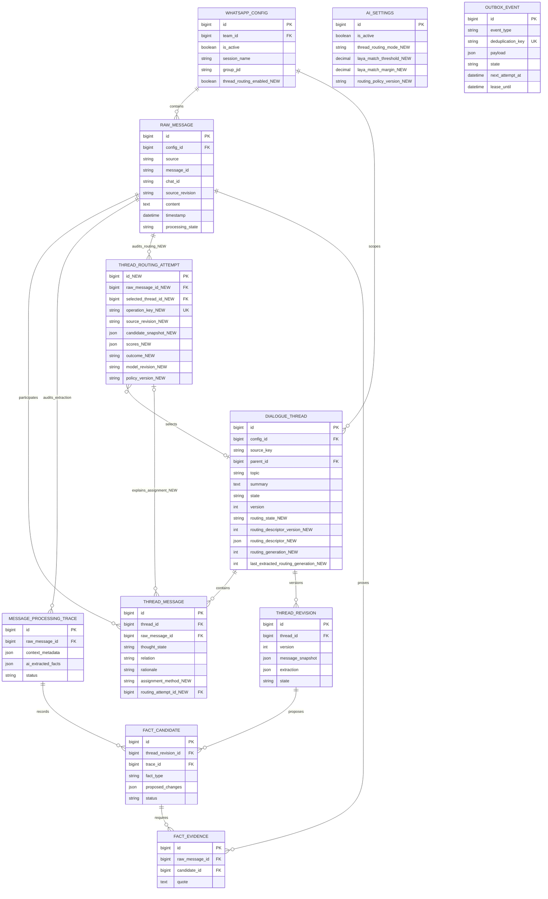

# Темы WhatsApp: формирование и извлечение через LLM, распределение через LAYA

- Задача: `laya-thread-routing`.
- Ветка: `feature/laya-thread-routing`.
- Создано: 12.10.2026, 08:54:28 MSK (UTC+3).
- Статус: согласована пользователем 12.10.2026; интеграция реализуется и проверяется на kk-minsk до production.
- Отдельное поручение пользователя: развернуть саму LAYA на `kk-minsk.by` сейчас и проверить работу на GPU.
- Базовая версия Mazory: `347b1b4a4c5f46c13c17b587c25ae044466c9c8e`.



ERD проверена по актуальным `models.py` и миграциям до `0052`. Суффикс `_NEW` обозначает изменения этой задачи, реализованные миграцией `0053_thread_routing`. `OUTBOX_EVENT` связывает этапы через типизированный payload с числовыми ID; новых SQL FK для его payload нет. AISettings — глобальная конфигурация без FK к источнику; выключенный `thread_routing_enabled` конкретной WhatsAppConfig сохраняет прежний путь независимо от глобального режима. Все текущие связи и ограничения источника сохраняются. Все ID моделей — `int`, DTO фронтенда — `number`.

```mermaid
sequenceDiagram
    participant WA as WhatsApp / WAHA
    participant API as Django API
    participant DB as БД / Outbox
    participant Q as Q2 Worker
    participant LA as LAYA на kk-minsk.by
    participant LM as LLM

    WA->>API: Новая реплика или редакция
    API->>DB: Сохранить оригинал и route_message
    API-->>WA: HTTP ответ без внешнего AI-вызова
    DB->>Q: Задача в порядке источника
    Q->>DB: Прочитать готовые описания тем и версии
    alt Нет готовой темы / слишком большой вход / неоднозначный ответ
        Q->>LM: История, оригиналы, существующие темы
        LM-->>Q: Тема, описание для распределения, связи, кандидаты фактов
        Q->>DB: Проверить источники, сохранить тему и проверенные кандидаты
    else Есть готовые описания
        Q->>LA: Пакеты пар сообщение + описание темы
        LA-->>Q: Вероятности продолжения каждой темы
        alt Единственное уверенное соответствие, версии актуальны
            Q->>DB: Сохранить принадлежность и аудит LAYA
            Q->>DB: Пометить тред dirty, запланировать извлечение
        else Несколько тем / низкая уверенность / таймаут / устаревшая версия
            Q->>LM: Полноценное определение темы и связей
            LM-->>Q: Проверяемое распределение и кандидаты
            Q->>DB: Сохранить решение LLM и описание темы
        end
    end
    DB->>Q: extract_thread по сроку или размеру накопленного пакета
    Q->>LM: Оригиналы треда и необходимые ответные/связанные сообщения
    LM-->>Q: Сделки/обязательства/оплаты, связи и буквальные цитаты
    alt Цитаты, версии и границы источника подтверждены
        Q->>DB: Ревизия треда и FactCandidate / FactEvidence
    else Ошибка AI / конфликт редакции / недостоверный источник
        Q->>DB: Зафиксировать ошибку; не публиковать бизнес-факт
    end
    Note over DB,LM: Дальнейшее подтверждение и доставка CRM сохраняют прежние разрешения
```

## Постановка

Разделить текущий совместный разбор на три роли:

1. LLM формирует и уточняет тему треда, пока её предмет не станет достаточно определённым.
2. После появления пригодного описания LAYA определяет, продолжает ли новая реплика эту тему.
3. LLM читает оригиналы накопленного треда и извлекает сделки, обязательства и существующие факты об оплатах; сервер проверяет доказательства и сохраняет кандидатов.

Цель — уменьшить число дорогостоящих разборов полной истории и объём входа LLM, сохранив полноту обязательств и корректные связи. Экономия не возникает автоматически от добавления классификатора: для неё необходимы отдельное накопление реплик и извлечение по конкретному треду.

## Подтверждённое исходное состояние

- `dialogue_threads.context_threads` выбирает недавние темы и темы с совпадениями слов. Тема имеет `topic`, `summary`, `state`, версии и связи с оригиналами.
- `pipeline.extract_message` получает `threads` и `facts` в общем LLM-разборе; `ready_facts` допускает факты из `open` и `ready`.
- `ready` означает определённую мысль, а не окончание разговора или выполнение обязательства.
- Векторы в Qdrant принадлежат сообщениям. В текущем распределении по тредам векторный поиск не вызывается.
- Нейтральное сообщение сохраняется с классификацией и пустым списком фактов; оно не удаляется.
- Полная история обрабатывается частями с сохранением промежуточного состояния и итоговой сверкой. Этот путь сохраняется для неопределённых случаев, длинных сообщений и исторического анализа.
- Ошибка доказательства или обрезанный ответ AI не равнозначны отсутствию факта; новый маршрутизатор не должен скрывать эти ошибки.

## Дополнение пользователя: пять реальных примеров и read-only Bitrix

Пользователь прямо поручил E2E на `kk-minsk.by` на своём TXT-файле с чтением действующего Bitrix и без записей в него. Для этого ограниченного сценария его прямое поручение заменяет общее ограничение использования только вымышленных данных: остальные E2E остаются синтетическими.

- Независимый разбор файла до запуска системы: 586 сообщений; SHA256 `8c4e8abcc6015d1e389bb42630ad72d75f6c5cf650e3473b278ee46e18479f92`.
- Пять окон исходной переписки и ручные ожидаемые результаты зафиксированы до реализации в приватном oracle, SHA256 `cbf863ddf11b635b749e70301c2e50204730c0d42bc9361a61c0807a6e8f5e18`. Ответы модели не используются для изменения эталона или обучения на этих пяти случаях.
- Выполнены только разрешённые чтения Bitrix: `crm.deal.list`, `crm.company.list`, `crm.company.get`; результаты с временем чтения сохранены рядом с oracle.
- В тестовом профиле действующий webhook доступен только отдельному relay с точным allowlist read-only методов. Он отвергает запись и batch, ведёт обезличенный журнал методов; backend/Q2 получают только адрес локального провайдера. Разрешения создания сделок/задач и автономной записи выключены; исходящий маршрут всё равно блокирует запись независимо от флагов.
- E2E проверяет настоящие API/БД/outbox/Q2, реальную LAYA и LLM, чтение Bitrix и отсутствие фактических записей. После прогона сравниваются полученные поля, источники, привязки и независимый oracle; необъяснённое расхождение не считается успехом.
- Пользователь получает приватный отчёт с выбранными оригиналами/номерами строк, данными Bitrix, ожиданиями, результатами, статусами совпадения и диагностикой. Содержимое файла, CRM-снимки, реальные ключи и отчёт не отправляются в публичный GitHub; в PR остаются код и синтетические сценарии.

## Выбор LAYA и проверка сервера

- Используется проект [NandhaKishorM/laya](https://github.com/NandhaKishorM/laya), а не одноимённые модели EEG.
- Мультиязычный checkpoint: [convaiinnovations/laya](https://huggingface.co/convaiinnovations/laya), подкаталог `multilingual`. Для русского/казахского и смешанной переписки модель явно фиксируется как `multilingual`, независимо от языка служебных инструкций.
- На момент подготовки: PyPI `laya==0.4.4`; ревизия весов `7b928d828b7b0e022f929d9bd2e44165aa270148`; проверенный HEAD исходников SDK `682ac6719faa5b1c04b529501feb93e58ee91f3d`. Не использовать плавающий `latest` для итогового развёртывания.
- Самостоятельный HTTP server предоставляет `POST /v1/systemone` и пакетный путь; это отдельный провайдер классификации, не OpenAI chat-completions API.
- `kk-minsk.by`, Docker context `kk-minsk`: NVIDIA RTX 3090, 24 576 MiB VRAM; при проверке занято 7 352 MiB, свободно 16 772 MiB; драйвер `595.104.02`. Ollama использует GPU, поэтому его модель не выгружается ради LAYA.
- На диске при проверке свободно 666 GiB. Docker доступен; в его текущем списке runtime отсутствует NVIDIA и не найдены CDI-описания. Непарольный sudo недоступен. Для отдельного сервиса используется ограниченный доступ к NVIDIA device nodes и read-only mounts библиотек существующего драйвера; это не требует установки пакетов на хост или перезапуска Docker. Пути закреплены за проверенным драйвером и требуют обновления при смене его версии.
- Требование развёртывания: прогретая мультиязычная модель фактически выполняет inference на CUDA; явный `LAYA_DEVICE=cuda` сам по себе не доказывает это. Проверяются статус модели, GPU-процесс и реальный запрос.
- Планируемый адрес: `https://laya.kk-minsk.by/v1/systemone`; DNS уже разрешается на `134.17.176.6`. Отдельный контейнер и маршрут Traefik, Bearer-аутентификация, ключ только в защищённом файле. Значение ключа не включается в Git, спецификацию, ответы и логи.

Ограничения LAYA учитываются по [официальному model card](https://huggingface.co/convaiinnovations/laya#honest-limits): zero-shot качество и исходная уверенность не являются гарантией пригодности к нашей задаче; длинные наборы вариантов могут терять определения из-за бюджета; `action.act_probability` не используется как разрешение автоматического действия. Пороги проверяются отдельно на задаче принадлежности сообщения к диалогу. Эти сведения не означают, что качество на русской/казахской рабочей переписке уже измерено.

## Требования к формированию темы

1. Добавить независимый от `open/ready/unknown` признак `routing_state=needs_context|prepared|disabled`. Открытый тред с определённым предметом может быть `prepared`.
2. LLM возвращает проверяемое `routing_descriptor`: предмет диалога, объект/контрагент при доказанной связи, действие или обсуждаемый вопрос, отличия от соседних тем, ссылки на исходные сообщения. Простое совпадение компании/объекта не объединяет разные обязательства.
3. Для первой версии не определять пригодность описания числом сообщений или одной модельной confidence. Нужны содержательная тема и подтверждённые исходники; заголовки вроде «Общее обсуждение» не допускаются к LAYA.
4. Первые и неоднозначные реплики обрабатывает LLM. До формирования описания они остаются в анализе; тема не создаётся LAYA.
5. Описание имеет отдельную монотонную версию. Уточнение предмета, редактирование доказательного сообщения, перенос между темами или объединение/разделение тредов инвалидирует старые результаты распределения.
6. `summary` и описание служат подсказкой, а не доказательством денег, обещания, исполнителя или срока. Только оригиналы дают основание для FactEvidence.

## Требования к распределению LAYA

1. Область кандидатов ограничена тем же `source_key`, командой, конфигурацией, сессией и WhatsApp-группой. Никаких тем чужой группы или компании из недоступного источника.
2. Первая версия проверяет все пригодные темы данного источника, включая старые `ready`, пакетами до 16 пар. Это предотвращает тихую потерю старой темы из-за отбора только последних 20. При более чем 200 кандидатах весь маршрут передаётся LLM с явно записанной причиной, пока не реализован и отдельно проверен более широкий поиск.
3. На каждую пару подаётся оригинал новой реплики, автор/время, доступная цитата ответа, краткое проверенное описание темы и необходимый ближайший контекст. «Ок», «Да», ссылка, местоимение без однозначного источника, несколько предметов в одном сообщении требуют LLM.
4. Использовать отдельный двухвариантный `choice` для каждой темы: нейтральные ключи `A` и `B`, полное конкретное описание предмета в определении положительного варианта и «другой предмет / недостаточно связи» в отрицательном. Служебное описание темы не смешивается с классифицируемым текстом как ещё одна новая реплика. Не помещать числовой ID треда в семантическую метку; сопоставление ключа вопроса с числовым ID хранится в серверном snapshot. Формат уточняется и фиксируется по измерению качества, а не выбирается по одному успешному примеру.
5. Решение принимается по вероятности варианта продолжения, разрыву между двумя наиболее подходящими темами и проверенному порогу. Энтропийная `confidence`, `answer_confidence` и `action.act_probability` не подменяют эту вероятность. Нулевая вероятность и отсутствие подходящей темы не означают «сообщение мусор».
6. До калибровки — только shadow: LAYA не меняет принадлежность. Стартовые значения для исследования: вероятность продолжения ≥0,90 и разрыв ≥0,15. Это гипотеза, не утверждённый производственный порог. Итоговые значения фиксируются по отложенной выборке и версии политики.
7. Низкая уверенность, отсутствие кандидатов, несколько подходящих тем, неизвестный язык, длинный вход, неполный ответ или недоступность сервиса приводят к LLM. Составное сообщение может принадлежать нескольким темам; LAYA не принуждает его к единственному треду.
8. Модель явно закреплена за multilingual. Начальный бюджет запроса: `max_len=2048`, `head_max_len=256`; считать реальные токены до отправки. Если оригинал вместе с контекстом не помещается, использовать LLM; не обрезать обещания, суммы, сроки и отрицания. Возможность этих параметров проверяется на выбранной версии HTTP server.
9. Перед сохранением блокировать источник и сверять редакцию сообщения, версию описания и snapshot кандидатов. При конфликте повторно распределить; не сохранять решение по устаревшей теме.
10. LAYA устанавливает только предварительную принадлежность. Она не выводит `thought_state=final`, `relation=fulfills`, сумму, факт выполнения, статус сделки или завершённость треда. До LLM связь имеет `thought_state=unknown`; текущая семантика `ThreadMessage` не подменяется классификатором.
11. Проверять числовые вероятности на конечность, диапазон [0,1], точные ключи вариантов и допустимую сумму. Записывать также `usage.truncated`, `state_tokens_dropped` и `truncated_questions`; любой обрезанный вход/вариант уходит LLM, даже при высокой вероятности.

## Извлечение LLM и экономия

1. Уверенное распределение увеличивает `routing_generation`, делает тред dirty и создаёт единственное ожидающее `extract_thread`. Ключ задачи содержит ID треда, диапазон исходников, generation и версии описания/политики; повторная доставка не дублирует работу и бизнес-факты. `last_extracted_routing_generation` обновляется только после успешной публикации проверенной ревизии. Generation входящих связей независима от версии описания темы и текущей бизнес-ревизии.
2. Начальные параметры накопления: извлечение после 30 секунд отсутствия новых реплик, при накоплении 8 реплик или не позднее 120 секунд после первой неразобранной реплики. Применить правило, которое наступило раньше. Эти интервалы относятся к новой маршрутизации, а не к окончившемуся разговору.
3. При ручном «Проанализировать сейчас», окончании импортного пакета и остановке мониторинга выполнить/зафиксировать flush накопленного анализа. Новые реплики во время выполняющегося запроса сохраняются и получают следующий диапазон.
4. LLM получает неизменяемый snapshot оригиналов треда, нужные цитаты ответов и источники, связанные с обещаниями, переносами, отменами и исполнением. Граница прочитанного состояния позволяет объединять несколько реплик в один запрос.
5. Большой тред читается частями с итоговой сверкой и точными диапазонами. Не заменять исходные обещания summary и не терять позднее исполнение.
6. Извлекать факты из `open` и `ready`; не ждать «закрытия». LLM может исправить ошибочную принадлежность LAYA, разделить составную реплику или уточнить тему. Исправление записывается отдельной ревизией и в аудит распределения.
7. Существующие FactSchema, проверки буквальных цитат, авторства обещания, хронологии, идемпотентности, ручное подтверждение и автономные политики сохраняются. Первое создание темы LLM может одновременно извлечь уже явный факт без второго идентичного запроса.
   При пропущенном явном действии выполняется типизированный дополнительный разбор LLM. Сопоставление повторов и исполнения использует оригинальные обещания и последующие сообщения; модель сначала объясняет найденный результат, затем возвращает статус. Проверенные поля первого обещания не переписываются при повторном подтверждении. Эти запросы учитываются в фактической стоимости и сравнении входных токенов.
8. LAYA не фильтрует содержимое из извлечения. Пустые факты, недостающий источник, ошибка модели и невыполненная задача — разные состояния.
   Успех распределения не устанавливает `RawMessage.processed=true` и не завершает HistoryAnalysisItem/анализ импортного пакета. Финальный результат возникает после терминального LLM-разбора; интерфейс различает «распределено» и «разобрано».
9. Отдельный специализированный промпт извлечения принимает известную предварительную тему. Он сохраняет право исправить связи, но не пересобирает все темы всей группы без причины.
10. Существующие флаги автономного подтверждения и записи CRM не включаются этим изменением. Интеграция LAYA не создаёт сделку или задачу в Bitrix сама.

## Данные, очередь, API и наблюдаемость

- Новая модель `ThreadRoutingAttempt` хранит числовой RawMessage FK, nullable выбранный DialogueThread FK, уникальный operation_key, редакцию исходника, snapshot ID/версий описаний, вероятности, outcome, причину возврата к LLM, latency, revision весов/SDK, policy_version и input hash. Хранить устойчивое решение и диагностику, без API-ключей.
- `ThreadMessage` получает `assignment_method=llm|laya` и nullable FK на попытку. Уже существующие связи остаются `llm`; миграция не переинтерпретирует обработанную историю.
- Новые поля DialogueThread отражают пригодность описания и границу последнего извлечения. Ревизии бизнес-смысла по-прежнему публикует LLM; техническое добавление предварительной связи не означает готовый бизнес-результат.
- В AISettings добавить глобальный режим `thread_routing_mode=llm|shadow|laya`, числовые/временные параметры накопления, пороги и версию политики. В WhatsAppConfig — `thread_routing_enabled=false` по умолчанию для поэтапного выбора источников; при false всегда прежний LLM-путь. Адрес и отдельный секрет LAYA задаются Django settings/окружением; ключ LLM не используется для LAYA.
- Все вызовы LAYA/LLM — только через outbox и Q2. Типы `route_message` и `extract_thread` обрабатываются в `tasks.py`; HTTP webhook только сохраняет данные. Обновить наборы дорогих операций/lease и диспетчеризацию: обоим типам назначаются `analysis_source_key` и исходная `analysis_position`, а не только старому `extract_message`. Сохраняются порядок одного источника и восстановление lease.
- Планируемый предел запроса LAYA: connect timeout 2 с, общий timeout 10 с, ограниченная конкуренция. При 401/422/500/503, OOM или таймауте фиксировать причину и передавать реплику LLM; не зацикливать её только на LAYA.
- Повторное выполнение проверяет deduplication_key и сохранённый input hash. Отмена, удаление, изменение доступа, редакция WhatsApp, повторный импорт и замена провайдера инвалидируют несовместимый результат.
- В админке и деталях треда показывать источник распределения, предварительность связи, версию темы, возврат/исправление LLM и границу разобранных сообщений. Числовые IDs строго типизированы.
- Измерять LAYA latency/число пар, долю уверенных назначений, возвратов и исправлений, LLM-запросы и входные токены на 100 сообщений, время до кандидата, нарушения порядка, повторные факты и backlog dirty-тредов. Версии модели/политики обязательны для сравнения.

## Развёртывание самой LAYA

Развёртывание отдельного сервиса пользователь поручил в текущем запросе. Оно не включает переключение production Mazory на новый маршрутизатор.

1. Подготовить воспроизводимые Dockerfile/Compose в `ops/laya/`. Установить зависимости только при сборке image; на хост не устанавливать Python-пакеты, Django или модельный сервер.
2. Передать только compute device nodes и read-only библиотеки проверенного драйвера в отдельный контейнер. Не предоставлять privileged, Docker socket, полный корень хоста или доступ к файлам других сервисов. Переход к NVIDIA Container Toolkit/CDI возможен позднее как замена этой конфигурации доступа; текущий запуск не требует прав sudo.
3. Создать отдельные container/network/cache volume, прогреть только multilingual. Закрепить SDK, CUDA/PyTorch и HF revision; сохранять фактический image digest и версии.
4. Выделить существующий GPU указанным доступом к device nodes, ограничить конкуренцию/бюджет пакета. При отсутствии CUDA не сообщать об успешном GPU-развёртывании.
5. Настроить отдельный HTTPS-маршрут `laya.kk-minsk.by` через существующий Traefik, Bearer key из защищённого файла и `restart: unless-stopped`. Контейнерный API не публиковать на всех интерфейсах отдельным открытым портом.
6. Проверить liveness, аутентифицированную готовность multilingual/CUDA, отказ без/с неверным ключом, реальный запрос на русском, отрицательный случай другой темы, перезапуск контейнера и сохранение model cache. Проверки только на вымышленных репликах.
7. Smoke-развёртывание не является доказательством качества классификации. Подключение к обработке реальных сообщений — отдельный этап реализации этой спецификации.

## Проверки и критерии готовности интеграции

1. Настоящий изолированный E2E на `kk-minsk`: браузер → реальный API → БД/outbox/Q2 → локальные провайдеры; frontend API не подменяется. Unit/component/integration/mock-наборы не создаются.
2. Сценарии: первоначальная тема LLM; продолжение LAYA; неуверенный возврат к LLM; другой предмет при той же компании; поздний ответ старому ready-треду; два предмета в одной реплике; «Ок» без/с цитатой; русская/казахская/смешанная переписка; несколько групп; длинный оригинал; отсутствие кандидата; одинаковые заголовки; редактирование; изменение описания во время запроса; повторная доставка; перезапуск Q2; таймаут/OOM/невалидный ответ LAYA; перенос срока/отмена/выполнение обязательства.
3. Новый быстрый путь не создаёт бизнес-фактов до LLM и проверки цитат, не теряет грязные диапазоны, не удваивает обязательства или деньги после повторного выполнения.
4. Для калибровки/оценки — не менее 400 заранее размеченных вымышленных реплик: 200 для настройки, 200 отложенных для проверки, не менее 50 неоднозначных/отрицательных/составных случаев. Ключи разделяются по целым диалогам; описание темы строится только по доступному префиксу, без будущих ответов. Рабочие WhatsApp/Bitrix-аккаунты и данные не используются.
5. Отложенные данные проходят через тот же Docker/API/Q2/БД-путь и реальную LAYA. Решения LLM не считаются эталонной разметкой. Положительные и отрицательные варианты контрбалансируются; отдельно проверяется смена порядка/нейтральных ключей без смены смысла. Автоназначения должны иметь измеренную точность ≥98% при покрытии ≥40%; показывать количество случаев и доверительный интервал. При провале сохраняется `shadow/llm`, а не понижается порог ради покрытия.
6. Обязателен этап доменной адаптации: прямые smoke-запросы уже обнаружили неверную принадлежность с вероятностью 0,91. Сравнить и зафиксировать формат вопроса/описания на калибровочной части, включить эти отрицательные случаи в регрессионный набор, проверить различимость положительных/отрицательных пар. Если zero-shot не достигает критериев, дообучить мультиязычный checkpoint на размеченных парах «реплика + тема + ближайший контекст» с отдельным train/validation/test разделением. Тестовые диалоги и их будущие реплики не включаются в обучение или калибровку. Одно температурное масштабирование не исправляет неверный порядок вариантов и не заменяет адаптацию. Закрепить новую ревизию и повторить полный E2E с отложенной выборкой; до выполнения критериев остаётся `shadow/llm`.
7. На одном и том же сценарии с тем же LLM и исходниками сравнить исходный путь и новый: входные токены LLM на 100 сообщений должны сократиться минимум на 30%, полнота/точность проверенных бизнес-фактов не ухудшается. Если маршрутизация без накопления не даёт экономии, задача не считается достигнутой.
8. Целевые показатели после прогрева: p95 распределения при ≤20 темах ≤1 с; кандидат не позже 120 с после первой dirty-реплики при исправных провайдерах и свободной очереди. Измерить также реальные задержки под совместной нагрузкой LAYA и Ollama; не выдавать чужие бенчмарки за результат RTX 3090.
9. Обязательные Docker-проверки: `manage.py check`, `makemigrations --check` → `No changes detected`; создание/применение миграций и повторный check; TypeScript/Vite через сборку nginx; просмотр логов backend/Q2/WAHA/LAYA.
10. После согласования и реализации — PR в `main`, обязательные CI/review, слияние. Production развёртывается через `mazory-remote`; тестовые контейнеры туда не добавляются. Начальный режим нового маршрутизатора — `llm`; `shadow` и затем `laya` включаются для ограниченного источника после проверки качества.
11. Откат: режим `llm`, сохранение исходников/ревизий/аудита, обработка незавершённых dirty-диапазонов прежним пайплайном. Отключение LAYA не блокирует прием сообщений и не меняет разрешения CRM.

## Планируемые файлы

- `ops/laya/`: отдельный Docker-сервис, зафиксированные зависимости/веса, проверяемый запуск.
- `backend/api/models.py` и миграции: описания, аудит распределения и методы назначения.
- `backend/api/thread_routing.py`: snapshot тем, HTTP client LAYA, проверка вероятностей/версий, сохранение решения.
- `backend/api/tasks.py`, ingestion webhook и история: route/extract outbox, порядок, накопление и flush.
- `backend/api/dialogue_threads.py`, `pipeline.py`, `message_context.py`, `full_history.py`, `context_tokens.py`: разные роли LLM, анализ исходников треда и возврат к полному разбору.
- `backend/api/admin.py`, thread API и `frontend/src/types/`/интерфейс тем: режимы и наблюдаемые состояния.
- Существующий изолированный E2E-стенд: детерминированные ошибки провайдеров и отдельный сценарий с реальной локальной LAYA.

## Первоначальные проверки и развёртывание zero-shot LAYA

- `git pull origin main`: актуальная main; создана отдельная ветка задачи.
- Повторно прочитаны модели, версии тредов, outbox и текущий код классификации/извлечения.
- GPU/VRAM и диск проверены на указанном сервере, а не оценены по памяти.
- В существующем Docker backend на `kk-minsk`: `makemigrations --check` → `No changes detected`. До согласования модели Mazory и их схема не изменялись.
- LAYA развернута отдельным контейнером `mazory-laya-laya-1` через Docker context `kk-minsk`; образ `mazory-laya:0.4.4-cu129`, image ID `sha256:c0e17dc4122bfa6141431a3842d19d0be471847f4132efba1f5751d9a1891070`. Python base закреплён digest `sha256:e88e9763f943ec1834f992a4b51e0f24500486803e8bc534e5767af9ea65f6ce`.
- Фактические версии: LAYA `0.4.4`, PyTorch `2.8.0+cu129`, CUDA runtime `12.9`, Transformers `4.57.6`; `pip check` при сборке успешен.
- HTTPS `https://laya.kk-minsk.by/health` отвечает HTTP 200 с проверкой доверенного TLS-сертификата. Подробная аутентифицированная проверка сообщает: загружена только `multilingual`, checkpoint revision `7b928d828b7b0e022f929d9bd2e44165aa270148`, реальное устройство `cuda`, `device_is_preference=false`, CPU fallbacks = 0.
- `POST /v1/systemone`: без ключа и с неверным ключом HTTP 401; с ключом HTTP 200. Значение ключа хранится только в защищённом файле на сервере, не в конфигурации Git.
- GPU-процесс LAYA после контрольного inference использует 1 848 MiB. Gemma `gemma4:e4b` осталась 100% GPU, контекст 131072, keep-alive Forever; процесс Ollama не перезапускался.
- Реальный `POST /v1/systemone/batch` с шестью вымышленными русскими/казахскими репликами завершился за 62,7 мс в одном контрольном вызове с сервера; это не p95 и не производственный бенчмарк. Обрезки состояния/вопросов не было.
- Качество контрольного набора: 3 правильных решения из 6. Модель ошибочно выбрала принадлежность для постороннего текста о ремонте телефона на казахском с вероятностью 0,9112. Поэтому скорость/успешный запуск не считаются готовностью автоматического распределения; требуется этап адаптации и отложенная проверка, описанные выше.
- После реального перезапуска и затем пересоздания контейнера с тем же model-cache и `HF_HUB_OFFLINE=1` сервис снова healthy; аутентифицированный HTTPS health подтверждает ту же ревизию на CUDA, CPU fallbacks = 0. Повторная загрузка весов из сети не требовалась.
- `docker compose config --quiet` для отдельного сервиса и `git diff --check` успешны; повторный `makemigrations --check` в существующем Docker backend также завершился с `No changes detected`.
- Пайплайн, схемы БД, настройки и рабочие сообщения production Mazory в рамках этого поручения не изменялись. Спецификация содержит предлагаемый переход; текущий результат развёртывания — отдельный защищённый LAYA-сервис.


## Реализованный путь и текущая проверка

В `0053_thread_routing` добавлены флаг источника, отдельное состояние описания темы, версии/поколения dirty-диапазона и аудит назначения. LAYA сравнивает все готовые темы этого источника (до 200) пакетами по 16, проверяет фактически возвращённые ревизии весов и калибровки, порог и разрыв вероятностей. Перед сохранением повторно проверяются оригинал, политика и версии тем под блокировкой источника. Назначение через LAYA не устанавливает `RawMessage.processed`: это делает успешный разбор LLM. Извлечение коалесцирует pending-задачи и сохраняет ограниченные диапазоны с отдельными ключами идемпотентности. Длинный тред возвращается в штатный многоэтапный разбор полных оригиналов.

Вспомогательные типизированные запросы LLM восстанавливают пропущенные рабочие обещания и технические изменения. Они используют только уже прочитанные оригиналы/доказательные выдержки текущего запроса, не открывают всю группу повторно. Повторность обещаний проверяется LLM по оригиналам и контексту, а не по возможным ошибкам названий в черновиках. Будущее обещание не является доказательством исполнения; исполнение требует буквальной последующей цитаты. Отменённые обещания сохраняют отдельное состояние. В UI видны метод назначения и ожидающие извлечения сообщения; руководитель может отправить flush в Q2.

Рабочие примеры и их эталон остаются в закрытом `private/` и не публикуются в PR. Независимый эталон зафиксирован до обработки системой. Парсер проверяет весь предоставленный TXT; бизнес-E2E использует пять выбранных окон из 28 оригинальных сообщений через настоящий webhook с исходными датами и авторами. Это не извлечение всех бизнес-фактов из всех 586 сообщений файла. Ответ на вопрос о подписании/выставлении подтверждает действие; суммы из вопроса сохраняются как контекст и не обязаны становиться подтверждёнными числовыми полями. Неизвестная сумма допустима и показывается в сравнении ожиданий и результата.

Реальное чтение рабочего Bitrix включается только для пяти окон отдельным контролем профиля. Для синтетических сценариев применяется локальный детерминированный CRM-провайдер. Запись в рабочий Bitrix блокируется одновременно `BITRIX_READ_ONLY` и отдельным relay с allowlist read-методов. Один намеренный write-probe был отклонён; он не передавался в Bitrix. Результаты локального автоматического решения кандидатов не являются записью в Bitrix.

Итоговая адаптация LAYA использует только вымышленные данные: 1000 train-диалогов (3000 пар, из них 2600 обучающих и 400 внутренней калибровки), отдельные 300 calibration-диалогов (900 пар), отложенные 200 обычных + 200 усложнённых диалогов. Предметы/ID диалогов разделены между частями; реальные WhatsApp/CRM-данные не использованы в обучении. В 400 membership-E2E исходные готовые темы задаются как явная синтетическая предпосылка; реальное формирование тем LLM проверяется отдельно. Эта выборка измеряет принадлежность, а не успешность извлечения фактов из 400 сообщений. Бизнес-извлечение проверяется пятью окнами и одинаковыми 100 сообщениями.

Закреплённые артефакты на kk-minsk:
- image `sha256:c51613f82c4c1babeab6740cfceab53b38b084fec62abc44bf68074eee89f300`;
- веса `whatsapp-v1`: `f5252e332072ff175e5fc7e31b8e3c3ca29a0c6a46cb22b8489b902e9a2ead49`;
- конфигурация/калибровка: `0294bbc940d063bfa646805df25131450c80d7ffd32df6f7c0e0fb544b3695d2`;
- SDK counterbalanced: 294 верных автоназначения из 294, всего 400, precision 100%, coverage 73,5%, Wilson 95% [98,7102%; 100%];
- 20 тем, два HTTPS-запроса 16+4, 100 прогретых измерений: p95 114,4 мс, максимум 150,8 мс;
- authenticated inference возвращает фактические pinned hash; без ключа/с неверным ключом HTTP 401; CUDA обоих checkpoints, CPU fallback 0.

Общие браузерные E2E: 26 успешных проверок + отдельная успешная проверка сохранения аватара после пересоздания контейнеров. `check`, `makemigrations --check` (No changes detected), применение миграций и TypeScript/Vite выполнены внутри Docker на kk-minsk. Dependency audits backend/frontend и сканирование исходников успешны. Итоги реальных пяти окон, сравнения 100 сообщений и 400 membership-E2E будут зафиксированы ниже после завершения. Production не изменён, начальные значения — `llm` и выключенный флаг источника.

Нативный структурированный ответ: при повторе после ссылки на отсутствующую тему JSON-схема требует ключи тем из предыдущего ответа самой LLM. Сервер не назначает сообщения по сходству слов и не создаёт их тему. В проверяемой версии нативного формата основная классификация цели является авторитетной относительно избыточной исторической ссылки; оба значения сохраняются в аудите. Legacy-ответы сохраняют прежнюю строгую проверку. E2E дополнительно проверяет некорректные вероятности, смену checkpoint, обрезанный вход и настоящий HTTP timeout через провайдерный fault boundary.

Дополнение проверки длинной истории: требования к ключам уже описанных LLM тем переносятся между этапами и берутся из previous_result. Они применяются только к нативной JSON-схеме без добавочного текста в заполненное окно модели. Перенос плана поставки сохраняется как изменение project, а не как недоказанное новое обещание автора. Прерванные неуспешные замеры экономии не считаются выполнением критерия 30%.

Обнаруженное при сравнении исправление входящего outbox: создание автоматической trace не является запросом явного повторного анализа. Уже обработанная другим успешным пакетом реплика не разбирается снова; ручные/history/commitment-refresh запросы и ещё не обработанные цели сохраняют свой путь. Основной raw ID остаётся первой целью автоматически набранного пакета.

Отдельная проверка показала безопасный отказ LAYA при p=0,8931 для неполной реплики о поставке: сохранён порог 0,90 и выполнен возврат к LLM. Положительный сценарий и одинаковые 100 обновлений явно называют оборудование (насосы); обе ветки получают дословно одинаковые сообщения. Фиксированная отложенная выборка 400 диалогов и независимый эталон пяти окон не изменены.

Выставленный счёт без сообщения о полученных деньгах не допускается как increment. Дополнительная типизированная LLM-проверка такого источника ограничивается invoice; при отсутствии в ответе денежного значения amount остаётся null/unknown. Тип, предмет, связи и доказательства по-прежнему извлекает LLM. Сумма из неподтверждённого вопроса не переносится в подтверждённое денежное событие.

Проверка настоящих LLM-описаний обнаружила зависимость первой адаптации от шаблона заголовка: замена «для объекта» на «по объекту» могла снизить p до 0,5631. Поэтому первоначальный checkpoint не считается окончательной готовностью. В train/calibration добавлены разные синтетические формулировки описаний; отложенные 400 решений и пользовательские оригиналы остаются неизменными. Новые веса проходят повторные pinned-hash, counterbalanced, latency и API/Q2 проверки до production.

Вторая адаптация хранится в отдельном каталоге `whatsapp-varied-v2`, публичный API alias остаётся `whatsapp-v1`. Каталог, SHA256 весов и SHA256 конфигурации проверяются при старте и возвращаются в ответе. SDK сообщает неизменённую температуру 1,0 и отсутствие подтверждённой калибровки уверенности: вероятности не считаются гарантией точности. Пороги 0,90/0,15 сохранены; приведённые показатели — эмпирическая проверка конкретной синтетической выборки. Реальные сообщения заказчика не участвовали в обучении.

Проверка оригинальных окон дополнительно ограничивает дату финансового события датами исходной реплики и явно названными календарными/относительными днями. Дата загрузки архива не является допустимой датой только из-за текущего запуска. LLM выбирает дату в этих пределах. Для счёта клиенту отдельно проверяются income, предмет коммерческого объекта и read-only CRM-сопоставление. Новый input hash входит в ключ попытки маршрутизации: после восстановления воркера изменённый snapshot получает отдельный аудит.

В профиле проверок пять оригинальных окон и синтетические сценарии используют разные команды Mazory. Каталог, прочитанный из рабочего Bitrix для пяти окон, не попадает в known_projects синтетического сравнения 100 сообщений и 400 решений. Во всех синтетических сценариях CRM обслуживается локальным провайдером.

Нативная схема запрещает parent_key, равный собственному ключу темы; корневая тема может иметь null/пустого родителя. Некорректная иерархия сохраняет ошибку, не публикует факты и допускает ограниченный структурный повтор. Отладочный прогон с обновлением контейнеров и операторским повтором не считается окончательной приёмкой; окончательная проверка выполняется на новом стенде с фиксированным кодом.

Проверка 100 сообщений выявила непригодность окна 32768 для накопленного полного контекста: встречались context_fixed_input_too_large и повторы источников внутри темы. Незавершённый замер не является результатом экономии. Обе ветки сравнения используют одинаковое окно 65536 и резерв 8192; перед изменением проверена RTX 3090 с 14860 MiB свободной VRAM. Нативный формат v7 при не более 200 прочитанных источниках использует фиксированные m<ID>-поля для уникальных сообщений темы; публичный API и сохранённые legacy-списки остаются списками. Каждое поле сохраняет целочисленный raw_message_id, согласованный с ключом. Классификации целей предшествуют описаниям тем, чтобы LLM определяла все нужные ключи перед их заполнением.

Первый полный прогон с окном 65536 завершил все сообщения, но не сохранил изменение поставки для одного объекта. Сравнение не принято. Дополнительное извлечение пропущенного project включает поставку/монтаж и применяется к обеим нативным автономным веткам. По каждой теме, уже выделенной самой LLM, выбирается последняя цель пакета; предмет/действие извлекает LLM. Основное доказательство project/payment ограничено выбранной целевой репликой; контекст сохраняется для идентичности объекта. Повторная проверка выполняется на тех же 100 сообщениях. Для CI сценарий pages получил 240 секунд ожидания вместо 120: на менее быстром runner он продолжал работать, все проверки источников и результата сохранены.

Основная цитата project/payment проходит проверку по тому же источнику и сохраняется в evidence ledger, даже если модель отдельно перечислила только контекстные доказательства. При дополнительном разборе единственная цитата цели, которую сама LLM вернула для данного факта, согласует его основной anchor; исходное значение и замена записываются в trace. Это устраняет отклонение факта из-за расхождения двух полей цитат и не отключает проверку буквального источника.

CI встретил 429 от ECR Public при загрузке Node. Для четырёх базовых образов CI используется Google mirror.gcr.io с закреплёнными digest: фактические pulls на kk-minsk подтвердили те же digest, что у уже проверенных образов Node/Python/nginx/PostgreSQL. Проверен Node v22.23.3. Это замена источника загрузки, версии проверяемого окружения не меняются.
