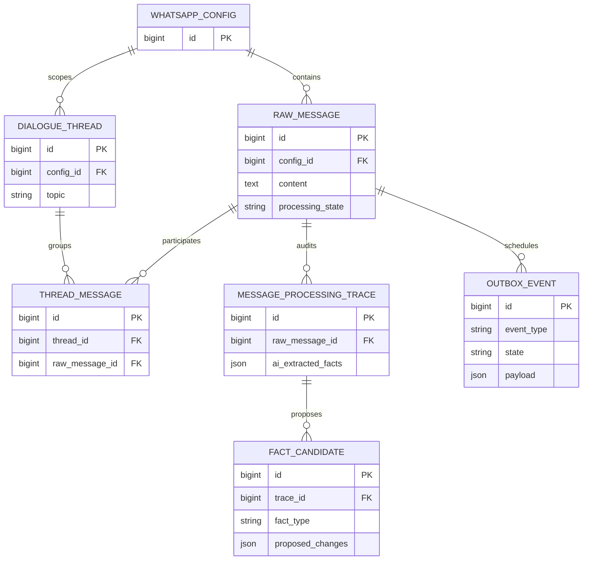

# Пробный запуск K2 Horizon 7B для извлечения фактов WhatsApp

- Задача: `k2-horizon-trial`.
- Ветка: `chore/k2-horizon-trial`.
- Создано: 13.10.2026, 00:44:13 MSK.
- Основание: пользователь поручил «попробуй все же K2 Horizon 7B» после обсуждения обязательного reasoning.
- База: `28ec97355eaca83557976f3decece58b4e96e2df`.
- Область: ограниченный эксперимент на kk-minsk.by; решение о пригодности принимается по фактическим результатам.



Диаграмма показывает существующие сущности изолированного E2E. Новые модели и миграции не планируются; связь outbox с raw задаётся идентификатором в JSON payload.

```mermaid
sequenceDiagram
    participant T as Пробный прогон
    participant B as Изолированный Mazory / Q2
    participant K as K2 Horizon 7B / CUDA
    participant C as Bitrix read-only relay
    T->>K: Проверка модели, версии, reasoning и GPU
    T->>B: Пять исходных окон WhatsApp
    B->>K: Оригинальные тексты и контекст, reasoning high
    K-->>B: Reasoning отдельно, итоговый JSON
    B->>C: Разрешённые методы чтения CRM
    C-->>B: Актуальные записи
    B-->>T: Кандидаты, трассы и терминальные события
    T->>T: Сверка с заранее зафиксированным oracle
    alt Ошибка или обрезанное размышление
        K-->>T: Зафиксированная неудача; не считать валидным результатом
    end
```

## Постановка

Проверить, подходит ли текстовая reasoning-модель K2 Horizon 7B для текущего извлечения сделок и обязательств, и сравнить её с уже сохранёнными результатами Gemma на тех же пяти примерах. Исторический Gemma baseline работал без reasoning; это различие обязательно отражается в сравнении.

## Требования

1. Использовать официальный post-trained `IFM/K2-Horizon-7B-GGUF`, начать с Q4_K_M; зафиксировать revision, SHA256 и версию CUDA-сервера.
2. Сервер работает только в Docker на `kk-minsk`, на отдельном локальном адресе. Существующая Gemma и LAYA сохраняются; production и его настройки не переключаются.
3. Reasoning включён. Начальные параметры разработчика: effort high, temperature 1.0, top_p 0.95, выходной бюджет 32768. Не выдавать обрезанное размышление за успешное извлечение.
4. Использовать исходный пользовательский файл и уже замороженный oracle пяти случаев из предыдущей проверки, без изменения ожидаемых ответов по результатам новой модели.
5. Чтение Bitrix разрешено предыдущим поручением; все обращения проходят whitelist relay. Отправка методов записи запрещена на сетевом уровне.
6. При использовании совместимого экспериментального адаптера явно фиксировать физическую модель K2, reasoning и реальные usage/тайминги; не выдавать адаптер за готовую production-поддержку K2.
7. Проверять итоговые факты: сумма, вид денежного события, компания, ответственный, срок, исполнение, идентификация CRM и отсутствие выдуманных оплат.
8. Измерить холодную загрузку отдельно от тёплых запросов, время до завершённого валидного результата, количество вызовов/повторов, токены reasoning и пиковую VRAM совместно с LAYA.
9. Частные тексты, CRM-ответы, screenshots и сырые модельные ответы остаются в игнорируемом `private/`; в спецификации только обезличенные результаты и пути.

## Планируемые действия

- Проверить поддержку K2 в текущем движке; при необходимости использовать отдельный официальный llama.cpp CUDA-контейнер с закреплённым digest.
- Скачать официальные веса в отдельный Docker volume и проверить checksum.
- Проверить настоящий русский запрос и отделение reasoning от final answer.
- Провести пять исходных сценариев через настоящий API/Q2/БД и браузер существующего изолированного E2E, если адаптер совместим; сбои фиксировать без подгонки oracle.
- Сопоставить результат с историческим baseline; сохранить доступный пользователю отчёт с исходными примерами и измерениями.
- После проверки убрать временные секреты и тестовые процессы; готовую модель сохранить для последующей работы, если она пригодна.

## Критерии готовности

- Получен подтверждённый результат по каждому из пяти примеров либо конкретная воспроизводимая причина неудачи.
- Есть сравнение качества, времени и памяти; ограничения эксперимента названы явно.
- Подтверждены отсутствие переданных в CRM записей и неизменность исходных CRM-записей при read-back.
- Проверена неизменность схемы Django (`makemigrations --check` в Docker).
- При появлении изменений общего кода выполнены соответствующие Docker-проверки и стандартный PR/review; сам пробный запуск не означает разрешения заменить модель в production.

## Фактический результат

Заполняется после выполнения эксперимента.
