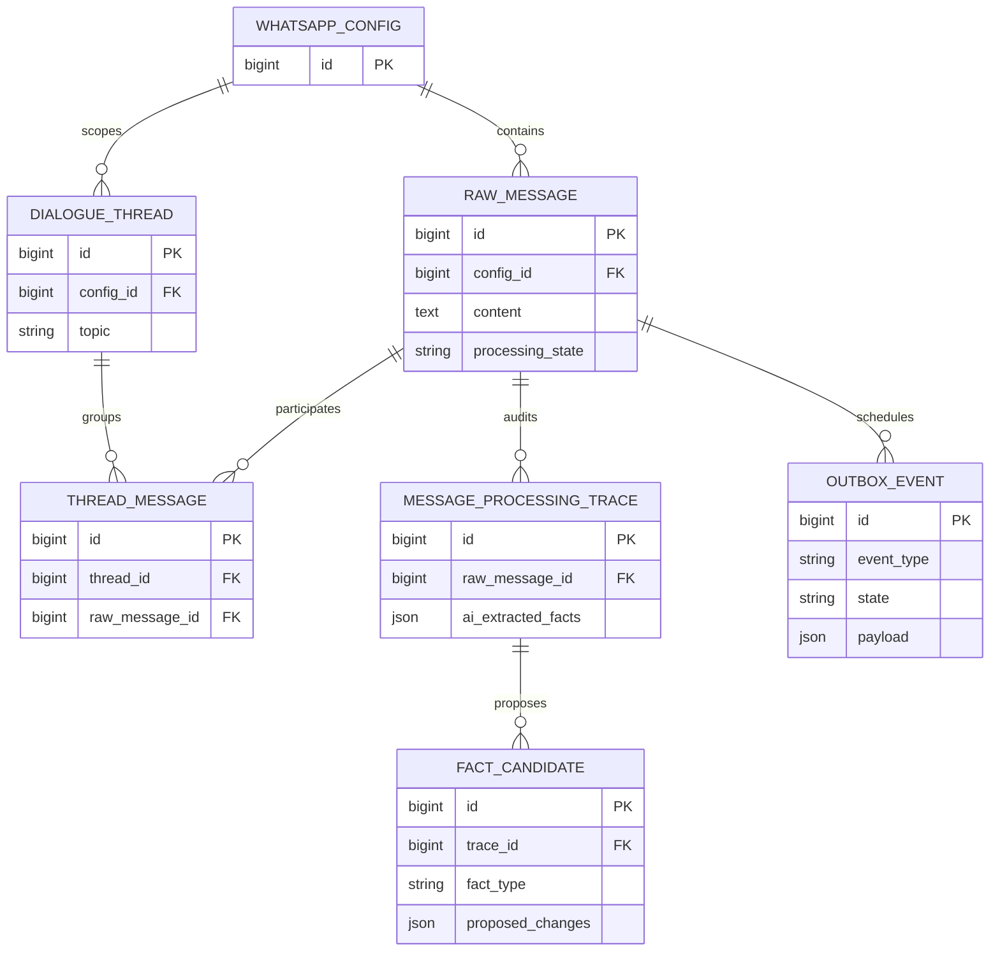

# Пробный запуск K2 Horizon 7B для извлечения фактов WhatsApp

- Задача: `k2-horizon-trial`.
- Ветка: `chore/k2-horizon-trial`.
- Создано: 13.10.2026, 00:44:13 MSK.
- Основание: пользователь поручил «попробуй все же K2 Horizon 7B» после обсуждения обязательного reasoning.
- База: `28ec97355eaca83557976f3decece58b4e96e2df`.
- Область: ограниченный эксперимент на kk-minsk.by; решение о пригодности принимается по фактическим результатам.



Диаграмма показывает существующие сущности изолированного E2E. Новые модели и миграции не планируются; связь outbox с raw задаётся идентификатором в JSON payload.

```mermaid
sequenceDiagram
    participant T as Пробный прогон
    participant B as Изолированный Mazory / Q2
    participant K as K2 Horizon 7B / CUDA
    participant C as Bitrix read-only relay
    T->>K: Проверка модели, версии, reasoning и GPU
    T->>B: Пять исходных окон WhatsApp
    B->>K: Оригинальные тексты и контекст, reasoning high
    K-->>B: Reasoning отдельно, итоговый JSON
    B->>C: Разрешённые методы чтения CRM
    C-->>B: Актуальные записи
    B-->>T: Кандидаты, трассы и терминальные события
    T->>T: Сверка с заранее зафиксированным oracle
    alt Ошибка или обрезанное размышление
        K-->>T: Зафиксированная неудача; не считать валидным результатом
    end
```

## Постановка

Проверить, подходит ли текстовая reasoning-модель K2 Horizon 7B для текущего извлечения сделок и обязательств, и сравнить её с уже сохранёнными результатами Gemma на тех же пяти примерах. Исторический Gemma baseline работал без reasoning; это различие обязательно отражается в сравнении.

## Требования

1. Использовать официальный post-trained `IFM/K2-Horizon-7B-GGUF`, начать с Q4_K_M; зафиксировать revision, SHA256 и версию CUDA-сервера.
2. Сервер работает только в Docker на `kk-minsk`, на отдельном локальном адресе. Существующая Gemma и LAYA сохраняются; production и его настройки не переключаются.
3. Reasoning включён. Начальные параметры разработчика: effort high, temperature 1.0, top_p 0.95, выходной бюджет 32768. Не выдавать обрезанное размышление за успешное извлечение.
4. Использовать исходный пользовательский файл и уже замороженный oracle пяти случаев из предыдущей проверки, без изменения ожидаемых ответов по результатам новой модели.
5. Чтение Bitrix разрешено предыдущим поручением; все обращения проходят whitelist relay. Отправка методов записи запрещена на сетевом уровне.
6. При использовании совместимого экспериментального адаптера явно фиксировать физическую модель K2, reasoning и реальные usage/тайминги; не выдавать адаптер за готовую production-поддержку K2.
7. Проверять итоговые факты: сумма, вид денежного события, компания, ответственный, срок, исполнение, идентификация CRM и отсутствие выдуманных оплат.
8. Измерить холодную загрузку отдельно от тёплых запросов, время до завершённого валидного результата, количество вызовов/повторов, токены reasoning и пиковую VRAM совместно с LAYA.
9. Частные тексты, CRM-ответы, screenshots и сырые модельные ответы остаются в игнорируемом `private/`; в спецификации только обезличенные результаты и пути.

## Планируемые действия

- Проверить поддержку K2 в текущем движке; при необходимости использовать отдельный официальный llama.cpp CUDA-контейнер с закреплённым digest.
- Скачать официальные веса в отдельный Docker volume и проверить checksum.
- Проверить настоящий русский запрос и отделение reasoning от final answer.
- Провести пять исходных сценариев через настоящий API/Q2/БД и браузер существующего изолированного E2E, если адаптер совместим; сбои фиксировать без подгонки oracle.
- Сопоставить результат с историческим baseline; сохранить доступный пользователю отчёт с исходными примерами и измерениями.
- После проверки убрать временные секреты и тестовые процессы; готовую модель сохранить для последующей работы, если она пригодна.

## Критерии готовности

- Получен подтверждённый результат по каждому из пяти примеров либо конкретная воспроизводимая причина неудачи.
- Есть сравнение качества, времени и памяти; ограничения эксперимента названы явно.
- Подтверждены отсутствие переданных в CRM записей и неизменность исходных CRM-записей при read-back.
- Проверена неизменность схемы Django (`makemigrations --check` в Docker).
- При появлении изменений общего кода выполнены соответствующие Docker-проверки и стандартный PR/review; сам пробный запуск не означает разрешения заменить модель в production.

## Фактический результат

Эксперимент завершён. Переключение текущего конвейера на K2 Horizon 7B по полученным результатам не рекомендуется. Этот вывод относится к проверенным профилям `reasoning_effort=high`, а не ко всем возможным режимам K2.

### Закреплённый runtime

- Официальный GGUF repository: `IFM/K2-Horizon-7B-GGUF`, revision `9fb01f7b397994455262f4b8256e4e00e4949ea9`.
- Q4_K_M: 5 592 217 984 bytes, SHA256 `eb89c15a0ae9712be2ee462bf43802de14200f20f93b73da6eb68c2ebdd28e4e`.
- Q5_K_M: 6 466 075 008 bytes, SHA256 `92a43adc88319346721e15bd8381ff7b6d31c4570a1c090ab8f75f665d92caee`.
- CUDA image digest: `sha256:20c6e722e2fcc5ca9c15401d3fd8e35408aaf8f9c54a12f32920f637c57959bb`; llama.cpp `0.6.0-dev`, build `11561`, commit `e937b17a2`.
- Видеокарта: RTX 3090, 24 576 MiB. Запуск с настоящими NVIDIA devices и CUDA; CPU fallback не использовался.
- Начальный профиль: 65 536 context, q8 KV cache. Контроль точности и отдельный бизнес-разбор: 49 152 context, f16 KV cache. В обоих случаях `high`, temperature 1.0, top_p 0.95, min_p 0, выходной бюджет 32 768. Context shift запрещён.

### Настоящий конвейер и отдельная оценка модели

В двух изолированных Docker-проектах существующий browser/API/PostgreSQL/Q2 E2E подавал исходные сообщения через настоящий webhook. Пробный relay сохранял старый native envelope приложения, но вызывал физическую K2, проверял её вход собственным tokenizer и отдельно сохранял reasoning. Первый пакет большого окна не завершился за 170 секунд. В следующей попытке первым поставили короткое окно; оно также не завершилось за 165 секунд. Было зафиксировано повторение исходника внутри reasoning и отсутствие final JSON. Эти прогоны остановлены и сохранены как неудачные; оставшиеся сценарии полного E2E K2 не объявляются проверенными или пройденными.

Контроль того же короткого запроса без JSON-грамматики также достиг 165 секунд без final answer. Замена q8 KV на f16 этого не устранила. Следовательно, причина не сводится к принудительной JSON-грамматике или только квантованию кэша; дальнейшая диагностика самого runtime/модели остаётся отдельной работой.

После этого все пять окон проверили отдельными настоящими вызовами K2 с компактным английским промптом, русскими оригиналами, явным JSON-контрактом и актуальным read-only CRM snapshot. Oracle модели не передавался. Это проверка основных бизнес-полей, а не прохождение полного E2E, полного контракта доказательств Mazory или CRM-сопоставления новой моделью.

| Обезличенный случай | Основные проверяемые поля | Время Q4 / high |
| --- | --- | ---: |
| A: обещание отправить таблицу | Ответственный, срок и pending совпали; в резюме искажена фамилия | 13.04 с |
| B: состоявшаяся оплата | Сумма, компания и дата совпали; в резюме перепутаны отправитель и получатель денег | 105.41 с |
| C: подписание договора и выставление счёта | Ошибка: сумма из вопроса стала подтверждённой ценой; придумано исполненное обязательство | 58.72 с |
| D: изменение технической мощности | Новая мощность и неизвестная цена совпали; написание ответственного изменено | 110.52 с |
| E: исполнение обещанного КП | Ответственный, исходный срок и дата исполнения совпали; ожидание финансирования не стало оплатой | 124.76 с |

Основные поля совпали в 4 из 5 отдельных разборов. Это малая выборка с дополнительными смысловыми ошибками, не оценка общей точности и не разрешение на автоматическую запись. Срок для приоритетов случая D проверен по полной исходной реплике: он действительно задан словами «На завтра два конкретных приоритета»; первоначальное подозрение на выдуманную дату не подтвердилось.

Суммарное модельное время пяти отдельных вызовов: 412.45 с; медиана 105.41 с; 12 003 входных и 44 807 выходных токенов, включая reasoning. Исторический Gemma baseline: весь прежний конвейер пяти окон, 23 модельных вызова, 91.2 с суммарного модельного времени, медиана вызова 3.623 с. У Gemma reasoning был отключён, промпты и число вызовов отличаются: сравнение не является A/B в одинаковом режиме.

Контроль критического случая C на Q5_K_M с тем же компактным запросом завершился за 147.78 с и также подтвердил неподтверждённую цену. Повышение точности весов не устранило эту конкретную ошибку в проверенном ответе.

### Память и безопасность чтения

Измеренная память GPU-процессов: Gemma при 64K — 5 846 MiB; LAYA — 3 128 MiB; K2 Q4/q8/64K — 10 340 MiB; K2 Q4/f16/48K — 12 152 MiB; K2 Q5/f16/48K — 12 864 MiB. Эти измерения относятся к конкретным context/cache настройкам и не заменяют нагрузочный тест. Выигрыш по VRAM в этих профилях не получен.

В Bitrix выполнены шесть разрешённых `crm.deal.get` — три до и три после. Все три записи полностью совпали при read-back. Переданных методов записи: 0. Временные webhook/relay credentials удалены; экспериментальные model/server и E2E-контейнеры остановлены. Веса сохранены в отдельном Docker volume для повторной проверки; Gemma и LAYA остались работоспособны.

### Артефакты и проверки

- Частный отчёт с оригиналами, frozen oracle, модельными результатами, историческим Gemma baseline, метриками и CRM before/after: `private/k2-horizon-trial-20261013/comparison.html`.
- Сырые ответы, частичные неудачные E2E и контрольные запросы находятся в том же игнорируемом каталоге. Пользовательские тексты и CRM-данные в GitHub не публикуются.
- `manage.py check` и `makemigrations --check` выполнены внутри обоих Docker E2E-проектов на kk-minsk: системных ошибок нет, `No changes detected`.
- Код приложения, модели Django и production-конфигурация не менялись. В PR публикуется только эта спецификация.
- PR: https://github.com/envOnion/kz-mazory/pull/76. Стандартная GitHub Docker/Vite/Django/E2E/audit проверка первого documentation head прошла; перед объединением проверяется актуальный head.
