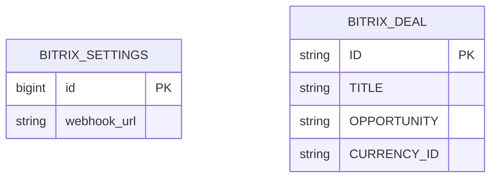
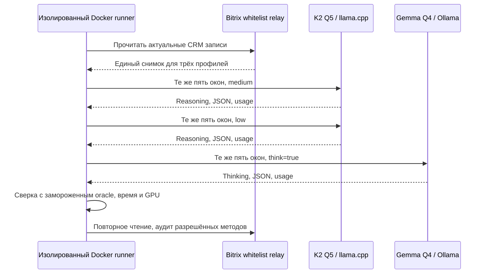

# Сравнение K2 medium/low и Gemma с reasoning

- Задача: `reasoning-model-comparison`; ветка `chore/reasoning-model-comparison`.
- Создано: 13.10.2026 02:47:08 MSK; база `7bed596450609cc66d0f3da6c1121752a3135c70`.
- Основание: прямое поручение пользователя сравнить три профиля на прежних пяти примерах, Bitrix только читать.

Читается существующая конфигурация активной интеграции и внешние сделки CRM. Между таблицей настроек и внешней сделкой нет ORM FK. Изменения схемы, записей приложения или Bitrix не планируются.

## Требования и план

1. Работа только на `kk-minsk`; production модель и настройки не переключаются. Production конфигурация читается только для получения разрешённого CRM подключения.
2. Прежние 28 исходных сообщений в пяти окнах и oracle остаются неизменными. Oracle SHA256 `cbf863ddf11b635b749e70301c2e50204730c0d42bc9361a61c0807a6e8f5e18`, файл SHA256 `8c4e8abcc6015d1e389bb42630ad72d75f6c5cf650e3473b278ee46e18479f92`.
3. Использовать один системный промпт с видимой JSON схемой из последнего compact-v2 прогона, одинаковые исходные сообщения и новый общий CRM снимок. Ожидаемые ответы не передаются модели.
4. K2: официальные уже проверенные Q5_K_M веса, один сервер с F16 KV, context 49152; режимы medium и low проверяются по фактическому префиксу chat template. Gemma: существующая `gemma4:e4b`, native Ollama API с `think=true`, проверка непустого поля thinking.
5. Для всех запросов context 49152, output budget 32768, temperature 1, top_p 0.95, min_p 0, top_k 0. Запросы последовательные, прогретые; один проход на профиль. Лимит полного ответа 600 секунд; обрезанные ответы считаются неудачами.
6. Сохранить все 15 запросов/ответов, рассуждения, завершение, входные/выходные токены, wall time и sampled process VRAM/total VRAM. Отдельно сохранить время прогрева; не включать его в медиану запросов.
7. Проверить обязательство и ответственного, исходный срок и исполнение, направление оплаты, сумму, договор и счёт, отсутствие выдуманной цены и оплаты. Проверить также дополнительные факты и цитаты, а не только наличие JSON.
8. Bitrix обращения только через whitelist relay без redirect; разрешены исключительно методы чтения. Зафиксировать аудит методов и сравнение прочитанных записей до/после. Временные ключи удалить после проверки.
9. Частный HTML отчёт содержит исходные примеры, ожидаемые и все фактические результаты; хранить в игнорируемом `private/reasoning-comparison-20261013/`. Публичная спецификация содержит обезличенные численные выводы.
10. Это контролируемая проверка извлечения непосредственно моделями. Она не подтверждает полное прохождение браузерного Mazory/Q2/outbox E2E или готовность production адаптера к reasoning. Существующий адаптер Gemma запрашивает think=false и отвергает thinking; его изменение в эксперимент не входит.

### Уточнение совместимости K2 перед основным прогоном

Контрольный запрос выявил несовпадение закрывающих тегов: модель при medium/low генерирует `</ifm|think>`, а исходный template задаёт парсеру `</ifm|think_fast>` / `</ifm|think_faster>`. С JSON grammar reasoning не завершается, лимит 1024 исчерпывается; без grammar тот же арифметический запрос завершается за 1,28 / 0,28 секунды, но итог попадает в reasoning_content. Исходный основной medium запрос прерван до получения результата и не включается в сравнение.

Попытка заменить закрывающие теги в template не исправила специализированный парсер llama.cpp; обход его выбора дал ответ без reasoning и также исключён. Исходный серверный template восстановлен. Для основного сравнения **у всех трёх профилей отключена принудительная decoder grammar**: полная одинаковая схема остаётся видимой в системном промпте, готовые JSON ответы валидируются отдельно. K2 ответ отделяется от reasoning по реально выданному IFM закрывающему тегу; исходные нативные поля сохраняются вместе с нормализованными. Допускается только снятие внешнего JSON code fence; дописывание, исправление содержания, повторный LLM repair или поиск произвольного JSON внутри текста запрещены.

До эксперимента записаны хеши десяти фактических K2 generation prompts; основной прогон проверяет их совпадение. Промпт, веса, входные данные и ожидаемые ответы остаются прежними. Обнаруженная несовместимость native JSON grammar отражается отдельно от оценки качества модели.

В первом low проходе обнаружено повторное использование почти полных medium prompts из KV кэша. Этот проход сохранён отдельно как cache-control и целиком исключён из основного сравнения. Основной low проход выполняется после перезапуска K2 и короткого прогрева, как medium; внутри каждого профиля разрешено естественное повторное использование общего системного префикса. Выбор повторного прохода сделан из-за различий в кэше, а не для отбора лучших ответов.

## Критерии готовности

- Получены и проверены ответы всех трёх профилей на тех же пяти окнах; ошибки и ограничения явно отражены.
- Сравнение качества, времени и VRAM связано с сохранёнными первичными данными. Пять примеров не выдаются за оценку общей точности.
- Bitrix writes отсутствуют; временные сервисы/ключи убраны, исходный контекст Gemma восстановлен.
- Частный отчёт доступен пользователю; публичный diff и обязательная проверка миграций чисты; PR направлен в main.

## Фактические результаты

Все три профиля выполнили основные пять запросов на kk-minsk.by и завершили генерацию с `stop`, без timeout или обрезки 32768-токенного бюджета. Невалидный JSON или нарушение схемы учитываются как ошибки; содержание не исправлялось. Хеши messages/system prompt одинаковы между тремя профилями для каждого случая, хеши K2 generation prompts совпали с исходным template. Короткие прогревы и исключённый cache-control проход не включены в таблицу.

| Профиль | JSON разбирается | JSON проходит схему | Основные поля совпали | Без существенных ошибок после ручной сверки | Медиана ответа, с | Все пять, с | Model process peak, MiB |
|---|---:|---:|---:|---:|---:|---:|---:|
| K2 Q5 medium | 4/5 | 4/5 | 3/5 | 1/5 | 20,09 | 176,73 | 12866 |
| K2 Q5 low | 4/5 | 3/5 | 2/5 | 1/5 | 9,52 | 45,33 | 12866 |
| Gemma Q4 think=true | 5/5 | 4/5 | 3/5 | 3/5 | 13,37 | 61,94 | 5972 |

Тайминги включают также ответы с ошибками; короткое завершение ошибки не равно успешной обработке. Диапазон времени K2 medium 5,10–97,11 с, K2 low 3,65–15,05 с, Gemma 10,12–14,16 с. Контекст у всех 49152. GPU memory измерена через nvidia-smi каждые 0,5 с; это process allocation peak конкретного движка/квантизации, а не размер весов и не стресс-тест конкурентных запросов.

| Проверяемый случай | K2 medium | K2 low | Gemma reasoning |
|---|---|---|---|
| A: одно обещание отправить таблицу | Основные поля видны в сыром ответе, но JSON сломан | Просьбы получателя превращены в дополнительные обещания, недословная цитата | Основное обязательство, ответственное лицо, срок и pending совпали |
| B: подтверждённое получение оплаты | Сумма, дата, направление, отсутствие дубля совпали | Сумма, дата, направление, отсутствие дубля совпали | Сумма, дата, направление, отсутствие дубля совпали |
| C: договор, счёт и вопросы о суммах | Основной договор/счёт без выдуманной цены; дополнительное ожидание превращено в чужое обязательство | Невалидный JSON, цена из вопроса выдана за факт, будущее действие выдано за выполненное | Цена из вопроса выдана за факт, отдельный invoice факт потерян, ожидание превращено в обязательство |
| D: изменение мощности | Мощность и неизвестная цена верны, имя ответственного выдумано | Мощность и неизвестная цена верны, цитата и ordinal не соответствуют источнику | Мощность, неизвестная цена, исходное имя и доказательства совпали |
| E: обещание КП, позднее исполнение | Исполненное обязательство не выделено, КП неверно названо документацией | Исполнение не выделено; запрещённое схемой поле, искажённый русский текст | Pending вместо fulfilled; потеря исходного срока/ответственного, одна цитата длиннее schema limit |

«Без существенных ошибок» включает дополнительные факты, цитаты и ручную проверку смысла. Мелкие замечания к второстепенным полям (например, status у payment/project или false вместо null для неприменимого contract_signed) сохранены в частном отчёте; они одинаково учитываются для всех моделей.

Gemma генерировала медианно 167,76 токена/с, K2 medium 95,47, K2 low 93,97; токенизаторы различаются, поэтому скорость токенов не является сравнением одинаковых объёмов русского текста. Полные выходные токены, включая reasoning: Gemma 9990, K2 medium 15986, K2 low 4005. Именно более короткий вывод low дал меньшую задержку, несмотря на меньшую скорость генерации токенов.

### Интерпретация

В этом окружении low быстрее Gemma по сумме времени примерно в 1,37 раза, но существенно уступает по качеству и требует около 12,56 GiB против 5,83 GiB model VRAM. Medium не дал достаточного качества при значительно большем времени. Gemma лучше сохраняет русский текст, имена и доказательства, однако reasoning не устранил критические ошибки договора и исполнения обязательства. Замена текущей модели на K2 по этим результатам не обоснована; включение reasoning само по себе также не обосновывает автоматическое применение финансовых фактов.

Пять случаев — диагностическая выборка; это не оценка общей точности и не сравнение с Gemma think=false на одинаковом промпте. Результат относится к K2 Q5 в llama.cpp и Gemma Q4 в Ollama; BF16/SGLang здесь не проверялся. Официальный K2 model card рекомендует high для опубликованных evals, medium/low допускает как исследование effort: <https://huggingface.co/IFM/K2-Horizon-7B>. Native Ollama разделяет thinking/content: <https://docs.ollama.com/capabilities/thinking>.

### CRM, восстановление и артефакты

- Relay audit: ровно шесть `crm.deal.get`, все разрешены; методов записи ноль. Три прочитанные записи идентичны до/после.
- LAYA оставалась загружена (3128 MiB), health OK. Во время K2 Gemma находилась в памяти без запросов; общий sampled peak 22777 MiB. Во время Gemma K2 остановлен; общий peak 9918 MiB. Эти total peaks отражают разные наборы резидентных процессов и не используются как сравнение размера моделей.
- K2 временный сервер остановлен, исходный template восстановлен. Read relay удалён, временные webhook credentials/relay key удалены. Веса в прежнем отдельном volume сохранены.
- Gemma возвращена к контексту 65536, `think=false` контроль завершился `OK`/stop; Ollama ps показал 100% GPU. Production конфигурация и модель не переключались.
- Частный отчёт: `private/reasoning-comparison-20261013/comparison.html`. В этой же игнорируемой директории — все пять оригиналов, oracle, 15 запросов/ответов с native/normalized reasoning, GPU samples, schema/manual validation, CRM снимки и аудит. Секретов в артефактах нет.
- K2 GGUF revision `9fb01f7b397994455262f4b8256e4e00e4949ea9`, Q5 SHA256 `92a43adc88319346721e15bd8381ff7b6d31c4570a1c090ab8f75f665d92caee`; llama.cpp b11561/e937b17a2, pinned CUDA image `sha256:20c6e722e2fcc5ca9c15401d3fd8e35408aaf8f9c54a12f32920f637c57959bb`. Ollama 0.34.0, `gemma4:e4b` dc35e8d9c606.
- На kk-minsk в Docker: `manage.py check` — без проблем; `makemigrations --check` — `No changes detected`. Изменяется только эта спецификация; frontend/backend приложения не меняются.
