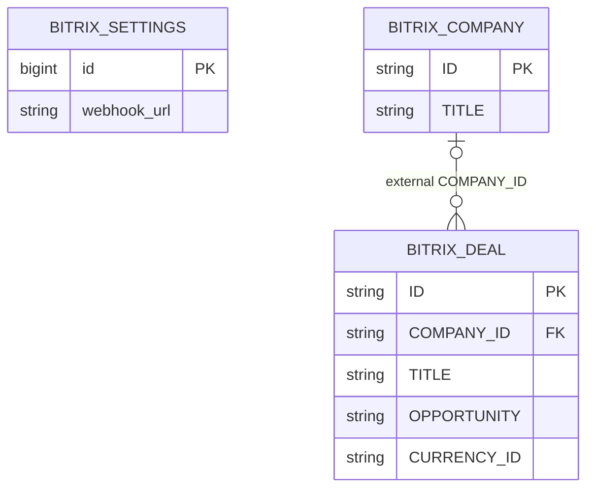

# Выбор более сильной модели с пятью корректными примерами

- Задача `stronger-model-selection`, ветка `chore/stronger-model-selection`.
- Создано 13.10.2026 04:29:28 MSK; база `35bce88c930574dd70612f7125b292db1dcb95c4`.
- Основание: пользователь поручил выбрать более сильную и крупную модель, прошедшую прежние пять примеров без существенных ошибок. Чтение Bitrix разрешено, запись запрещена.



Читаются существующая конфигурация интеграции и внешние записи CRM. ORM FK между ними нет, схема приложения и бизнес-записи не меняются.

```mermaid
sequenceDiagram
    participant R as Docker experiment runner
    participant M as Candidate CUDA model
    participant B as Bitrix read-only relay
    R->>M: Проверить веса, шаблон, reasoning и размещение GPU
    R->>B: Прочитать общий свежий снимок CRM
    B-->>R: Разрешённые CRM записи
    R->>M: Прежние пять окон с неизменным промптом/схемой
    M-->>R: Reasoning, JSON, usage, timings
    R->>R: Schema, frozen oracle, ручная сверка всех фактов/цитат
    alt Нет пяти корректных случаев
        R->>M: Следующий предварительно выбранный кандидат
    else Пять корректных случаев
        R->>M: Независимый повтор на том же конфиге
        M-->>R: Повторная проверка устойчивости
    end
    R->>B: Прочитать записи повторно; проверить аудит
    R->>R: Восстановить исходные сервисы и удалить временные ключи
```

## Требования и план

1. Первым проверить Qwen3.8-27B с reasoning; запасной кандидат — Gemma 4 31B. Веса получать из официальных источников, фиксировать tag/revision, digest/SHA256 и фактическую квантизацию. Если аппаратные ограничения требуют другого профиля, документировать его до основного прогона.
2. Размещать временный сервер и runner в Docker на `kk-minsk`; текущий public routing и production настройки не переключать. LAYA остаётся загружена. Gemma E4B допускается временно выгрузить из VRAM для крупной модели; после испытаний восстановить её с контекстом 65536. Не выдавать частичный CPU offload за полный GPU запуск.
3. Прежние 28 сообщений в пяти окнах, frozen oracle SHA256 `cbf863ddf11b635b749e70301c2e50204730c0d42bc9361a61c0807a6e8f5e18`, source SHA256 `8c4e8abcc6015d1e389bb42630ad72d75f6c5cf650e3473b278ee46e18479f92`; ожидаемые ответы не менять и не передавать модели.
4. Использовать прежний compact-v2 системный промпт с видимой полной схемой. Первичный профиль: context 49152, output budget 32768, temperature 1, top_p 0.95, top_k 20, min_p 0, reasoning ON в наиболее сильном поддержанном режиме; decoder grammar выключена, JSON проверяется после завершения. Параметры Qwen соответствуют model card, отличие top_k от предыдущего эксперимента фиксируется. Фактический GGUF template Qwen3.8 поддерживает xhigh (default), medium, low; первоначальный high отвергнут до основного прогона, выбран xhigh.
5. Не исправлять содержание ответа, не дописывать поля, не отбирать удачные случаи из разных прогонов. Полный один проход содержит все пять случаев; при 5/5 повторить весь проход после сброса KV cache. Разрешено снять только внешнюю JSON code fence и отделить reasoning по фактическому нативному протоколу.
6. Сверять основные поля и все дополнительные факты: просьба/принятое обещание, ответственный, исходный срок/исполнение, вид и направление оплаты, неизвестная цена, договор/счёт, отсутствие ложных оплат, точность имён, дословные цитаты и original ordinal. Невалидный или обрезанный ответ — неуспех. Критерии не ослаблять ради 5/5.
7. Сохранить все исходные ответы и ошибки. Измерить полное время, tokens, process/total GPU memory с периодом 0.5 с. Разделять прогрев, выходные токены reasoning, повторы и фактические запросы.
8. Bitrix только через прежний whitelist relay, без redirect и методов записи. Зафиксировать чтение до/после, аудит и отсутствие изменений прочитанных записей. Удалить временные credentials по завершении.
9. Все сообщения, CRM снимки и подробный отчёт — в игнорируемом `private/stronger-model-selection-20261013/`; публичная спецификация содержит обезличенные измерения. По результатам честно указать подходящий профиль либо отсутствие прошедшего кандидата.
10. Проверка напрямую через model API не подменяет полный Mazory/Q2/outbox E2E и не означает production rollout. Пять из пяти — результат этой диагностической выборки, не гарантия отсутствия ошибок на произвольной переписке.

### Достаточность CRM контекста

Первый Qwen проход сохранил прежний compact input только с crm.deal.get. В случае B он ошибочно приписал оплату объекту CRM кандидата, несмотря на запрет такой привязки в уже замороженном oracle. До следующих полных проходов добавляется чтение crm.company.get по фактическому COMPANY_ID и явное обозначение retrieved records как кандидатов поиска, а не подтверждённых совпадений. Это дополнительные реальные данные и граница доверия retrieval, а не подсказка ожидаемого ответа. Системный промпт, исходные сообщения, схема и oracle не меняются; исходный Qwen проход сохраняется целиком как диагностика. Обогащённые проходы обозначаются отдельно и используют одинаковый CRM контекст.

Запрет неверной привязки случая B дополнительно включается в машинную сверку: он уже присутствовал в oracle до испытаний и не является новым критерием.

### Профиль Gemma 31B перед её основным прогоном

Официальные текстовые Q4_K_M веса Gemma 4 31B занимают 18 670 033 120 байт. GGUF metadata: 60 слоёв, global attention KV 4×512 каждые 6 слоёв, sliding attention KV 16×256/window 1024. Расчётный F16 KV для context 49152 составляет около 4,53 GiB и вместе с весами/LAYA выходит за бюджет 24 GiB. Поэтому заранее выбран q8_0 KV, flash attention, один слот, batch 512/ubatch 128; context/output budget сохраняются. Это изменение аппаратного профиля документировано до проверки качества. Reasoning ON без неподдерживаемого именованного effort, прочие sampling параметры прежние.

Фактическая попытка context 49152/q8 KV завершилась CUDA OOM ещё до первого пользовательского запроса; CPU fallback не использовался. Следующая конфигурация до основного прогона: context 32768, output budget 24576, остальные параметры те же. Runner проверяет полный input+output reserve и отсутствие обрезки каждого ответа. Прежний исходный файл и все сообщения сохраняются полностью.

Context 32768/q8 тоже не поместился: CUDA OOM при выделении compute buffer 292 MiB до пользовательских запросов. Для следующего запуска заранее уменьшены context/output до 16384/8192; все исходные входы помещаются полностью. Это аппаратное ограничение совместного размещения 31B + LAYA; фактически обрезанный ответ по-прежнему считается ошибкой, а не успешным результатом.

### Более явный контракт доказательств перед дополнительными проходами

Gemma 31B на прежнем промпте повторила ошибку переноса суммы из вопроса в статусный ответ. Для следующих полных проходов вводится отдельный профиль `evidence-policy`: исходная схема и инструкции сохраняются, добавляются общие операционные правила доказательств. Ненулевая сумма требует числового денежного утверждения, а короткое подтверждение подписания/счёта после вопроса подтверждает статус, не сумму; переговоры не доказывают решение проблемы; CRM кандидаты не являются подтверждёнными связями; исполнение обещанного действия отделяется от дальнейшего финансирования; имена копируются буквально, цитата принадлежит указанному ordinal.

Это изменение промпта документируется до запуска и маркируется отдельно. В нём нет названий объектов, сумм, дат, ordinal или ответов из oracle. Прежние неудачные ответы сохраняются; критерии не меняются. Результат tuned-профиля на этих пяти случаях нельзя называть независимой общей оценкой модели. После 5/5 нужен полный повтор на неизменном профиле.

Дополнительный полный medium/evidence-policy проход Qwen убрал ложную привязку оплаты и перенос сумм из вопроса, но представил агрегат как project. Перед следующим полным профилем онтология уточняется общим правилом: project — один идентифицируемый реальный бизнес-объект; портфель/статистика/таблицы и события не являются проектами, их агрегаты не создают project/payment/invoice. Имя объекта сохраняется узнаваемым, при неизвестном имени — null. Это уточняет уже существовавший запрет превращать агрегат в сделку; oracle и критерии не меняются. Предыдущий проход сохраняется без фильтрации/исправления.

Полный v4 проход устранил aggregate project, но спрятал исполненное обещание в summary проекта без type=commitment. Перед v5 общее представление уточнено: принятое обещание обязательно создаёт отдельный commitment, project/summary его не заменяет; позднее исполнение закрывает то же обязательство с исходным сроком; уверенный план собственного действия в рабочем отчёте может подтвердить обещание при поддержке владения действием, а запросы/ожидания третьих лиц не являются обещаниями автора. Это уточнение формата сохраняет ту же семантику oracle и не содержит частных ответов.

В v5 основные пять сценариев верны, но дополнительное принятое обещание потеряло pending, а ранее запланированная встреча названа состоявшейся по сообщению о последующем разговоре. Перед v6 добавлено общее правило статусов: обязательство pending до явного подтверждения выполнения именно обещанного действия; план, поздний контакт и другое действие не доказывают исполнение плана. Правило распространяется на summary и все дополнительные факты. Для воспроизводимого режима извлечения заранее выбрана temperature=0; остальные параметры medium-профиля сохранены. Отличие от рекомендованной temperature=1 и предыдущих проходов явно фиксируется. Приватные ответы/критерии не исправляются; при 5/5 нужен весь повтор v6 на неизменном профиле.

Полный v6 верно извлёк основные факты и статусы, но нормализовал внутренние пробелы в нескольких цитатах. Проверка дословности сохраняется. Перед v7 вводится native JSON-schema decoding с enum разрешённых evidence_quote: все оригинальные сообщения и непустые строки этих сообщений, с сохранением внутренних пробелов/пунктуации. Evidence ordinal ограничен ordinal входных сообщений; принадлежность цитаты указанному ordinal отдельно проверяется. Остальные поля/их семантика не меняются. Список строится только из входа, без oracle, не фильтрует источник по ожидаемым фактам и не исправляет результат после генерации. Промпт/medium/temperature=0 сохраняются как в v6. Ограничение применяется к итоговому JSON, reasoning остаётся включённым; это проверяется в нативном ответе. Успех будет результатом модели вместе с grounded decoder, а не модели на свободном JSON.

Проверка v7 выявила цитирование заголовка сообщения вместо строки с доказательством мощности, а в другом случае — превышение исходного maxLength=300 у цитаты: native decoder не обеспечил это ограничение, отдельный JSON-schema validator отверг ответ. До v8 источник ограничивается целым оригинальным сообщением; JSON schema anyOf связывает evidence_ordinal и evidence_quote через const в каждой ветке. Поле evidence_quote получает отдельный формат полного источника вместо короткого фрагмента до 300 символов; ограничения/типы остальных бизнес-полей не меняются. Все сообщения доступны без отбора по содержимому. Это сохраняет полный контекст доказательства и запрещает неверный ordinal/нормализацию, но увеличивает число выходных токенов за счёт длинных цитат. Содержательные поля остаются свободным выводом модели и проверяются прежним oracle/ручной сверкой; содержимое ответа не исправляется после генерации.

## Критерии готовности

- Назван конкретный прошедший профиль с первичными данными 5/5 и повтором; либо прозрачно зафиксированы результаты испытанных кандидатов и причина отсутствия выбора.
- Пользователь получил пять оригинальных окон, ожидаемые и реальные результаты, время и измеренную VRAM.
- Ноль Bitrix writes, восстановлены исходные сервисы, временные ключи удалены.
- Docker migration check и публичный diff проверены; PR в main проходит обязательные проверки и review.

## Зафиксированные веса и окружение

- RTX 3090, 24 576 MiB; NVIDIA 595.104.02. Прямой native OpenAI-compatible model API, один последовательный слот, flash attention, полное GPU размещение. LAYA остаётся в памяти.
- llama.cpp CUDA image `ghcr.io/ggml-org/llama.cpp@sha256:20c6e722e2fcc5ca9c15401d3fd8e35408aaf8f9c54a12f32920f637c57959bb`, build b11561/e937b17a2.
- Qwen3.8-27B: текстовые Q4_K_M веса 16 810 714 464 байт; SHA256 `f5f1dd8920d417aac2718b0bda3403da274301efdd6760b4f0f4b864ff2ad57d`; официальный Ollama manifest digest `aaee06c39dcf2437cde036998d960e1fc1494b8191be7cc9657d01e509097813`. По metadata 27 320 697 856 параметров. Vision projector не скачивался и не загружался.
- Gemma 4 31B: текстовые Q4_K_M веса 18 670 033 120 байт; SHA256 `cd20f2b3f2e30239023189c04e65754b0cc7c38959665ac727461ee470df16cf`; официальный manifest digest `17ba34c06c801ba22f6047bab21ced9429c6d43e0e42ecf339b0f3e5a61e8d97`. Vision projector не использовался.
- Для v8 сервер создан заново, defaults medium/T=0 совпадают с явными request overrides; базовые контексты и веса сохранены. Добавлено общее указание выбирать целое сообщение, которое доказывает факт. Данные oracle не входят ни в промпт, ни в native grammar.

### Ограничения интерпретации

Это выбор модели вместе с режимом reasoning, реальным retrieval контекстом, уточнённым контрактом доказательств и ограничением декодирования. Нельзя приписывать успех только увеличению числа параметров: исходный Qwen xhigh дал 3/5, Gemma 31B — 2/5 в полной ручной сверке. Подбор проводился на этих же известных пяти случаях. Полный повтор без изменения профиля проверяет воспроизводимость, но не заменяет независимую контрольную выборку.

Профиль v8 не является готовой заменой production model name: перед внедрением потребуется согласованно адаптировать формат provenance для полных источников вместо кратких цитат. Приложение/API/ORM в этой задаче не изменяются; числовые и смысловые ожидания frozen oracle сохраняются. Native schema и точные запросы лежат в первичных приватных данных.

Небольшие замечания к представлению второстепенных объектов и контрагентов фиксируются отдельно. Автоматический CRM entity matching и запись бизнес-сущностей не испытываются и не разрешены. Тайминг одного процесса и VRAM snapshot не являются проверкой конкурентной нагрузки или SLA.

## Результаты полных проходов

Каждая строка — все пять исходных окон, без отбора отдельных ответов. Полная сверка дополнительно учитывает JSON schema, quote/ordinal и смысл всех побочных фактов. Tiny warmup исключён.

| Профиль | Полная сверка | Медиана, с | Весь набор, с | Model peak, MiB |
|---|---:|---:|---:|---:|
| Qwen 27B, исходный xhigh | 3/5 | 281,47 | 1140,72 | 18820 |
| Gemma 31B, исходный ON + CRM компании | 2/5 | 63,62 | 376,47 | 19494 |
| Qwen medium, evidence v3 | 4/5 | 76,80 | 449,17 | 18820 |
| Qwen medium, ontology v4 | 4/5 | 83,48 | 401,20 | 18820 |
| Qwen medium, commitment v5 | 2/5 | 83,13 | 406,49 | 18820 |
| Qwen medium, status v6, T=0 | 4/5 | 76,35 | 409,71 | 18820 |
| Qwen medium, source spans v7, T=0 | 3/5 | 74,38 | 406,59 | 18820 |
| Qwen medium, full-source v8, T=0 | 5/5 | 111,43 | 605,75 | 18820 |
| Qwen medium, полный повтор v8 | 5/5 | 111,32 | 605,15 | 18820 |

Оба v8 полностью завершены с finish_reason=stop, reasoning во всех ответах, по 17 679 входных и 24 757 выходных токенов включая reasoning. Полный GPU peak 22 766 MiB (22,23 GiB), model peak 18 820 MiB (18,38 GiB). Есть редакционное замечание к неоднозначному местоимению во второстепенном сравнении оборудования; структурированные основные факты верны и полный оригинал сохранён. Повтор выполнен после перезапуска: все пять полных request/schema идентичны, все пять фактических JSON полностью совпали. Первый вход каждого прохода имел cached_tokens=0; cold weight loading не измерялось.

Выбран Qwen3.8-27B Q4_K_M, medium, temperature=0, полный профиль v8. На этих пяти случаях 5/5 воспроизведены в двух проходах; это сохраняет ранее описанные ограничения подбора на известной выборке и требует отдельной адаптации provenance перед внедрением.

Приватный HTML отчёт `private/stronger-model-selection-20261013/comparison.html` содержит все 28 оригинальных сообщений в пяти окнах, frozen ожидаемые ответы, фактические JSON, reasoning, ручные замечания и ссылки на запросы/нативные ответы/GPU samples. В GitHub эти данные не публикуются.

## Контроль чтения и завершение

- Bitrix: 6 crm.deal.get и 2 crm.company.get; всего 8 разрешённых чтений, 0 write calls. Полные снимки трёх контрольных сделок и одной компании до/после совпадают. Аудит и первичные данные сохранены приватно.
- Временный read relay и все runner контейнеры удалены. Его credentials/key удалены с сервера; постоянный ключ LAYA сохранён. Кандидат остановлен, проверенные веса сохранены в отдельном Docker volume.
- Исходный Gemma4:E4B восстановлен в native Ollama: context 65536, ответ OK/stop, 100% GPU. LAYA /health — 200; public Ollama без токена — 401. Production настройки и маршруты не переключались.
- Docker kk-minsk: manage.py check — без замечаний; makemigrations --check — No changes detected. Схема/код приложения не менялись.
- HTML в настоящем Chromium Docker: 5 секций, 45 результатов, 9 строк профилей; desktop 1440 и mobile 390 без глобального горизонтального overflow и pageerror. Скриншоты просмотрены.
- Публичный diff содержит только эту спецификацию. Browser/Q2/outbox E2E приложения выполняется обязательным CI на одноразовом engine; это не подтверждает внедрение выбранного профиля в приложение.
