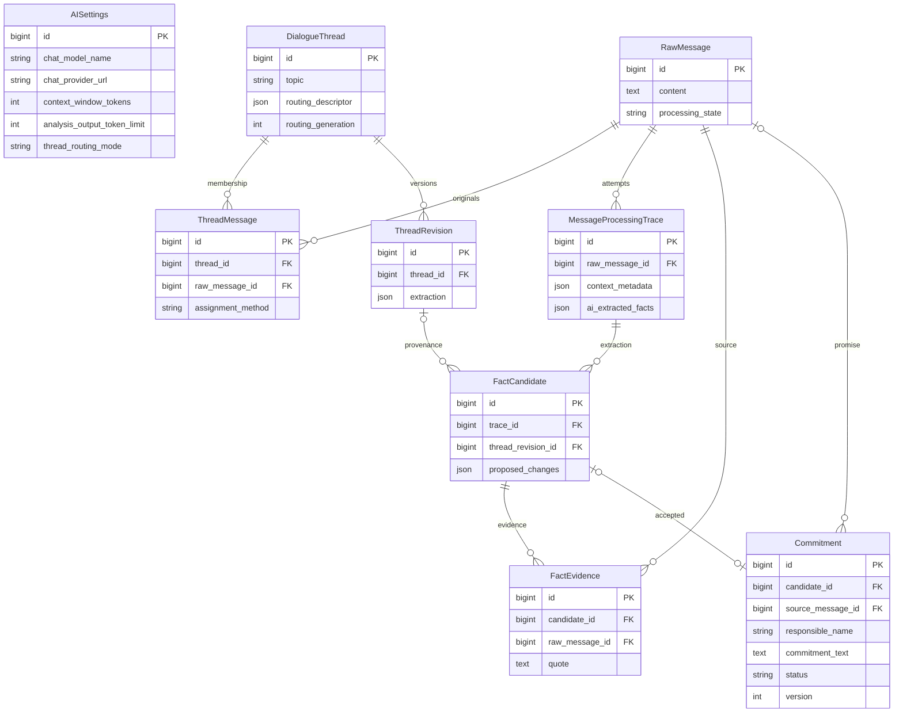
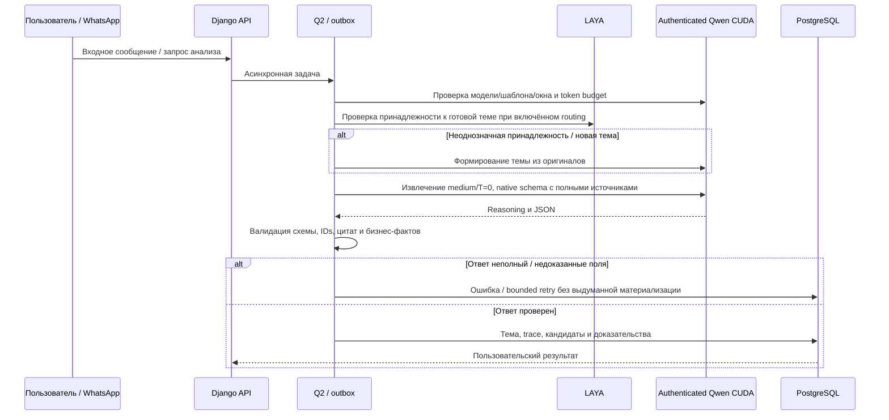

# Production: Qwen 27B с reasoning и доказательствами из оригиналов

- Задача qwen-production-rollout, ветка feature/qwen-production-rollout.
- Создано 2026-10-13 10-46-39 MSK; база 0ed05ef3c4e6d92846f5ed479281d423229a4cce.
- Пользователь прямо поручил сменить модель на production после двух проходов 5/5. Это разрешает реализацию, проверки, merge и rollout без повторного согласования.

Текущая структура проверена по models.py. Новая схема БД не планируется. Production имеет миграции до 0052; при rollout применяется уже принятая 0053 для LAYA/тем. Полные цитаты до 32000 символов уже поддержаны сериализаторами и TextField.

## Требования

1. Внедрить проверенные Q4_K_M веса Qwen3.8-27B (SHA256 f5f1dd8920d417aac2718b0bda3403da274301efdd6760b4f0f4b864ff2ad57d), pinned llama.cpp CUDA image 20c6e722e2fcc5ca9c15401d3fd8e35408aaf8f9c54a12f32920f637c57959bb; text only, без vision projector, context 49152, один слот, medium, temperature 0, output reserve 32768.
2. Inference остаётся на GPU kk-minsk; приложение production запускается только через mazory-remote. Все стенды и E2E только kk-minsk, отдельные проекты/volumes. Ничего не устанавливается на хост.
3. Сохранить существующий Bearer key, использовать защищённый отдельный маршрут Qwen у ai.kk-minsk.by с Docker DNS вместо ephemeral IP; проверить missing/invalid/valid auth, длинный запрос и восстановление после restart. Предусмотреть безопасное сосуществование/выгрузку legacy Gemma по фактической VRAM.
4. Проверять фактический template/model/context при подсчёте токенов. Пин шаблона совпадает с имеющимися tokenizer assets Qwen. Reasoning medium включён в extraction и прикладных запросах, parser отделяет reasoning от итогового JSON; actual input/output учитываются в ProviderUsage.
5. Общие правила доказательств из выбранного профиля адаптировать к существующим project/payment/commitment и темам: числовой вопрос не подтверждает сумму, просьба не обещание, обещание обязательно структурировано, позднее выполнение закрывает исходное действие, финансирование не оплата, планы не выполненные события, агрегат не проект, CRM кандидаты не подтверждённая связь, имена исходные.
6. Native schema связывает source ID с полным original content, включая вторичные evidence_messages. Источники только из полного входного snapshot; не нормализовать/исправлять цитаты и факты после генерации. Для больших оригиналов явно соблюдать существующий лимит и token budget, не обрезать доказательство.
7. Production текущие autonomous_enabled=false и autonomous_crm_enabled=false сохраняются: эта задача меняет модель, не включает массовую обработку или CRM запись. Bitrix только чтение. Не импортировать/пересоздавать исторические сущности в production ради проверки.
8. До rollout настоящий browser/API/PostgreSQL/outbox/Q2 E2E на прежних пяти окнах и синтетических случаях, с real Qwen/LAYA; ответы из oracle не попадают в модель. Прогнать контекст, fulfilment, отрицательные запросы/суммы, аналитику и восстановление очереди. Никаких unit/mock/component/integration suites.
9. Для production сохранить защищённый backup БД/настроек/images, quiesce затронутые workers перед миграцией/настройкой, развернуть принятый PR, проверить API/frontend/logs/worker и bounded read-only model canary через Q2. При отказе вернуть рабочий провайдер/настройки без потери бизнес-данных.
10. Текущий production image temporal-backfill-20261008-r1 старше main (PR74/75); включить необходимые уже принятые изменения фронтенда/тем/провайдера с проверкой миграций, а не выдавать смену строки model name за весь rollout.

## План изменений

- Provider profile/runtime metadata и tokenizer rendering для Qwen llama.cpp.
- Общие промпт-правила и связывание evidence ID/полного текста в native extraction schema; versioned request snapshots.
- Docker service Qwen, защищённый routing и operational configuration без секретов в Git.
- Расширение существующего изолированного real-model E2E профиля и проверки фактических результатов в API/БД.
- Docker check/migrations/frontend build/full E2E, PR в main, review/merge и проверенный rollout с кратким результатом в этой спецификации.

## Критерии готовности

- Production AISettings указывает Qwen, проверенные context/output/tokenizer/temperature; настоящий Q2 запрос успешно завершён этой моделью.
- Пять прежних примеров проходят через приложение, без существенных ошибок основных и дополнительных фактов; сохранены входы/ожидания/фактические результаты и время.
- Auth сохранён; сервис автоматически запускается после restart; совместное размещение с LAYA проверено фактически.
- Bitrix writes не выполнены; массовая autonomous обработка не включена; существующие бизнес-данные и история сохранены.
- manage.py check, makemigrations --check, миграции, frontend types/build и real E2E успешны; CI/review и PR merge завершены.

## Уточнения по первому прикладному прогону

Первый изолированный прогон v40 выявил ошибочную project-классификацию онлайн-таблицы, повторную материализацию одного обещания и старый четырёхминутный deadline extraction. Результаты сохранены, не исправлялись вручную. Профиль v2 закрепляет первый promise-source в native schema, отвергает артефакты как проекты и сопоставляет повтор по автору, предмету, действию и исходному обещанию; одинаковая полная цитата сама по себе больше не объединяет разные действия. Deadline Qwen extraction ограничен 1200 секундами и AI_REQUEST_TIMEOUT, включая HTTP read timeout; остальные провайдеры сохраняют 240 секунд на задачу и 180 секунд на запрос. Аналитика Qwen получает до 600 секунд с сохранением срока хранения/прав доступа, output reserve в аналитике равен фактическим 8192, а extraction — 32768. Canary сверяет native token count и для plain text, и для истории tool calls. Повторная проверка — в чистой v41 БД.

Прикладной v41 не прошёл: контекст нормализовал отступы вторичных источников, а автономная проверка искала будущую оплату во всём большом оригинале и отвергала корректное поступление. Профиль v3 передаёт неизменённый content; native quotes остаются целыми оригиналами. Проверка поступления требует утверждения о выполненном движении и именно извлечённой сумме в одной буквальной реплике/предложении без вопроса или будущего времени. Для нескольких передач КП/таблиц календарный срок и отрицание выполнения проверяются относительно предмета обещания, сами доказательства сохраняются полностью. Запрос обратной связи и список нескольких объектов не создают проект. Исправлена подготовка JSON arguments для pinned tool-call tokenizer template. v40/v41 сохранены без изменения результатов. Финальный v42 использует чистую БД, непрозрачные message IDs, batch limit 20/context 30 для Qwen; те же лимиты будут установлены на production при сохранении выключенной автоматики.

В v42 найден второй источник нормализации — full_history.snapshot; он приводил к неверным вторичным цитатам и отклонению достоверных кандидатов. Оба snapshot-пути Qwen в профиле v4 сохраняют raw content полностью. Legacy исправление source IDs/цитат отключено для Qwen; частичные цели и evidence excerpts не объявляются полными оригиналами. Проверка целостности full-history рассчитывается по тому же точному snapshot. Финальный независимый запуск перенесён в чистый v43. В Compose воркеру history передаётся существующий AI_CREDENTIAL_ENCRYPTION_KEY, без ротации.

В v43 auxiliary-сверка повторных обещаний сохранила legacy cap 2048 и обрезала reasoning/ответ, хотя основной запрос имел резерв 32768. Профиль v5 применяет настроенный Qwen output reserve также в сверке повторности/исполнения; для остальных моделей legacy cap сохраняется. Auxiliary-проход Qwen всегда получает полные raw originals и не считает контрольный текст запросом-источником. Повтор — чистый v44 без исправления прежних результатов.

В v44 все 28 исходных сообщений обработаны без provider errors; source quotes полностью совпадают с оригиналами. Найдено удвоение одного поступления: отчёт назвал Top Build в object_name, подтверждение оставило object_name пустым, при одинаковом company/amount/date/direction/kind. Профиль v6 объединяет такие явно подтверждающие реплики внутри одной темы при совпадении компании и всех денежных характеристик; сообщения о новом/втором платеже и разные известные объекты не объединяются. Новая проверка — чистый v45. Остальные четыре основных результата v44 соответствуют ожиданиям, дополнительная планируемая встреча остаётся pending.

В v45 финансовый дубль устранён, остальные извлечённые поля верны; выявлена гонка invoice observation с CRM lookup: преждевременный approve отменял ожидающий read-only поиск. Решение ожидает завершения CRM lookup для любого факта с именованным объектом без подтверждённой связи. Проверка названия/компании по полному источнику теперь использует unbounded нормализацию текста; нормализованные идентификаторы объектов по-прежнему ограничены 255. Прежнее ограничение обрезало длинную цитату до упоминания Vertex и необоснованно отклоняло связь. Профиль v7, проверка в v46; ожидания не изменены.

## Проверенный результат v46 и rollout

Настоящий browser/API/PostgreSQL/outbox/Q2 прогон на kk-minsk завершён успешно: 5/5 исходных примеров, 28/28 сообщений, 29,9 минуты, ошибок провайдера нет. Источники и ожидания не изменены, полные цитаты совпадают с исходными сообщениями. Таблица — одно обещание Zhanat со сроком 20.08; Top Build — одно поступление 117 млн KZT 09.09 без неверной связи CTP 343; Vertex — подписанный договор и отдельный счёт 15.09 с CRM 1532, суммы из вопроса остаются неизвестными; Курчатов — мощность 8 МВт и предложение CRM 1556; обещание Turar имеет исходный срок 15.09 и подтверждённое исполнение 17.09, финансирование не платёж. Дополнительная встреча UAM остаётся pending.

Canary через настоящий Q2 подтвердил reasoning и совпадение native/local token counts для plain text и tool history. Qwen и LAYA совместно занимают 22768 MiB на RTX 3090 с 24576 MiB. После завершения пяти примеров провайдер перезапущен; дополнительные browser E2E для двух действий, повторов, отдельного второго платежа и аналитики запущены. Их результат, CI/review и production rollout ещё не подтверждены. До завершения этих этапов production остаётся на Gemma с выключенными autonomous_enabled/autonomous_crm_enabled. Пять согласованных примеров использовались при настройке профиля: это acceptance проверка, не слепая оценка всей переписки.
