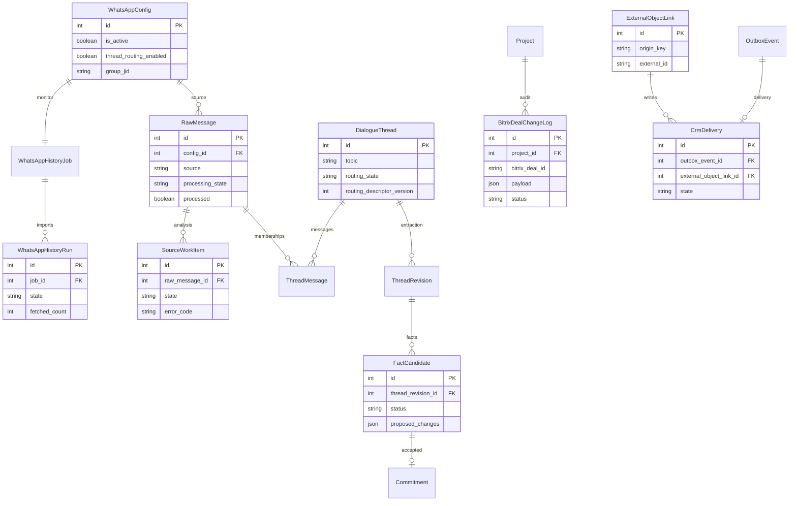
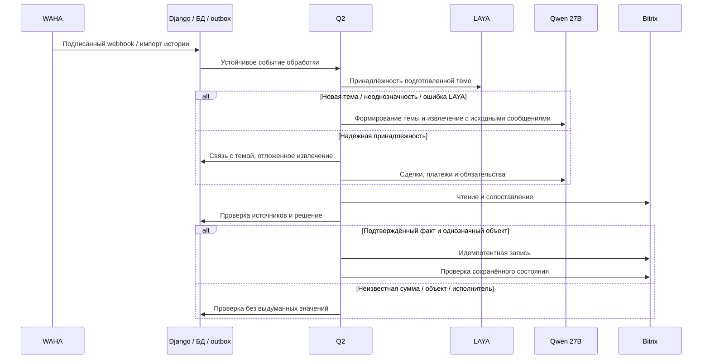

# Постоянная обработка WhatsApp и проверенная синхронизация Bitrix

Дата: 13.10.2026 21:59:19 MSK. Задача: whatsapp-continuous-crm.
Пользователь поручил включить чтение и запись, проверить прежние изменения и полноту истории. Это подтверждение реализации и рабочих операций; неизвестные суммы и неоднозначные связи требуют проверки.

## Требования

1. Проверить живую сессию, подпись webhooks, постоянный мониторинг и восстановление очереди.
2. Подключить существующую LAYA whatsapp-v1 с закреплёнными моделью, калибровкой и политикой; темы и факты формирует Qwen3.8-27B medium.
3. До массовых записей сверить полный журнал прежних изменений со ссылками на первоисточники и текущими объектами Bitrix. Сохранить посторонние CRM данные, неизвестные суммы, аудит и внешние ключи; не создавать дубли.
4. Проверить сохранённый TXT и всю доступную WAHA историю, устранить пропуски и ошибки обработки. Отдельно отразить недоступные сообщения/вложения и факты, требующие выбора человека.
5. Включить автономную обработку и доставку только после настройки и проверки источника. Все внешние операции выполняются Q2.
6. Проверить реальный E2E в изолированном Docker kk-minsk с локальным провайдером CRM; production только mazory-remote.

## Планируемые изменения

Проверка действующих моделей и доставки, рабочая конфигурация LAYA и автономной обработки; необходимые исправления подписки, повторов и полноты обработки по результатам аудита. Схема БД пока не меняется. Уточнения вносятся сюда.

## Критерии готовности

Живая сессия WORKING; поступающие сообщения сохраняются и обрабатываются; LAYA и Qwen доступны из очередей; известна полнота истории и судьба каждого сохранённого текстового сообщения; прежние и новые CRM изменения сверены с источниками и чтением Bitrix. Нет зависших текущих операций или непроверенных автоматических денежных значений. Неоднозначные факты явно перечислены. Docker check, makemigrations --check, необходимые сборки и E2E проходят. PR в main проверен и объединён.

## Начальный аудит

На 13.10.2026 18:59 UTC в БД 735 сообщений: 482 TXT и 253 WAHA. 27 сообщений имеют текущий processing_state=failed; исторических SourceWorkItem ошибок 52. 48 кандидатов approved, 35 pending, 17 rejected, 104 superseded. В журнале 40 изменений Bitrix. Монитор включён с интервалом 360 секунд, saved status WORKING; живое состояние проверяется отдельно. Автономная обработка/запись выключены, LAYA в production не настроена. Это исходный снимок, не подтверждение полноты или качества.

## Реализация и проверка

Живой WAHA WORKING, NOWEB store.enabled/fullSync=true. Два полных чтения дали одинаковые 252 сообщения; все ID сохранены (ещё один ранее сохранённый оригинал сейчас не возвращается WAHA). TXT содержит 586 записей: 482 текста сохранены, 78 медиа и 26 системных строк явно исключены; вложения по одному TXT восстановить нельзя.

Прочитаны все сделки ORIGINATOR_ID=MAZORY: 29, иных записей с этим внешним ключом нет; дубли ORIGIN_ID отсутствуют. Прочитаны все 29 объектов журнала из 40 записей, отправленные поля совпадают с текущим CRM. Денежные поля прежних проверенных записей сопоставлены с таблицей договоров и прямыми сообщениями, неизвестные суммы ранее не отправлялись.

Обнаружены ошибочные непринятые кандидаты прежней Gemma: 15% как 15 тенге, 117 млн поступления как reversal, неизвестная сумма Vertex как 78 млн и др. Автономное принятие теперь требует совпадения модели кандидата с текущей конфигурацией; денежный показатель требует денежной единицы/масштаба, проценты исключены. Переключение модели входит в отпечаток решения. Прежние человеческие подтверждения сохраняются.

Compose передаёт закреплённую конфигурацию LAYA всем нужным процессам. Reconcile учитывает route_message/extract_thread и их batch_ids, восстанавливает извлечение для routed сообщения, не создавая параллельный extract_message. Доставка сделки проверяет ID и все отправленные поля чтением Bitrix перед delivered; числовое OPPORTUNITY сравнивается как Decimal.

Добавлены два настоящих браузерных E2E с API, PostgreSQL, outbox, Q2 и локальными внешними HTTP-провайдерами. Изолированный kk-minsk mazory-continuous-e2e-v3: 2 passed, 13.3 секунды. Проверены silently discarded CRM update, последующая идемпотентная доставка, процент вместо денег, кандидат старой модели, потерянное отложенное извлечение и повторный webhook. Это проверка контуров приложения, не дополнительный замер качества LAYA/Qwen.

Полный portable E2E на kk-minsk v5: 28 passed, 9 skipped, 3.8 минуты, с настоящим перезапуском Q2 между этапами. Django check чист, makemigrations --check: No changes detected; nginx Docker build проходит vue-tsc/Vite. После пересоздания backend обязательно перезапущен nginx для обновления адреса upstream. Добавлена проверка смешанного отчёта: точное поступление 60 млн по одному объекту остаётся точным движением, несмотря на примерный счёт и ожидание 30 млн по другому. Денежные признаки и приблизительность проверяются по утверждениям с соответствующей суммой. Код не ослабляет запрет инструкций о фиктивных платежах.

Живой production Q2 успешно вызвал LAYA по HTTPS; вероятность для ранее проверенного синтетического примера 1.0, model/calibration revisions совпали. Глобальный HMAC secret WAHA совпадает с backend; за свежий интервал webhook HTTP ошибок нет. У большинства сотрудников Bitrix не возвращает телефоны, поэтому пользователь запрошен о конкретных соответствиях для задач. Единственная связь профиля №10 с сотрудником Bitrix №64 подтверждена точным телефоном.

Рабочий запуск восстановления №13 содержит 64 сообщения, режим history-packets-v1, по 4 полных оригинала в пакете. CRM запись на момент запуска выключена. Три сообщения защищены ранее доставленными человеческими подтверждениями; автоматическая замена результатов для них заблокирована. Итог будет внесён после сверки.

Пользователь подтвердил исполнителей Bitrix: Турар 146, Самат 132, Камиль 40, Улугбек 34, Жанат 20, Вячеслав 68. Существующие профили связаны после проверки user.get; для подтверждённых имён без телефонного профиля используется явная карта по team_id. Новые аккаунты и права не создаются. Задача считается доставленной после tasks.task.get с проверкой ID, названия, исполнителя при создании и связанной сделки.

Ежечасный флаг ранее не имел планировщика (Schedule пуст, справочник устарел с 8 октября). run_outbox теперь планирует синхронизацию раз в минуту с атомарным ограничением до одного прохода в час и повтором failed/idle справочника. E2E проверяет два подряд вызова и один новый generation.

Запуск №13 отменён с сохранением исходников и готовых результатов: структурный повтор потерял явное full_history_policy=null и унаследовал полный разбор из reserve_attempt. Для одного сообщения началось чтение всех 735 оригиналов. pipeline сохраняет выбранную политику, ai_retries явно копирует null; bootstrap новой темы LAYA использует ограниченный контекст полных оригиналов. Явный полный разбор истории сохраняется. Повтор после ошибки evidence/thread дополнительно требует явного включения каждого доказательства в messages соответствующей темы, без исправления ID или цитат кодом. Maintenance replay не отправляет уведомления WhatsApp о кандидатах.

Итог полного portable E2E kk-minsk v11: 28 passed, 9 skipped, 4.2 минуты; настоящий перезапуск Q2 на checkpoint. Добавлено воспроизведение ошибочного ответа и успешного повторного bounded пакета: все попытки сохраняют full_history_policy=null. Проверены ежечасный generation, явный исполнитель без bitrix_user_id профиля, прочтение задачи и сделки. Docker Django check и makemigrations --check чисты; сборки nginx/browser включают vue-tsc и Vite. На 20:29 UTC осталось 25 failed текстов, 642 analyzed, 35 no_facts, 4 needs_review и 29 no_text. Запущена отдельная перепроверка failed по одному оригиналу, без CRM записи; окончательная полнота проверяется после терминальных результатов.

PR №80 объединён (d0808ad), CI 522f885 успешен. В production image continuous-crm-20261013 включены autonomous_enabled/autonomous_crm_enabled, LAYA для источника №1, fallback опрос WAHA каждые 30 секунд. Справочник Bitrix generation=7 успешно прочитан: 641 сделка, last_success 20:40:49 UTC. last_hourly_sync_at обновлён постоянным диспетчером. Public ready=200, check/migrations чисты. Историческое обещание №205 удержано человеческим deferred: текущее исполнение таблицы не доказано; оно не создаёт просроченную задачу автоматически.

Эксперимент native v11 с буквальными разделами вместо полных цитат отклонён: первый пример завершён, во втором получено пустое company_name для Top Build и лишний project. Он выполнялся в отдельном kk-minsk Compose с read-only relay и не развёрнут в production. Qwen сохраняет исходный проверенный профиль full-source-v10. Дополнительно автоматическая проверка отвергает подмену объекта названием компании, если источник называет её компанией и не называет одноимённым объектом/проектом. E2E моделирует такой ложный project и проверяет отсутствие сделки в CRM.

Упоминание компании с unknown ролью сохраняется локально и не создаёт company в Bitrix. Историческому запуску можно задать review_before_delivery в analysis_limits: автоматическое решение deferred до сверки и снятия удержания; обычный поток новых сообщений продолжает работать. Этот флаг влияет на отпечаток только при true, поэтому прежние человеческие удержания сохраняются. Реальный E2E v14: 2 passed, 26.1 секунды; проверены валидный платёж с неустановленной ролью компании и удержание/освобождение другого валидного платежа.

Структурная ошибка ответа не уменьшает бюджет входа: у native запроса fixed prompt около 9 тыс. токенов, прежнее деление лимита 10–16 тыс. пополам делало повтор невозможным. Сокращение сохранено только для переполнения входа/выхода. В E2E провайдер измеряет минимум 9000 токенов для этого запроса, затем выдаёт одну ошибку схемы; успешный повтор должен сохранить достаточный бюджет и bounded политику.

Пользователь подтвердил политику стадий: сопоставимые стадии менять, остальные фиксировать в таймлайне. По живому справочнику Bitrix: lead → NEW, proposal_sent → UC_VF1EID, contract_signing → UC_WB6P16, completed → WON, lost → LOSE. qualification, design, in_execution и stalled явно сопоставлены null: внешняя стадия сохраняется, подробный статус Mazory записывается в комментарий с источником. Отсутствующий ключ остаётся ошибкой конфигурации; null означает согласованную доставку через таймлайн. E2E проходит настоящий webhook «монтаж начался», автоматическое принятие, CRM доставку и комментарий без подмены внешней стадии.

Финальный локальный E2E v16 на kk-minsk: 2 passed, 25.9 секунды, включая согласованную политику стадий, company-only guard, удержание/освобождение истории, bounded retry и CRM read-back. Docker check без ошибок, makemigrations --check: No changes detected; nginx/browser собраны с проверкой TypeScript/Vite.

CI полной серии обнаружил зависимость fixtures: предыдущий тест полного контекста оставлял context_window_tokens=12000, из которого после резерва ответа нельзя вместить 9000 токенов fixed prompt. Continuous fixture теперь явно восстанавливает исходное окно portable провайдера 131072 и input limit 16384 перед сценарием. Это изоляция E2E, production параметры модели не меняются.

PR №81 объединён (643e0fe), CI точного head 192f7cd успешен. Финальная полная серия в новой БД kk-minsk: 28 passed / 9 skipped, 4.3 минуты; дополнительная проверка после пересоздания backend/nginx: 1 passed. Production backend и все пять рабочих процессов обновлены одним image 05cbdba2; ready, check и makemigrations --check чисты. Согласованная карта стадий действует. Создан запуск №15: 25 failed сообщений, по одному оригиналу, review_before_delivery=true.

При проверке №15 найден рабочий backlog: 83 активных периодических сверки и 843 уже терминальных Redis пакета тормозили новую обработку; прежняя маршрутизация того же сообщения создала ещё три дубля. Они отменены/удалены с аудитом, сохранены исходные сообщения, действующие задания и CRM данные. Планировщик должен держать не более одной pending/enqueued/processing периодической сверки; короткая блокировка AISettings сериализует одновременные вызовы. E2E проверяет два вызова при удержанной первой сверке и её выполнение настоящим Q2 после освобождения.

E2E этой защиты на отдельном kk-minsk v18: 2 passed, 31.1 секунды. Docker check и makemigrations --check чисты; nginx/browser собраны с TypeScript/Vite. После удаления повторов рабочий запуск №15 начал реальный вызов Qwen по исходному отчёту №903, скорость генерации около 41 токена/с; в Bitrix из запуска ещё ничего не отправлено.

Установлена причина долгой самой сверки: default ordering RawMessage по timestamp попадал в SELECT DISTINCT config_id, timestamp. В production запрос вернул 620 строк для единственного источника, поэтому полный checkpoint пересчитывался 620 раз. Перед distinct очищается ordering; семантика отчёта и источники сохраняются. E2E дополнен 735 сохранёнными сообщениями в одном отдельном источнике, проверяет завершение реального Q2 отчёта за отведённые 30 секунд и опубликованную через API полноту этого источника.

Расширенный E2E v19 на новой БД kk-minsk: 2 passed, 27.2 секунды, включая источник из 735 оригиналов, два вызова планировщика и полноту через настоящий API. Django check/makemigrations --check чисты, nginx/browser собраны. На время выкладки исправления введено ограниченное 15-минутное подавление только новых периодических сверок с аудитом; live обработка, чтение/доставка CRM и все источники остаются включены.

PR №82 объединён (8d5cf93), CI head 7b33cc0 успешен; production обновлён image 9587dcbc, check/migrations/ready чисты. Запуск №15 расширен до 55 сообщений (25 ошибок + 30 непринятых/исторических источников), одинаковые bounded ограничения и удержание. После исправления очередь AI пустая, монитор №12 watching, запрос источников возвращает одну строку.

Сверка первого отчёта обнаружила некорректную общую привязку: CRM match для Sensata записал project_id=585 в тред №1130, хотя тот содержит Курмет, перинатальный центр и Казына Парк. Это блокировало правильные остальные факты; запись в CRM удержана. Автоматический match должен использовать существующую проверку _link_thread_project: один проект допустим только для совместимых фактов, смешанный отчёт остаётся без общей project привязки. E2E содержит один оригинал с известным БЦ Север и новым БЦ Запад, чтение CRM, удержание/освобождение и реальную доставку обоих при thread.project=null.

E2E выявил второй путь той же привязки в pipeline: первый факт с локальным совпадением назначал проект треду до сохранения остальных фактов. Эта запись заменена проверкой _link_thread_project после сохранения всех кандидатов и замены старых. Финальный изолированный v23: 2 passed, 24.1 секунды; check без ошибок, makemigrations --check: No changes detected, nginx/browser собраны. E2E fixture удержания защищён от гонки webhook/dispatch, control ожидает опубликованный proof с тем же nonce; используются поля реального API crm_resolution.state.

Пользователь подтвердил: «ЖК Казына Парк» 2 МВт — отдельная временная котельная. Кандидат 211 принят с явным human decision и аудитом, создан отдельный проект 643 / Bitrix 1654 с ORIGIN_ID mazory:1:project:643 и комментарий 26718. crm.deal.get подтвердил название, NEW и OPPORTUNITY=0; сумма договора неизвестна, платежи не созданы. До этого Курмет (350) и перинатальный центр (1276) получили комментарии 26710/26712 с сохранением прежних сумм и стадий. Три ошибочные общие привязки тредов 1131/878/1138 сняты с аудитом; индивидуальные проекты кандидатов и CRM не менялись.
