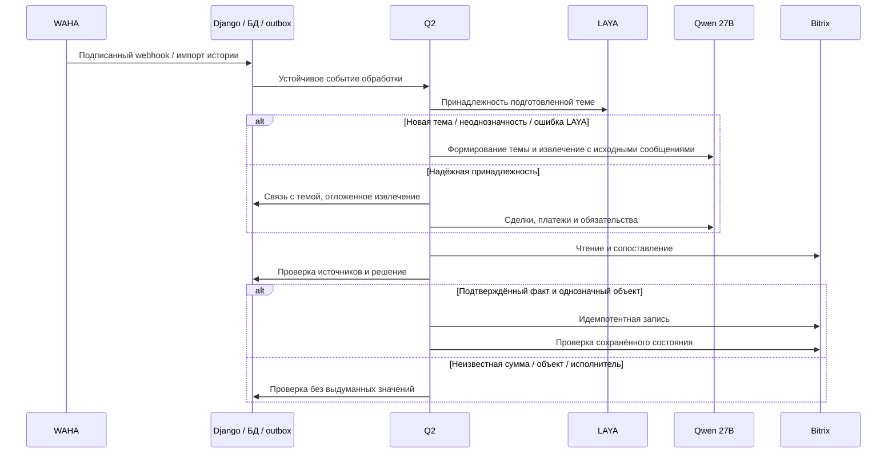

# Постоянная обработка WhatsApp и проверенная синхронизация Bitrix

Дата: 13.10.2026 21:59:19 MSK. Задача: whatsapp-continuous-crm.
Пользователь поручил включить чтение и запись, проверить прежние изменения и полноту истории. Это подтверждение реализации и рабочих операций; неизвестные суммы и неоднозначные связи требуют проверки.

## Требования

1. Проверить живую сессию, подпись webhooks, постоянный мониторинг и восстановление очереди.
2. Подключить существующую LAYA whatsapp-v1 с закреплёнными моделью, калибровкой и политикой; темы и факты формирует Qwen3.8-27B medium.
3. До массовых записей сверить полный журнал прежних изменений со ссылками на первоисточники и текущими объектами Bitrix. Сохранить посторонние CRM данные, неизвестные суммы, аудит и внешние ключи; не создавать дубли.
4. Проверить сохранённый TXT и всю доступную WAHA историю, устранить пропуски и ошибки обработки. Отдельно отразить недоступные сообщения/вложения и факты, требующие выбора человека.
5. Включить автономную обработку и доставку только после настройки и проверки источника. Все внешние операции выполняются Q2.
6. Проверить реальный E2E в изолированном Docker kk-minsk с локальным провайдером CRM; production только mazory-remote.

## Планируемые изменения

Проверка действующих моделей и доставки, рабочая конфигурация LAYA и автономной обработки; необходимые исправления подписки, повторов и полноты обработки по результатам аудита. Схема БД пока не меняется. Уточнения вносятся сюда.

## Критерии готовности

Живая сессия WORKING; поступающие сообщения сохраняются и обрабатываются; LAYA и Qwen доступны из очередей; известна полнота истории и судьба каждого сохранённого текстового сообщения; прежние и новые CRM изменения сверены с источниками и чтением Bitrix. Нет зависших текущих операций или непроверенных автоматических денежных значений. Неоднозначные факты явно перечислены. Docker check, makemigrations --check, необходимые сборки и E2E проходят. PR в main проверен и объединён.

## Начальный аудит

На 13.10.2026 18:59 UTC в БД 735 сообщений: 482 TXT и 253 WAHA. 27 сообщений имеют текущий processing_state=failed; исторических SourceWorkItem ошибок 52. 48 кандидатов approved, 35 pending, 17 rejected, 104 superseded. В журнале 40 изменений Bitrix. Монитор включён с интервалом 360 секунд, saved status WORKING; живое состояние проверяется отдельно. Автономная обработка/запись выключены, LAYA в production не настроена. Это исходный снимок, не подтверждение полноты или качества.

## Реализация и проверка

Живой WAHA WORKING, NOWEB store.enabled/fullSync=true. Два полных чтения дали одинаковые 252 сообщения; все ID сохранены (ещё один ранее сохранённый оригинал сейчас не возвращается WAHA). TXT содержит 586 записей: 482 текста сохранены, 78 медиа и 26 системных строк явно исключены; вложения по одному TXT восстановить нельзя.

Прочитаны все сделки ORIGINATOR_ID=MAZORY: 29, иных записей с этим внешним ключом нет; дубли ORIGIN_ID отсутствуют. Прочитаны все 29 объектов журнала из 40 записей, отправленные поля совпадают с текущим CRM. Денежные поля прежних проверенных записей сопоставлены с таблицей договоров и прямыми сообщениями, неизвестные суммы ранее не отправлялись.

Обнаружены ошибочные непринятые кандидаты прежней Gemma: 15% как 15 тенге, 117 млн поступления как reversal, неизвестная сумма Vertex как 78 млн и др. Автономное принятие теперь требует совпадения модели кандидата с текущей конфигурацией; денежный показатель требует денежной единицы/масштаба, проценты исключены. Переключение модели входит в отпечаток решения. Прежние человеческие подтверждения сохраняются.

Compose передаёт закреплённую конфигурацию LAYA всем нужным процессам. Reconcile учитывает route_message/extract_thread и их batch_ids, восстанавливает извлечение для routed сообщения, не создавая параллельный extract_message. Доставка сделки проверяет ID и все отправленные поля чтением Bitrix перед delivered; числовое OPPORTUNITY сравнивается как Decimal.

Добавлены два настоящих браузерных E2E с API, PostgreSQL, outbox, Q2 и локальными внешними HTTP-провайдерами. Изолированный kk-minsk mazory-continuous-e2e-v3: 2 passed, 13.3 секунды. Проверены silently discarded CRM update, последующая идемпотентная доставка, процент вместо денег, кандидат старой модели, потерянное отложенное извлечение и повторный webhook. Это проверка контуров приложения, не дополнительный замер качества LAYA/Qwen.

Полный portable E2E на kk-minsk v5: 28 passed, 9 skipped, 3.8 минуты, с настоящим перезапуском Q2 между этапами. Django check чист, makemigrations --check: No changes detected; nginx Docker build проходит vue-tsc/Vite. После пересоздания backend обязательно перезапущен nginx для обновления адреса upstream. Добавлена проверка смешанного отчёта: точное поступление 60 млн по одному объекту остаётся точным движением, несмотря на примерный счёт и ожидание 30 млн по другому. Денежные признаки и приблизительность проверяются по утверждениям с соответствующей суммой. Код не ослабляет запрет инструкций о фиктивных платежах.

Живой production Q2 успешно вызвал LAYA по HTTPS; вероятность для ранее проверенного синтетического примера 1.0, model/calibration revisions совпали. Глобальный HMAC secret WAHA совпадает с backend; за свежий интервал webhook HTTP ошибок нет. У большинства сотрудников Bitrix не возвращает телефоны, поэтому пользователь запрошен о конкретных соответствиях для задач. Единственная связь профиля №10 с сотрудником Bitrix №64 подтверждена точным телефоном.

Рабочий запуск восстановления №13 содержит 64 сообщения, режим history-packets-v1, по 4 полных оригинала в пакете. CRM запись на момент запуска выключена. Три сообщения защищены ранее доставленными человеческими подтверждениями; автоматическая замена результатов для них заблокирована. Итог будет внесён после сверки.

Пользователь подтвердил исполнителей Bitrix: Турар 146, Самат 132, Камиль 40, Улугбек 34, Жанат 20, Вячеслав 68. Существующие профили связаны после проверки user.get; для подтверждённых имён без телефонного профиля используется явная карта по team_id. Новые аккаунты и права не создаются. Задача считается доставленной после tasks.task.get с проверкой ID, названия, исполнителя при создании и связанной сделки.

Ежечасный флаг ранее не имел планировщика (Schedule пуст, справочник устарел с 8 октября). run_outbox теперь планирует синхронизацию раз в минуту с атомарным ограничением до одного прохода в час и повтором failed/idle справочника. E2E проверяет два подряд вызова и один новый generation.

Запуск №13 отменён с сохранением исходников и готовых результатов: структурный повтор потерял явное full_history_policy=null и унаследовал полный разбор из reserve_attempt. Для одного сообщения началось чтение всех 735 оригиналов. pipeline сохраняет выбранную политику, ai_retries явно копирует null; bootstrap новой темы LAYA использует ограниченный контекст полных оригиналов. Явный полный разбор истории сохраняется. Повтор после ошибки evidence/thread дополнительно требует явного включения каждого доказательства в messages соответствующей темы, без исправления ID или цитат кодом. Maintenance replay не отправляет уведомления WhatsApp о кандидатах.

Итог полного portable E2E kk-minsk v11: 28 passed, 9 skipped, 4.2 минуты; настоящий перезапуск Q2 на checkpoint. Добавлено воспроизведение ошибочного ответа и успешного повторного bounded пакета: все попытки сохраняют full_history_policy=null. Проверены ежечасный generation, явный исполнитель без bitrix_user_id профиля, прочтение задачи и сделки. Docker Django check и makemigrations --check чисты; сборки nginx/browser включают vue-tsc и Vite. На 20:29 UTC осталось 25 failed текстов, 642 analyzed, 35 no_facts, 4 needs_review и 29 no_text. Запущена отдельная перепроверка failed по одному оригиналу, без CRM записи; окончательная полнота проверяется после терминальных результатов.
