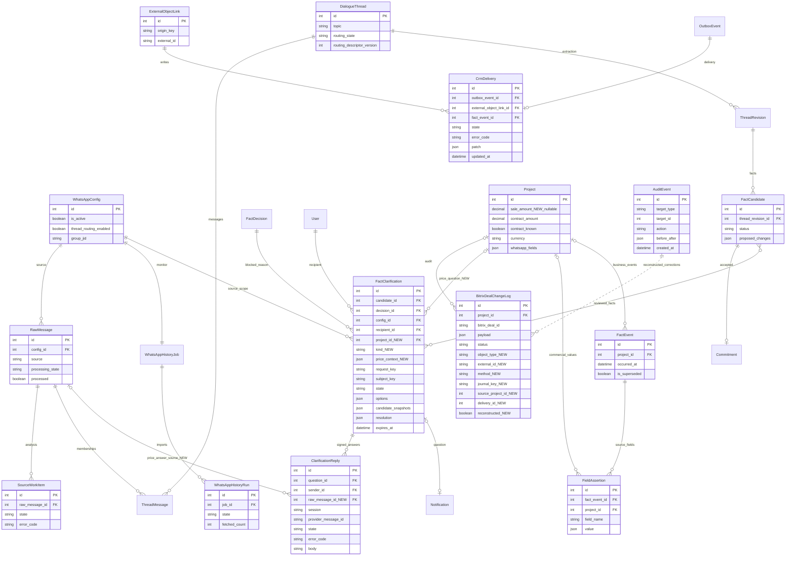
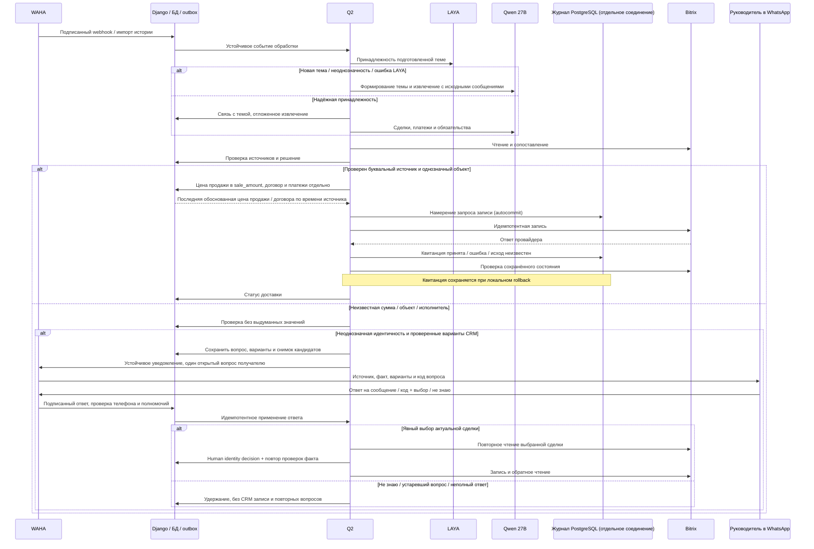

# Постоянная обработка WhatsApp и проверенная синхронизация Bitrix

Дата: 13.10.2026 21:59:19 MSK. Задача: whatsapp-continuous-crm.
Пользователь поручил включить чтение и запись, проверить прежние изменения и полноту истории. Это подтверждение реализации и рабочих операций; неизвестные суммы и неоднозначные связи требуют проверки.





## Требования

1. Проверить живую сессию, подпись webhooks, постоянный мониторинг и восстановление очереди.
2. Подключить существующую LAYA whatsapp-v1 с закреплёнными моделью, калибровкой и политикой; темы и факты формирует Qwen3.8-27B medium.
3. До массовых записей сверить полный журнал прежних изменений со ссылками на первоисточники и текущими объектами Bitrix. Сохранить посторонние CRM данные, неизвестные суммы, аудит и внешние ключи; не создавать дубли.
4. Проверить сохранённый TXT и всю доступную WAHA историю, устранить пропуски и ошибки обработки. Отдельно отразить недоступные сообщения/вложения и факты, требующие выбора человека.
5. Включить автономную обработку и доставку только после настройки и проверки источника. Все внешние операции выполняются Q2.
6. Проверить реальный E2E в изолированном Docker kk-minsk с локальным провайдером CRM; production только mazory-remote.
7. Подтверждение пользователя 14.10.2026: реализовать вопросы в WhatsApp и обработку ответов; текущую модель сохранить. Уведомление показывает автора/дату исходника, конкретный факт, причины неоднозначности, названия/ID вариантов Bitrix и короткую инструкцию ответа. Ответ «не знаю» / «оставь неподтверждённым» сохраняется как human hold, без угадывания или повторных вопросов по тому же предмету.
8. Входящие ответы допускаются только с подписью WAHA, из подтверждённого телефона получателя, в нужной сессии и допустимом личном/исходном групповом чате. Неизвестный @lid не считается телефоном. Внешние вызовы — исключительно Q2; ответ сохраняется в отдельном inbox и не становится новым платежом/поручением.
9. Варианты заморожены в вопросе; изменение кандидата, доказательств, модели или результатов поиска делает старый выбор недействительным. Повтор webhook/ответа/воркера не создаёт второе решение, платёж, задачу или запись. Выбор сделки разрешает только идентичность; сумма, срок, направление и наличие фактической оплаты проходят прежние проверки.
10. Один активный вопрос одному руководителю, тихие часы и предпочтения существующих уведомлений; очередь остальных вопросов сохраняется. Не повторять неизвестную отправку WAHA вслепую. Исторический review hold и явные предыдущие ответы пользователя сохраняются.

## Планируемые изменения

Проверка действующих моделей и доставки, рабочая конфигурация LAYA и автономной обработки; необходимые исправления подписки, повторов и полноты обработки по результатам аудита. Планируемое дополнение схемы 14.10: FactClarification (состояние, сохранённые CRM варианты, версии кандидатов, получатель, notification и human resolution), ClarificationReply (подписанный идемпотентный inbox ответов), M2M вопросов и кандидатов одного исходного сообщения. Текущие бизнес-модели и источники цитат сохраняются; выбор разрешает лишь привязку, затем выполняется существующая автономная валидация и доставка. Уточнения вносятся сюда.

## Критерии готовности

Живая сессия WORKING; поступающие сообщения сохраняются и обрабатываются; LAYA и Qwen доступны из очередей; известна полнота истории и судьба каждого сохранённого текстового сообщения; прежние и новые CRM изменения сверены с источниками и чтением Bitrix. Нет зависших текущих операций или непроверенных автоматических денежных значений. Неоднозначные факты явно перечислены. Docker check, makemigrations --check, необходимые сборки и E2E проходят. PR в main проверен и объединён.

Дополнение: настоящий E2E браузер/API/БД/outbox/Q2/WAHA/Bitrix на kk-minsk проверяет автоматический вопрос после чтения CRM, явный ответ и read-back доставку, «не знаю», постороннего отправителя, повторные ответы, устаревшие варианты, ответы после пересоздания Q2 и отсутствие бизнес-извлечения из служебных сообщений. Старые human holds Иргили и Divs/Parus не создают новых вопросов. Финальная сверка истории содержит исходные пять примеров, предварительные ожидания, фактические результаты, выполненные CRM операции и отдельный список неизвестных/недоступных данных.

Уточнение 14.10: источники 1145/1146 повторного прохода не завершаются. У 1145 finish_reason=length при 32768 выходных токенах (85395 символов ответа и 38881 reasoning); следующий повтор уменьшил вход до 7000 и упёрся в фиксированный prompt. Полные оригиналы многократно дублируются в constrained output. План: опциональный QWEN_COMPACT_EVIDENCE=1, атомарная native ссылка source:ID вместо повторного полного текста; после проверки wire schema восстанавливать полную буквальную цитату исключительно из полного оригинала замороженного outbound пакета. Непрочитанные/partial источники не разрешены. Модель, medium reasoning и смысл бизнес-проверок сохраняются. Включение в production — после настоящей сверки пяти исходных примеров и проверки проблемного большого отчёта на kk-minsk, Bitrix в этих модельных проверках только читается.

## Начальный аудит

На 13.10.2026 18:59 UTC в БД 735 сообщений: 482 TXT и 253 WAHA. 27 сообщений имеют текущий processing_state=failed; исторических SourceWorkItem ошибок 52. 48 кандидатов approved, 35 pending, 17 rejected, 104 superseded. В журнале 40 изменений Bitrix. Монитор включён с интервалом 360 секунд, saved status WORKING; живое состояние проверяется отдельно. Автономная обработка/запись выключены, LAYA в production не настроена. Это исходный снимок, не подтверждение полноты или качества.

## Реализация и проверка

Живой WAHA WORKING, NOWEB store.enabled/fullSync=true. Два полных чтения дали одинаковые 252 сообщения; все ID сохранены (ещё один ранее сохранённый оригинал сейчас не возвращается WAHA). TXT содержит 586 записей: 482 текста сохранены, 78 медиа и 26 системных строк явно исключены; вложения по одному TXT восстановить нельзя.

Прочитаны все сделки ORIGINATOR_ID=MAZORY: 29, иных записей с этим внешним ключом нет; дубли ORIGIN_ID отсутствуют. Прочитаны все 29 объектов журнала из 40 записей, отправленные поля совпадают с текущим CRM. Денежные поля прежних проверенных записей сопоставлены с таблицей договоров и прямыми сообщениями, неизвестные суммы ранее не отправлялись.

Обнаружены ошибочные непринятые кандидаты прежней Gemma: 15% как 15 тенге, 117 млн поступления как reversal, неизвестная сумма Vertex как 78 млн и др. Автономное принятие теперь требует совпадения модели кандидата с текущей конфигурацией; денежный показатель требует денежной единицы/масштаба, проценты исключены. Переключение модели входит в отпечаток решения. Прежние человеческие подтверждения сохраняются.

Compose передаёт закреплённую конфигурацию LAYA всем нужным процессам. Reconcile учитывает route_message/extract_thread и их batch_ids, восстанавливает извлечение для routed сообщения, не создавая параллельный extract_message. Доставка сделки проверяет ID и все отправленные поля чтением Bitrix перед delivered; числовое OPPORTUNITY сравнивается как Decimal.

Добавлены два настоящих браузерных E2E с API, PostgreSQL, outbox, Q2 и локальными внешними HTTP-провайдерами. Изолированный kk-minsk mazory-continuous-e2e-v3: 2 passed, 13.3 секунды. Проверены silently discarded CRM update, последующая идемпотентная доставка, процент вместо денег, кандидат старой модели, потерянное отложенное извлечение и повторный webhook. Это проверка контуров приложения, не дополнительный замер качества LAYA/Qwen.

Полный portable E2E на kk-minsk v5: 28 passed, 9 skipped, 3.8 минуты, с настоящим перезапуском Q2 между этапами. Django check чист, makemigrations --check: No changes detected; nginx Docker build проходит vue-tsc/Vite. После пересоздания backend обязательно перезапущен nginx для обновления адреса upstream. Добавлена проверка смешанного отчёта: точное поступление 60 млн по одному объекту остаётся точным движением, несмотря на примерный счёт и ожидание 30 млн по другому. Денежные признаки и приблизительность проверяются по утверждениям с соответствующей суммой. Код не ослабляет запрет инструкций о фиктивных платежах.

Живой production Q2 успешно вызвал LAYA по HTTPS; вероятность для ранее проверенного синтетического примера 1.0, model/calibration revisions совпали. Глобальный HMAC secret WAHA совпадает с backend; за свежий интервал webhook HTTP ошибок нет. У большинства сотрудников Bitrix не возвращает телефоны, поэтому пользователь запрошен о конкретных соответствиях для задач. Единственная связь профиля №10 с сотрудником Bitrix №64 подтверждена точным телефоном.

Рабочий запуск восстановления №13 содержит 64 сообщения, режим history-packets-v1, по 4 полных оригинала в пакете. CRM запись на момент запуска выключена. Три сообщения защищены ранее доставленными человеческими подтверждениями; автоматическая замена результатов для них заблокирована. Итог будет внесён после сверки.

Пользователь подтвердил исполнителей Bitrix: Турар 146, Самат 132, Камиль 40, Улугбек 34, Жанат 20, Вячеслав 68. Существующие профили связаны после проверки user.get; для подтверждённых имён без телефонного профиля используется явная карта по team_id. Новые аккаунты и права не создаются. Задача считается доставленной после tasks.task.get с проверкой ID, названия, исполнителя при создании и связанной сделки.

Ежечасный флаг ранее не имел планировщика (Schedule пуст, справочник устарел с 8 октября). run_outbox теперь планирует синхронизацию раз в минуту с атомарным ограничением до одного прохода в час и повтором failed/idle справочника. E2E проверяет два подряд вызова и один новый generation.

Запуск №13 отменён с сохранением исходников и готовых результатов: структурный повтор потерял явное full_history_policy=null и унаследовал полный разбор из reserve_attempt. Для одного сообщения началось чтение всех 735 оригиналов. pipeline сохраняет выбранную политику, ai_retries явно копирует null; bootstrap новой темы LAYA использует ограниченный контекст полных оригиналов. Явный полный разбор истории сохраняется. Повтор после ошибки evidence/thread дополнительно требует явного включения каждого доказательства в messages соответствующей темы, без исправления ID или цитат кодом. Maintenance replay не отправляет уведомления WhatsApp о кандидатах.

Итог полного portable E2E kk-minsk v11: 28 passed, 9 skipped, 4.2 минуты; настоящий перезапуск Q2 на checkpoint. Добавлено воспроизведение ошибочного ответа и успешного повторного bounded пакета: все попытки сохраняют full_history_policy=null. Проверены ежечасный generation, явный исполнитель без bitrix_user_id профиля, прочтение задачи и сделки. Docker Django check и makemigrations --check чисты; сборки nginx/browser включают vue-tsc и Vite. На 20:29 UTC осталось 25 failed текстов, 642 analyzed, 35 no_facts, 4 needs_review и 29 no_text. Запущена отдельная перепроверка failed по одному оригиналу, без CRM записи; окончательная полнота проверяется после терминальных результатов.

PR №80 объединён (d0808ad), CI 522f885 успешен. В production image continuous-crm-20261013 включены autonomous_enabled/autonomous_crm_enabled, LAYA для источника №1, fallback опрос WAHA каждые 30 секунд. Справочник Bitrix generation=7 успешно прочитан: 641 сделка, last_success 20:40:49 UTC. last_hourly_sync_at обновлён постоянным диспетчером. Public ready=200, check/migrations чисты. Историческое обещание №205 удержано человеческим deferred: текущее исполнение таблицы не доказано; оно не создаёт просроченную задачу автоматически.

Эксперимент native v11 с буквальными разделами вместо полных цитат отклонён: первый пример завершён, во втором получено пустое company_name для Top Build и лишний project. Он выполнялся в отдельном kk-minsk Compose с read-only relay и не развёрнут в production. Qwen сохраняет исходный проверенный профиль full-source-v10. Дополнительно автоматическая проверка отвергает подмену объекта названием компании, если источник называет её компанией и не называет одноимённым объектом/проектом. E2E моделирует такой ложный project и проверяет отсутствие сделки в CRM.

Упоминание компании с unknown ролью сохраняется локально и не создаёт company в Bitrix. Историческому запуску можно задать review_before_delivery в analysis_limits: автоматическое решение deferred до сверки и снятия удержания; обычный поток новых сообщений продолжает работать. Этот флаг влияет на отпечаток только при true, поэтому прежние человеческие удержания сохраняются. Реальный E2E v14: 2 passed, 26.1 секунды; проверены валидный платёж с неустановленной ролью компании и удержание/освобождение другого валидного платежа.

Структурная ошибка ответа не уменьшает бюджет входа: у native запроса fixed prompt около 9 тыс. токенов, прежнее деление лимита 10–16 тыс. пополам делало повтор невозможным. Сокращение сохранено только для переполнения входа/выхода. В E2E провайдер измеряет минимум 9000 токенов для этого запроса, затем выдаёт одну ошибку схемы; успешный повтор должен сохранить достаточный бюджет и bounded политику.

Пользователь подтвердил политику стадий: сопоставимые стадии менять, остальные фиксировать в таймлайне. По живому справочнику Bitrix: lead → NEW, proposal_sent → UC_VF1EID, contract_signing → UC_WB6P16, completed → WON, lost → LOSE. qualification, design, in_execution и stalled явно сопоставлены null: внешняя стадия сохраняется, подробный статус Mazory записывается в комментарий с источником. Отсутствующий ключ остаётся ошибкой конфигурации; null означает согласованную доставку через таймлайн. E2E проходит настоящий webhook «монтаж начался», автоматическое принятие, CRM доставку и комментарий без подмены внешней стадии.

Финальный локальный E2E v16 на kk-minsk: 2 passed, 25.9 секунды, включая согласованную политику стадий, company-only guard, удержание/освобождение истории, bounded retry и CRM read-back. Docker check без ошибок, makemigrations --check: No changes detected; nginx/browser собраны с проверкой TypeScript/Vite.

CI полной серии обнаружил зависимость fixtures: предыдущий тест полного контекста оставлял context_window_tokens=12000, из которого после резерва ответа нельзя вместить 9000 токенов fixed prompt. Continuous fixture теперь явно восстанавливает исходное окно portable провайдера 131072 и input limit 16384 перед сценарием. Это изоляция E2E, production параметры модели не меняются.

PR №81 объединён (643e0fe), CI точного head 192f7cd успешен. Финальная полная серия в новой БД kk-minsk: 28 passed / 9 skipped, 4.3 минуты; дополнительная проверка после пересоздания backend/nginx: 1 passed. Production backend и все пять рабочих процессов обновлены одним image 05cbdba2; ready, check и makemigrations --check чисты. Согласованная карта стадий действует. Создан запуск №15: 25 failed сообщений, по одному оригиналу, review_before_delivery=true.

При проверке №15 найден рабочий backlog: 83 активных периодических сверки и 843 уже терминальных Redis пакета тормозили новую обработку; прежняя маршрутизация того же сообщения создала ещё три дубля. Они отменены/удалены с аудитом, сохранены исходные сообщения, действующие задания и CRM данные. Планировщик должен держать не более одной pending/enqueued/processing периодической сверки; короткая блокировка AISettings сериализует одновременные вызовы. E2E проверяет два вызова при удержанной первой сверке и её выполнение настоящим Q2 после освобождения.

E2E этой защиты на отдельном kk-minsk v18: 2 passed, 31.1 секунды. Docker check и makemigrations --check чисты; nginx/browser собраны с TypeScript/Vite. После удаления повторов рабочий запуск №15 начал реальный вызов Qwen по исходному отчёту №903, скорость генерации около 41 токена/с; в Bitrix из запуска ещё ничего не отправлено.

Установлена причина долгой самой сверки: default ordering RawMessage по timestamp попадал в SELECT DISTINCT config_id, timestamp. В production запрос вернул 620 строк для единственного источника, поэтому полный checkpoint пересчитывался 620 раз. Перед distinct очищается ordering; семантика отчёта и источники сохраняются. E2E дополнен 735 сохранёнными сообщениями в одном отдельном источнике, проверяет завершение реального Q2 отчёта за отведённые 30 секунд и опубликованную через API полноту этого источника.

Расширенный E2E v19 на новой БД kk-minsk: 2 passed, 27.2 секунды, включая источник из 735 оригиналов, два вызова планировщика и полноту через настоящий API. Django check/makemigrations --check чисты, nginx/browser собраны. На время выкладки исправления введено ограниченное 15-минутное подавление только новых периодических сверок с аудитом; live обработка, чтение/доставка CRM и все источники остаются включены.

PR №82 объединён (8d5cf93), CI head 7b33cc0 успешен; production обновлён image 9587dcbc, check/migrations/ready чисты. Запуск №15 расширен до 55 сообщений (25 ошибок + 30 непринятых/исторических источников), одинаковые bounded ограничения и удержание. После исправления очередь AI пустая, монитор №12 watching, запрос источников возвращает одну строку.

Сверка первого отчёта обнаружила некорректную общую привязку: CRM match для Sensata записал project_id=585 в тред №1130, хотя тот содержит Курмет, перинатальный центр и Казына Парк. Это блокировало правильные остальные факты; запись в CRM удержана. Автоматический match должен использовать существующую проверку _link_thread_project: один проект допустим только для совместимых фактов, смешанный отчёт остаётся без общей project привязки. E2E содержит один оригинал с известным БЦ Север и новым БЦ Запад, чтение CRM, удержание/освобождение и реальную доставку обоих при thread.project=null.

E2E выявил второй путь той же привязки в pipeline: первый факт с локальным совпадением назначал проект треду до сохранения остальных фактов. Эта запись заменена проверкой _link_thread_project после сохранения всех кандидатов и замены старых. Финальный изолированный v23: 2 passed, 24.1 секунды; check без ошибок, makemigrations --check: No changes detected, nginx/browser собраны. E2E fixture удержания защищён от гонки webhook/dispatch, control ожидает опубликованный proof с тем же nonce; используются поля реального API crm_resolution.state.

Пользователь подтвердил: «ЖК Казына Парк» 2 МВт — отдельная временная котельная. Кандидат 211 принят с явным human decision и аудитом, создан отдельный проект 643 / Bitrix 1654 с ORIGIN_ID mazory:1:project:643 и комментарий 26718. crm.deal.get подтвердил название, NEW и OPPORTUNITY=0; сумма договора неизвестна, платежи не созданы. До этого Курмет (350) и перинатальный центр (1276) получили комментарии 26710/26712 с сохранением прежних сумм и стадий. Три ошибочные общие привязки тредов 1131/878/1138 сняты с аудитом; индивидуальные проекты кандидатов и CRM не менялись.

Проверка выявила отдельный рабочий сбой Qdrant: HTTP запросы истекали, журнал сервера показывал «Too many open files». После перезапуска процесс уже держал 1006 fd, из них 972 — файлы сохранённой коллекции, при soft limit 1024. Лимит nofile в Compose повышен до 65536. Production пересоздан с прежним external volume mazory_qdrant_data и прежним ключом; коллекция доступна. Это нехватка лимита для существующей коллекции, утечка клиентских соединений не установлена. На отдельном Docker Qdrant kk-minsk с тем же лимитом настоящий API индексировал 1000 синтетических векторов и вернул 5 результатов поиска. Событие индексации 17120 / raw 1140 повторно поставлено в очередь с аудитом.

По поручению пользователя кандидат 220 «Иргили» оставлен pending, human decision user_requested_unconfirmed запрещает сопоставление с 1106/542 и создание отдельной CRM сделки. Проверенные обозначения Atletico Madrid (1118), Icon (1366), Акиота (1640), ЦТП квартал 343 (718) закреплены алиасами на основе первоисточников и живого GET. Короткое «Top build оплатили» (918) не создаёт денежную проводку; подробный отчёт 948 подтверждает 117 млн 09.09.2026, идентичность ЦТП квартал 343 дополнена буквальной цитатой 895. Кандидат 245 принят, одна FinancialRecord=117000000 KZT, существующая сумма CRM 718=42000000 сохранена. На 00:10 UTC обратное чтение подтвердило 40 delivered, 38 MAZORY сделок без ошибок (29 прежних + 9 новых), неизвестные договорные суммы новых объектов остаются 0/неподтвержденными.

В ограниченных history-packets-v1 при full_history_policy=null отсутствовал evidence_ranges и не вызывалась существующая validate_evidence. Поэтому focused extraction мог вернуть буквальные доказательства из прочитанного контекста без дублирующих links треда, после чего пакет повторялся с fact_thread_evidence_conflict. Теперь границы фиксируются по действительно отправленным target/context сообщениям (partial контекст исключён); существующая проверка цитат и связей вызывается после focused extraction для любого пакета. Модель, промпт, бюджет и классификация целей не меняются. Недоступный ID/цитата блокируются прежними проверками.

Финальный отдельный E2E v26 на kk-minsk: 2 passed, 30.7 секунды. Через настоящий webhook/Q2/outbox/API проверены ограниченный пакет с явной context цитатой и отсутствующей дублирующей связью, review hold/release и доставка, а также недоступное доказательство без кандидата и CRM записи. Этот сценарий имеет отдельный источник, чтобы его намеренно невалидный ответ не влиял на независимые сценарии full-history. check/makemigrations --check чисты; nginx/browser собраны. В production все 19 отсутствовавших текстовых векторов восстановлены настоящей очередью, без ошибок и с аудитом.

PR №83 объединён (3bbd739), CI exact head f24d2f3 успешен. Для исправления bounded evidence используется отдельная ветка bugfix/whatsapp-bounded-evidence, основной spec остаётся этим файлом.

## Вопросы WhatsApp и продолжение аудита 14.10

Контракт Noweb quotedStanzaID содержит короткий ID, тогда как сохранённый ID отправки имеет форму true_chat_stanza. Корреляция поддерживает точный serialized ID и единственный stanza suffix в той же сессии; телефон, полномочия, чат и согласованность MZ кода проверяются прежними условиями. E2E использует настоящий формат serialized ID и отвечает через короткий quotedStanzaID.

Реальная сверка v92: модель правильно определила исполнение военного КП (основной и focused ответы fulfilled, promise27/fulfillment28), но дополнительная reconciliation дала противоречивую ссылку на исходное обещание27 и затёрла уже подтверждённое исполнение. Backend должен сохранять прежнее выполненное состояние при неизменном исходном обещании, только если его буквальный поздний источник подтверждает действие; другой пункт сообщения/будущее обещание не доказывают выполнения. Большой отчёт v92 дал лишь3 project и6 commitments при нескольких перечисленных коммерческих объектах, поэтому восстановление project фактов должно учитывать многопунктный рабочий отчёт, даже когда в основном ответе уже есть отдельные project. Модель и reasoning medium сохраняются. Проверки должны воспроизводить настоящие сохранённые ответы и проходить через очередь/API, а большой отчёт — реальную модель с Bitrix read-only.

Проверка живой доставки выявила два уточнения контракта. Вопрос1/кандидат246 дошёл получателю, что подтверждено чтением истории личного чата WAHA (один исходящий текст с MZ-1), но sendText не вернул распознаваемый ID и delivery стал unknown; требуется безопасное восстановление ID по единственному точному исходящему тексту без повторной отправки. Поиск Интегры предложил чужой объект «КШ село Достык»346, потому что при наличии компании не выполнялся отдельный поиск названия объекта. Поиск должен убирать компанию из префикса названия, проверять ограниченные токены объекта независимо от company lookup и учитывать название с вставленными служебными словами; совпадение только компании не включается в WhatsApp варианты. Старая версия вопроса не применяется. E2E должен содержать неверный company-only вариант и правильную поликлинику со служебными словами в названии; также Noweb ответ отправки без ID с последующим точным чтением истории.

Дополнительная сверка обнаружила ошибку процедуры release: системные deferred решения кандидатов 287/299/300 не являлись устойчивыми удержаниями и после снятия общего trace review могли быть пересчитаны. Кандидат 287 ошибочно классифицировал накладную как счёт, 299 создал неподтверждённый пектиновый завод, 300 содержал выдуманный дедлайн. Очередь остановлена; требуется отменить эти эффекты с аудитом и обратным чтением, сохранять source_review_hold как отдельное авторитетное решение review_hold=true. Автоматический пересчёт, версия каталога и вопрос не снимают его; освобождение требует явного более нового review_hold=false. E2E дополнен настоящим повтором решения через Q2 после смены CRM revision.

Исправление текущих записей выполнено настоящей Q2 CRM задачей 9a7c6fd3: удалены только автоматически созданная сделка 1674 с ORIGIN_ID mazory:1:project:667, нулевой суммой и DATE_MODIFY=DATE_CREATE, и комментарий 26828 с маркером MAZORY-EVENT:83 (накладная ошибочно названа invoice). Оригиналы и резервная копия сохранены; отсутствие обеих записей подтверждено обратным чтением. Delivery 71/72/74 помечены superseded с причиной source_review_correction. Delivery73 отменена, обязательство33 стало cancelled/unverified без дедлайна; внешней задачи и FinancialRecord по287 нет. Остальные исторические hold решения закреплены с review_hold=true. Отдельная проверка invoice требует доказанного счёта: накладная без слова счёт/инвойс в денежной фразе удерживается delivery_note_not_invoice; E2E проверяет намеренно ошибочный ответ внешнего LLM провайдера и отсутствие финансовых/CRM эффектов.

PR №85 объединён после успешного CI exact head fb52de4, merge 9a16551. Финальный полный изолированный E2E v9 на kk-minsk: 29 passed, 10 skipped, затем 1 passed после пересоздания; Django check и makemigrations --check чисты. Проверены настоящий Q2 restart, подписанные ответы, чужой телефон, непрозрачный LID, подмена fromMe, повторные ответы и устаревшие вопросы.

Реальная Qwen medium на большом оригинале 1145 с компактными ссылками завершила извлечение за 7,1 минуты: 12 кандидатов, полные восстановленные буквальные доказательства, без contract_amount. Основной ответ 15031 символ и 11300 токенов вместо прежнего оборванного ответа 85395 символов / 32768 токенов. Старый E2E порог «меньше двух исходников» не учитывал объём структурированных полей и дал единственную ошибку после успешных смысловых проверок. Критерий исправлен: ответ должен быть меньше половины минимального размера повторения полного источника для каждого кандидата. Реальная проверка пяти примеров повторяется после уточнения сохранения company_name; первая попытка имела 4/5, платёж Top Build был верным по сумме/дате, но компания пропущена и запись удержана. Компактный режим остаётся выключенным в production до окончания проверки.

PR №84 объединён (e540689), исправление bounded evidence развёрнуто во всех шести backend-ролях. Повторный проход №15 содержит 55 текстовых источников; перед добавлением вопросов завершены 27, два больших отчёта требуют ремонта выхода/входа, 26 ожидают. Это не подтверждение финальной полноты.

Добавлены FactClarification/ClarificationReply и миграция 0054. Вопрос создаётся после проверки буквальных доказательств и результата поиска Bitrix, содержит исходный фрагмент, дату/автора, факт, различимые варианты с ID и инструкцию ответа. Несколько фактов одного оригинала с тем же предметом используют один вопрос. Один открытый вопрос получателю; отправка учитывает существующие предпочтения и тихие часы. Состояние отражено в кабинете и read-only admin.

Подписанный webhook сохраняет служебный ответ отдельно, по цитируемому provider message ID или коду MZ. Получатель/телефон/сессия/чат/полномочия и снимки кандидатов проверяются повторно воркером. Для fromMe аккаунт сессии получен из настоящего WAHA API, посторонний PN и opaque @lid не проходят. «Не знаю» / «оставь без подтверждения» сохраняет человеческое удержание даже после изменений версии/модели. Выбор привязывает существующую сделку, но не снимает проверок фактического движения, суммы, валюты, срока и повторности. resolved выставляется после завершения проверенных CRM deliveries.

Изолированный kk-minsk v5: полный сценарий вопрос → ответ → настоящий перезапуск Q2 → применение → read-back, неизвестный ответ, повтор/посторонний отправитель и изменённый кандидат: 1 passed, 15.3 секунды. Полный v7: 29 passed, 10 skipped, 5.1 минуты; после пересоздания backend/nginx аватар 1 passed. Повтор v8 после проверки аккаунта сессии также проходит полный набор. Django check и makemigrations --check чисты, nginx/browser проходят TypeScript/Vite. Финальный v9 дополнительно проверяет конфликт fromMe/PN и opaque @lid.

Full-suite выявил недостаток внешней тестовой фикстуры: её сброс возвращал нумерацию timeline comments к 1000, хотя БД приложения сохраняла прежние внешние ссылки. Теперь счётчик внешних ID устойчив к сбросу, как ID настоящего Bitrix. Добавленные сделки фикстуры имеют полный контракт дат/ответственного для CRM catalog. API приложения не подменяется.

Сверены источники 216/1141/1142/1143/1148 и живые сделки 1636/1664/1672/718/1396. Накладная 144 млн не принята как новый счёт или денежное поступление; правильное закрытие документа отражается информацией по ЦТП 343. Встреча «в понедельник» не получает выдуманное 13.10. Составное Integra South NS/Prime и связь котельной Oasis со сделкой складов НС+ПТО остаются неразрешёнными. Явный человеческий defer Divs/Parus (261/262/267) и Иргили сохраняется.

При повторной проверке рабочего объекта обнаружен ещё один путь ошибочного сопоставления: ранее привязанный локальный проект с Bitrix ID прекращал поиск независимо от названия объекта в источнике. Локальное сопоставление допустимо только при совпадении объекта с названием или подтверждённым алиасом; иначе выполняется настоящий поиск CRM. E2E повторно проверяет Шуглу после привязки к другой котельной и подтверждает новый результат поиска без финансовой записи.

На рабочей истории обнаружен `commitment_context_message_too_large` после успешного извлечения большого отчёта. Причина: сверка повторных обязательств копировала один длинный оригинал в каждую пару сравнений и в каждое основание. Оригиналы остаются полностью прочитанными в context; повторные ссылки на ровно тот же текст передаются как `source:ID`. В парах дополнительно передаются конкретные действия и предметы, чтобы разные обещания одного большого отчёта не объединялись. Native E2E повторяет большой отчёт, проверяет реальную сверку повторов моделью, отсутствие ошибки окна и сохранение полных цитат в итоговых данных.

Срок «до четверга» в отчёте Самата от 13.10 однозначно относится к 15.10. Для форм «до/к <день недели>» календарная проверка подтверждает ближайший названный день по исходной дате отправки; неопределённые упоминания дней без такой формы не разрешают придумывать дату. E2E проходит через подписанный WhatsApp webhook, настоящий разбор и сохранённый кандидат и проверяет дату и точность срока.

Native-проверка выявила позиционное расхождение: модель вернула оба подлинных доказательства, но более раннее сообщение поставила перед объявленным `promise_message_id`. Канонизация переставляет только уже возвращённое, точно связанное с прочитанным оригиналом доказательство обещания на первую позицию; текст, ID, роли, даты и остальные поля сохраняются и затем проходят полную JSON Schema проверку. Для отдельного разбора доступны также первые обещания прежних кандидатов текущей модели, если их оригиналы реально включены в этот запрос; это охватывает обещания с формой «планирую», а не только «подготовлю».

При рабочей сверке обнаружена задержка детерминированных `decide_fact` за двумя длинными LLM запросами в AI-очереди. Проверка цитат, применение ответа и постановка CRM доставки не вызывают модель; они направляются в существующий CRM-воркер через обычный outbox claim/dedup. Текст WhatsApp вопроса включает сохранённое объяснение решения, чтобы конкретная причина неоднозначности была видна рядом с исходным фрагментом и вариантами. Критерий: полный изолированный E2E вопросов/ответов и повторов проходит на kk-minsk, сообщение содержит причину; модели/схема БД не меняются.

Ответ на исторический вопрос может прийти после свежего отчёта. Для project с более поздним подтверждённым current_action/next_action исторический факт сохраняется как наблюдение и комментарий, без отката текущей проекции. Суммы и стадии по-прежнему проходят существующую проверку временного порядка. E2E подаёт более старый подписанный webhook после принятого нового статуса и проверяет сохранение текущего состояния и исторический комментарий Bitrix.

Реальный повтор отчёта1145 показал пять КП/сравнительных цен, которые модель назвала invoice, хотя исходные строки не сообщают о счёте. Валидация invoice требует прямого упоминания счёта/инвойса в денежном утверждении; предложение цены отклоняется до CRM эффекта. Счёт с неизвестной суммой, явно выставленный в коротком ответе (Vertex/Шу), остаётся информационным фактом. E2E проверяет ошибочную классификацию КП внешним провайдером, rejected кандидат и отсутствие таймлайна/денежной записи.

Ответ «не знаю» удерживает не только первоначального кандидата: новый факт того же источника с тем же обозначением (включая явно подтверждённые языковые варианты) не получает автоматическую привязку при последующем изменении каталога. Используются исходный config и незавершённое unconfirmed уточнение, без внешних вызовов и без повторной отправки вопроса. Независимые объекты остаются отдельными. E2E после «не знаю» создаёт точное локальное/внешнее совпадение и подаёт новое настоящее сообщение; кандидат остаётся pending с user_requested_unconfirmed и без CRM эффектов.

QA: concurrent temporal benchmark уже прошёл, но его тестовый результат истёк через10мин до браузерного чтения (access fingerprint совпадал). Срок только синтетических benchmark операций приведён к7дням, как у основной операции; production TTL и проверка доступа сохраняются. Новый сценарий КП выполняется после существующих сценариев, чтобы его тема не меняла детерминированный контекст старого провайдера.

Реальный trace3804 сформировал тему429символов при ограничении255; содержательные факты уже были извлечены, но публикация сорвалась на подписи темы. Для UI ограничивается только подпись по границе слова; исходная тема целиком сохраняется в trace, summary, оригиналы и факты не меняются. E2E с длинной темой проверяет завершение сообщения и сохранение полной исходной темы вместе с короткой подписью.

Финальная проверка дополнений: изолированный v27 на kk-minsk —29passed/11skipped (native отдельный профиль), после пересоздания backend/nginx —1passed. Пройден реальный webhook/API/БД/outbox/Q2/локальный внешний HTTP провайдер, включая тему длиннее255, ошибочный invoice из КП, более старое состояние после нового и новый факт после «не знаю» при точном совпадении изменённого каталога. Django check и makemigrations --check чисты, nginx TypeScript/Vite собран. Все сервисные исправления CRM отдельно проходят обратное чтение.

Повтор trace3804 показал тот же длинный заголовок в отдельном focused-разборе, до основного prepare_themes. Общий ограничитель подписи применяется также к topic_updates focused-разбора; полный исходный заголовок сохраняется в trace. Изолированный E2E проверяет обе ветви через настоящий webhook, очередь и внешний HTTP провайдер.

Сверка1171/1174 выявила потерю pending-фактов при переклассификации исторического сообщения: опустевший маршрут темы помечал все прежние факты superseded, хотя новое сообщение не заменяло их извлечение. Опустевшая тема остаётся superseded для маршрутизации, но её факты с неизменными revision/evidence сохраняются для рассмотрения. Замена фактов настоящей повторной обработкой цели сохраняется.

Оригинал1161 прямо подтверждает произведённую100% оплату14,5млн09.10, однако валидатор не распознавал формулировку «произведена100% оплата». Добавлено только явное завершённое действие при той же денежной проверке; «не произведена» и «будет произведена» не допускают поступления. E2E проверяет все три утверждения через webhook/API/БД/Q2 и таймлайн провайдера.

Финальный v31:29passed/11skipped, сохранение после пересоздания backend/nginx1passed. Отдельные native проверки текущей Qwen medium5/5 и большого отчёта/сверки повторов выполнены ранее с Bitrix только read-only. Новая проверка сохраняет2 pending факта после переклассификации темы и подтверждает14,5млн при произведённой оплате, отклоняя отрицание и будущее действие.

## Обратное чтение задач после разрешения task 14.10

Пользователь разрешил добавить task к существующему webhook4, сохранив ключ. Право сохранено и проверено действующим API; задачи992/994 созданы для подтверждённых исполнителей146/132. Живое обратное чтение выявило автоматический дедлайн Bitrix19.10 19:00 при отсутствии точного времени в источнике. Этот срок удалён, исходные дни14/15.10 остаются в описаниях. Доставка должна явно очищать такой default при добавлении/обновлении, проверяя отсутствие точного дедлайна повторным GET. Поиск TITLE с добавленным символом% на текущем портале не возвращает существующую задачу; поиск буквального маркера без% возвращает её. E2E воспроизводит оба контракта внешнего HTTP-провайдера и повторную доставку после утраты локальной привязки: одна задача, прежний ID/исполнитель/сделка, исходный день в описании, без выдуманного времени. Неустановленный исполнитель обязательства34 остаётся удержанным. Модель и схема БД не меняются.

## Полный журнал изменений Bitrix, 14.10

Пользователь подтвердил исправление, восстановление уже отправленных изменений, E2E на kk-minsk и production выпуск. Диагноз: автономный обработчик не заполняет BitrixDealChangeLog. Журнал по существующему URL должен включать сделки, таймлайн, компании и задачи, с внешним ID, методом, фактическими параметрами и ответом, исходным временем и окружением. Чтения и пропущенные записи не считаются изменениями. Принятый Bitrix запрос сохраняется даже при последующем откате локальной транзакции из-за readback mismatch: отдельное autocommit-соединение к той же PostgreSQL БД записывает только журнал, без FK на заблокированные проекты/доставки. Исходный project ID хранится отдельно; права просмотра остаются ограничены доступными проектами.

Историческое восстановление через Q2 выполняет только GET/LIST, проверяет внешние объекты/маркеры и сохраняет отдельные явно помеченные восстановленные подтверждения доставок. Оно не придумывает точный метод старой операции, не повторяет CRM-записи и идемпотентно по ID доставки; старые журнальные записи сохраняются. Удалённые/недоступные объекты явно отражаются как непроверяемые исторические доставки, без ложного успеха. Критерии: браузер видит текущие и восстановленные строки, внешние ссылки правильного типа, повтор восстановления не дублирует строки, readback mismatch не скрывает принятый запрос, GET/no-op не добавляют записи; весь сценарий проходит через настоящий API/БД/outbox/Q2/изолированный внешний HTTP сервис. Миграция, Django check, makemigrations --check, сборка nginx, CI и production проверка обязательны.

Первоначальное правило этой части задачи оставляло плановую стоимость только в таймлайне до появления суммы договора. Пользователь отменил это ограничение 14.10: действует правило отдельной суммы продажи из следующего раздела, без ожидания договора. Диагностика должна различать сервер модели kk-minsk и рабочую БД/CRM-воркер production. Конкретные CRM идентификаторы, цитаты и суммы сохраняются в приватном доказательстве проверки.

Review журнала: восстановление включает частичные доставки со crm_stage_mapping_missing и подтверждённые исправления из AuditEvent (удаления сделок/комментариев, корректировки сроков задач). Историческая команда могла завершиться no-op: её снимок и локальное время явно отличаются от точной квитанции нового запроса. Временная ошибка чтения повторно проверяется по прежнему ключу, без дублей. Контекст legacy sync_project сохраняет принадлежность проекту и approved revision для ограниченного доступа сотрудников. E2E дополнен реальным созданием/удалением объектов изолированного провайдера, восстановлением аудита и частичной доставки, повторной проверкой unavailable и подсчётом всех mutation-запросов до/после восстановления.

Уточнение пользователя 14.10: коммит и push прямо в main вместо PR (предыдущее упоминание test отозвано). Авторизация production выпуска сохраняется.

Проверка журнала: общий прогон v35 на kk-minsk дал 27 passed; новое ожидание «нет недоступных исторических объектов» исправлено, поскольку предыдущие сценарии намеренно сбрасывают внешнего провайдера. Финальные два сквозных сценария v36 прошли (2 passed), включая browser admin, сохранение квитанции при rollback, восстановление удалений, partial, retry unavailable, отсутствие дублей и внешних mutations. Проверка аватара после пересоздания контейнеров: 1 passed. Django check и makemigrations --check чисты, nginx/TypeScript/Vite собраны. Независимый review: блокирующих замечаний нет.


## Сумма продажи в Bitrix без ожидания подписания, 14.10

Пользователь явно изменил требование: указанная в сообщении сумма продажи должна записываться в сумму сделки Bitrix без подтверждения договора и без ручного одобрения суммы. Это постоянное поведение для новых фактов и изменений цены; отдельно требуется перепроверить каждую созданную Mazory сделку с нулевой суммой.

Добавляется nullable Project.sale_amount: коммерческая цена продажи/нашего предложения отделена от суммы договора, себестоимости, прибыли и денежных поступлений. Неизвестная цена не равна нулю. Контракт извлечения, сохранение факта, FieldAssertion/происхождение, сериализация и replay поддерживают поле. Bitrix OPPORTUNITY получает наиболее актуальную известную коммерческую сумму по времени источника; более старое сообщение не откатывает новую цену. Обязательны буквальная привязка цены к своему объекту и исключение цен конкурентов, прибыли, платежей и процентов; подтверждение подписанного договора для sale_amount не требуется. Не меняются contract_known, платежи и договорная дебиторка при одной лишь цене продажи.

Критерии: E2E на kk-minsk через реальный webhook/API/БД/outbox/Q2/HTTP-провайдер проверяет цену продажи до подписания, цену КП, изменение цены, запрет отката старым сообщением, разделение цены/прибыли/платежа/конкурента и объектов составного отчёта. Дополнительно проверяются сохранение известной цены при отсутствии новой, выбор последней цены между sale_amount и contract_amount по исходной дате, сохранение точной суммы при округлённом пересказе и применение явного изменения цены даже в округлённой записи. Узкое правило пересказа действует только для числа в миллионах, когда оно равно округлению прежней точной цены до указанной точности, отличие меньше 0,1% и отсутствует сообщение об изменении цены; основание сохраняется в решении. Обратный импорт OPPORTUNITY не должен превращать коммерческую цену в подтверждённую сумму договора. Миграция, Django checks и frontend build обязательны. Живой read-only инвентарь включает все MAZORY-origin сделки с нулевым OPPORTUNITY; по каждому объекту фиксируется исходная цитата и результат. Найденные цены применяются через проверяемый процесс, журнал и обратное чтение; отсутствие цены или противоречие источников отражается явно, без выдуманных значений. Конкретные деловые данные остаются в приватных материалах сверки.

Предварительный read-only аудит охватил 30 созданных Mazory сделок с нулевой суммой: для 9 найдены цены в источниках, для 21 цена отсутствует или связь неоднозначна. Это результаты чтения и подготовки исправлений, а не подтверждение применения, успешного E2E или production выпуска. Названия объектов, CRM ID, суммы и исходные цитаты остаются в приватных материалах сверки.


Проверка выпуска суммы: финальный сквозной сценарий v42 на kk-minsk прошёл (1 passed), включая собственные КП в трёх формулировках, отсутствие договора, изменение и округление цены, разделение прибыли/платежа/конкурента, хронологию, общий отчёт по двум объектам и браузерное чтение реального журнала после Q2/readback. Существующие continuous/reconciliation сценарии v39 прошли (2 passed). Исправлена обработка системного промпта focused extraction для Anthropic: исходный JSON остаётся отдельным пользовательским сообщением. Django check и makemigrations --check чисты; TypeScript/Vite/nginx собраны в Docker.

Журнал выпущен в production на 173bd03: восстановлено 176 исторических подтверждений, недоступных 0, прежние 40 записей сохранены. Повторный запуск: 0 новых, 176 пропущенных, без повторных внешних записей; admin и публичная readiness вернули 200. Исправления цен на момент этого коммита ещё не применены.

## Полный цикл уточнения цены в WhatsApp, 15.10

Пользователь подтвердил реализацию для оставшихся 21 сделки и будущих случаев, E2E на kk-minsk и выпуск на production. Предыдущее прямое указание коммитить в main сохраняется. Сумма, явно названная в ответе, применяется без второго запроса подтверждения; прежние «не знаю» и «оставь неподтверждённым» сохраняются.

План: расширить существующий устойчивый вопрос отдельным типом цены, ссылкой на проект и снимком контекста (цитаты, причина, вариант поставки, прочитанная CRM карточка). Ответ хранит исходное подписанное WhatsApp сообщение и становится источником нового sale_amount, без подмены прежней цитаты и без создания платежа/подтверждения договора. Автоматическое планирование вызывается после доставки созданной сделки и периодической сверкой; исторические 21 проходят тот же механизм с проверенными причинами и исходниками из приватной сверки. Вопросы очередные, одному руководителю по одному, с тихими часами и без дублей.

```mermaid
sequenceDiagram
    participant Q as Q2
    participant DB as PostgreSQL / Outbox
    participant CRM as Bitrix
    participant WA as WhatsApp
    participant U as Руководитель
    Q->>CRM: Прочитать сделку и проверить отсутствие цены
    Q->>DB: Сохранить вопрос, источник, варианты и снимок проекта/CRM
    Q->>WA: Понятный вопрос о недостающей цене / объёме КП
    WA->>U: Название и ID сделки, причина, цитата, варианты ответа
    U->>WA: Цена с валютой / вариант КП / не знаю
    WA->>DB: Подписанный ответ, проверка получателя и привязки
    DB->>Q: Задача применения устойчивого inbox
    Q->>CRM: Проверить, что объект и цена не изменились
    alt Ответ содержит однозначную нашу цену
        Q->>DB: Новый исходник, факт sale_amount и финансовый аудит
        DB->>Q: Версионированная CRM доставка
        Q->>CRM: Записать сумму без повторного подтверждения
        Q->>CRM: Прочитать результат
        Q->>DB: Журнал; завершить вопрос после подтверждённой доставки
    else Не знаю / неоднозначность / конфликт / неверный автор
        Q->>DB: Сохранить основание, без записи цены
    end
```

Критерии: полный E2E проходит через настоящий webhook, API, БД, outbox, Q2 и изолированные HTTP-провайдеры; проверяет запрос отсутствующей цены, выбор КП, ответ с новой ценой, валюту, повтор без дубля, перезапуск Q2 между ответом и применением, неправильного автора, неоднозначную сумму, старый вопрос после нового изменения, «не знаю» и отсутствие повторных вопросов, журнал и обратное чтение. Никаких тестовых сообщений/записей в рабочих аккаунтах. Проверяются регрессии существующих уточнений идентичности, Django check, makemigrations --check и сборка TypeScript/Vite. После выпуска 21 исторический случай имеет проверяемый исход: вопрос в очереди/отправлен, сохранённое удержание человека либо уже заполненная цена; неизвестные ответы не выдумываются. Модель остаётся текущей.

Дополнительные условия: повторная загрузка истории сохраняет исходный ответ и не отправляет его в обычное извлечение LLM; оба порядка получения (webhook перед историей и история перед webhook) проверяются E2E. Если после ответа человек изменил цену в CRM, доставка блокируется; последующее обычное обновление стадии/описания не переносит эту цену в обход блокировки. Вопрос и уведомления результата привязаны к проекту и повторно проверяют доступ перед отправкой. Исторические удержания другого объекта, ошибочно связанного с той же карточкой, сохраняются и не блокируют независимый вопрос с проверенным источником. Возможный дубль требует в первичном ответе явно назвать отдельную поставку и её цену; повторного подтверждения самой суммы нет.

Изменение только текущего действия или стадии между вопросом, ответом и доставкой не отменяет уточнение цены. Сохраняются проверки объекта, валюты, источников и актуального денежного утверждения; новая цена или конфликт CRM блокируют устаревшую запись. Завершение outbox не заменяет состояние `blocked` успешным состоянием доставки. Сквозная проверка включает обновление статуса до ответа и после него, а также самостоятельное изменение цены в Bitrix перед доставкой. При сверке 21 исторического случая вопросы создаются одной транзакцией после повторного чтения всех карточек; ранее удержанный объект остаётся без отправки, остальные становятся в существующую последовательную очередь.

Финальная проверка v46 на kk-minsk: полный изолированный прогон — 31 passed, 11 skipped (сценарии отдельных профилей), 0 failed; сохранение аватара после пересоздания backend/nginx — 1 passed. Новый цикл цены прошёл целиком за 52,2 с, включая реальный перезапуск Q2, историю до/после подписанного ответа, конфликт ручной CRM цены, изменение стадии, отсутствие повторного подтверждения и идемпотентный набор 21 случаев. Существующий сценарий списка фактов исправлен на чтение всех страниц реального API. Django check: 0 issues; makemigrations --check: No changes detected; миграция 0057 применена; TypeScript/Vite/nginx собраны. В проверенных логах нет traceback и ошибок БД. Все 539 файлов runtime/E2E совпадают со снимком исходников прогона. Рабочие аккаунты в E2E не использованы. Выпуск и постановка рабочих вопросов проверяются отдельно после CI.

CI первого коммита обнаружил гонку в прежнем continuous E2E: снимок задачи читался до завершения удаления автоматического дедлайна провайдера, а проверялся после доставки. Тест теперь повторно читает ту же внешнюю задачу после `delivered`; требования к сроку и CRM-связи сохранены. Отдельный запуск также убрал зависимость начальных OPPORTUNITY/STAGE_ID от предыдущих сценариев: после отклонённой записи/несопоставимой стадии требуется строгое равенство фактическому значению до действия. Свежий v48 на kk-minsk: оба continuous сценария passed (48,4 с); runtime идентичен v46, изменён только этот E2E-файл. CI повторяется для окончательного коммита.
