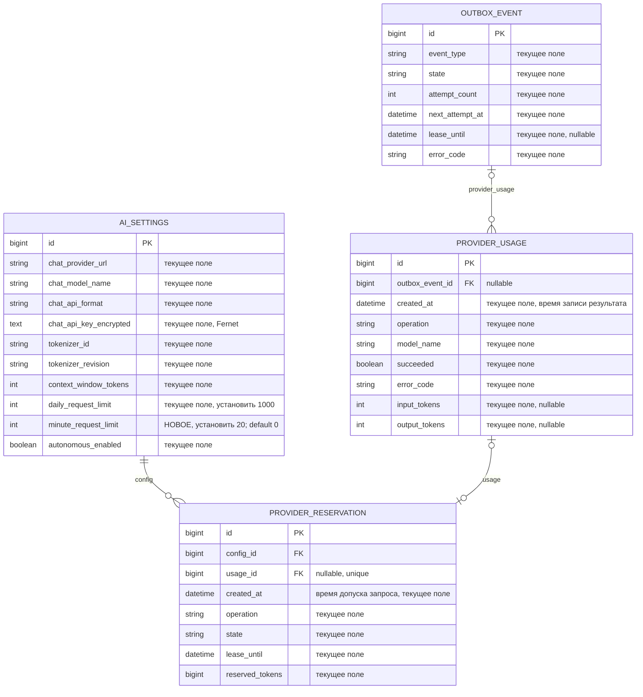
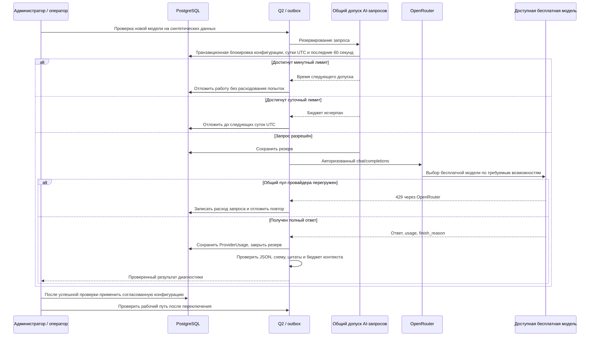

# OpenRouter Free Router и ограничения частоты AI-запросов

- Создано: 15.10.2026, 11:31:37 MSK (UTC+3).
- Задача: `openrouter-gemma-rate-limits`, прямое поручение пользователя, без GitHub Issue.
- Ветка: `feature/openrouter-gemma-rate-limits`; `git pull origin main` выполнен до подготовки спецификации, исходный HEAD `a163c5b`.
- Статус: пользователь поручил реализацию и проверку с уточнением `openrouter/free` вместо фиксированной Gemma 31B; первоначальный план обновлён в этом же файле.
- Уточнение процесса: пользователь прямо поручил «пушь напрямую в main»; после проверок отправить проверенный коммит ветки задачи в `main` без PR.
- Секрет OpenRouter получен от пользователя; значение не включать в спецификацию, исходники, логи, PR или E2E.

## Постановка

Перевести основной Chat/Reasoning с Qwen на `kk-minsk.by` на маршрутизатор `openrouter/free` через `https://openrouter.ai/api/v1`, используя предоставленный ключ. Добавить отсутствующую настройку ограничения запросов в минуту и обеспечить соблюдение 1000 запросов в сутки и 20 запросов за любые последние 60 секунд всеми процессами Mazory.

## Проверенное текущее состояние

1. Production проверен через Docker context `mazory-remote`. Активная `AISettings.id=1`: `chat_provider_url=https://ai.kk-minsk.by/qwen/v1`, `chat_model_name=qwen3.8-27b`, `chat_api_format=openai_compatible`, `daily_request_limit=0`.
2. Текущий токенизатор `Qwen/Qwen3.8-27B@1d4bf0f2ff6012fd82039f2fa52739d0dd7c60c0`; окно 49152, резерв ответа 32768, запас 2048, отдельный вход анализа 14000. Режим LAYA, автономная обработка и CRM включены. Изменение провайдера не должно менять эти флаги, данные или права.
3. `AIService._post` учитывает завершённые запросы в `ProviderUsage`. `provider_reservations.reserve` блокирует строку конфигурации и резервирует суточный бюджет, но полностью пропускается при `autonomous_enabled=false`. Минутного ограничения нет.
4. `context_tokens.context_runtime` допускает проверенные профили Nemotron, Qwen и локальной Gemma E4B. Перенос одного названия и URL не добавит поддержку Gemma 31B: нужен отдельный проверенный профиль токенизации и маршрутизации OpenRouter.
5. `GET /api/v1/key` с предоставленным ключом вернул HTTP 200: `free_model_daily_requests={used:4, limit:1000, remaining:996}`. Это снимок до диагностических генераций, а не остаток после них. Кредитный остаток равен 0; наличие кредитов не считать доказательством доступности бесплатного пула.
6. Метаданные модели подтверждены API OpenRouter: провайдер `google-ai-studio`, окно 262144, максимальный ответ 32768; доступны `reasoning`, `response_format`, `tools`, `tool_choice`. Параметр `response_format` сам по себе не доказывает строгое соблюдение JSON Schema.
7. Два прямых диагностических запроса с production-сервера вернули HTTP 429. Второй ответ явно указал `limit_source=upstream_provider_shared_pool` и временное ограничение `google/gemma-4-31b-it:free` у Google AI Studio; `Retry-After` отсутствует. Успешный ответ модели пока не получен. Настройки production не менялись.

## Требования

1. Добавить `AISettings.minute_request_limit`: положительное целое или 0 для отключения; значение по умолчанию 0 сохраняет существующее поведение других установок. В Django admin показать «Лимит запросов AI в минуту» рядом с суточным лимитом; help text объясняет скользящее окно 60 секунд и общий учёт вызовов.
2. Устанавливать для рабочей конфигурации `daily_request_limit=1000` и `minute_request_limit=20`. Сохранить существующий консервативный охват общего лимита AI: embeddings, chat, аналитика, внешний подсчёт токенов и метаданные, если они выполняются через общий транспорт. Запросы LAYA не расходуют квоту OpenRouter.
3. Допуск запросов атомарный между всеми Q2-кластерами и HTTP-процессами, независимый от `autonomous_enabled`. Не ограничиваться подсчётом завершённых `ProviderUsage`: одновременно выполняющиеся запросы тоже занимают квоту. Для минуты использовать время допуска, а не окончания генерации; учитывать границу суток и незавершённые запросы.
4. Считать каждое фактическое обращение к провайдеру, включая неуспешные вызовы и повторные попытки. Отказ локального лимитера не создаёт ложный внешний расход. Исторические данные и суточные счётчики не обнулять. Общая квота Mazory не гарантирует свободный пул провайдера и не учитывает стороннее использование аккаунта вне Mazory.
5. При исчерпании минуты сохранять работу и назначать `next_attempt_at` по ближайшему освобождению квоты; не занимать worker ожиданием и не исчерпывать число попыток из-за локального лимита. Суточный лимит возобновляется в 00:00 UTC, что соответствует 03:00 MSK. Для внешних 429 сохранять раздельную диагностику и учитывать `Retry-After`, если он присутствует.
6. Для `openrouter/free` модель неизвестна до ответа. Добавить отдельный профиль с консервативной границей размера текстового запроса в UTF-8 плюс резерв шаблона; явно обозначать это верхней оценкой, не точным счётчиком выбранной модели. Не приписывать маршрутизатору токенизатор Qwen/Gemma. Провайдер выполняет окончательную проверку контекста; при переполнении сохранять явную ошибку, без автоматического сжатия или потери исходников. Проверить, что реальный usage синтетического ответа укладывается в предварительный бюджет. В ProviderUsage и диагностике сохранять фактически ответившую модель.
7. Проверить OpenRouter endpoint metadata, формат JSON, reasoning и работу tool calling для аналитики. Входящие данные остаются недоверенными, прикладная проверка фактов, цитат и схемы сохраняется. Не отправлять Ollama/llama.cpp-параметры в OpenRouter и не включать сжатие/обрезание истории автоматически.
8. Профиль production: `name=OpenRouter Free`, URL `https://openrouter.ai/api/v1`, модель `openrouter/free`, формат `openai_compatible`, окно-бюджет 200000, резерв ответа 32768, запас 2048. Для верхней оценки установить вход анализа 65536 вместо прежних 14000 точных Qwen-токенов: один фиксированный рабочий промпт занимает больше 16000 UTF-8 байт. Эта граница ограничивает размер запроса; не означает точное окно или число входных токенов конкретной случайно выбранной модели. Сохранить прикладные проверки схем и доказательств. Маршрутизатор выбирает случайную модель среди подходящих по функциям, а не гарантированно лучшую по качеству.
9. Новый Chat API key сохранить штатным `set_chat_api_key` в зашифрованном поле. Embeddings URL/модель/ключ, LAYA, CRM, автоматизацию и бизнес-данные не менять. Не включать платные модели, платный fallback или другую модель без поручения пользователя.
10. Перед переключением получить успешный ответ новой модели с этого сервера. После переключения выполнить синтетическую проверку штатного анализа через Q2 и убедиться в успешном завершении, записи расхода и отсутствии созданных бизнес-фактов. Если проверка после переключения неуспешна — восстановить предыдущие поля провайдера и зашифрованный ключ и явно сообщить причину; наличие валидного ключа или HTTP 200 метаданных не считать успешной генерацией.

## Планируемые изменения

1. Модель `AISettings`, миграция, форма/настройки Django admin: новое поле минутного лимита.
2. Общий транспорт `AIService`, `provider_reservations`, отложенные повторы outbox и пояснения состояний: атомарные общие лимиты, раздельная обработка локального ожидания и внешнего 429. Проверить другие AI-транспорты на обход общей квоты.
3. `context_tokens` и необходимые адаптеры: отдельный профиль Free Router с явной консервативной оценкой контекста, JSON-ответом и аналитическими инструментами; не закреплять модель или провайдера в запросе маршрутизатора.
4. Только разрешённые браузерные E2E в изолированном Docker Compose на `kk-minsk`, с настоящими API, БД, outbox и Q2 и локальным детерминированным сервисом провайдера. Проверить редактирование лимита, общий допуск из нескольких workers, ожидание/продолжение после лимита, 429, перезапуск Q2 и выключенный автономный режим. Не создавать unit/component/integration/mock-наборы и не использовать рабочий ключ в E2E.
5. Docker-проверки: `manage.py check`, применение миграции, `makemigrations --check` с `No changes detected`, TypeScript/Vite-сборка nginx, запуск сервисов и просмотр логов backend/qcluster/WAHA.
6. После проверок и review отправить коммит в `main` напрямую по отдельному поручению пользователя. Развернуть проверенные образы на `mazory-remote`, применить миграцию и обновить все процессы, выполняющие AI-вызовы.
7. Применить узкий набор полей AISettings для проверенного маршрута `openrouter/free` транзакционно с возможностью восстановления в памяти, выполнить Q2-проверки до конечного результата и read-back настроек. Не пересоздавать старые задачи и не запускать массовый повтор анализа.

## Критерии готовности

- Настройка минутного лимита доступна в БД/admin, миграции применены, системные проверки и сборка успешны.
- E2E доказывает не более заданного числа внешних запросов за скользящие 60 секунд при нескольких workers, отсутствие обхода при `autonomous_enabled=false` и сохранение работы при ожидании.
- Локальный лимит и внешний 429 не приводят к потере заданий, немедленному циклу повторов или ложной записи успешной обработки.
- В production read-back подтверждает выбранные URL, модель, профиль токенизатора и 1000/20; ключ хранится зашифрованным, прочие поля сохранены.
- Реальная синтетическая генерация и штатный анализ через Q2 завершаются успешно, есть `ProviderUsage` новой модели и корректный ответ; бизнес-записей не создано.
- При недоступности бесплатного пула явно зафиксирован незавершённый переход; рабочий Qwen сохранён или восстановлен. Не сообщать «работает» до получения реального проверенного ответа.

## Источники

- Проверенные модели: `backend/api/models.py`, `backend/api/ai_service.py`, `backend/api/provider_reservations.py`, `backend/api/context_tokens.py`, `backend/api/tasks.py`, `backend/api/admin.py`; соответствующие текущие миграции в `backend/api/migrations/`.
- Метаданные: https://openrouter.ai/api/v1/models/google/gemma-4-31b-it:free/endpoints
- Ограничения и 429: https://openrouter.ai/docs/api_reference/limits
- Официальный токенизатор: https://huggingface.co/google/gemma-4-31B-it

## Уточнение пользователя и предварительная проверка Free Router

- Пользователь заменил цель на `openrouter/free` и повторно поручил переключение и проверку. Лимиты 1000/сутки и 20/минуту сохраняются.
- Два реальных синтетических запроса с production-сервера уже получили HTTP 200: JSON от `cohere/north-mini-code:free` (Cohere), вызов функции с правильным аргументом от `nvidia/nemotron-3-super-120b-a12b:free` (Nvidia). Стоимость каждого ответа 0. Это доказывает доступность маршрута, но ещё не завершённое переключение Mazory.
- Документация маршрута: https://openrouter.ai/docs/guides/routing/routers/free-router

## Выполненные проверки реализации

- Review исправил два дефекта до выпуска: ожидание квоты в аналитике возвращается в существующий outbox; специальные схемы сверки обязательств преобразуются в `response_format.json_schema`, учитываются в предварительном бюджете и проверяются локально.
- Изолированный Router E2E на `kk-minsk`: 1 passed. Из 12 реальных задач четырёх Q2 workers при лимите 3/мин провайдер получил ровно 3 запроса; 9 остановлены локально. Чат и WhatsApp сохранили ожидание без расхода попыток после перезапуска Q2; следующий запрос ушёл через 60,667 секунды. Чат завершился успешно, оба сообщения получили успешные traces и сохранённые факты. Внешний HTTP 429 повторён через 15,353 секунды и завершился успешно.
- В отдельном Router-стенде Qdrant отсутствует: не относящиеся к сценарию задачи `index_message` сообщают об этом; production dispatcher оставлен настоящим. Проверка успешности анализов основана на traces, фактах и завершённой операции API.
- Сборка TypeScript/Vite, Django `check`, применение миграции 0058 и `makemigrations --check` прошли. Системные проверки повторены после финальных изменений; `No changes detected`.
- Стандартный Docker E2E: 31 passed, 12 штатных пропусков специальных стендов; после пересоздания backend/nginx отдельная проверка сохранённого аватара — 1 passed. Вместе с Router E2E выполнены 33 успешных сценария. Проверка production-настроек внутри Docker завершилась с кодом 0.
- Первый GitHub CI остановился на ложном срабатывании Gitleaks: автоматически созданная зависимость миграции `('api', '0057_sale_clarifications')`. Существующее точное исключение для имён миграций расширено на одинарные кавычки Django; правила поиска ключей сохранены.

## Финальная проверка схемы Free Router

- Реальный preflight выявил, что обычное извлечение передавало только JSON-режим. Адаптер теперь добавляет актуальную native extraction schema, пересоздаёт её после focused passes и учитывает её в бюджете. Повторяющиеся узлы вынесены в `$defs/$ref` без изменения контракта; явные пользовательские схемы имеют приоритет, tool calls не изменены.
- Для синтетического пакета из 20 сообщений верхняя оценка запроса составила 55109; 50 сообщений — 74967 и требуют штатного разбиения. Проверены стабильность после JSONB-переупорядочения, повторная подготовка, отклонение отсутствующей классификации и чужого ID.
- Финальный браузерный Router E2E: 1 passed (1.4m). В дополнение к минутной квоте, перезапуску Q2 и 429 проверен HTTP 200 без обязательной классификации: trace отклонён с `invalid_extraction_schema`, фактов от него нет; повтор завершился успешно. Django check и makemigrations --check прошли.
- Синтетический preflight с production-сервера через реальный Q2 завершился успешно: packet classification от `dots-studio/dots-3-note-preview:free` (2937 фактических входных токенов при оценке 41517), explicit JSON Schema от `liquid/lfm-2.5-2.6b:free`, tool call от Dots. Стоимость каждого запроса 0; read-back подтвердил encrypted key и неизменность прочих полей. До выпуска финального образа preflight восстановил прежний провайдер. Один предшествующий ответ Nvidia прошёл JSON Schema, но был отклонён прикладной проверкой классификации: корректность произвольного ответа бесплатного пула не гарантируется, локальная валидация и повтор сохраняются.
