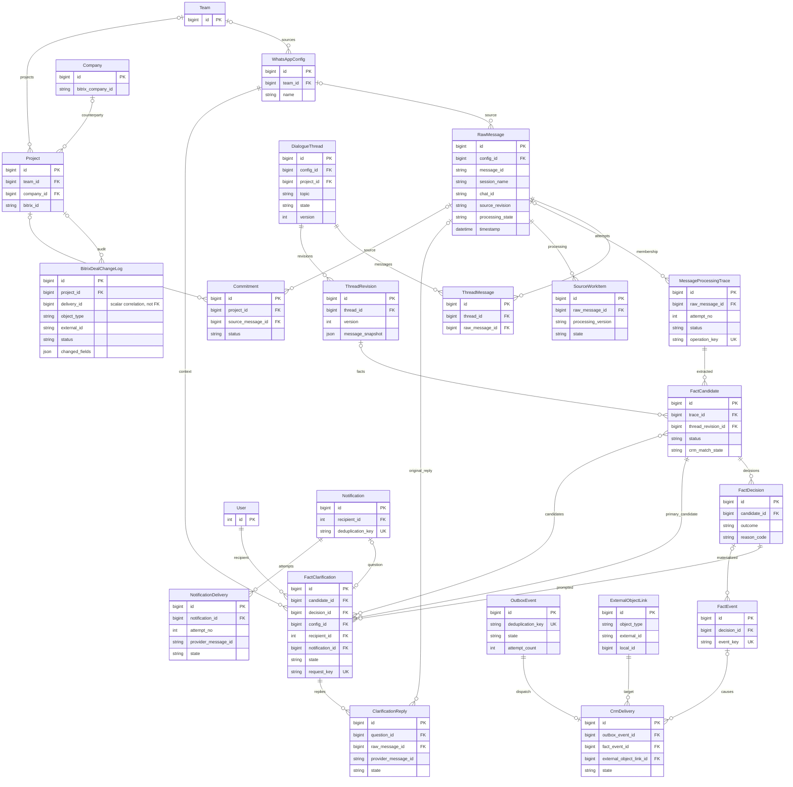
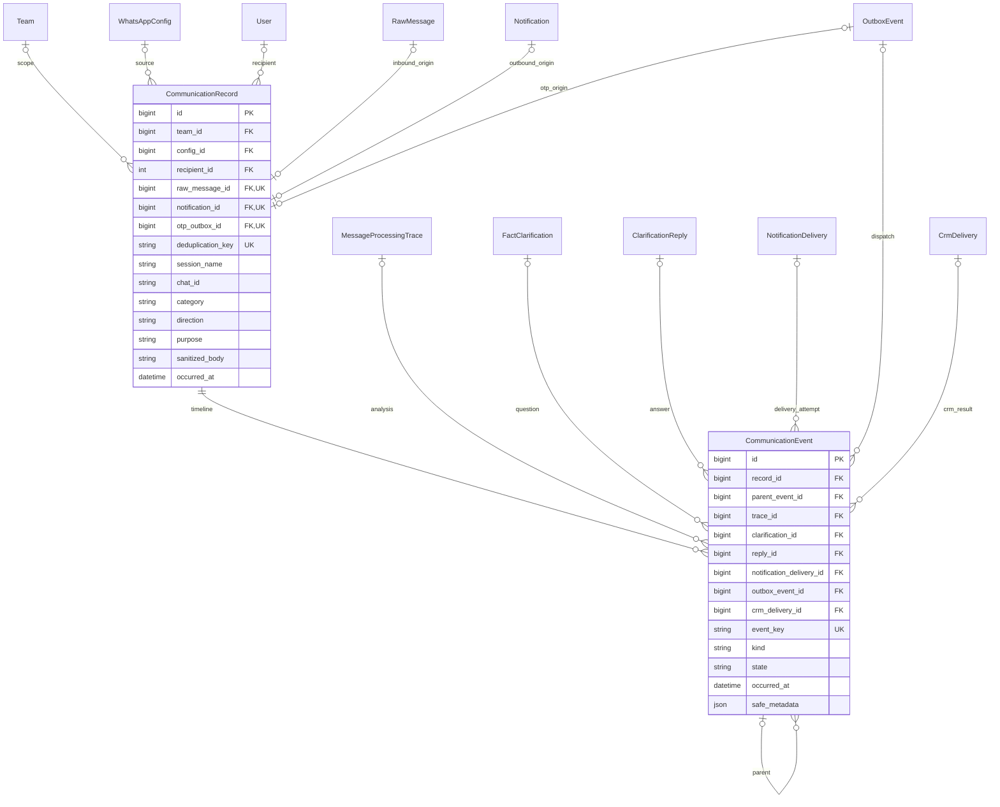
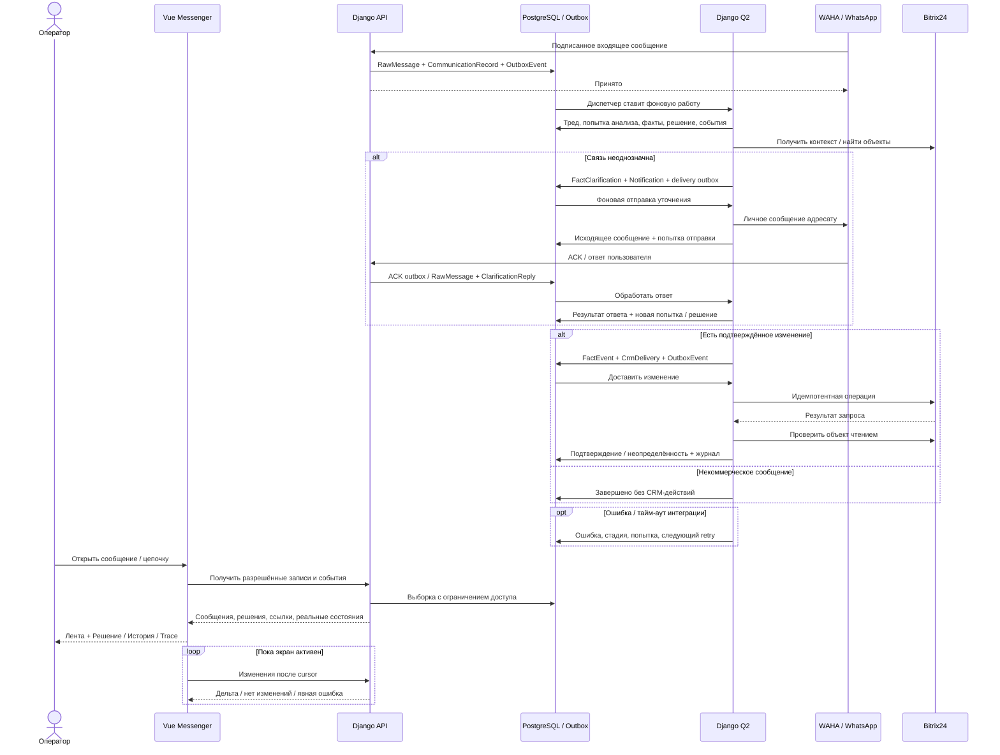

# Mazory Messenger Premium — полная переработка сайта и операционного интерфейса

- Задача: `messenger-redesign`; ветка спецификации: `docs/messenger-redesign-spec`.
- Создано: 2026-10-16 14:35:06 MSK (UTC+3).
- Статус: реализация локально проверена в `feature/messenger-redesign`; финальные результаты и границы проверки — §13. Все ранее незакоммиченные изменения сохранены; новых commit/push/PR нет.
- Основание: [чат «Варианты интерфейса админки»](https://chatgpt.com/share/6ad20ae5-87d4-83ed-a469-f088adf6734a), финальный прототип `mazory-messenger-premium.html`, выбранный пользователем после доработки дизайна.
- Дополнение пользователя в текущем чате: крупная переделка сайта, fallback не нужен. Это требование приоритетнее предложения в исходном чате оставить старые страницы моделей как запасной интерфейс.
- Дополнение по скриншоту текущего меню: «All applications», группа «Api» и автоматически названные модели на английском непонятны и перегружают навигацию. Нужны русские названия, смысловые группы и ранжирование по рабочей важности; технические записи не должны смешиваться с повседневными разделами.
- База исследования: `main`, SHA `c577ecc`; перед созданием ветки выполнен `git pull origin main`.
- Ниже функциональная концепция и визуальные параметры взяты из чата и исходного HTML. Архитектура, новые модели, API и измеримые критерии — проектные решения данной спецификации, подлежащие review вместе с ней.

## ERD: существующие данные перенесённых настроек и финансов

Изменений схемы этих таблиц не планируется; добавлены scoped чтение и формы поверх существующих моделей.

```mermaid
erDiagram
    User ||--o| AdminMFA : protects_actions
    AISettings ||--o{ ProviderReservation : reserves
    ProviderUsage o|--o| ProviderReservation : measured
    OutboxEvent o|--o{ ProviderUsage : calls
    User ||--o{ AsyncOperation : requests
    Team o|--o{ TemporalEntityRevision : versions
    Project o|--o{ TemporalEntityRevision : versions
    RawMessage o|--o{ TemporalEntityRevision : evidence
    ProviderReservation {
        bigint id PK
        bigint config_id FK
        bigint usage_id FK,UK
        string state
        bigint reserved_tokens
        datetime lease_until
    }
    ProviderUsage {
        bigint id PK
        bigint outbox_event_id FK
        string model_name
        int input_tokens
        int output_tokens
        decimal cost_usd
        boolean succeeded
    }
    AsyncOperation {
        bigint id PK
        int requested_by_id FK
        string operation_type
        string status
        datetime expires_at
    }
    TemporalEntityRevision {
        bigint id PK
        bigint team_id FK
        bigint project_id FK
        bigint raw_message_id FK
        string entity_type
        bigint entity_id
        int revision
        datetime effective_at
        datetime recorded_at
    }
    DjangoQTask {
        string id PK
        string name
        string func
        boolean success
        datetime started
        datetime stopped
    }
    User ||--o{ ChatAccess : granted
    WhatsAppConfig ||--o{ ChatAccess : chat
    User ||--o{ ClientProjectAccess : client
    Project ||--o{ ClientProjectAccess : project
    Project ||--o{ FinancialRecord : payments
    Project ||--o{ PaymentScheduleItem : schedule
    FinancialRecord ||--o{ PaymentAllocation : allocated
    PaymentScheduleItem ||--o{ PaymentAllocation : allocation
    UserProfile ||--o{ SalesTarget : targets
    Team ||--o{ SalesTarget : scope
    WhatsAppConfig ||--o| WhatsAppHistoryJob : history
    WhatsAppHistoryJob ||--o{ WhatsAppHistoryRun : runs
    AdminMFA {
        bigint id PK
        int user_id FK,UK
        datetime confirmed_at
        bigint last_counter
    }
    ChatAccess {
        bigint id PK
        int user_id FK
        bigint config_id FK
        boolean is_active
    }
    ClientProjectAccess {
        bigint id PK
        int user_id FK
        bigint project_id FK
        string status
    }
    FinancialRecord {
        bigint id PK
        bigint project_id FK
        decimal amount
        string currency
        date payment_date
    }
    PaymentScheduleItem {
        bigint id PK
        bigint project_id FK
        decimal amount
        date due_date
    }
    PaymentAllocation {
        bigint id PK
        bigint financial_record_id FK
        bigint schedule_item_id FK
        decimal amount
    }
    SalesTarget {
        bigint id PK
        bigint profile_id FK
        bigint team_id FK
        date month
        decimal amount
        int version
    }
    WhatsAppHistoryJob {
        bigint id PK
        bigint config_id FK,UK
        boolean only_new
        boolean enabled
    }
    WhatsAppHistoryRun {
        bigint id PK
        bigint job_id FK
        string state
    }
    AISettings {
        bigint id PK
        string routing_policy_version
        string autonomous_policy_version
        string chat_api_format
        string chat_provider_url
        float chat_temperature
        int context_window_tokens
        decimal daily_budget_usd
        boolean autonomous_enabled
        boolean autonomous_crm_enabled
    }
    BitrixSettings {
        bigint id PK
        boolean is_active
        boolean crm_matching_enabled
        boolean auto_create_deals
        boolean auto_create_tasks
    }
```



## ERD: существующая структура данных

Имена соответствуют моделям `backend/api/models.py`; физические таблицы имеют префикс `api_`, пользователь — `auth_user`. Диаграмма показывает значимые поля и связи, а не все поля моделей. `*_id` в блоках — FK, кроме явно отмеченных скалярных ссылок. Локальные PK — `BigAutoField`, PK стандартного `User` — целочисленный.



Проверены модели и миграции создания платформы/доставок `0012`, тредов `0029`, автономных решений и CRM `0034`, уточнений `0054`, их расширения `0057`, актуальная вершина `0058`. Важная особенность: `BitrixDealChangeLog.delivery_id` сейчас скаляр, а не FK; связь нельзя изображать или использовать как гарантированную ссылочную целостность. Составной namespace внешнего объекта задаёт `ExternalObjectLink`, одного ID Bitrix недостаточно.

## ERD: планируемое дополнение для единой истории коммуникаций

Следующие **две модели новые**, в текущей БД их нет. Остальные показанные сущности уже существуют. Это журнал отображения и связности; бизнес-решения продолжают храниться в существующих моделях, повторная реализация CRM-пайплайна не нужна.



## Сквозной сценарий



## 1. Постановка и границы

Создать единый законченный интерфейс Mazory, в котором оператор начинает работу с WhatsApp-переписок и видит последствия каждого сообщения: анализ, сопоставление CRM, вопрос пользователю, ответ, повторную обработку и подтверждённое изменение внешнего объекта. Это крупная переработка структуры сайта, навигации, экранов и слоя наблюдаемости, а не замена цветов Django Admin.

Обязательны шесть разделов финального прототипа: **Чаты, Аналитика, Треды, Очередь, Изменения CRM, Настройки**. Профиль и существующие возможности пользователей включаются в новую оболочку. Главная страница сотрудника после входа — Messenger. Клиентский доступ остаётся ограниченным собственными проектами и не открывает внутренние чаты.

**Без fallback:** не создавать переключатель «старый/новый интерфейс», параллельную legacy-оболочку, автоматическую переадресацию в старую админку при сбое или подстановку демонстрационных данных при недоступности API. После выпуска новый интерфейс — единственный рабочий UI. Ошибка имеет явный экран и действие повторения в нём. Технический откат релиза средствами развёртывания не является пользовательским fallback и не требует второй работающей оболочки.

Не включаются: новый CRM-движок, смена провайдера WhatsApp/AI, перенос на сторонний SaaS, свободный WhatsApp-клиент с произвольной ручной отправкой. Истечение срока обязательства само по себе не доказывает выполнение: интерфейс показывает просрочку, а закрытие требует соответствующего бизнес-события.

## 2. Проверенное исходное состояние и целевая архитектура

| Область | Сейчас | План |
|---|---|---|
| Пользовательский сайт | Vue 3, `App.vue`, выбор экранов через состояние, KPI/AI-чат, `WorkspaceView`, профиль | Полноценная Vue-оболочка с адресуемыми разделами и единым визуальным языком |
| Админка | Django Unfold 0.108.0, `UNFOLD`, страницы моделей и кастомные WAHA/trace-страницы | Пользовательские операции и диагностика перенесены в новый интерфейс; старые операционные страницы не используются как второй продукт |
| Бизнес-API | DRF, JWT, существующие проверки `access.py` | Переиспользование существующих команд; новые read API Messenger, очереди, журнала, аналитики и настроек |
| Треды/факты | `DialogueThread`, ревизии, trace, кандидаты, решения, уточнения | Сохраняются как источник истины; добавляются явные связи для единого просмотра |
| Исходящие сообщения | Notification/NotificationDelivery; OTP отправляется из `deliver_otp` без отдельной полной истории коммуникации | Общий журнал коммуникаций и событий, безопасное отображение OTP без значения кода |
| CRM | Outbox, `CrmDelivery`, `ExternalObjectLink`, `BitrixDealChangeLog` | Общая проекция истории с подтверждением доставки и переходами к источникам |

Выбор реализации: развивать существующий **Vue 3 + TypeScript + Tailwind + Lucide**, Django оставить сервером API, прав и фоновых процессов. Не добавлять React/Next и второй frontend. Unfold — существующая зависимость, а не ограничение дизайна нового сайта. Его удаление допускается только после переноса всех нужных функций и проверки зависимостей.

Ввести Vue Router с прямыми адресами `/messenger`, `/analytics`, `/threads`, `/queue`, `/crm-changes`, `/settings`, `/profile`; отдельные состояния выбранного диалога, сообщения, вкладки и фильтров отражать в URL. `/` ведёт сотрудника в Messenger после авторизации. `/admin/` становится входом в новый рабочий интерфейс с проверкой прав, а не списком моделей. Старые URL функционально перенесённых экранов направлять на соответствующий новый экран, недоступные модельные страницы закрыть. Исключение — необходимые технические endpoints аутентификации/MFA, без альтернативной операционной оболочки. Сохранить серверную MFA-проверку для привилегированных операций; JWT-вход не должен обходить её.

Прямое открытие и обновление маршрута должны работать через nginx. Существующие API-клиенты, MCP и webhooks не ломать при удалении старого UI. Не менять бизнес-правила автоматической записи в Bitrix под видом редизайна.

## 3. Визуальный контракт финального прототипа

Использовать именно **финальный Premium**, одобренный после замечания о сыром дизайне. Первые три варианта и первоначальный Messenger не являются целевыми макетами. В HTML проверены CSS, DOM и обработчики взаимодействий; публичный просмотр не предоставляет рабочую ссылку на скачивание вложения. Исходный HTML удалось извлечь из опубликованного содержимого чата. Значения ниже взяты из него, не придуманы по текстовому описанию. Демоимена, числа и статусы из макета не переносятся в рабочие данные.

### 3.1. Компоновка

- Полноэкранное пространство на `100dvh`, тёмные спокойные поверхности, тонкие границы, независимая прокрутка списка, ленты и инспектора.
- Узкая навигационная полоса слева: **80 px**; рядом список диалогов **328 px**; в центре гибкая лента; справа инспектор **356 px**. Ширина центральной части получает оставшееся место.
- При ширине от 1850 px: список 362 px, инспектор 395 px. До 1370 px: полоса 68 px, список 287 px, инспектор 320 px.
- До 1130 px инспектор открывается поверх справа отдельной кнопкой; до 760 px список диалогов выдвигается слева, лента занимает основную ширину. До 520 px полоса 51 px, инспектор занимает доступную ширину.
- На узком экране панели имеют фон-подложку, закрытие по Escape/кнопке и возврат фокуса; открытие панели не сбрасывает сообщение и позицию ленты. Страница работает от 320 px без горизонтального скролла всего документа.

### 3.2. Токены и компоненты

| Назначение | Значение из HTML |
|---|---|
| Фон страницы | `#090e16` |
| Навигационная полоса | `#0b101a` |
| Список диалогов | `#0e1420` |
| Центральное пространство | `#0d1420` |
| Инспектор | `#0e1521` |
| Поверхности карточек | `#141e2d`, `#192536`, `#202d40` |
| Границы | `#233044`, `#2c3b50` |
| Основной текст / вторичный | `#ebf0f8` / `#8492a9` |
| Акцент / светлый акцент | `#987eff` / `#b2a2ff` |
| Успех / ожидание / ошибка / информация | `#40d3ab` / `#ffbe73` / `#ff8296` / `#82b5ff` |
| Крупный радиус / тень | `16px` / `0 14px 36px rgba(0,0,0,.24)` |

Шрифт Inter при доступном локальном ресурсе, затем системный стек из макета; не подключать внешний сервис шрифтов. Базовый размер прототипа 13 px, заголовок списка 23 px. Сохранить плотность, но рабочие сообщения/формы на мобильном не уменьшать до нечитабельных 11 px: обеспечить минимум 14 px для основного текста и 44 px для сенсорных действий. Статусы обозначать текстом и иконкой вместе с цветом. Сохранить текущие фирменные ресурсы Mazory; демонстрационную монограмму прототипа не объявлять новым брендингом.

Общие компоненты: AppShell, NavigationRail, DialogList, MessageTimeline, MessageBubble, ProcessingEvent, StatusBadge, EntityChip, Inspector, TimelineStep, MetricCard, Chart, FilterBar, DataTable, EmptyState, ErrorState, Skeleton, SettingsForm. Единые состояния hover/selected/focus/disabled/loading; видимый focus, подписи иконок, поддержка reduced motion. WCAG AA для текста и элементов управления, не копировать недостаточный контраст второстепенного текста автоматически.

### 3.3. Русская навигация и порядок разделов вместо All applications

На скриншоте пользователь видит рядом с рабочим меню автоматический алфавитный список технических моделей: `Async operations`, `Chat accesss`, `Clarification replys`, `Crm deliverys` и другие. В текущем коде включён `UNFOLD.SIDEBAR.show_all_applications = True`; у `ApiConfig` не задано понятное русское имя, часть зарегистрированных моделей не имеет русских названий. Это отдельный дефект информационной архитектуры в scope полной переработки.

Не ограничиваться переводом «All applications» и не воспроизводить этот список в новой оболочке. Убрать автоматическую выдачу всех Django-моделей из пользовательской навигации и поиска. Если нужен общий каталог переходов, назвать его **«Все разделы»**, формировать по явному реестру рабочих экранов и доступам пользователя. Группа **«Api»** в пользовательском каталоге отсутствует. Регистрация новой модели в admin сама по себе не добавляет пункт меню.

Порядок главных разделов фиксированный, по рабочему приоритету: **1. Чаты → 2. Аналитика → 3. Треды → 4. Очередь → 5. Изменения CRM → 6. Настройки**. Профиль — в нижней части навигационной полосы. Активные проблемы выделяются счётчиками и фильтром «Требует внимания», не переставляют разделы во время работы. Не сортировать меню по английскому имени модели или по числу строк в таблице.

В каталоге «Все разделы» и поиске переходов использовать следующую иерархию. Это группировка экранов, а не дополнительные пункты верхнего уровня:

| Приоритет | Группа | Содержимое и основной способ доступа |
|---|---|---|
| 1 | Ежедневная работа | Чаты, требующие внимания сообщения, треды, проекты и сделки, контрагенты, задачи и обязательства; переходы из основных разделов и карточек |
| 2 | Контроль и результаты | Аналитика, финансы и оплаты, очередь обработки, изменения CRM, уведомления и история отправок |
| 3 | Настройка системы | WhatsApp, ИИ, Bitrix24, импорт истории, участники и команды, права доступа; внутри «Настройки», только разрешённые функции |
| 4 | Служебная диагностика | Попытки обработки, технические доставки и события, происхождение фактов, версии, контроль полноты, ресурсы провайдера; внутри «Настройки → Система → Диагностика», по отдельным действующим правам, скрыто из повседневного меню |

Для диагностики показывать краткое описание назначения и причины открытия записи. Контекстный переход из сообщения, ошибки, задания или CRM-операции предпочтителен общему реестру. Связанные низкоуровневые записи объединяются в одной карточке с вкладками/раскрытием; каждой таблице не требуется собственный самостоятельный раздел. Скрытие пункта не означает удаление данных, функций аудита или ограничений read-only.

Все пользовательские названия групп, разделов, вкладок, полей, статусов, кнопок, поиска, пустых состояний и ошибок — на русском. Например, «Поиск по разделам и данным» вместо `Search apps and models`, «Диагностика ИИ» вместо `Trace / AI`, «Настройки ИИ» вместо `AI Settings`. Названия продуктов WhatsApp, WAHA, Bitrix24, MCP, идентификаторы, error codes и названия моделей провайдеров сохраняются; техническое имя Django-модели допускается только вторичной подписью в разрешённой диагностике. Не исправлять английские автоматические множественные формы вручную в UI по строковым заменам.

Соответствие для моделей из скриншота и связанных текущих регистраций:

| Техническое название | Русское название | Целевое место |
|---|---|---|
| AsyncOperation | Фоновые операции | Очередь; подробности операции |
| AuditEvent | Журнал действий пользователей и системы | Настройки → Система → Аудит |
| ChatAccess | Доступ к чатам | Настройки → Доступ → Чаты |
| ClientProjectAccess | Доступ клиентов к проектам | Настройки → Доступ → Проекты |
| Team / TeamMembership | Команды / Участники команд | Настройки → Доступ и команды |
| Participant / ParticipantIdentity | Участники WhatsApp / Идентификаторы участника | Настройки → Участники; идентификаторы внутри карточки |
| FactCandidate | Предложенные изменения | Инспектор сообщения/треда; разрешённый review |
| FactClarification / ClarificationReply | Уточнения / Ответы на уточнения | Личный диалог и связанная история сообщения |
| FactDecision | Решения по фактам | Инспектор → Решение и История |
| FactEvent / FieldAssertion | События фактов / Подтверждения значений полей | Диагностика выбранного факта; без отдельных основных пунктов |
| CrmDelivery | Доставка изменений в CRM | Изменения CRM → Операция → Доставка |
| ExternalObjectLink | Связи с объектами CRM | Карточка объекта/операции → Диагностика |
| CompanyAlias / ProjectAlias | Варианты названий контрагентов / проектов | Карточка контрагента/проекта; редактирование только по существующим правилам |
| ProjectParty | Стороны проекта | Карточка проекта → Участники и контрагенты |
| ProjectRevision / TemporalEntityRevision | История изменений проекта / Версии данных | История соответствующей карточки; технические детали по правам |
| McpToken | Ключи доступа MCP | Профиль → Подключение MCP; административные действия только по правам |
| MessageArtifact | Вложения и извлечённый текст | Исходное сообщение → Вложения/диагностика обработки |
| NotificationDelivery | Доставка уведомлений | Уведомление/исходящее сообщение → Попытки доставки |
| OutboxEvent | События на обработку и отправку | Очередь → Задание → Технические события |
| SourceWorkItem / SourceCheckpoint | Обработка источников / Полнота обработки | Очередь и диагностика источника |
| ProviderReservation | Резервирование ресурсов ИИ | Настройки → ИИ → Диагностика лимитов |
| ThreadRoutingAttempt | Попытки определения темы | Тред/сообщение → Диагностика ИИ |
| WhatsAppHistoryJob / WhatsAppHistoryRun / HistoryAnalysisItem | Настройки импорта / Запуски импорта / Обработка сообщений импорта | Настройки → WhatsApp → История; ход работы — в Очереди |
| WhatsAppExportEntry | Сообщения из файла импорта | Детали соответствующего импорта |

При реализации проверить полный фактический список зарегистрированных моделей, включая Django/Q2: каждому доступному действию назначить понятное русское название и место, а технические записи оставить внутри контекстной диагностики. Названия для оставшихся моделей определить в этой же спецификации. Для сохраняющихся внутренних Django-представлений задать корректные `verbose_name`/`verbose_name_plural` и app label через штатные механизмы локализации, без изменения технического `app_label`, таблиц и миграционных зависимостей. Эти метаданные не являются основанием возвращать старую оболочку как fallback. Миграции метаданных, если их создаст Django, фиксируются и проверяются обычным порядком.

Поиск по разделам ранжирует точное совпадение русского названия выше частичного; при равенстве использует приоритет группы и стабильный порядок меню. Не включает технические модели для обычного сотрудника, даже если он может читать связанную бизнес-карточку. Технический поиск доступен отдельно в разрешённой диагностике. Дубли одного экрана из sidebar и каталога объединяются. Локализация меню не расширяет права и не скрывает нужные возможности от уполномоченного администратора.

## 4. Чаты — основной экран

### 4.1. Список диалогов

Категории **Все / Группы / Личные / Система**; отдельный фильтр **Требует внимания**. В строке: аватар/иконка, имя, категория, последнее сообщение, время, количество требующих внимания элементов. Не выдавать счётчик ошибок или уточнений за число непрочитанных WhatsApp.

Диалог идентифицируется namespace `(session_name, chat_id, category, scope)`; одинаковый телефон в разных сессиях/командах не объединять. Личные диалоги включают вопросы системы, ответы людей и последующую обработку. Системная категория показывает авторизацию, уведомления, состояние отправки и ошибки. Поиск выполняется сервером по доступным чатам и сообщениям, с переходом к точному результату; поиск по телефону доступен только в разрешённой области.

Показывать реальное состояние WAHA и время последней проверки. Не использовать постоянную зелёную подпись из демомакета. Обновление статуса и QR/restart выполняются через очередь по правилам проекта, а не синхронным внешним вызовом из HTTP.

### 4.2. Лента сообщений

Для сообщения показывать автора/получателя, направление, время источника, текст/доступное вложение, тип сообщения, статусы обработки и связанные сущности. При неизвестном времени — соответствующая подпись, не дата импорта. Входящие и исходящие визуально различаются. Системные события между сообщениями компактны и раскрываются.

Обязательные подписи сущностей: «Сделка #…», «Новая сделка #…», «Обновлена сделка #…», «Контрагент #…», «Новый контрагент #…», «Новая задача #…», «Обновлена задача #…», «Задача завершена». Каждая подтверждённая внешняя сущность имеет настоящую ссылку в Bitrix24. До получения внешнего ID показывать локальный объект и стадию доставки. «Связана» не означает «Изменена», локальное обязательство не равно созданной задаче Bitrix.

Некоммерческое сообщение получает «Не относится к сделкам / без CRM-действий», а не ошибку. «Ошибка» открывает соответствующую попытку и стадию в новом инспекторе. Одно сообщение может породить несколько фактов и операций: показывать их отдельно, не выбирать один произвольный результат.

Лента загружается курсорами, поддерживает длинную историю и открытие сообщения вне текущей страницы. Новые данные не переносят прокрутку вниз, если пользователь читает историю: появляется «Новые сообщения». Сохранять положение при подгрузке предыдущих сообщений; дедуплицировать webhook/экспорт и транспортные алиасы.

### 4.3. Инспектор

Три вкладки финального макета:

| Вкладка | Содержимое |
|---|---|
| Решение | Краткое объяснение, факты, основание сопоставления, связанные сделки/контрагенты/задачи, подтверждённое «было → стало», результат уточнения |
| История | Сообщение группы → анализ → кандидаты Bitrix → личный вопрос → доставка → ответ → его интерпретация → повторное решение → доставка и проверка CRM |
| Диагностика ИИ (в прототипе Trace / AI) | Попытки и стадии, модель/версия prompt, использованный контекст, фактические вход/выход в разрешённом виде, error code, безопасный traceback, длительность, ссылки на задания |

«Объяснение» — сохранённое обоснование решения и использованные факты; не запрашивать и не конструировать скрытую цепочку рассуждений модели. Не генерировать объяснение LLM при каждом открытии карточки.

Выбор шага цепочки открывает соответствующий диалог/сообщение, сохраняя корневой контекст и возможность вернуться. Ссылки недоступной ветви не раскрывают содержимое, телефон, заголовок CRM или текст ошибки. Не угадывать связь только по близкому времени или похожему тексту.

Повтор обработки — отдельное действие с правами, текущей версией и подтверждением внутри UI. Оно создаёт новую попытку, не затирает старую. Произвольного поля отправки сообщений нет. Существующее адресное уведомление переносится в явное действие с выбором получателя и действующими ограничениями прав.

### 4.4. Статусы без ложного успеха

Хранить и возвращать раздельные оси состояния. Общий badge — только краткая сводка, подробные состояния всегда доступны.

| Ось | Публичные состояния / смысл |
|---|---|
| Анализ | Получено, В очереди, Анализируется, Нужен контекст, Проанализировано, Без CRM-действий, Ошибка |
| Уточнение | Готовится, Отправляется, Ожидает ответа, Ответ получен, Ответ обрабатывается, Не подтверждено, Разрешено, Истекло, Заменено |
| Доставка WhatsApp | В очереди, Отправляется, Отправлено провайдеру, Доставлено при наличии ACK, Ошибка, Результат неизвестен |
| CRM | Не требуется, Запланировано, В очереди, Отправляется, Запрос принят, Проверяется чтением, Подтверждено, Ошибка, Результат неизвестен, Отключено |

Канонические исходные значения `SourceWorkItem`, Outbox, trace, clarification и delivery переводятся в эти состояния серверным адаптером. `RawMessage.processed` недостаточно для итогового вывода. Терминальный успех AI не означает успех CRM; `OutboxEvent.done` или ответ API Bitrix не подменяет readback. Уточнение `answered` не равно `resolved`. Ошибка предыдущей попытки остаётся в истории, но не считается текущей, если повтор завершился успешно.

Общая сводка при нескольких результатах показывает число незавершённых/ошибочных действий. Текущая ошибка и неясный результат требуют внимания; затем ожидание ответа, выполняющиеся работы, очередь; полное завершение разрешено только при терминальном результате всех актуальных ветвей. Наличие старой ошибки не перекрывает успешный актуальный результат.

## 5. Остальные разделы

### 5.1. Аналитика

Период, команда, источник/группа; каждый показатель имеет определение и раскрывается в соответствующую отфильтрованную выборку.

| Блок | Метрики и источник |
|---|---|
| Сообщения | Уникальные входящие WhatsApp: всего, завершено, очередь, анализ, ожидание уточнения, текущие ошибки; исходящие и OTP — отдельно |
| Задачи | Создано, изменено, завершено в Bitrix по подтверждённым операциям; локальные обязательства и просрочки отдельно |
| Сделки | Создано/изменено системой за период; текущее количество в доступном каталоге Bitrix с датой синхронизации и полнотой |
| Контрагенты | Создано системой; всего в доступном каталоге, отдельно компании и контакты при поддержке текущей интеграцией |
| Ошибки | Анализ, чтение Bitrix, запись/readback Bitrix, WAHA-доставка, импорт/очередь; текущие проблемы и все неудачные попытки — разные ряды |
| Динамика | Поток сообщений и результаты по дням, длительность стадий, backlog, ожидающие ответы |

Сообщения считать по каноническому источнику, CRM-операции — по уникальному логическому действию, не по числу retry. Для воронки по входящим выбрать когорту сообщений с временем источника в `[from, to)`, показывать состояние этой когорты на `as_of`; неизвестное время выделять отдельно. Исходящие считать по времени отправки, подтверждённые операции — по времени подтверждения. Метрики разных временных оснований явно подписывать.

Знаменатель и категории графика согласованы; «Неизвестно» или «Нет данных» не равно нулю. Нельзя назвать размер локальной неполной выборки «всего в Bitrix». Возвращать `as_of`, `coverage`, timezone и фильтры. Финансовые KPI, существующие аналитические диалоги и артефакты сохраняются внутри нового раздела аналитики; суммы договора, продажи, оплаты и остатка не смешиваются.

### 5.2. Треды

Список по темам с группой, временем активности, количеством сообщений, ревизией, связанными объектами, состоянием анализа и уточнений. Сортировки: активность, ошибки/ожидания, незавершённые CRM-операции, новые; при равенстве — стабильный ID. Не выдавать несуществующий AI-рейтинг за рассчитанный показатель.

Карточка раскрывает исходные сообщения, тему, summary, ревизии, routing/extraction, кандидатов и решения, подписку и существующие разрешённые действия. Переходы в Messenger открывают конкретные сообщения. Историческая ревизия не переписывается текущим результатом.

### 5.3. Очередь

Список логических работ со стадией, источником, тредом, объектами CRM, попыткой, временем создания/старта/окончания, длительностью, ближайшим retry и ошибкой. Фильтры: тип работы, состояние, команда, источник, период, требует внимания. Очереди AI, delivery, history, CRM показываются отдельно; outbox, Q2-задание и бизнес-результат не складывать как три разные обработки одного сообщения.

`enqueued` не обозначать «анализируется» без свидетельства старта. Нужны heartbeat/lease или сохранённое событие стадии; зависшее задание явно отмечать. Не обещать процент, ETA или точную позицию в параллельных очередях, если они не вычисляются достоверно. Retry доступен по действующим правам, идемпотентен, сохраняет прежние попытки и не повторяет неизвестную внешнюю запись без проверки.

### 5.4. Изменения CRM

Общий журнал по типам **Сделки / Задачи / Контрагенты**, с уточнением компания/контакт. Фильтры: действие, результат, период, объект/ID, команда, источник. Строка показывает автора действия (система/пользователь), поля «было → стало», состояние проверки, ссылку Bitrix, исходные сообщения и цепочку.

Повторы одной доставки группируются. Восстановленная история помечается как восстановленная; неполные before/after не дополняются вымышленными значениями. `unknown`, `unavailable` и `accepted` не отображать как подтверждённый успех. Состояния чтения и записи Bitrix различать. Проверить фактическую поддержку каждого типа объекта в delivery/journal; отсутствие журнала компании или задачи — задача реализации, а не повод скрыть соответствующий фильтр.

### 5.5. Настройки и профиль

Полноценные формы в общей стилистике, без перехода в старую админку:

- WhatsApp: конфигурации/группы/сессии, состояние, QR, перезапуск, история/импорт, параметры мониторинга, участники и идентификация.
- AI: действующие провайдеры/модели, лимиты запросов и токенов, бюджет, timeout, политика анализа и автономности; видимые ошибки конфигурации. Поля и валидации согласовать с актуальными `AISettings` и существующими admin forms, сохранить текущие значения.
- Bitrix24: подключение, разрешённые виды записи, синхронизация каталога, сопоставления команд/ответственных/стадий, результаты фоновых проверок. Не включать запись автоматически при редизайне.
- Доступ и команды: существующие назначения ролей, участники, приглашения и проектные доступы; специальные права интегратора сохраняются.
- Профиль: контакты/аватар, мои KPI, уведомления/тихие часы, AI-предпочтения, безопасность/сессии, MFA, существующее MCP-подключение.

Ключи и токены вводятся только в разрешённой форме, не читаются обратно: показываются «Настроено», дата и разрешённая операция замены. Все секретные payload исключены из event metadata, traces и истории настроек; журнал фиксирует название изменённого поля, не секрет.

### 5.6. Сохранение действующих функций

Существующие проекты, подтверждение/коррекция фактов, обязательства, финансы/графики оплат, назначения, уведомления, каталог/участники, экспорт, вложения, аналитический AI-чат и MCP должны получить место в новой оболочке. Проекты/обязательства/финансы открываются из аналитики и карточек CRM/тредов; действия review — из инспектора; адресное уведомление — из коммуникаций; справочники/доступ — из настроек. Клиентский кабинет сохраняет разрешённые проекты, задачи и уведомления в новой стилистике, без внутренних trace и чужих сообщений.

До удаления каждого старого экрана составить в этой же спецификации окончательное соответствие его операций новому экрану. Отсутствие функции в демопрототипе не разрешает её потерять. Контроль полноты относится к основному выпуску, не к неопределённому «потом».

## 6. Данные, история и асинхронность

### 6.1. CommunicationRecord

Одна запись на логическое сообщение. Категория `group|private|system`, направление `inbound|outbound|internal`, purpose `source|clarification|reply|notification|auth|system`. Основной origin — ровно один из `raw_message`, `notification`, `otp_outbox`; служебный internal event может иметь самостоятельный origin с уникальным ключом. Ограничение CHECK запрещает несколько origin одновременно. Повторная доставка notification — событие той же записи, не дублирующее сообщение.

Для входящих использовать уникальность канонического RawMessage и уже существующие transport aliases. Для исходящего webhook `fromMe` связывать транспортный ID с отправленным сообщением и не запускать повторный бизнес-анализ собственного текста. Назначение неизвестного исходящего не угадывать. `chat_id`/provider IDs остаются строками. Личные сообщения идентифицировать явным адресатом и контекстом исходной конфигурации, а не только телефонным номером.

OTP сохраняется только как безопасное событие «Отправлен код входа», без кода, шаблона с кодом и Redis-значения. `recipient_id` обязателен для auth/private; `team_id` может отсутствовать у auth, доступ тогда только получателю и специально уполномоченному администратору. Для групповой записи необходимы `team_id` и `config_id`. Для системного события без команды доступ определяется отдельной привилегией, а не общим staff-флагом.

### 6.2. CommunicationEvent

Append-only события попыток и переходов. `event_key` уникален по исходной операции, стадии и номеру попытки; повтор webhook/задачи не создаёт дубль. `parent_event` связывает исходное сообщение с вопросом и ответом в другом диалоге; nullable FK связывают реальные trace, clarification, reply, notification delivery, outbox и CRM delivery. Поля FK могут сочетаться, если одно событие связывает несколько стадий. Проверять совместимость recipient/team/config и отсутствие циклов причинности.

Событие содержит стадию, фактический результат и безопасные метаданные. Текущее состояние бизнес-модели остаётся каноническим; журнал событий обеспечивает историю и корреляцию, а не вторую независимую машину бизнес-состояний. Терминальные состояния и переходы для каждой оси описать константами/типами при реализации.

Сообщение и событие создаются в одной транзакции с исходной записью/outbox там, где это возможно. Внешний вызов выполняется только воркером после фиксации транзакции. При сбое после внешней отправки не повторять её вслепую: использовать существующий recovery/readback и статус неизвестного результата. UI-команды используют идемпотентность и существующий `AsyncOperation`/outbox; HTTP возвращает `202` и ссылку на операцию.

### 6.3. Исторические данные и миграция

Миграции схемы добавить после актуальной вершины, номер определить на момент реализации. Индексы: область/категория/время/id, namespace диалога/время/id, recipient/время, ссылки событий на исходные сущности. Уникальные ключи и CHECK создаются в БД. Не менять типы существующих PK.

Выполнить идемпотентное заполнение журнала из сохранённых RawMessage, Notification, deliveries, clarification/replies, traces и CRM delivery. Применять небольшие пакеты с checkpoint и отчётом полноты внутри этой спецификации/вывода операции. Никаких отправок WhatsApp, LLM-запросов и CRM-записей при реконструкции. Старые OTP без сохранённого подтверждения доставки не восстанавливать как отправленные; события и времена без свидетельства помечать неизвестными. Связи реконструировать только по устойчивым ID/ключам, не по текстовой похожести. Указать момент начала полной регистрации новых коммуникаций.

Проверить все места исходящих отправок, включая `deliver_otp`, уведомления, уточнения, retry/recovery и ACK. После миграции новая история не зависит от сохранения старой админки. Не удалять бизнес-историю и исходные таблицы вместе с удалением UI.

## 7. API и frontend-контракты

Новые endpoint names ниже — планируемые, сейчас их нет. Все под `/api/`, `IsAuthenticated`, с серверными проверками прав и единым query layer для списков и счётчиков.

| Endpoint | Назначение |
|---|---|
| `GET messenger/dialogs/` | Категории, поиск, attention, cursor, последние сообщения |
| `GET messenger/records/` | Лента выбранного namespace, cursor/limit, вокруг `record_id` |
| `GET messenger/records/<int:pk>/` | Сообщение и оси состояния |
| `GET messenger/records/<int:pk>/chain/` | Разрешённый граф и хронология причин/следствий |
| `GET messenger/records/<int:pk>/traces/` | Попытки и безопасный контекст, отдельное право trace |
| `GET messenger/changes/` | Дельта записей и событий после непрозрачного курсора |
| `GET analytics/operations/` | Метрики, серии, определения, полнота, `as_of` |
| `GET processing/jobs/` | Общая очередь с фильтрами и состояниями стадий |
| `GET crm/changes/` | Унифицированный журнал, группировка попыток |
| `GET/PATCH settings/<section>/` | Разрешённая конфигурация и серверная валидация |
| `POST settings/<section>/actions/<action>/` | Фоновые проверки/синхронизация/restart; `202` |

Существующие `/threads/`, `/candidates/`, `/notifications/`, `/operations/<id>/`, `/outbox/<id>/retry/`, проекты/финансы и прочие команды использовать повторно или расширить совместимо. Для повторного анализа добавить явную команду `POST messenger/records/<int:pk>/reanalyze/`: права, версия источника, идемпотентный ключ, `202`, сохранение попыток. Не переназначать произвольный outbox retry в повторный анализ любого сообщения.

DTO списков: `items`, `next_cursor`, `as_of`, `coverage`; это явный контракт пагинации, без конверта `success/data`. Для статусов возвращать машинный код и доступное действие, текст локализовать в UI. В карточке: локальные `id: number`, отдельно внешние `external_id: string`, `object_type`, URL, состояния анализа/уточнения/доставок, counts, capabilities. Не использовать `number|string`, `any`, выбор одного ID из разных полей или приведения типов наугад. Decimal возвращать строкой, неизвестное значение — `null` с причиной, не `0`.

Курсоры стабильны при одинаковом времени и новой вставке; для ленты порядок `(occurred_at, id)`, неизвестное время имеет отдельную согласованную политику. Курсор изменений учитывает новые записи и события к старым сообщениям, а не только максимальный ID сообщения. Ограничить page size по умолчанию 50, максимум 100; цепочку с большим числом шагов также пагинировать.

Обновление: единственный механизм — cursor polling раз в 5 секунд для активного экрана; при скрытой вкладке приостановить, при возвращении обновить. После своей команды запросить изменения сразу. При ошибках backoff до 30 секунд с видимым состоянием несвежих данных. Отменять устаревшие запросы при смене диалога, не терять selection/scroll. Это основной транспорт, не запасной путь после SSE/WebSocket; второй транспорт в рамках задачи не нужен.

Запросы формируются через существующий API helper относительно `VITE_API_URL`; DTO расположить в `frontend/src/types/`. Пустой результат, отсутствие прав, недоступность и загрузка имеют разные состояния. Реальный сбой не маскируется демоданными или старым UI.

## 8. Доступ, trace и безопасность

Сохранить действующие границы `access.py`: team_lead, finance, manager, client, superuser, ChatAccess и право настройки интеграций. Новая матрица разрешений обязана быть как минимум не шире существующей. Доступ к проекту не даёт автоматически доступ к WhatsApp-группе, личному уточнению другого человека или OTP. Доступ к сообщению не означает право на полный trace.

Каждый узел цепочки фильтруется самостоятельно. Общие метрики, поиск, facets и attention используют ту же область доступа; скрытые узлы не утекут через total, snippets, названия, телефоны или экспорт. API не принимает произвольный URL интеграции от frontend для ссылки/запроса.

JWT, refresh/CSRF и OTP cooldown/attempt limits сохраняются. Для защищённых настроек и привилегированных действий сохранить MFA и аудит. Наличие `AllowAny` на техническом входе не разрешает анонимный доступ к содержимому нового интерфейса. Trace/копирование/экспорт применяют одну серверную очистку: секреты интеграций, Bearer, cookies, OTP и значения ключей не должны попадать в выдачу, JSON, traceback, HTML или логи.

Каждая изменяющая команда пишет AuditEvent с actor, целью и безопасным результатом. UI скрывает недоступное действие, backend независимо отклоняет запрос. Внешние операции через Q2; WAHA вызывается только из фоновых задач с `settings.WAHA_API_URL` / `WAHA_API_KEY`. Не использовать учётные данные из опубликованного чата в спецификации, коде, E2E или запросах к production.

## 9. План реализации после согласования

1. Зафиксировать в этой спецификации окончательную карту старых функций, API, источников состояний и permissions. Завершить инвентаризацию пунктов All applications и зарегистрированных моделей по правилам §3.3: русское название, группа, приоритет, права, новый экран или контекстная диагностика. Уточнить фактические before/after и поддержку всех типов CRM по delivery-коду.
2. Добавить две модели, миграции, безопасную запись всех коммуникаций и фоновых стадий; реализовать реконструкцию и полноту истории. Сначала обеспечить данные, затем интерфейс.
3. Сделать scoped read API, единые проекции статусов/счётчиков/attention, цепочки и paginated queries без N+1. Добавить безопасные команды недостающих операций.
4. Собрать токены и новую Vue-оболочку, маршруты, вход и профиль. Реализовать Messenger, инспектор и переходы по цепочке с настоящими данными.
5. Реализовать аналитику, треды, очередь, CRM-журнал и все настройки. Перенести оставшиеся действующие функции; убрать демонстрационные обработчики/заглушки макета.
6. Провести Docker-проверки, локальные E2E и визуальный review. Исправить найденное в той же задаче. После функционального паритета удалить старую операционную оболочку и проверить прямые URL.
7. После проверки — PR только в `main`, обязательные CI/review, merge согласно AGENTS.md. Развёртывание выполнять по согласованному релизному процессу; факт merge, начало deployment и проверенный результат различать. Реализация явно подтверждена пользователем в текущей сессии; повторное согласование не требуется.

## 10. Проверки и критерии готовности реализации

Только Docker. По прямому override пользователя проверки этой задачи — только локальный `socktainer`, проект `mazory-e2e`. Production не используется. Не устанавливать зависимости на хост и не создавать unit/component/integration/mock-тесты.

Обязательные команды для реализации:

```bash
docker --context socktainer compose -f compose.e2e.yml -f compose.e2e.socktainer.yml up -d --build nginx qcluster outbox
docker --context socktainer compose -f compose.e2e.yml -f compose.e2e.socktainer.yml exec -T backend python manage.py check
docker --context socktainer compose -f compose.e2e.yml -f compose.e2e.socktainer.yml exec -T backend python manage.py makemigrations --check
docker --context socktainer compose -f compose.e2e.yml -f compose.e2e.socktainer.yml exec -T backend python manage.py migrate --check
E2E_DOCKER_CONTEXT=socktainer bash ops/run_local_e2e.sh
docker --context socktainer compose -f compose.e2e.yml -f compose.e2e.socktainer.yml logs --tail=50 backend qcluster outbox provider
```

Сборка nginx в `up --build` обязана выполнить `vue-tsc -b` и Vite без ошибок. Новые миграции применяются seed-сервисом изолированного стенда; повторный `makemigrations --check` должен дать `No changes detected`. `provider` в E2E — локальный внешний провайдер, не рабочий аккаунт WAHA/Bitrix/LLM. При проверке развёрнутого приложения дополнительно смотреть `backend`, все задействованные `qcluster_*`, `outbox`, `waha` в правильном контексте.

### Приёмочные E2E

| № | Проверяемый пользовательский сценарий |
|---|---|
| E1 | Вход по OTP → сотрудник открывает Messenger; системная запись содержит факт отправки/ошибки без самого кода; действуют cooldown и ограничения доступа |
| E2 | Новое групповое сообщение через настоящий webhook/API → очередь/Q2 → тред/факты/trace → статусы в ленте; некоммерческий текст завершается без CRM-действий |
| E3 | Неоднозначная сделка → личное уточнение → доставка → ответ человека → новая обработка → подтверждённое изменение CRM; все переходы группы/личного диалога работают в обе стороны |
| E4 | Ошибка WAHA/AI/чтения Bitrix/записи/readback → правильная стадия и trace; повтор сохраняет историю, актуальный успех снимает текущую проблему |
| E5 | Потерянный ответ внешней записи и перезапуск Q2 → неизвестный результат/recovery, одна CRM-операция и одно исходящее сообщение, без дублей |
| E6 | Создание/изменение сделки, создание контрагента, создание/обновление/завершение задачи → реальные внешние ID и ссылки, before/after, журнал и источник |
| E7 | Аналитика на контролируемой истории → точные метрики, корректные когорты/периоды/попытки, переход из KPI в тот же набор записей; неполный каталог явно помечен |
| E8 | Настройки WhatsApp/AI/Bitrix сохраняются, фоновые действия видны в очереди, секреты не читаются обратно; профиль/MFA/сессии/уведомления/MCP сохраняют функции |
| E9 | Пользователи разных команд/ролей, менеджер и клиент → запрещённые сообщения, личные ответы, traces, счётчики и прямые URL недоступны также через API |
| E10 | Длинная история, поиск и прямая ссылка на старое сообщение, новые события к старой записи, смена диалога при запросе → стабильные cursor/scroll/selection, без дублей и чужого ответа |
| E11 | Повтор реконструкции и доставка повторного webhook → неизменные числа записей; реконструкция не вызывает внешних записей/отправок; неизвестные времена и связи честно показаны |
| E12 | Главная и прямые маршруты, browser back/forward/reload, 320/390/768/1280/1680 px → полноценная новая оболочка; при сбое API явная ошибка; старого UI/fallback/демоданных нет |
| E13 | Навигация, каталог разделов и поиск на русском: нет All applications/Api и автоматически опубликованного списка моделей; порядок и группы соответствуют §3.3; сотрудник не видит технический мусор, уполномоченный администратор находит нужную диагностику и все сохранённые операции; новая зарегистрированная модель не появляется в меню автоматически |

E2E идут через браузер, настоящий API, БД, outbox и очередь. Никаких `page.route` для подмены API. Состояние «подтверждено в CRM» проверяется и в UI, и чтением локального провайдера/БД; «задача поставлена в очередь» не считается выполнением. Дополнить существующие E2E сценариями новой оболочки, не удалить проверки бизнес-процессов вместе со старой разметкой.

Визуальная приёмка: desktop 1680×980 сверяется с финальным Premium по общей композиции, ширинам, палитре, плотности и иерархии; дополнительные размеры проверяют адаптивность, клавиатуру, длинные RU-тексты, загрузку, пустое состояние и ошибки. Проверяется реальный UI с тестовыми данными, а не повторно открытый HTML-макет. Цель производительности на изолированном стенде с 100 000 сообщений: p95 read API первой страницы до 1 секунды, открытие первого полезного экрана до 2 секунд после аутентификации при прогретом приложении; фиксировать условия измерения. Обновления не замораживают ввод и не сбрасывают ленту.

Реализация готова, когда E1–E13 и обязательные проверки пройдены, весь scope доступен в новой оболочке, формы работают, данные реальные, сохранены существующие функции/права и новый интерфейс не зависит от старых страниц.

## 11. Review и проверка этой спецификации

- [x] Прочитан исходный чат, определён окончательно выбранный Premium-вариант и извлечён его HTML.
- [x] Выполнена синхронизация `main`, создана отдельная docs-ветка; код приложения не менялся.
- [x] Модели, API, frontend и значимые миграции сверены с репозиторием.
- [x] Явно определены отсутствие fallback, границы полной переработки, перенос функций, ERD/sequence, данные/API, план и приёмка.
- [x] Учтён скриншот All applications: русская навигация, смысловые группы, ранжирование, соответствие технических моделей рабочим экранам и приёмка E13.
- [x] Проверка diff нового документа (`git diff --no-index --check /dev/null <spec>`): ошибок пробелов нет; структура Markdown и наличие обеих ERD/sequence проверены.
- [x] `makemigrations --check` выполнен в локальном socktainer при реализации: `No changes detected`. Прежний SSH-блокер docs-этапа снят прямым override пользователя; удалённый Docker не используется.
- [x] Review и согласование пользователем перед реализацией (подтверждено прямым указанием продолжить реализацию). Открытые архитектурные решения для review: Vue как единая оболочка; две новые модели коммуникаций; перенос операционных функций `/admin/` в новый UI без старой оболочки.

На этапе создания только Markdown сборка приложения/E2E не требовалась согласно AGENTS.md. Секреты из исходного чата не перенесены в артефакт. Этот docs-этап завершён; реализация впоследствии подтверждена пользователем и описана ниже.


## 12. Продолжение реализации 2026-10-16

Пользователь подтвердил реализацию и явно переопределил контекст проверок: **только локальный `docker --context socktainer`**, изолированный проект `mazory-e2e`. Production и чужие контейнеры не используются. Синхронизация уже выполнена (`Already up to date`); текущая ветка `feature/messenger-redesign`. До завершения всех проверок коммит, push и PR запрещены.

На старте продолжения сохранены изменения App/main/package/router/shell/views/types, urls и settings_api. Модели CommunicationRecord/Event и read API уже находятся в ветке. Обнаружены отсутствующий SettingsView, расхождения DTO/usages, отсутствие scope очереди/метрик, обход модельных проверок настроек и отсутствие MFA на новых привилегированных API. Исправления выполняются в рамках того же scope.

### Локальный стенд

Воспроизведено: seed не достигает Python, VZErrorDomain Code=2 `The storage device attachment is invalid`. Общие writable named volumes fixtures/static/avatars представлены образами диска `volume.img` и одновременно присоединяются к отдельным VM Apple Container. Для Socktainer добавлен `compose.e2e.socktainer.yml`: эти три каталога разделяются через virtiofs bind mounts в игнорируемом `.e2e-runtime/`. Исходные named volumes не удаляются; database volume остаётся единственным диском postgres. Provider работает от UID/GID владельца host-каталога для корректных chmod; каталоги совместного доступа подготавливаются до запуска. Секреты рабочего окружения не используются.

Команды стенда дополняются `-f compose.e2e.socktainer.yml`; скрипт E2E выбирает его автоматически при `E2E_DOCKER_CONTEXT=socktainer`. Результаты проверок ниже заполняются только после фактического выполнения.

### Реализованные изменения продолжения

- Маршрутизируемая Vue-оболочка: шесть разделов, профиль и отдельный клиентский кабинет, прямые ссылки на сообщение и тред; исправлена гонка начальной навигации/refresh, отмена устаревших запросов и мобильные панели.
- SettingsView и формы WhatsApp/ИИ/Bitrix/истории, команды WAHA через существующий outbox, TXT-импорт, pause/resume/cancel/reanalyze через существующие history_jobs. Чтение флагов ключей не раскрывает значения. Изменение секретов в стенде не выполнялось.
- Settings API использует строгие типы, ModelSerializer + full_clean, прежние проверки URL и привязки ключа к хосту/протоколу, транзакции и аудит имён полей. Проверены отдельные model permissions, JWT не обходит существующую подтверждённую MFA.
- Scope сообщений, частных уточнений/ответов, очереди, ошибок/метрик и CRM сужен до действующих access.py. Очередь и CRM имеют курсоры по времени/ID/источнику, повтор outbox требует причину и подтверждение недоставки, если результат неизвестен.
- Адаптер статусов исправлен: Django model читается атрибутами; delivered CRM отражает readback; завершение OTP-outbox отражает отправку провайдеру без вымышленного ACK. Повтор сообщения вызывает реальный schedule_reanalysis с UUID и прежними проверками доступа, а не некорректный самодельный payload.
- Финансы, оплаты, графики и распределение, версии планов, CSV через фоновые операции; загрузка/просмотр/публикация вложений; существующие review, уведомления, темы/подписки, отчёты и профиль встроены в новую оболочку.
- /admin/ больше не публикует операционные страницы моделей: явная карта переходов в Vue, неизвестные страницы закрыты. Сохранены только технические login/logout/MFA и namespace для штатных reverse.
- Browser Dockerfile исправлен: исходный MCR tag отсутствует (registry 404); Chromium устанавливается в Debian-контейнере, зависимости на хост не устанавливаются. В compose для socktainer shared writable диски заменены virtiofs, старые volumes не удалены.

### Карта сохранённых функций

| Прежняя функция | Новое место | Серверный источник / команда |
|---|---|---|
| KPI, аналитические диалоги и артефакты | Аналитика → Обзор | kpi, chat/conversations, turns, artifacts |
| Проекты, история, назначение, review фактов | Аналитика → Проекты / Факты и решения | projects, candidates, history, assign |
| Обязательства, уведомления и отправки | Аналитика → Обязательства / Уведомления | commitments, notifications/dispatch |
| Графики, распределения, планы, экспорт | Аналитика → Финансы | finance/*, exports → operations |
| Вложения и публикация клиенту | Аналитика → Вложения; кабинет клиента | attachments/* |
| Темы, исходные сообщения, подписка, flush/backfill | Треды | threads/* |
| Повтор с полной историей, контекст попытки | Чаты → Диагностика ИИ | records/*/traces, schedule_reanalysis |
| WAHA, группы, настройки источника | Настройки → WhatsApp | settings/whatsapp, waha_control |
| Импорт истории, TXT, мониторинг, управление запуском | Настройки → WhatsApp → История | history_jobs, whatsapp_exports |
| ИИ и Bitrix | Настройки → ИИ / Bitrix24 | settings/ai, settings/bitrix |
| Участники, роли, команды, ChatAccess, клиентские гранты | Настройки → Участники / Доступ и команды | directory, access, settings/access/grants |
| Журнал CRM, происхождение и переход к сообщению | Изменения CRM | CrmDelivery + BitrixDealChangeLog |
| Аватар, сессии, предпочтения, MCP | Профиль | profile, auth/sessions, mcp/connection |

### Проверки (промежуточные, не финальная приёмка)

В socktainer успешно применены миграции, manage.py check: 0 проблем, makemigrations --check: No changes detected, migrate --check: exit 0. Docker nginx/TypeScript/Vite успешно собирались после исправления отсутствующего SettingsView и некорректного закрытия тега Messenger. Реальные API через nginx возвращают 200 для Messenger, настроек, аналитики, очереди и CRM. Проверены 404 для чужих/неразрешённых записей, 403 для отсутствующего model permission/MFA.

Первый браузерный прогон выявил и позволил исправить потерю record query при начальном refresh. Следующий прошёл прямую ссылку и пять размеров, но обнаружил, что тест прерывал незавершённый refresh немедленным reload; сценарий теперь дожидается завершения входа перед проверкой reload. Полный E2E-прогон и окончательные результаты ниже ещё не подтверждены. До их завершения коммит/push/PR не выполняются.

### Дополнение по результатам настоящего E2E

Обнаружено меж-VM расхождение часов: приложение выставляет исходный updated_at, а следующий UPDATE получает время PostgreSQL, которое может оказаться раньше. Это нарушает устойчивость временных курсоров новых очереди/CRM. Миграция `0060_monotonic_record_updates` меняет только внутреннюю функцию `mazory_record_times`: реальное изменение получает `GREATEST(clock_timestamp(), OLD.updated_at + 1 microsecond)`, no-op сохраняет отметку, created_at остаётся неизменным; режим temporal_backfill сохраняет прежний bypass. Бизнес-даты, суммы и правила CRM не изменяются. Проверка — существующий сквозной temporal E2E через настоящую БД, rollback, bulk и аналитические представления.

Virtiofs может кратковременно возвращать ENOENT при атомарном rename общего файла между VM. Диспетчер E2E повторяет чтение реального файла, не создавая подстановочных данных; браузерный файловый helper ограниченно повторяет реальное чтение JSON. Production код файлового транспорта не меняется. Для чистой приёмки создаются новые именованные volumes БД и каталоги fixtures с сохранением прежних данных.

### Дополнения сквозной проверки интерфейса

- Переход из метрики анализа теперь открывает ту же когорту исходных сообщений с серверным фильтром analysis, а не очередь с несовместимыми состояниями попыток. SQL-проекция сверена с каноническим адаптером осей; приватные сообщения не добавляются в когорту входящих источников.
- Контекст ИИ загружается отдельно и постранично. Каждая исходная запись проверяется через records_scope, включая личные ответы; полный request envelope и скрытые рассуждения не выдаются. Сохранены безопасные показатели токенов, длительности, повторов и ограничения вывода. История событий имеет собственный курсор.
- При выборе аналитического артефакта прежний график/его контролы сбрасываются сразу: быстрый выбор другого графика больше не уточняет прежний артефакт. Исправление проверяется реальным сценарием с двумя артефактами и parent_artifact_id.
- У настроек есть write-only формы замены ключей, подключения Bitrix, создание выключенной конфигурации, редактирование параметров команд с версией правил и диапазоном маржи 0–100. Реальные секреты не изменялись. Bitrix URL использует существующий checked_bitrix_webhook_base.
- Выбранный импорт WhatsApp сохраняется в URL; поздние ответы status/history не обновляют другой раздел. Названия групп и отправителей берутся из реальных config/raw данных; телефон маскируется только при наличии валидного исходного номера.
- В сгруппированной CRM-операции сохранены все фактически записанные методы вызовов и признак реконструкции. Пакетные запросы заменили запросы на каждую строку; неизвестное before не выдумывается.
- Для вложений E2E-провайдер принимает настоящий multipart-файл по HTTPS и фиксирует хеш/размер; Q2 сохраняет результат, браузер скачивает тот же оригинал, публикация проверяется отдельным клиентским JWT. Это изолированный детерминированный внешний сервис, а не подмена API приложения.
- E2E истории дожидается через реальный Settings API, пока диспетчер применит окно модели. Одна запись control-файла не считается подтверждением; защита context_configuration_changed сохранена.

Приёмка продолжается. После всех исправлений нужен чистый полный прогон и отдельные проверки реконструкции/100000 сообщений; промежуточные сбои не объявляются успешной проверкой.


### Завершение переноса диагностики и контроля запуска

Система содержит явный read-only реестр аудита, резервов/расхода провайдера, версий данных, фоновых операций, результатов Q2 и полноты коммуникаций. Реестр не зависит от регистрации Django-моделей; аргументы/результаты Q2, ключи и payload интеграций исключены. Права superuser и существующая MFA проверяются до выборки. Числовые PK сохраняются числами, строковый PK Q2 — строкой; есть курсоры и точный поиск ID.

Проверено особое поведение Docker-compatible Socktainer: оборванный браузер с фактическим 137 может дать внешнему Compose код 0. Вспомогательный compose run во время up с abort-on-container-exit прервал основной браузер; этот прогон не засчитан. Runner теперь сохраняет фактический код дочернего Playwright-процесса и JSON-отчёт в уникальном каталоге запуска; Python внутри Docker проверяет оба результата, отсутствие unexpected/flaky/errors и положительное число пройденных сценариев. Аналогично отдельно проверяется аватар после пересоздания контейнеров. Неполный или отсутствующий отчёт означает сбой, независимо от внешнего exit code.

Общий messages_for также ограничен групповым transport namespace или явным адресатом личного ответа: старый /messages/{id}/ больше не должен обходить приватность нового журнала. Это сужение проверяется отдельно через настоящий старый и новый API после основного прогона.

### Проверки 2026-10-17, продолжение приёмки

Стенд `.e2e-runtime/acceptance-20261016-2355`, volume `mazory-e2e_database_20261016_2355`: исходный полный прогон дал 37 passed, 13 skipped, 1 failed, 1 did not run. Не считается чистым полным прогоном. Последний сбой — отображение публичной ссылки восстановленной задачи: общий санитайзер принимал длинный путь за токен. Исправлено сохранением только канонического URL, построенного из проверенного публичного origin, фактического owner readback и числового external ID. Прямой повтор на сохранённых DB/provider данных: 1 passed, CRM-записей не добавилось. Отдельно выполнен ранее не запущенный сценарий continuous reconciliation через Q2: 1 passed.

Повтор Messenger/диагностики: 8 passed; проверены формы настроек/команд, некорректные значения, отдельные model permissions, MFA и replay, роль/ChatAccess/личный адресат, настоящий multipart + hash + provider/Q2 + клиентский download, финансы/CSV, webhook и OTP. Оба API для личного ответа: руководитель/финансист/интегратор/клиент 404, адресат-менеджер 200; результат сохранён в `private-scope-after.json`. Аватар после пересоздания backend/nginx: 1 passed.

Реконструкция на сохранённых данных выполнена дважды с `--from-scratch`: до 634 records / 1541 events / 735 пропусков RawMessage; после первого и второго одинаково 1369 / 2292 / 0 пропусков. Outbox 2136 и mutating CRM calls 61 не изменились. Повтор не создаёт дублей и внешних отправок (`reconstruction-results.json`).

На 100000 настоящих сообщений (100 групп, отдельная команда/права) первый замер: p95 dialogs 443 мс, records 73 мс, полезный экран 813 мс; это ещё не успешная приёмка, поскольку последующая проверка старого сообщения обнаружила перезапись around-ленты watcher-ом query. Watcher теперь сравнивает конкретные значения фильтров; выбор отсутствующего в ленте record загружает его контекст. Список диалогов получил устойчивый курсор `(last_at, last_id)`, nulls-last и явную подгрузку; скрытый предел 200 больше не отсекает историю. E2E проверяет все 100 диалогов через несколько страниц без дублей, поиск самого старого сообщения и reload прямой ссылки. Окончательный повтор и полный прогон ниже ещё предстоят.

Повтор 100k после исправлений: **1 passed**, p95 dialogs **257.6 мс**, records **68.1 мс**, полезный экран **845.0 мс**. На каждый API 20 прогретых измерений, один прогрев исключён; реальные PostgreSQL, Chromium, JWT refresh, два gunicorn worker. Пагинация 100 диалогов (API страницы по 17 + браузерная подгрузка), точный поиск сообщения 0 и reload around-ссылки прошли. Артефакты: `acceptance-20261016-2355/fixtures/messenger-performance-results.json` и `playwright/performance-final-20261017-0025`.

Следующий чистый полный прогон (`acceptance-20261017-0025`) выявил реальный SQL permission denied в аналитике: новый namespace/recipient predicate выполняется также через read-only analytics connection. Команда `provision_analytics_role` дополнена только column SELECT для `WhatsAppConfig.group_jid` и `CommunicationRecord.raw_message_id,recipient_id`. Полные таблицы конфигураций/журнала и поля ключей не разрешаются; защита роли от записи, CREATE, членства и SECURITY DEFINER остаётся. Права API/MFA не расширяются. Требуется повтор полного прогона с этим provisioning на новой БД.

## 13. Финальная локальная проверка 2026-10-17

Этот раздел фиксирует итог; записи §12 — промежуточный журнал обнаружения и исправления сбоев. Вся проверка проведена через **`docker --context socktainer`**, Compose **`mazory-e2e`**, настоящий Django API/PostgreSQL/Redis, Q2/outbox и локальный HTTPS provider. Production, рабочие интеграционные аккаунты и чужие `ra-map` не использовались. Ни один существующий volume не удалён. На хост не устанавливались зависимости и не запускались Django/Vite/СУБД/провайдеры.

### Завершённые дополнения при финальной сверке

- Перенесены обе редактируемые версии политик ИИ из реальных `AISettingsAdmin.fieldsets`; формы сохраняют существующие значения и прежние ограничения. Добавлены даты фактических запусков Bitrix.
- Очередь: фильтры команды, источника задания, состояния, вида очереди и периода. CRM: команда, источник, фактическое действие вызова, тип объекта, точный строковый внешний ID, результат и период. Фильтры только сужают уже разрешённые серверные queryset; неизвестная команда не расширяет scope. Типы ID сохранены.
- Для очереди и CRM отменяются устаревшие запросы, обновляются все уже открытые страницы без сброса пагинации, есть pause при скрытой вкладке, backoff 5–30 секунд и явная ошибка несвежих данных. На 320 px фильтры и поиск остаются внутри экрана; широкая таблица очереди прокручивается внутри своего контейнера.
- Автор CRM берётся из сохранённого решения/проверившего пользователя; при отсутствии свидетельства показано «Автор не сохранён». Реконструкция не приписывает неизвестный исходный RPC-метод. Фильтр действий проверен на фактически сохранённой квитанции удаления сделки: API и PostgreSQL совпали по ID/методу/внешнему ID.
- Повторные E2E не читают предыдущую OTP-отправку: ожидается новый provider message ID. Для каждого прогона создаётся отдельный локальный получатель, поэтому тест не зависит от уже исчерпанной квоты старого номера. Production cooldown/лимиты и существующие Redis-счётчики не менялись. Новый OTP получен настоящим воркером, употреблён один раз; его запись недоступна другому пользователю той же команды.

### Runtime и достоверность результатов

Первоначальный VZ-сбой устранён заменой совместно используемых writable дисковых образов fixtures/static/avatars на virtiofs bind mounts; PostgreSQL остаётся в отдельном именованном volume. Старые volumes сохранены. [Socktainer](https://github.com/socktainer/socktainer) предоставляет Docker API поверх Apple Container; перезапуск общей системы контейнеров для обхода ошибки не выполнялся.

После нескольких полных прогонов у процесса Socktainer наблюдались 2553 FD (2322 kqueue), `exec` возвращал 255, распаковка build context завершалась ArchiveUtilityError. Процесс затем завершился сам; Apple Container API PID 18363 и работающие VM сохранились. Восстановлен только существующий Docker API proxy с `--no-auto-start --no-docker-context` и увеличенным лимитом дескрипторов своего процесса. Глобальные настройки/чужие VM не менялись. Runner больше не создаёт тысячи exec-сессий для проверки checkpoint: в Socktainer он читает настоящие общие файлы virtiofs, а checkpoint завершения ставит только после успешной Docker-команды перезапуска Q2. Для других движков сохранены контейнерные проверки.

Образ backend, собранный во время отказа, оказался неполным (`api.security` отсутствовал при наличии исходника). Выполнена пересборка без кэша. После развёртывания SHA-256 всех **215 Python-файлов** api/e2e/mazory_backend в контейнере совпали с рабочей копией, расхождений нет (`backend-source-manifest.json`). Для E2E проверяется собственный сохранённый код дочернего Playwright и JSON reporter, а не только ненадёжный внешний код Compose.

### Выполненные проверки

Финальный стенд: `.e2e-runtime/acceptance-20261017-0037`, PostgreSQL volume `mazory-e2e_database_20261017_0037`, UI `http://127.0.0.1:18080`. Дополнительный 100k-стенд и результаты сохранены в `acceptance-20261016-2355` / `mazory-e2e_database_20261016_2355`.

| Проверка | Фактический результат / свидетельство |
|---|---|
| Полный основной E2E на чистой БД | **39 passed, 14 skipped, 0 failed/flaky**, 12.3 минуты. `playwright/run-20d39389-caab-436e-807a-d7545ba6e5d3/{results.json,browser-exit.json}`; exit 0 подтверждён внутри Docker |
| После финального переноса полей/фильтров и исправления повторного OTP fixture | **10 passed, 0 skipped/failed/flaky**, 44.6 секунды. `playwright/final-acceptance-20261017-0112`; содержит 7 Messenger, диагностику и 2 новых настоящих E2E очереди/CRM |
| Аватар после пересоздания backend/nginx | **1 passed**. `playwright/avatar-final-20261017-0104`; тот же WebP доступен через nginx и профиль |
| 100000 настоящих сообщений / 100 диалогов | **1 passed**, 20 прогретых измерений: p95 dialogs **257.6 мс**, records **68.1 мс**, полезный экран **845.0 мс**. Проверены курсоры без дублей, подгрузка, поиск сообщения 0 и reload прямой ссылки. `acceptance-20261016-2355/fixtures/messenger-performance-results.json` |
| Двойная реконструкция без внешних отправок | После первого и второго 1369 records / 2292 events, пропусков 0; outbox 2136 и CRM mutations 61 неизменны. `acceptance-20261016-2355/fixtures/reconstruction-results.json` |
| Приватность старого и нового API | Руководитель/финансист/интегратор/клиент: 404; явный адресат: 200. `acceptance-20261016-2355/fixtures/private-scope-after.json`; дополнительно повторено финальным Messenger E2E |
| Read-only analytics роль | Namespace/recipient SELECT разрешены; body журнала, AI key и auth password запрещены; transaction read-only on, superuser/BYPASSRLS false. `analytics-role-after.json` |
| Аналитический PostgreSQL compiler / Q2 | Все **20** реальных выборок прошли, max **205.13 мс** на 100000 temporal revisions. Temporal E2E подтвердил rollback, bulk, no-op, неизменность created_at, монотонность updated_at, backfill/replay и чужой scope |
| Docker nginx + TypeScript/Vite | Финальные образы успешно собраны. Дополнительный `vue-tsc -b && vite build` в отдельном контейнере: exit 0, Vite 5.44 секунды (`typescript-final.log`); хостовые зависимости не использовались |
| Django check | `System check identified no issues (0 silenced)` |
| Миграции | Применены seed-сервисом, включая 0060; финальные `makemigrations --check`: **No changes detected**, `migrate --check`: exit 0 |
| Runtime / diff | backend/postgres/provider/redis healthy; nginx/qcluster/outbox запущены. Просмотрены последние 50 строк логов. `git diff --check` и проверка пробелов всех новых исходников без ошибок; `bash -n ops/run_local_e2e.sh` — exit 0 |

Полный основной прогон предшествует последним дополнениям полей/фильтров; эти дополнения затем отдельно проверены 10 сценариями на финальных образах. Перечисленные числа не складываются в число уникальных сценариев. Из 14 пропусков основного запуска: 11 отдельных router/LAYA/Qwen/private-file профилей не запускались; avatar-recreate, 100k и read-only journal continuation проверены отдельными фазами. Работа с реальными внешними моделями/рабочими аккаунтами не заявляется проверенной.

Скриншоты реально работающей оболочки сохранены: `messenger-{320,390,768,1280,1680}.png`, `queue-filters-320.png`, `crm-filters-320.png`, профиль и аналитические сценарии. Их визуальная проверка выполнена; модельный список старой админки не используется как fallback.

Нерешённых блокеров основной локальной приёмки не осталось. Оставшаяся граница покрытия — перечисленные отдельные optional profiles; они не засчитаны как пройденные. Commit/push/PR/merge и production-развёртывание в этом продолжении не выполнялись. Полный review diff относительно `origin/main`, включая новые исходники и существующие feature-коммиты, передаётся отдельным patch-артефактом по прямому запросу пользователя; исходная рабочая копия и её незакоммиченные изменения сохранены.

Patch: `.e2e-runtime/acceptance-20261017-0037/messenger-redesign.patch`, **99 файлов**. Проверен `git apply --check --cached` относительно `origin/main` через отдельный временный index; основной git index и рабочая копия не изменялись.
