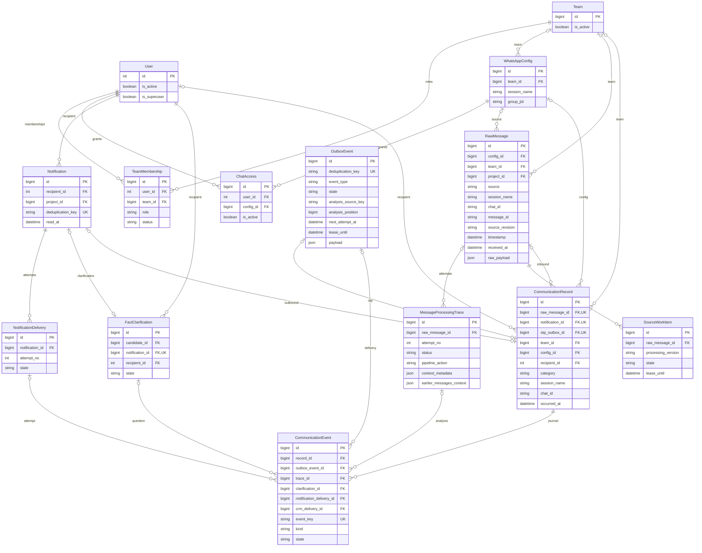
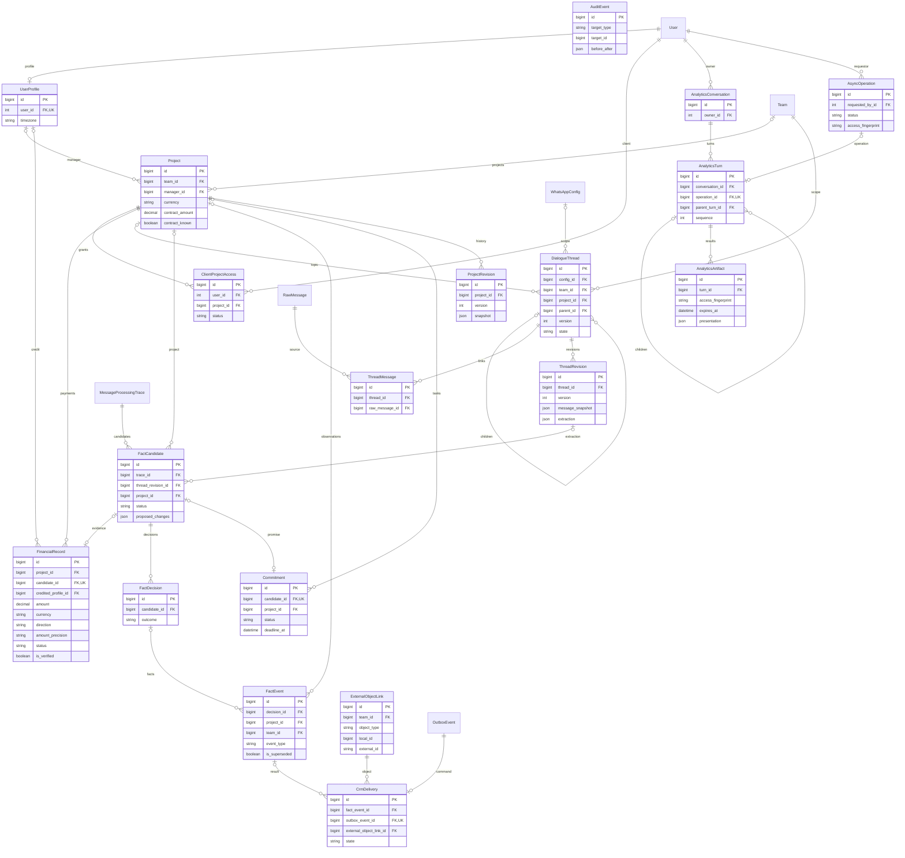
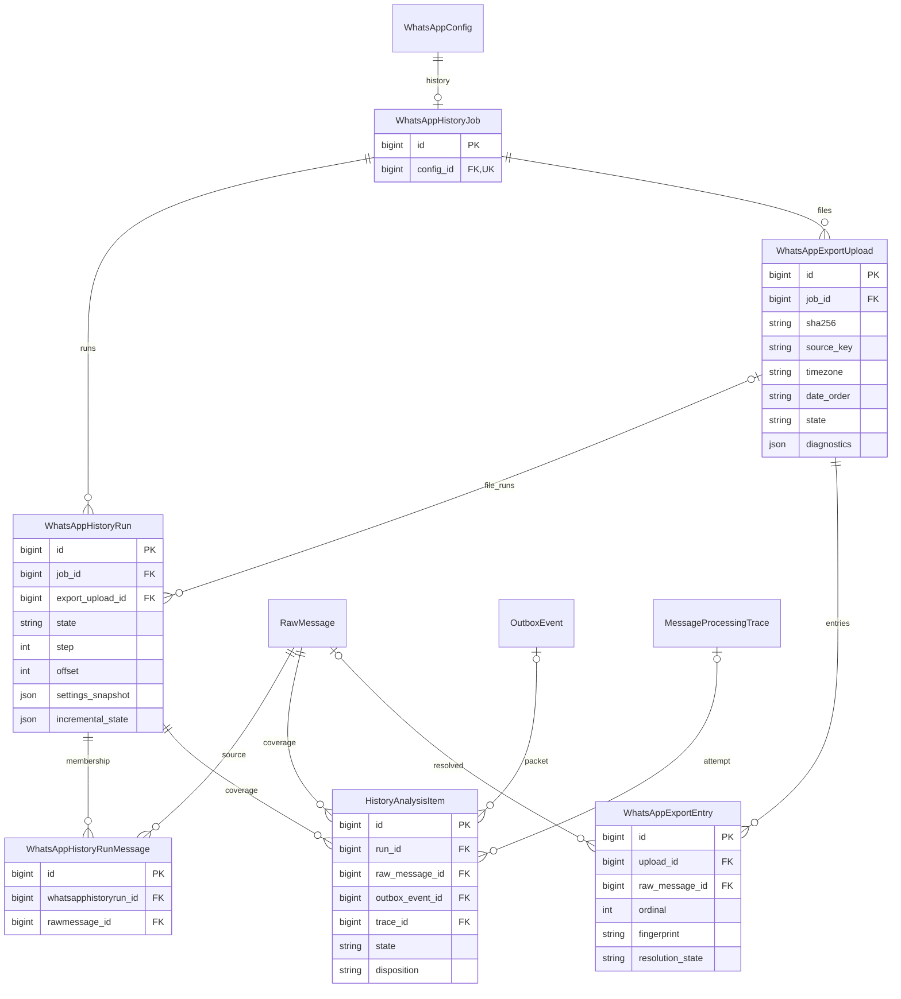
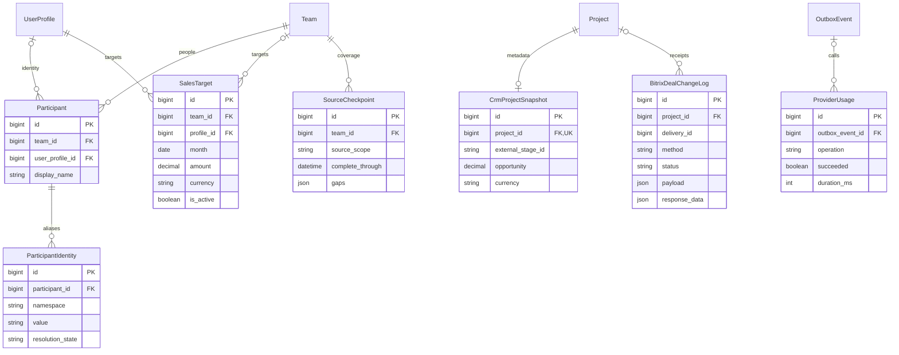
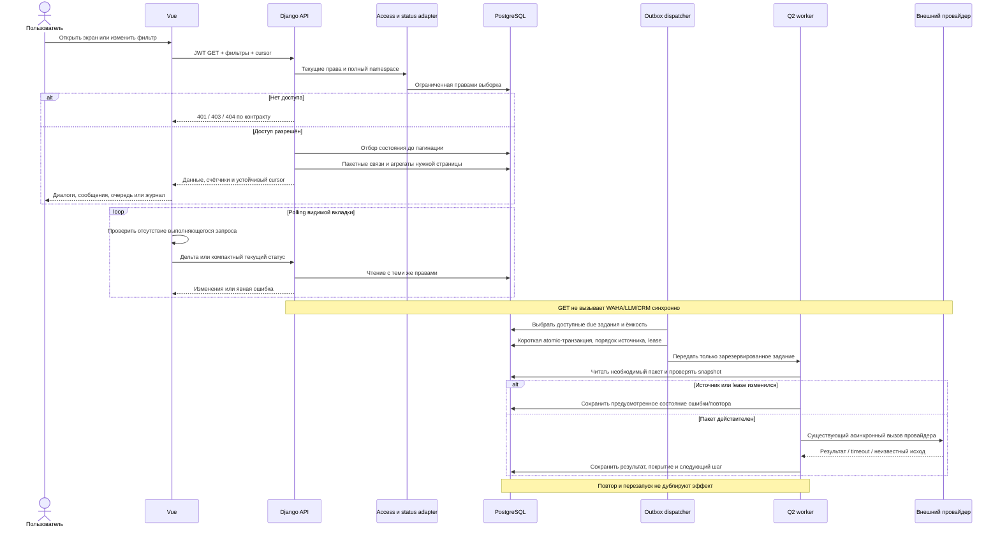

# Оптимизация ORM и доступа к данным Mazory

- Задача: `orm-performance`, прямое поручение пользователя, без GitHub Issue.
- Создана: 2026-10-18 19:03:08 MSK (UTC+3).
- Ветка спецификации: `docs/orm-performance`.
- Базовый код: `main`, `ca0ff62b6a79121f158b4f73ac9be2e81a3705b3`.
- Статус: **спецификация согласована; этап I влит (`725283a`), этап II реализован локально в `refactor/orm-performance-stage-2`; этап 0 и измеримая performance-приёмка остаются незакрытыми**.
- Основание: аудит 20 групп проблемных мест после production-таймаута Messenger; исправление `attention=1` уже выпущено в PR #94.
- Единственный текстовый артефакт задачи — этот файл. Измерения, решения по индексам, изменения контрактов и итоговая приёмка дополняются здесь.

## 1. ERD затронутых данных

Диаграммы показывают **существующие** модели и значимые для задачи поля, проверенные по `backend/api/models.py` и миграциям до `0060`. Использованы модельные имена; обычные таблицы имеют префикс `api_`, `User` — `auth_user`. `AuditEvent.target_type/target_id`, числовые ID внутри `OutboxEvent.payload` и `ExternalObjectLink.local_id` не являются внешними ключами. Неизвестные исторические `created_at/updated_at` допускают `NULL`.

### 1.1. Права, коммуникации и текущие состояния

У `CommunicationRecord` действует существующий контракт единственного источника; для внутренних записей допустим только `deduplication_key`. Идентификатор диалога — полный `(session_name, chat_id, category, team_id)`. Дополнительная M2M-связь `FactClarification.candidates` сохраняется и учитывается при построении цепочки; она не заменяет основной `candidate_id`.

### 1.2. Финансы, темы, решения и аналитические разговоры

`AuditEvent` связан с проектом логическим ключом, а не FK. `ExternalObjectLink.local_id` тоже типизирован парой `local_type/local_id`, а не FK проекта. Диаграммы не предписывают превращать эти поля во внешние ключи.

### 1.3. Импорт и покрытие анализа

Таблица through для `WhatsAppHistoryRunMessage` — `api_whatsapphistoryrun_messages`. Существующие уникальности `(run,raw_message)`, `(upload,ordinal)`, `(thread,version)`, `(raw_message,attempt_no)` и ключи идемпотентности сохраняются.

### 1.4. Справочники, финансовые планы и квитанции

`BitrixDealChangeLog.delivery_id` — сохранённый числовой идентификатор, не FK; связь с CrmDelivery проверяется запросом. Остальные конфигурационные модели читаются через существующие разрешённые настройки; их секретные поля не входят в проекции/метрики. Новые связи в схему этой диаграммой не вводятся.

**Планируемое состояние схемы:** базовый вариант не добавляет таблицы, FK или новые бизнес-состояния. Допустимы только обоснованные индексные миграции по §8. Новые витрины, persisted counters, staging-парсер и таблицы принадлежности заданий относятся к альтернативам Б; для их включения сначала дополнить этот файл конкретной схемой, backfill, совместимостью и откатом, затем согласовать изменение объёма. Их отсутствие не препятствует реализации базового варианта А.

## 2. Последовательности оптимизированных сценариев

Диаграмма описывает существующий многошаговый процесс и оптимизацию чтений/резервирования. Процедуры подтверждения доставки, MFA и восстановления неизвестного исхода сохраняются.

## 3. Постановка и исходные свидетельства

Снизить количество SQL, перенос ненужных JSON, повторные полные проходы и длительность блокировок в 20 группах аудита. Устранить остаточные тяжёлые фильтры Messenger и зависимость стоимости списков от числа объектов страницы. Сохранять фактическую полноту данных и пользовательский результат.

Аудит выполнен на `ca0ff62`. Прямые вызовы существующих GET-обработчиков выполнялись в текущем production backend, в read-only транзакциях с `statement_timeout=2000ms` и `lock_timeout=500ms`. Это время **без HTTP-сети, middleware и браузерного рендеринга**; одиночные измерения не являются p95 или нагрузочной приёмкой.

| Сценарий | Полученный результат | Что подтверждено |
|---|---|---|
| Messenger `analysis=error/analyzed/queued` | Каждый SQL прерван защитным лимитом примерно через 2 с | Три варианта одного тяжёлого пути; 504 каждого варианта не воспроизводился |
| План `analysis=error` | 17 subplan, 133 JIT functions, estimated cost 289305.45 | `EXPLAIN` без `ANALYZE`; cost не измеряется в миллисекундах |
| Очередь, limit 5 / 50 | 9 / 54 SQL; 0.284 / 0.309 с | Запросы на каждую строку |
| Сериализация 5 / 30 уведомлений | 12 / 62 SQL; 0.092 / 0.295 с | Обход prefetch и отдельный reverse OneToOne; сюда не включена вся пагинация endpoint |
| CRM-журнал, limit 50 | 7 SQL; 3.607 с | Небольшое число SQL само по себе не гарантирует быстрый ответ |
| Операционная аналитика | 16 SQL; 1.488 с | Весь входящий cohort обрабатывается при GET |
| Исправленный attention Messenger | 9 SQL; 0.901 с | Рабочая база сравнения; исправление PR #94 не откатывать |
| Список трасс сообщения с 26 попытками | 0.505 с, 26 строк | Поля/объём требуют оптимизации; таймаут этого сценария не подтверждён |
| Fingerprint прав / текущий аналитический разговор | 4 / 15 SQL; 0.007 / 0.105 с | Малый пример не показывает масштаб длинной истории |

На момент аудита `pg_stat_statements` не установлен. Полной частотной статистики SQL за сутки нет в результатах аудита. Активного обычного сотрудника с membership для сравнения runtime сложного scope не оказалось; обычные роли обязательно проверить на изолированных данных. 20 пунктов ниже — группы работ, а не 20 доказанных production-таймаутов.

## 4. Общие обязательные требования

1. Сохранять `access.py`, актуальные memberships, ChatAccess, client/project grants, личного адресата, полную транспортную область чата и MFA. Суперпользовательский прогон не заменяет проверку обычных ролей. Не кэшировать готовые ответы между разными правами.
2. Фильтрация прав, поиска, состояния и бизнес-выборки выполняется до пагинации. Обновлённое состояние после удачного повтора не должно включать старую ошибку в текущий attention. История попыток сохраняется отдельно.
3. Не вводить скрытые лимиты на историю, знаменатели аналитики, число проблемных сообщений и доступные проекты. Для длинных коллекций — явная пагинация с `next_cursor`; итоги считаются по полной разрешённой выборке.
4. Сохранять число, смысл и приоритет осей состояний из канонического адаптера. Сравнивать DTO, ID, суммы, счётчики и курсоры до/после; расхождение объяснить и согласовать до выпуска.
5. Использовать `.only()`, `.values()`, JSON-key projection и пакетные связи так, чтобы последующий доступ к deferred field не создавал скрытый N+1. Уменьшение числа SQL не должно достигаться загрузкой всей истории в RAM.
6. Не отключать JIT глобально, не увеличивать timeout и не ослаблять блокировки/проверки как способ пройти приёмку. `Subquery`, `Exists`, `get_or_create` и блокировки не считаются дефектами сами по себе.
7. Все внешние вызовы остаются в Q2. HTTP не выполняет WAHA/CRM/LLM/export синхронно. В работе с очередью сохраняются лимиты in-flight, lease, порядок одного источника, operation/dedup keys, защита от повторного эффекта и неизвестного результата.
8. Не менять неизвестные даты `NULL` на вымышленное время. Сохранять детерминированный `NULLS LAST`, tie-breaker и продолжение курсора в недатированной части. ID остаются числовыми согласно DTO; новые типы — в `frontend/src/types/`.
9. Polling не перекрывает выполняющийся запрос, скрытая вкладка не создаёт фоновую нагрузку, ошибка имеет retry/backoff. Таймаут запроса приводит к явному состоянию ошибки, а не вечной загрузке.
10. Не логировать SQL с параметрами, токены, raw payload, OTP, текст переписки и секретные пути webhook. Диагностика содержит fingerprint/имя сценария, длительность, число запросов, агрегированный объём и correlation ID.
11. Использовать Docker: разработка/проверки — `kk-minsk`, production — `mazory-remote`; отдельные синтетические данные и volumes. Не копировать production-переписку для локального профилирования. Не устанавливать проектные сервисы/зависимости на хост.
12. Не создавать unit/component/integration/mock-наборы, E2E-инфраструктуру, CI-задания или новые требования E2E. Приёмка — Docker checks, измерения реальных read/write путей в изолированной среде и ручная проверка UI. Никаких рабочих отправок ради измерения.

## 5. Реестр 20 работ и варианты

Основной план — **вариант А** каждого пункта. Альтернативы Б сохраняются для решения по фактическим измерениям, не считаются автоматически входящими в реализацию. Переход к Б с изменением схемы/процесса требует конкретизации в этом же файле. Оценки — предварительные рабочие дни одного разработчика, без ожидания внешних согласований; их нельзя просто складывать из-за общих зависимостей.

### ORM-01. Фильтры анализа Messenger — этап I

- Код: `backend/api/messenger_api.py:326–369`, DialogsView и RecordsView.
- Проблема: повторение последней трассы/работы/уточнения внутри выражений состояния и последующей группировки.
- **А, 0.5–1 день:** выбирать ID последних записей до чтения тяжёлых полей; вычислять необходимые состояния одним переиспользуемым запросом/пакетным адаптером. Не размножать одни и те же коррелированные выражения в `CASE` и `GROUP BY`; не прогонять без ограничений весь scoped cohort в Python ради первой страницы. SQL-представление состояний сверяется с `axes_for_records` для всех ветвей, включая queued clarification, delivery/OTP и CRM.
- **Б, 3–5 дней:** отдельная проекция текущих статусов с инвалидацией, восстановлением и проверкой прав при каждом чтении.
- Готовность: все 7 `analysis` отдельно и вместе с `attention`, `cohort=source`, поиском, категорией/namespace и курсором дают точные ID/счётчики и выполняют бюджеты §7. Историческая исправленная ошибка не возвращается.

### ORM-02. Очередь заданий — этап I

- Код: `backend/api/operations_api.py:208–265`.
- **А, 2–4 часа:** пакетно получить CommunicationRecord по raw IDs, существующие SourceWorkItem и нужные разрешения; проецировать только необходимые payload keys. Удалить `.first()`/`.exists()` на строку.
- **Б, 2–3 дня:** единая проекция логического задания и связанных попыток.
- Готовность: число SQL не растёт линейно при limit 5/50/100; AI-outbox с существующим SourceWorkItem не дублируется. Исключение дублей выполняется до ограничения страницы либо через дочитывание, чтобы не терять дальнейшие записи/курсор. Смешанный курсор source_work/outbox сохраняет недатированные строки.

### ORM-03. Уведомления — этап I

- Код: `backend/api/notification_views.py:74–89`, `backend/api/notifications.py:118–134`, `frontend/src/shell/ShellNotifications.vue`.
- **А, 2–4 часа:** `select_related` уточнения, использование prefetched deliveries без нового `.values()`, переиспользование paginator count; компактный unread count. Сохранить nullable legacy timestamps.
- **Б, 1 день:** отдельное чтение badge и пагинированного списка.
- Готовность: одинаковые notifications, deliveries, unread/count и порядок; объём страницы 5/30/50 уведомлений не добавляет SQL на строку. Существующий default page size 50 сохраняется. Polling панели использует in-flight guard/видимость/backoff.

### ORM-04. CRM-журнал и диагностика Messenger — этап I

- Код: `backend/api/operations_api.py:273–383`, `backend/api/messenger_api.py:655–850`.
- **А, 0.5–1 день:** выбирать нужные поля кандидата, решения, trace, outbox и квитанции; JSON-проекция `crm_baseline`, proof и разрешённых metadata. Для `has_context/has_raw_payload` не переносить сами payload. В chain пакетно проверить доступность связанных вопросов/ответов. Детальный контекст получает только запрошенные поля и страницу; список попыток не читает полный historical snapshot.
- **Б, 2–4 дня:** разнести краткую запись и тяжёлый payload в хранении.
- Готовность: actor, публичные CRM URL, методы, receipt, before/after, reconstructed, количество попыток и права каждого узла совпадают; детали доступны по явному запросу. Проекция не создаёт deferred-field N+1.

### ORM-05. Операционная аналитика — этап II

- Код: `backend/api/operations_api.py:135–205`.
- **А, 1–2 дня:** общий запрос текущих состояний ORM-01 и SQL-агрегаты вместо полного materialize inbound и Python-счётчиков; объединить совместимые условные COUNT. Корректно считать latest delivery/CRM отдельно от failed attempts.
- **Б, 3–5 дней:** инкрементальные агрегаты с периодом актуальности и полной сверкой.
- Готовность: полная разрешённая выборка, период, timezone, totals и dynamics совпадают; не появляется скрытый cap 5000/100000. Число запросов не зависит от числа входящих сообщений.

### ORM-06. KPI по менеджерам и проектам — этап II

- Код: `backend/api/datamart.py:119–185,189–308`, `project_workspace.py`.
- **А, 1–2 дня:** групповые агрегаты оплат/планов/ожидаемых команд по manager/project, пакетная загрузка CRM snapshot; переиспользование totals в `project_row` без нового запроса.
- **Б, 3–5 дней:** финансовая витрина по версии данных и разрешённой области.
- Готовность: суммы только подтверждённых оплат нужной валюты, precision/direction, отрицательный остаток/переплата, timezone и полнота истории сохраняются; отсутствие данных не превращается в ноль. Рост числа менеджеров/проектов не добавляет отдельный SQL на каждого.

### ORM-07. Прогресс анализа/импорта — этап I

- Код: `history_analysis.py:97–125`, `history_jobs.py:285–310`, `settings_api.py:398–406` и вызовы progress из worker.
- **А, 1–2 дня:** SQL `GROUP BY state,disposition`, условные агрегаты кандидатов; пакетный расчёт выбранных до 30 runs, общие last/waiting/running/usage выборки. Завершённые неизменившиеся runs не пересчитывать без причины. Если используются snapshots результатов, определять актуальность по всем зависимым источникам, не только `run.updated_at`.
- **Б, 2–4 дня:** durable counters с восстановлением/сверкой и учётом повторных переходов.
- Готовность: все поля progress и legacy path совпадают; увеличение 1→30 runs не вызывает около 9 новых SQL на каждый; 100000 coverage rows не переносятся в Python ради Counter. UI корректно обновляет активный запуск и сохраняет историю.

### ORM-08. Настройки WhatsApp и directory — этап I

- Код: `settings_api.py:265–278`, `waha_admin_views.py:control_state`, `participants.py:directory_sync_status`, `platform_views.py:DirectoryView`.
- **А, 0.5–2 дня:** группировать config по session; пакетно выбирать активные/последние control и participant-sync события, ограничить поля; разнести/пагинировать большие каталоги участников и обновить их потребителей.
- **Б, 2–3 дня:** текущая ссылка на событие синхронизации у session/config.
- Готовность: число SQL не зависит от числа config; одна session не запрашивается повторно; приоритет активной команды над последней завершённой и изоляция team/session/chat сохранены. QR/MFA/действия остаются рабочими, справочники не теряют элементы при пагинации.

### ORM-09. Scope Outbox для обычных ролей — этап II

- Код: `backend/api/operation_scopes.py`.
- **А, 1–2 дня:** измерить ветви обычных ролей, сократить повторное вычисление JSON keys/authorization subqueries, использовать узкие aliases, семантически эквивалентные наборы ID/`Exists` и обоснованные expression indexes. Не увеличивать область для ускорения OR/DISTINCT.
- **Б, 3–5 дней:** типизированные связи/таблица принадлежности заданий сущностям и backfill старых payload.
- Готовность: точное совпадение разрешённых ID для admin/lead/finance/manager/client/integration; malformed, отсутствующие и чужие payload ID безопасно исключаются. Plain JSON GIN не считать универсальным решением regex+cast.

### ORM-10. Workspace проектов — этап II

- Код: `backend/api/project_workspace.py:22–104`.
- **А, 0.5–1 день:** batch-агрегаты полноты/ошибок, нужные поля и доступные source IDs; не загружать всю переписку и полные trace JSON для страницы проектов. Проверить JOIN fan-out поиска aliases/parties и корректность `distinct` totals.
- **Б, 2–3 дня:** проекция полноты и причин по проекту.
- Готовность: все фильтры/счётчики полноты и доступные ссылки совпадают; в RAM попадает только нужная страница/агрегаты, а не история её проектов; источники проверяются текущими правами.

### ORM-11. Список и детали тем — этап III

- Код: `backend/api/thread_views.py:57–220,321–376`.
- **А, 1–2 дня:** last-per-thread выборка без всех ревизий, узкие candidate поля, доступные project IDs только страницы; проверить одновременные Count children/message_links. Для длинной детали — отдельные страницы сообщений, кандидатов и детей.
- **Б, 3–4 дня:** summary темы, latest revision и отдельные detail payload.
- Готовность: количество сообщений/детей не умножается JOIN-ами; последняя ревизия/кандидат выбраны детерминированно; candidate context не вкладывает всю большую тему; пользователь может дочитать всю историю через UI.

### ORM-12. Аналитические разговоры и fingerprint прав — этап III

- Код: `backend/api/analytics/dialogue.py:33–83`, `backend/api/access.py:fingerprint`.
- **А, 0.5–1 день:** один fingerprint пользователя на HTTP-запрос, передача его serializer/usable; ограниченные страницы turns/artifacts без лишних JSON. Повторное вычисление в следующем запросе обязательно, изменения grants видны сразу. Очистку старых разговоров вынести из GET в существующий фоновой механизм с прежним сроком хранения.
- **Б, 2–3 дня:** версия прав и краткие snapshots.
- Готовность: сроки доступности/ownership/parent links и явные expired состояния сохранены; GET не выполняет удаление; добавление turns не добавляет 4+ SQL fingerprint на каждый; UI продолжает историю через страницы.

### ORM-13. История проекта — этап III

- Код: `backend/api/platform_views.py:478–495`.
- **А, 0.5–1 день:** summary и cursor pagination revisions, payload отдельного snapshot по запросу; измерить поиск AuditEvent и при необходимости индекс логического ключа/порядка.
- **Б, 1–2 дня:** общая проектная событийная лента.
- Готовность: доступность проекта проверяется на каждом detail/page; все версии/события доступны без дублей, неизвестные времена сохранены. Не обрезать историю молча до первой страницы.

### ORM-14. Полная история для LLM — этап IV

- Код: `backend/api/full_history.py:112–140,454`, `message_context.py`.
- **А, 1–2 дня:** узкая проекция обязательных полей `source_metadata`, исключение повторной сортировки, потоковый расчёт hash/проверки и последовательное чтение пакетов. Не менять состав полного источника и не заменять проверку полного hash только max ID: редактирование существующего сообщения должно обнаруживаться.
- **Б, 3–5 дней:** сохранённый неизменяемый snapshot, версия/fingerprint источника и чтение частей без повторной реконструкции всей истории.
- Готовность А: тот же упорядоченный источник, `source_hash`, выбор последней редакции, `snapshot_max_id`, временные метаданные и провайдерный запрос на тех же входах; снизить память/лишние поля. Базовая А всё ещё может требовать полного O(N) hash-прохода на этап; **не заявлять устранение O(N×число этапов)**. Если это остаётся доминирующей стоимостью, зафиксировать отдельное решение Б в этом файле.

### ORM-15. TXT-импорт WhatsApp — этап IV

- Код: `backend/api/whatsapp_exports.py:63–142`, `whatsapp_export_parser.py`.
- **А, 1–2 дня:** ограничить done ordinals текущей страницей, пакетно получать aliases/matching candidates, объединить счётчики, безопасные bulk-записи; уменьшить время удержания job/config lock. Не пропускать communication/signals/temporal effects, которые нужны бизнес-контракту.
- **Б, 3–5 дней:** однократный разбор в staging с durable checkpoint и дальнейшей обработкой страниц; отдельно определить поля/очистку staging и сохранение checksum.
- Готовность А: те же matched/created/blocked/excluded, multiplicity одинаковых сообщений, source snapshot, timezone/date order/line numbers, checksum и повтор без дублей; запросы чтения на страницу не растут от уже импортированного префикса. Полный повторный parse файла в А остаётся известным ограничением и измеряется отдельно; не считать его устранённым. Условие перехода к Б — доминирующее время повторного parse после пакетной оптимизации.

### ORM-16. Диспетчер Outbox — этап IV

- Код: `backend/api/tasks.py:dispatch_outbox`, `management/commands/run_outbox.py`.
- **А, 1–2 дня:** сразу исключать недоступный класс работ при исчерпанной ёмкости, переиспользовать проверенные счётчики в пределах корректного атомарного claim, ограничить выборку и подобрать индексы due/lease. Финальная проверка конкурентной ёмкости внутри блокировки обязательна.
- **Б, 3–5 дней:** отдельные очереди по классу, атомарное резервирование с сохранением порядка и source ownership.
- Готовность: нет до 100 повторных глобальных COUNT при заполненных 2 слотах; одновременно два dispatcher не превышают лимит и не резервируют одно событие; просроченные lease восстанавливаются, активный lease не захватывается повторно; доступные delivery/CRM задания не голодают за AI backlog.

### ORM-17. Ежедневные сводки и risk planning — этап II

- Код: `backend/api/notifications.py:345–367,437–454`.
- **А, 4–8 часов:** пакетно проверить dedup ключи по user/локальной дате до KPI; preload preferences, рассчитывать только ещё необходимые сводки. Для risk использовать дешёвую проверку изменений релевантного набора/периода, не прятать новые риски за уже существующим digest.
- **Б, 2–3 дня:** durable `next_run_at`, общий mart по scope/версии и отдельная доставка.
- Готовность: повтор того же minute tick после созданного daily digest не запускает mart снова; две гонки не создают дубль; локальная дата/время, настройки доставки и отказ после создания/до отправки не теряют уведомление.

### ORM-18. Контекст тем для LLM — этап IV

- Код: `backend/api/dialogue_threads.py:80–101`.
- **А, 1 день:** пакетно получить commitments и links выбранных тем, применить корректные лимиты 10/40 на каждую тему, а не ко всему общему queryset.
- **Б, 2–3 дня:** контекст по version/revision с явной инвалидацией.
- Готовность: тот же порядок/состав контекста; 20 тем не создают около 42 SQL. Не делать безлимитный prefetch истории каждой темы.

### ORM-19. Планирование анализа истории — этап IV

- Код: `backend/api/history_analysis.py:14–76`, `processing_attempts.py:reserve_attempt`.
- **А, 1–2 дня:** общий cfg/snapshot max на операцию, preload существующих items/attempts, безопасные bulk-операции и ограниченные пакеты чтения/записи **внутри существующей общей atomic-транзакции**. Сохранить порядок целей `(timestamp,id)` и идентичность существующего пакета/operation key. Outbox становится видимым dispatcher только после общего commit. `run.step` остаётся fence задания импорта и не используется как номер страницы планировщика; `incremental_state` в А не получает нового planner-протокола.
- **Б, 3–4 дня:** самостоятельный durable planner со страницами и короткими транзакциями. До включения Б в этой спецификации определить отдельный `incremental_state.planner_v1`, границу/порядок frozen targets, cursor, generation и идентичность пакета, атомарный commit items/events/checkpoint и запрет публикации частично спланированного запуска. Fence импорта `run.step` сохраняется отдельно; также описать отмену, изменение источника, восстановление после каждой точки отказа и совместимость старых worker.
- Готовность А: сохранены номер попытки, уникальность operation key, покрытие всех целей и `replace_unsent` guards; сбой внутри planning полностью откатывает транзакцию, повтор не создаёт дубль уже зафиксированных items/attempts/events. Два вызова и отмена не публикуют частичный план. Уменьшение SELECT/времени транзакции измеряется, но А **не объявляется планировщиком с commit на каждую страницу**. Если оставшаяся длительность общей транзакции неприемлема по замерам, пункт требует решения о Б.

### ORM-20. Reconcile фоновых задач — этап IV

- Код: `backend/api/autonomous.py:627–651`.
- **А, 1 день:** ограничить active lookup рассматриваемыми IDs/source, выбирать raw_id/batch_ids вместо полного payload; пакет failed IDs, raw_message и projects; `select_related` для нужных FK. Проверять routed-thread ownership и задания с `batch_ids`, а не только `raw_id`.
- **Б, 2–4 дня:** типизированная связь заданий и источников с backfill.
- Готовность: число дополнительных чтений не растёт на один SQL для каждой из 100 записей; не создаются конкурирующие recovery/full-history/routed-thread задания; неизвестный CRM исход не превращается в повторную внешнюю запись.

## 6. Этапы, зависимости и границы завершения

| Этап | Состав | Результат |
|---|---|---|
| 0 | Безопасный сбор baseline, форма метрик и синтетические наборы §7 | Есть сравнимые ID/суммы/SQL/время/объём для обычных ролей, не только admin |
| I | ORM-01,02,03,04,07,08 | Остаточные фильтры Messenger и частые экраны без N+1/тяжёлых ненужных JSON; ориентир 4–6 рабочих дней |
| II | ORM-05,06,09,10,17 | Общие состояния/агрегаты/права, workspace и отсутствие повторного расчёта готовых сводок |
| III | ORM-11,12,13 | Темы, проектная и аналитическая история с явной пагинацией и изменёнными потребителями Vue |
| IV | ORM-14,15,16,18,19,20 | Пакетные фоновые операции с сохранением hash, lease, порядка и идемпотентности |
| V | Итоговая повторная приёмка затронутых путей, выпуск и production readback | Зафиксированы принятые/непринятые пункты, релиз и фактические показатели |

ORM-01 предшествует общему расчёту ORM-05; ORM-06 переиспользуется ORM-17, но ранний dedup ORM-17 может внедряться независимо. ORM-07 общий для HTTP и worker. ORM-09/16/20 должны пользоваться согласованным пониманием source ownership. Изменения пагинации ORM-08/11/12/13 выпускаются с Vue в том же этапе.

Каждый этап — отдельная реализационная ветка/PR в `main`, описание ссылается на этот файл; отдельные спецификации/планы/реестры не создаются. Исходная ветка `docs/orm-performance` содержит только спецификацию. Успешный этап I не означает выполнение всех 20 пунктов. Полное выполнение базового объёма — все А, без нерешённых нарушений собственных критериев; ограничения А для ORM-14/15 отдельно остаются видимыми. Решение по Б принимается по измерениям и отражается в этой же спецификации.

## 7. Измерения и критерии производительности

### 7.1. Воспроизводимая процедура

- Проверки только на изолированном Docker Compose в `kk-minsk`, с собственной БД/Redis/volumes и синтетическими пользователями. Не создавать новые постоянные тестовые наборы/раннеры. Разовые измерения и ручные запросы используют настоящее приложение/БД, без подмены frontend API.
- До baseline записать SHA приложения, версии образов/PostgreSQL, CPU/RAM limits и размер набора. Для before/after не менять ресурсы/данные/конкуренцию/настройки PostgreSQL. Нет фоновых чужих задач внутри проверочного проекта.
- Разделять server handler/SQL, HTTP и время полезного экрана. SQL count считать без BEGIN/SET/auth middleware, отдельно отмечать обычные permission queries. Измерять wall time, число SQL, bytes ответа, process RSS/high-water mark, число посещённых строк/пакетов, план и lock waits по необходимости.
- Для p95: 3 прогрева, затем 30 последовательных измерений каждого выбранного параметра/роли. Указать median/p95/max, ошибки и отмены; не исключать медленные успешные ответы. Длительные фоновые сценарии сравнить минимум 3 раза, учитывая setup отдельно. Это не проверка пропускной способности при произвольном числе пользователей.
- Сначала `EXPLAIN (FORMAT JSON)` без исполнения; `EXPLAIN ANALYZE` — только на изолированной БД. Для production допустимы ограниченные чтения с statement/lock timeout; не выполнять многопользовательскую нагрузку, генерацию данных и DDL ради диагностики.
- В baseline и after использовать одинаковые фильтры, направление сортировки, окна дат, cursor и набор прав. Временно неизменяемые данные позволяют сравнивать точные множества; конкурентные изменения проверяются отдельно.

### 7.2. Минимальные синтетические наборы

| Набор | Объём / обязательные случаи |
|---|---|
| Коммуникации | 100000 RawMessage, 100 диалогов, 3 команды; до 3 попыток на сообщение; все 7 analysis states, все attention причины, исправленные ошибки, уточнения и личные ответы |
| Большие поля | В части трасс/квитанций payload 100 KiB–1 MiB; метаданные/сырые контексты в основном не нужны списку. Задокументировать распределение, не раздувать каждый из 300000 trace одинаковым мегабайтом |
| Права | admin, lead, finance, manager, client, integration; доступный и чужой чат одной команды, личные сообщения другого пользователя, отозванный grant, неактивная команда |
| Операции | 100000 OutboxEvent с преобладанием terminal и разными types, leases, датами NULL; до 10000 CRM deliveries/receipts; осмысленные JSON ID плюс malformed/missing keys |
| Списки | 50 уведомлений страницы, 100 config (в том числе общая session), 30 history runs с суммарно 100000 coverage items |
| Проекты и темы | 1000 проектов, 20 менеджеров, 100000 финансовых записей; тема с 10000 links/100 ревизиями, проект с 1000 ревизиями |
| Аналитический разговор | 200 turns, минимум 1 artifact/turn, expired/failed/parent связи и смена прав между запросами |
| Импорт | TXT до существующих 20 MiB/100000 записей, включая одинаковые сообщения, неоднозначность, медиа/служебные строки, timezone/date-order случаи |

Большие наборы могут быть отдельными фазами в одной изолированной среде; одновременно хранить все комбинации не требуется. Они не обращаются к рабочим WhatsApp/CRM/LLM аккаунтам. Для оптимизации истории сравниваются source IDs, metadata, hash и сформированные пакеты до внешней отправки; качество модели не выдаётся за проверенное.

### 7.3. Целевые бюджеты

Бюджеты — критерии новой локальной приёмки, **не уже достигнутые показатели** и не SLA при неизвестной production-нагрузке. Порог действует на наборе §7.2 в зафиксированной конфигурации; нехватка ресурсов/невалидный baseline фиксируется до изменения кода и требует уточнения здесь, а не тихого ослабления критерия.

| Путь | SQL/масштабирование | Цель |
|---|---|---|
| Messenger dialogs/records с analysis/attention | Нет повторного SQL на строку; никаких hidden caps | Handler p95 ≤1 с; ни одного SQL timeout; прямые ссылки/все курсоры корректны |
| Очередь, уведомления, CRM list | Admin handler ≤12 SELECT для limit≤100; обычная роль ≤25; рост limit 5→50→100 добавляет не более 2 SELECT | Handler p95 ≤0.8 с; для CRM также ≥50% уменьшение времени при тяжёлых JSON |
| Settings/control/directory, progress 30 runs | Нет 2–3 SQL/config и 9 SQL/run; рост 1→30 runs либо 1→100 config добавляет ≤4 SELECT на каждый самостоятельный список | Handler p95 ≤1 с для страницы; history coverage не materialize целиком |
| Операционная аналитика, KPI/workspace | Число SQL не растёт линейно от messages/managers/projects; группы считаются в БД | Handler p95 ≤2 с на полном наборе, точные totals |
| Темы/истории/conversation | Измеряемая страница 50 объектов; default/max конкретизированы в §9, глубина payload ограничена; fingerprint один раз/request | Handler p95 ≤1 с; доступ ко всем страницам; bytes краткой страницы не растут от длины скрытой истории |
| LLM context 20 тем | Не более 6 SELECT для самостоятельного `context_threads` на подготовленном scope | Тот же контекст и лимиты 10/40; нет безлимитного prefetch |
| Full history, TXT import А | Считать SQL/bytes/parse/hash отдельно; сохранять известные полные проходы | ≥50% уменьшение peak RAM или переносимых ненужных данных, ≥30% уменьшение DB-времени на больших входах; полное время не ухудшается >10% |
| Planner/reconcile/dispatcher | Read-запросы пакетные; необходимые записи/уникальные claims считаются отдельно | ≥50% уменьшение SELECT относительно baseline на одном наборе; lock-hold p95 не ухудшается и не охватывает внешние вызовы |

Для worker А, где алгоритмически остаётся O(N) полный hash/parse, замер должен явно показать эту зависимость. Если цель А или обязательная корректность не выполнена, пункт остаётся незавершённым: исправить реализацию либо конкретизировать/согласовать Б, не отмечать работу выполненной только за сокращение SQL.

### 7.4. Функциональные критерии

- Все роли проходят доступные списки/детали; недоступные чаты, личные адресаты и данные другой команды не появляются в счётчиках/ссылках/поиске/дельтах. Отзыв доступа виден в следующем запросе, включая fingerprint и артефакты.
- Курсоры списков/историй проходят до конца без повторов/пропусков на фиксированных данных; проверены одинаковые времена, даты NULL, объединённые источники и обратная навигация/перезагрузка URL.
- Состояния queued/analyzing/need_context/error/analyzed/no_crm_actions/received, доставка/OTP, уточнения и CRM совпадают с сохранённым эталоном осей. Ошибочная ранняя попытка после успешной поздней остаётся только в истории.
- Финансы совпадают до копейки с учётом currency/precision/verification; completeness/coverage и «нет данных» не меняются ради скорости.
- При двух dispatcher, повторе/остановке worker и истёкшем lease сохраняются единственность claim, порядок источника, in-flight cap, покрытие каждого target и idempotency. Bulk не обходит обязательную коммуникационную/temporal проекцию и audit.
- Формируемая полная история и source_hash совпадают; изменение текста/редакции/временных метаданных после snapshot обнаруживается. Порядок, полнота и source ownership не подменяются только последней сотней сообщений.
- UI: выбор диалога, фильтры, очередь, уведомления, настройки, темы и новые страницы истории доступны; нет вечных skeleton и перекрывающего polling; пользователь может дочитать данные, скрытые за пагинацией.

## 8. Индексы, наблюдаемость и миграции

### 8.1. Индексы

Во время аудита в production подтверждены существующие индексы: `OutboxEvent` по state/next_attempt_at/analysis_source_key и `analysis_dispatch_idx(analysis_source_key,state,next_attempt_at,analysis_position)`; unique `(raw_message,attempt_no)` трасс, `(raw_message,processing_version)` работ; namespace/scope/recipient индексы CommunicationRecord. У RawMessage в моделях/миграциях уже есть `(config,timestamp,id)` и `(team,source,project,timestamp,id)`.

Кандидаты, **не список обязательных CREATE INDEX**:

- последняя трасса `(raw_message_id,id DESC)` — только если изменение формы запроса и существующий индекс не достаточны;
- due/active/lease Outbox — partial/compound по фактическим event_type/state/next_attempt_at/lease access paths;
- cursor очереди/CRM — порядок `updated_at DESC NULLS LAST,id DESC`, с нужными селективными фильтрами;
- recipient/unread Notification и логический ключ AuditEvent с порядком;
- `(run,state,disposition)` coverage и иные агрегаты — по плану/распределению;
- expression indexes JSON keys — точное соответствие guarded cast/regex выражению, либо отказ от них в пользу существующих FK-путей.

Для принятого индекса в этом файле записать запрос/fingerprint, план before/after, время, размер, цену записи и причину, почему существующий индекс не подходит. Учитывать NULLS LAST и направления колонок. Не создавать наборы почти дублирующихся индексов и не индексировать каждый JSON наугад.

Изменения только миграциями Django, согласованными с `Meta.indexes`; для большой production-таблицы использовать поддерживаемую concurrent-операцию PostgreSQL в non-atomic миграции, проверить valid/ready и поведение после неудачи. Не оставлять manual DDL/расхождение состояния Django. При отсутствии обоснованных индексов отсутствие новой миграции допустимо.

### 8.2. Наблюдаемость

Обязательны воспроизводимые разовые измерения §7 и безопасные агрегированные метрики по именованным сценариям. Не включать DEBUG SQL с параметрами в production.

`pg_stat_statements` — рекомендуемый отдельный операционный шаг. Сначала проверить версию, доступность extension, `shared_preload_libraries`, требование restart и уже существующие настройки. Если нужен restart PostgreSQL, не выполнять его скрытно вместе с обычным обновлением web; записать конкретный план/окно и откат здесь. Отсутствие extension не блокирует исправления этапа I. Нормализованные тексты запросов/доступ к статистике не публиковать и не считать гарантированно очищенными от любых чувствительных literals.

## 9. Совместимость API и фронтенда

1. Для ORM-01–10/14–20 сохранять действующие URL/DTO, коды ошибок, default page size и числовые ID, если отдельное изменение явно не описано ниже.
2. Для ORM-08/11/12/13 принят контракт §9.1: действующие detail URL и имена массивов сохраняются, длинные массивы становятся страницами с независимыми cursor. Изменение полноты массива явно отражается в DTO и всех потребителях того же PR. Старый непагинированный fallback не сохраняется.
3. Полные JSON snapshots проекта загружаются отдельным endpoint §9.1. Недоступный объект/страница/снимок не раскрывает существование чужих данных. Тяжёлые diagnostic context endpoints сохраняют прежние проверки прав.
4. Обновить соответствующие DTO и всех потребителей: notifications, SettingsView, WorkspaceView, ThreadBrowser/candidate context, аналитические разговоры. Общие справочники не должны принимать первую страницу за полный набор.
5. На изменении фильтра отменять только устаревший запрос; polling пропускает in-flight, после ошибки применяет backoff. Значения поисковых/транспортных параметров сохраняются в URL при выборе объекта.

### 9.1. Конкретные контракты страниц

У каждой пагинируемой коллекции `C` параметры `C_limit` (целое, default 50, min 1, max 100), `C_cursor` и ответ `C: Item[]`, `C_next_cursor: string | null`. Неправильный limit, повреждённый/подменённый cursor, несовпадение его объекта/коллекции/фильтра дают HTTP 400 с `{"error":"..."}`. На смену фильтров Vue сбрасывает cursor и накопленные строки. Для обычного 401/403/404 действуют прежние правила. `as_of` добавляется на верхний уровень detail; DTO не оборачиваются в `success/data`.

Cursor — непрозрачный подписанный объект с версией, видом коллекции, ID родительского объекта (и revision при необходимости), якорем сортировки, направлением и нормализованными фильтрами. Поля и типы проверяются до ORM; cursor не содержит разрешения, токен, snapshot или текст переписки. Права проверяются заново на каждой странице; отзыв grant не разрешает использовать старый cursor. Сортировка всегда имеет уникальный tie-breaker. На фиксированных данных первый/последующий запросы покрывают коллекцию без дублей/пропусков; конкурентные добавления относятся к следующему обновлению списка, а не к вымышленному неизменяемому snapshot.

| Endpoint / коллекция C | Порядок и якорь | Изменение ответа / потребителя |
|---|---|---|
| `GET /api/directory/`, `participants` | `display_name ASC,id ASC`, cursor `(display_name,id)` | Массив участников + `participants_next_cursor`. Memberships/identities выбираются только для участников страницы; полное число при необходимости отдельным агрегатом |
| Тот же endpoint, `teams`, `profiles`, `chats`, `companies` | teams/chats/companies — `name ASC,id ASC`; profiles — `full_name ASC,id ASC`; cursor соответствующих полей | Каждый массив получает собственный `_next_cursor`; селекторы выполняют поиск/подгрузку, а не считают первую страницу полным справочником |
| Тот же endpoint, `participant_sync` | `config_id ASC`, cursor `config_id` | Пакетные статусы config только страницы, `participant_sync_next_cursor`; существующий participants/sync scope не расширяется |
| `GET /api/threads/<id>/`, `messages` | В SQL `raw.timestamp DESC,raw.id DESC`; ответ страницы хронологически ASC. Cursor `(timestamp,raw_id)` продолжает к более старым сообщениям | Начально последние 50; старые страницы Vue добавляет в начало. Одинаково для live links и разрешённого immutable revision snapshot, с metadata соответствующей ревизии |
| Тот же endpoint, `facts` | Сохранённые candidates — `id ASC`; fallback extraction — ordinal ASC внутри конкретной последней revision | `facts_next_cursor` содержит отдельный kind `candidate`/`revision_fact`. При смене актуальной revision/набора fallback сервер возвращает 400 и UI перечитывает detail; ordinal не подставляется в поле числового candidate ID |
| Тот же endpoint, `children` | `id ASC`, cursor `id` | `children_next_cursor`; доступность каждого child сохраняется |
| `GET /api/chat/conversations/<id>/`, `turns` | В SQL `sequence DESC,id DESC`, ответ страницы ASC; cursor `(sequence,id)` к более старым ходам | Начально последние 50 turns, `turns_next_cursor`; Vue подгружает/добавляет старые ходы в начало. Новые ходы продолжают добавляться в конец без перезаписи старых |
| `GET /api/projects/<id>/history/`, `revisions` | `version DESC,id DESC`, cursor `(version,id)` | `revisions_next_cursor`; запись summary: `id`, `version`, `approved_at`, `approved_by_id`, `source`, `snapshot_href`; полный `snapshot` из списка исключается |
| Тот же endpoint, `events` | `created_at DESC NULLS LAST,id DESC`, cursor `(created_at-or-null,id)` | `events_next_cursor`; снят прежний скрытый предел 100, `before_after` загружается только для текущей страницы |

Дополнения к таблице:

- `GET /api/directory/` принимает `include` — запятыми имена перечисленных коллекций плюс существующие `projects`, `crm_catalog`, `crm_connection`, `autonomous_enabled`. Отсутствие параметра означает все текущие поля, с пагинацией длинных массивов. Неизвестное имя/пустое значение — 400. Для непрошенных коллекций ключи отсутствуют, потребители запрашивают нужный набор явно. Действующие `project_page/project_search`, страница проектов 100 и `projects_count/projects_next_page` сохраняются; отдельный `C_search` для participants/profiles/chats/companies фильтрует по соответствующему имени до пагинации. Фильтры включаются в cursor. Finance запрашивает только свои каталоги; people/settings отдельно participants/sync.
- В analytic conversation артефакты turn тоже не могут быть неограниченным вложенным массивом: в `serialized_turn` отдавать не более 50 кратких `{id,parent_artifact_id,title,available,generated_at}` и `artifacts_next_cursor`. Следующая страница: `GET /api/chat/conversations/<conversation_id>/turns/<turn_id>/artifacts/?limit=50&cursor=...`, общий максимум 100, порядок `id ASC`, ответ `{items,next_cursor,as_of}`. Проверяются owner conversation, принадлежность turn и текущая доступность каждого artifact; один fingerprint на запрос. Полная presentation/данные остаются в существующем artifact detail API.
- Новый `GET /api/projects/<id>/history/revisions/<version>/` возвращает `{id,version,approved_at,approved_by_id,source,snapshot}` конкретной доступной ревизии. Несуществующая/недоступная — 404. Только этот detail переносит полный snapshot; `snapshot_href` строится сервером из числовых project/version.
- Вложенная `thread` в candidate context получает те же ограниченные `messages/facts/children` и cursor metadata, а не вызывает старый полный `thread_data`. Внешнее окно `context.messages/source` вокруг выбранного исходного сообщения сохраняется независимо от последней страницы thread; выбранный источник не теряется. Подгрузка thread detail использует тот же вид/ID ревизии и исходные права. Для этого thread detail принимает опциональный числовой `revision_id`, проверяет принадлежность теме и все message grants; cursor привязан к revision. При отсутствии параметра используется текущая тема.
- В ответах истории проекта две независимые коллекции: передача `revisions_cursor` не продолжает events и наоборот. Vue сохраняет состояния отдельно; при запросе только одной коллекции может передавать `include=revisions` либо `include=events` (default обе). Незнакомое include — 400. Начальная страница не маскирует наличие продолжения.
- Defaults существующего списка `/api/threads/`, очереди, уведомлений и прочих списков не меняются этой таблицей; правила относятся к новым страницам длинных detail/directory коллекций. Общие shape изменений конкретизированы здесь, а точные TypeScript DTO обновляются одновременно с сервером.

## 10. Проверки, выпуск и откат

- До кода спецификация проходит review пользователя по процессу AGENTS. Это поручение создаёт только спецификацию; оно не означает, что 20 оптимизаций уже реализованы.
- После backend изменений внутри Docker: `python manage.py check`, `python manage.py makemigrations --check`, при миграциях — `migrate` и `migrate --check`. Финальный `makemigrations --check`: exit 0 / `No changes detected` на актуальном коде и подключённой изолированной БД.
- После frontend изменений: `docker --context kk-minsk compose build nginx`, включая `vue-tsc -b` и Vite. Просмотреть последние логи backend/qcluster/outbox/waha, проверить `git diff --check`.
- Разовые функциональные и performance-проверки §7 не оформлять в запрещённые наборы тестов/новый E2E pipeline. Доказательства в той же спецификации: SHA, окружение, размер набора, сценарий, SQL count, времена/память, результат сравнения и границы покрытия. Большие временные технические файлы не коммитить и не превращать в постоянную документацию.
- PR каждого этапа направляется только в `main`; обязательные CI/review должны пройти. Не коммитить/пушить напрямую в main. Подписи о соавторстве AI не добавлять.
- Выпуск через `mazory-remote`: сверить точный merge SHA/образ/source; изменение только read API допускает обновить web отдельно, при изменении worker-кода обновить затронутые workers и проверить совместимость активных job/checkpoint. Сохранять volumes, network, env, настройки лимитов и реальные очереди. Не сбрасывать production backlog и lease ради прохождения проверки.
- Перед изменением схемы подготовить актуальную проверяемую резервную копию; для новых индексов описать прямой/обратный ход и последствия блокировок. Не выполнять destructive data rollback.
- После выпуска — последовательные авторизованные GET по затронутым путям, сравнение счётчиков/курсоров и анонимный отказ, health и логи. Production readback не заменяет локальные объёмные замеры; очередь/CRM не отправляют рабочие сообщения ради приёмки.
- Откат к предыдущим web/worker образам должен быть совместим с уже сохранёнными job/payload и additive индексами. При изменении JSON checkpoint — версия/чтение предыдущего формата или явный безопасный drain без удаления задач; стратегию записать до такого изменения. Нельзя просто откатить старый dispatcher к неподдерживаемым новым состояниям.

## 11. Критерий завершения и фиксация результатов

Выполнение спецификации подтверждено, когда все 20 вариантов А удовлетворяют своим функциональным и измеримым критериям, нужные потребители Vue обновлены, Docker/CI проверки чистые, этапы объединены и разрешённые релизы проверены на фактическом SHA. Альтернативы Б не объявляются сделанными заодно с А. Любой неизмеренный сценарий/роль, непрошедший бюджет или неустранённый риск указывается явно и не засчитывается как успешная приёмка.

| Этап | PR / SHA | Размер данных / роли | Before / after SQL, p95, bytes/RAM | Корректность / runtime | Статус |
|---|---|---|---|---|---|
| 0 | docs branch — | Изолированная PostgreSQL 16; 100000 RawMessage + CommunicationRecord, 100 диалогов, 3 команды; все — private/inbound/source, без traces/work/attention; одноразовые Docker-контейнеры, host 32 CPU/30 GiB, контейнерные CPU/RAM limits не заданы; прямая backend-ORM выборка без HTTP и ролевого scope | Analytics: baseline `ca0ff62` — 201 SQL, median 1.633 s, p95 1.891 s, peak RSS 136784 KiB; этап II `4ece628` — 1 SQL, median 0.564 s, p95 0.647 s, peak RSS 86048 KiB. Attention=1 при нуле кандидатов: baseline 1 SQL, median 0.013 s, p95 0.014 s; этап I/II — 1 SQL, median 0.552 s, p95 0.623 s. Для этих synthetic cases состояния совпали | 3 warmups + 30 последовательных измерений на каждом пути; один PostgreSQL и одинаковый неизменный dataset; полная §7.2 и измерения через HTTP не выполнены | Аналитический агрегат выиграл на этом наборе; Messenger attention путь регрессировал при отсутствии кандидатов и требует кандидатного ограничения до latest-state CTE. Baseline частичный, не подтверждает разные роли/все 7 состояний/целевые бюджеты |
| I | PR #95 / `725283a` | backend и nginx собраны; SQL проверен на 7 синтетических сообщениях | 100k attention=1 subset показал регрессию без кандидатов (см. этап 0); остальные p95/bytes/RAM и §7.2 не измерены | CI прошёл; `manage.py check` и `makemigrations --check` чисты; сравнение SQL CTE с `axes_for_records` совпало для состояний и attention (7 записей); вспомогательные duplicate-key/Waha/DISTINCT ON запросы выполняются | Влит; необходимо исправление attention-плана до приёмки |
| II | PR #96 / `841cd62` | backend собран; изолированная PostgreSQL 16: 55 проектов → `dealsCount=55`, 50 карточек; подтверждённая оплата 100.00 включена, непроверенная 500.00 исключена; workspace вернул 55 строк; Outbox scope сохранил только разрешённый проект и исключил чужую команду/malformed/overflow ID; повторный digest дал 1 уведомление и 1 доставку; риск менеджера виден только в его команде и не дублируется | Analytics subset см. этап 0; before/after по остальным путям и нагрузка §7.2 не измерены | CI прошёл; backend build, `manage.py check`, `makemigrations --check` (`No changes detected`); SQL/API-helper результаты проверены на синтетике; `git diff --check` чист | Влит; известное ограничение KPI-risk: mart пересчитывается по пользователям, чтобы не скрыть новый переход порога; stage-II performance budgets не подтверждены |
| III | — | — | — | — | Не начат |
| IV | — | — | — | — | Не начат |
| V | — | — | — | — | Не начат |

Спецификация подготовлена по исходникам и замерам аудита. Для этапа I подтверждена ограниченная функциональная корректность на малом синтетическом наборе; производительность, p95, крупный набор данных и production-поведение не подтверждены.

Проверки самого документа: все 20 пунктов присутствуют ровно один раз; четыре ERD и sequence-диаграмма размещены до постановки; имена полей и OneToOne-уникальности ERD сверены с актуальными моделями. Замечания проверки о кардинальности FinancialRecord/Commitment, конкретных контрактах пагинации и отдельной семантике `run.step` исправлены. Проверка пробелов нового файла чистая. Для реализации этапа I `manage.py check` и `makemigrations --check` прошли на отдельном временном PostgreSQL 16; Messenger CTE выполнился, а его выборки совпали с пакетным адаптером для всех состояний и внимания на 7 synthetic сообщениях. Build backend/nginx и `git diff --check` прошли. Время/SQL budget/RAM на наборе §7.2 не измерялись; проверки runtime логов общего `kk-minsk` показали уже перезапускающиеся Redis/qcluster сервисы, поэтому их состояние не использовалось как приёмочное. Данные проверочного контейнера изолированы от общих и production данных.
