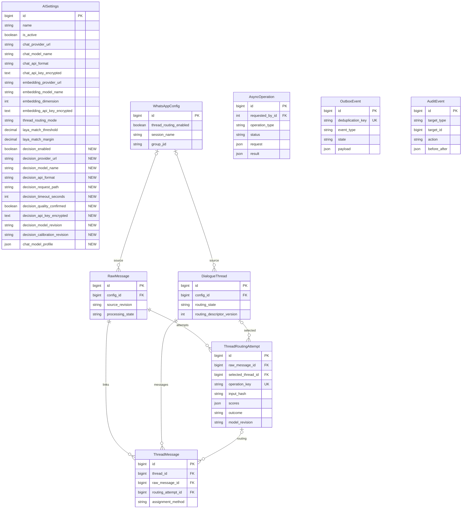
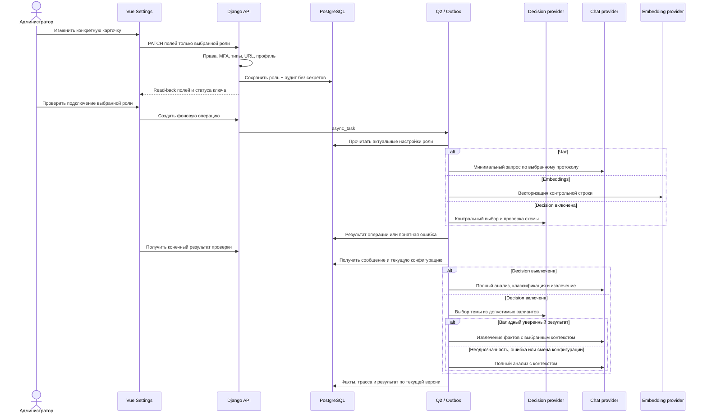

# Независимые настройки моделей ИИ — прототип и рабочая реализация

- Задача: `ai-model-settings-prototype`, прямое поручение пользователя, без GitHub Issue.
- Создано: 2026-10-19 04:24:27 MSK (UTC+3).
- Ветка: `feature/ai-model-settings-prototype`.
- Базовый код: `main`, `001d72835d3d7df3ebbf53ecd090bd6f15a0e8e6`.
- Статус: **HTML-прототип согласован; спецификация рабочей реализации подтверждена пользователем; код реализован, завершаются проверки и review PR**.
- Этап 1 завершён: HTML-прототип. Этап 2 по поручению «Теперь реализуй эти три независимые конфигурации моделей в рабочей странице настроек»: Vue, API, хранение настроек, фоновые подключения и реальный режим `chat_only`.
- База перед рабочей реализацией синхронизирована повторным `git pull origin main`; текущая ветка сохраняет согласованный прототип.

## ERD — существующее состояние и расширение

Структура проверена по `backend/api/models.py` и миграциям до `0062`. Имена ниже — модельные; таблицы имеют префикс `api_`. Поля с префиксом `decision_` и `chat_model_profile` в AISettings планируются; остальные показанные поля и связи существуют. Три назначения моделей остаются независимыми каналами существующего профиля AISettings, с отдельными маршрутами, протоколами, именами моделей, ключами и сохранением. Новая таблица для переноса уже работающих chat/embedding не требуется.

`OutboxEvent.payload`, `AsyncOperation.request` и `AuditEvent.target_id` содержат прикладные ссылки, а не дополнительные FK. Исторические попытки, решения и связи не переписываются под нового провайдера.

## Последовательность рабочей настройки и обработки

## Постановка

Текущая страница показывает одну длинную форму настроек AISettings. Пользователь должен иметь возможность на одной странице независимо настраивать три назначения моделей: большую модель анализа и генерации, embedding-модель и модель принятия решений, заменяя провайдера (например, LAYA на JEV или Clef) без смешения маршрутов, ключей и параметров разных ролей.

## Требования

1. Сохранить визуальную основу Mazory из приложенного скриншота: тёмная тема, спокойные поверхности, фиолетовый акцент, существующая навигация разделов настроек.
2. Разделить содержимое на три ясно различимые карточки: «Большая модель», «Embedding-модель», «Модель принятия решений».
3. В каждой карточке в верхней части показать чаще изменяемые параметры в порядке: провайдер/маршрут (endpoint), идентификатор модели, API-ключ. У каждого назначения собственные значения и индикатор состояния подключения.
4. Большая модель включает профиль контекста/токенизатора и отдельное место для загрузки конфигурации квантования. Загрузка в прототипе демонстрационная и не передаёт файл.
5. Embedding-модель включает размерность вектора и относящиеся только к ней параметры.
6. Модель принятия решений включает параметры выбора/маршрутизации и пороги уверенности; интерфейс допускает замену поставщика и не закрепляет LAYA как единственный вариант.
7. Редкие параметры и подробные профили размещать во вторичном визуальном слое (например, сворачиваемая группа). Не показывать технические поля политик и внутренние версии на первом экране.
8. Использовать только демонстрационные значения и замаскированные ключи. Кнопки и загрузка должны быть явно прототипными и не вызывать API.
9. Прототип должен оставаться читаемым на узком экране; поля складываются в одну колонку.

## Планируемые изменения

1. После согласования создать один автономный HTML-файл прототипа в `frontend/prototypes/` с локальными CSS и минимальным JS для раскрытия расширенных настроек и демонстрации выбора файла.
2. Не менять производственную Vue-страницу, схему данных, секреты, настройки провайдера или поведение API на этом этапе.

## Критерии готовности

- На одной странице визуально отделены три назначения моделей.
- В каждой карточке маршрут, модель и собственный ключ находятся среди первых и наиболее заметных полей.
- Большая модель имеет отдельный блок конфигурации квантования; embedding и decision имеют только относящиеся к ним параметры.
- Расширенные параметры скрыты до явного раскрытия.
- Визуальный стиль соответствует приложенному скриншоту, а адаптивная сетка не создаёт горизонтальной прокрутки на узкой ширине.
- Прототип самодостаточен, содержит только фиктивные данные и не отправляет запросов.

## Результат

- По уточнению пользователя «Большая модель» переименована в «Чат-модель». Добавлен переключатель независимой модели принятия решений: выключение переводит весь цикл классификации, выбора, анализа и ответа на чат-модель; embedding-подключение сохраняет своё назначение. Прототип блокирует поля отключённой модели, сохраняет их значения и экспортирует режим `chat_only`.

- Создан `frontend/prototypes/ai-model-settings.html`: самостоятельная страница с тремя карточками, сворачиваемыми группами, чтением JSON-конфигурации и экспортом настроек без API-ключей.
- Проверены синтаксис JavaScript, отсутствие ошибок браузера, три карточки и чтение JSON-файла. Chromium запускался в одноразовом контейнере `kk-minsk` без сети.
- Проверена адаптивность на ширинах 1440 и 390 px, включая раскрытые расширенные группы. Производственная страница и конфигурации сервисов не менялись.

## Этап 2 — рабочая реализация

### Требования к странице и независимости настроек

1. Использовать согласованный прототип как основу Vue-компонента на `/settings?section=ai`: «Чат-модель», «Embedding-модель», «Модель принятия решений», общая автоматизация отдельно. Маршрут, модель, ключ и протокол — в верхней части; подробности — в раскрываемых группах.
2. Каждая роль сохраняется отдельно. Изменение chat не обновляет embedding/decision и наоборот. Контракты DTO находятся в `frontend/src/types/`; числовые ID остаются `number`, `any` не используется.
3. Сохранить работу нескольких профилей AISettings и их активации; не создавать три глобальных несвязанных профиля и не менять активный профиль неявно.
4. Подключения имеют реальный read-back, реальные ошибки API и реальную фоновую проверку. «Ключ сохранён» показывается только по серверному признаку; ответ подключения — только по завершённой Q2-операции. Ключи не включаются в GET, экспорт, ошибки и аудит.
5. Независимая замена/удаление трёх ключей через существующий механизм Fernet с привязкой к роли и протоколу. Сохранить существующие ключи chat/embedding и MFA/permissions. Смена хоста или протокола с сохранённым ключом требует явной замены/очистки этого ключа.

### Decision-подключение и режим chat_only

1. Перенести параметры подключения модели решений из постоянной зависимости от `settings.LAYA_*` в редактируемые поля AISettings: endpoint, модель, ключ, протокол, путь метода, таймаут, версия и калибровка. Названия LAYA/JEV/Clef являются значениями модели, а не жёстко заданными ветками интерфейса.
2. Поддержать два явных адаптера: SystemOne (`state/questions`, типизированные ответы с вероятностями) и OpenAI-compatible с валидируемым JSON-ответом классификации. Произвольный сервис поддерживается при совместимости с одним из этих контрактов; новый несовместимый протокол требует отдельного адаптера. Проверять числовые вероятности, полноту вариантов, выбранные ID и отсутствие усечения.
3. Сохранить пороги, режим наблюдения и контроль версий. Замена провайдера не означает автоматическое подтверждение качества/калибровки; историческую валидацию LAYA не переносить на другую модель. Статус валидированности и причины направления к chat показывать явно.
4. Выключение decision сохраняет её поля/ключ и переводит обработку в `chat_only`: никаких обращений к decision, включая проверки ревизии, из конвейера новых и ещё не начавших обработку заданий. Чат выполняет классификацию, выбор контекста, анализ и извлечение. Embeddings продолжают самостоятельную функцию поиска.
5. Если конфигурация поменялась в ходе выполняющегося запроса, не применять устаревшее решение к теме. Нельзя отменить уже ушедший запрос; его результат проверяется относительно актуального снимка конфигурации.
6. Изменить внутренние обозначения новых попыток на нейтральные по отношению к поставщику; исторические значения `laya` и история сохраняются.

### Chat/embedding и импорт профиля

1. Реальные chat и embedding URL/модель/ключ продолжают использоваться соответствующими runtime-транспортами. Не ограничивать смену провайдера названием модели, если выбранный протокол и профиль контекста поддержаны.
2. Импорт JSON профиля chat выполняет серверную валидацию схемы, ограничение размера и отображает ошибки до сохранения. Файл не выполняется как код; произвольные поля не превращаются в аргументы транспорта автоматически.
3. Разделить параметры квантования (описание уже развёрнутой модели) и токенизации/контекста (параметры расчёта входа). Изменение JSON не запускает квантование весов и не разворачивает модель на сервере. Поддержанные поля профиля реально используются для проверки контекста/токенизатора; неизвестная несовместимая схема отклоняется с объяснением.
4. При смене embedding-модели/размерности сохранить существующие индексы; не запускать массовую переиндексацию автоматически. Показать отдельное предупреждение о необходимости перестроения индекса.
5. Экспортировать только валидируемые настройки без API-ключей; общий бюджет/автоматизация сохраняются отдельно от карточек подключений.

### План реализации

1. Дополнить AISettings и миграции; расширить шифрование на decision. Подготовить одноразовый перенос существующих LAYA-параметров без публикации ключей и без изменения состояния автономной CRM-записи.
2. Дополнить settings API типизированными группами/разрешёнными полями каждой роли, импортом профиля и отдельной работой с третьим ключом; валидация и аудит выполняются сервером.
3. Выделить decision-адаптер и заменить runtime-чтение LAYA-переменных; обеспечить актуальные снимки настроек, контроль качества, `chat_only` для новых и отложенных операций и нейтральные трассы.
4. Добавить проверки подключения в задачи `tasks.py` через Q2; UI следует за AsyncOperation до конечного результата. Из HTTP не обращаться к внешним моделям синхронно.
5. Перенести оформление прототипа в Vue-компонент настроек, сохранить права просмотра/изменения и доступные профили, добавить отдельные сохранения, состояния ключей, импорт/экспорт и переключатель.
6. В Docker-контексте `kk-minsk` выполнить миграции, `manage.py check`, `makemigrations --check` (`No changes detected`), сборку nginx с TypeScript/Vite, запуск и просмотр логов backend/qcluster/WAHA. Не создавать unit/component/integration/mock-наборы.
7. Проверить штатный путь через браузер/API/Q2 в изолированном окружении: независимое сохранение трёх ролей, третий ключ, ошибки провайдера, импорт/экспорт, выключение и повторное включение decision, отсутствие запросов к ней в `chat_only`, сохранение существующей обработки сообщений. Отдельно проверить экран с правами только просмотра и отсутствие секретов в ответах/экспорте.
8. После проверок подготовить PR только в `main` и выполнить обязательные этапы review. Production-конфигурации и развертывание — отдельный шаг после готовности и review кода; текущие рабочие значения не переключать на примеры из прототипа.

### Критерии приёмки

- Рабочая страница повторяет согласованное разделение; часто меняемые поля видны сверху каждой карточки, подробности раскрываются отдельно.
- Реальные endpoint/модель/ключ каждой роли редактируются независимо и используются соответствующим транспортом в Q2.
- Совместимый SystemOne/OpenAI сервис решений можно заменить через настройки без редактирования `.env` или кода; неподдержанный протокол имеет явную ошибку.
- При выключенной decision обработка сообщений проходит через chat, количество новых внешних decision-запросов равно нулю; повторное включение восстанавливает прежнее подключение.
- В режиме `chat_only` ошибки/пустые настройки выключенной decision не блокируют chat или embedding.
- Проверки подключения показывают конечный реальный результат; ошибки не выглядят как успешный статус.
- Импорт профиля и экспорт реализованы, секреты не возвращаются, параметры профиля применяются только по поддержанному контракту.
- Существующие данные и зашифрованные ключи chat/embedding сохранены; миграции применяются чисто, требуемые Docker-проверки пройдены.

## Выполненная рабочая реализация и проверка

- Добавлены миграции `0063_independent_model_connections` и `0064_migrate_decision_connection`. Роли хранятся в существующем профиле AISettings; миграция не переписывает chat/embedding credentials. Legacy LAYA импортируется один раз, дальнейшее runtime-подключение берётся из БД.
- Ролевое сохранение: `PATCH /api/settings/ai/{id}/models/{chat|embedding|decision|shared}/`. Ключи: штатный `POST /api/settings/ai/{id}/` с ролью ключа. Проверка: POST ролевого `/check/` возвращает `operation_id`, GET с ним возвращает конечный результат Q2.
- Decision имеет SystemOne и OpenAI-compatible адаптеры, собственный шифрованный ключ, маршрут/путь, таймаут и версии. Подтверждение калибровки — явное действие администратора; проверка подключения его не устанавливает. Противоречащая ответная идентичность модели отклоняется.
- JSON-профиль версии 1 содержит только описанные поля, metadata `quantization` (method/bits/group_size/format/description) и при необходимости `tokenizer` вместе с `chat_template`. Поддерживаемые переменные шаблона: messages, tools, add_generation_prompt, enable_thinking. Токенизатор используется в расчёте контекста. Квантование весов не выполняется.
- Для JSON-профиля разрешено до 16 МБ; обычные API-запросы сохраняют прежний лимит 1 МБ. Увеличенный запрос проверен через gateway, а не только прямой Django-вызов.
- Изолированный Compose `mazory-ai-settings` запущен на `kk-minsk` с отдельной PostgreSQL/volumes и синтетическим TLS-провайдером. Производственные credentials и WhatsApp-сессии не использовались, бизнес-факты и CRM-записи не создавались.
- Браузер/API/Q2: независимое сохранение трёх карточек, сохранение соседнего черновика, запрет полей чужой роли, реальные конечные проверки трёх подключений, отключение decision, round-trip профиля с сохранением токенов vocabulary, экспорт без секретов, read-only доступ и мобильная ширина 390 px — успешны.
- Конвейер Outbox/Q2: decision включена — 1 decision + 1 chat запрос; выключена — 0 decision + 1 chat запрос. Обе обработки завершились `processed=true` и успешной трассой, без FactCandidate.
- Дополнительная API-приёмка: независимые шифрованные ключи, HTTP 401 провайдера, JSON >1 МБ, отклонение неизвестных полей профиля, проверка неактивного профиля без его активации, OpenAI decision-адаптер, отклонение чужой модели в ответе и сохранение chat при пустых настройках выключенной decision — успешны.
- На отдельной изолированной БД воспроизведено обновление с `0062`: старые chat/embedding ключи расшифровываются без изменений; legacy decision переносится в зашифрованное поле с сохранением подтверждённых версий.

- Совместимость SystemOne: общий запрос model/state/questions без LAYA-специфичных обязательных параметров; identity читается из routing/top-level/usage (включая Clef usage.revision). Любые явно противоречащие версии отклоняются. Если API не возвращает калибровку, в трассе явно отмечается источник administrator, а не утверждается, что провайдер подтвердил её.

- Повторная приёмка последней версии через Q2 с Clef-форматом ответа (`model`, `usage.revision`, без `routing.calibration_revision`) завершилась успешно: включённая decision вызывает 1 decision + 1 chat, выключенная — 0 decision + 1 chat. Признак administrator в трассе отличает ручное подтверждение калибровки от ответа провайдера.
- В браузере отдельно проверена замена decision-ключа и последующее сохранение таймаута: устаревший флаг калибровки не восстанавливается.
- Финальные локальные `manage.py check` и `makemigrations --check`: ошибок нет, `No changes detected`. TypeScript/Vite, Docker-сборки и проверка production settings успешны; последняя выводит только прежние предупреждения HSTS includeSubDomains/preload.
- PR реализации: https://github.com/envOnion/kz-mazory/pull/102, база `main`. Первый полный CI-прогон (включая gitleaks и оба dependency audit) успешен; заключительное исправление совместимости SystemOne проходит отдельный прогон до merge.
