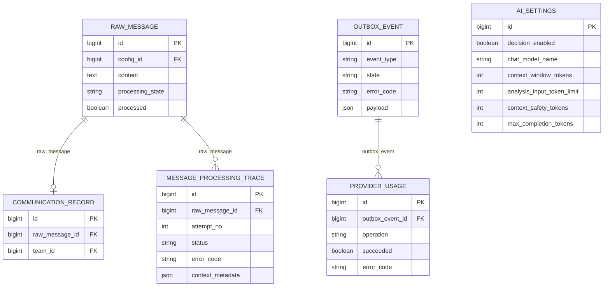
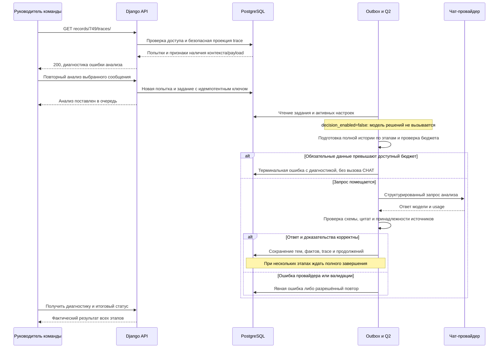

# Исправление диагностики и проверка анализа без LAYA

- Создано: 2026-10-19 11-16-59 MSK (UTC+3).
- Задача: `chat-only-analysis`, прямая постановка пользователя, без GitHub Issue.
- Ветка: `bugfix/chat-only-analysis`; база `main` синхронизирована через `git pull origin main`, commit `aca6176`.
- Статус: спецификация подтверждена пользователем 19.10.2026; исправление развёрнуто, выполняется сквозная проверка.
- Схема БД не меняется. Ниже показаны существующие сущности, которые читаются или обновляются при проверке.

Связь сообщения с заданием хранится в `OutboxEvent.payload.raw_id`, не во внешнем ключе. Активные `AISettings` выбираются глобально. Выделение тем остаётся в существующих `DialogueThread/ThreadMessage/ThreadRevision`; эта задача их структуру не меняет.

## Постановка

Пользователь отключил LAYA и ожидает сквозную обработку через чат-модель. На production `https://ai.mazory.best` запись Messenger №749 отображает ошибку анализа; запрос `/api/messenger/records/749/traces/` возвращает HTTP 500 с correlation_id `2ef9dc7986ca4e34bc029d5fefa65b09`.

Оставить существующую архитектуру векторов и распределения тем. Исправить диагностику и устранить подтверждённый барьер бюджета, затем проверить выбранное сообщение через настоящий worker и провайдер.

## Подтверждённые данные диагностики

Проверено 19.10.2026 на production через Docker context `mazory-remote`; backend и workers используют image `mazory-backend:ai-settings-aca6176`.

1. Активная настройка `decision_enabled=false`, чат-модель `openrouter/free`. Статический аудит подтверждает прямой путь новых сообщений через `extract_message`; уже созданные `route_message` также передают обработку чат-модели при отключённом decision.
2. Messenger record `749` связан с RawMessage `1187`.
3. Последняя попытка `3824`, OutboxEvent `66329`: `failed/context_fixed_input_too_large`, `request_state=not_sent`; ProviderUsage этого задания отсутствует.
4. Read-only повтор подготовки запроса воспроизводит оценку `100123` при лимите `65536`. Для Free Router это консервативная верхняя оценка по UTF-8-байтам, не точные токены выбранной провайдером модели.
5. Сериализованные messages занимают `45189` байт, response_format — `50550`; остальное — резерв/обрамление. Даже подготовка без дополнительных сообщений истории превышает текущий предел.
6. SQL `SELECT jsonb_object_length('{}'::jsonb)` на production возвращает `ProgrammingError: function jsonb_object_length(jsonb) does not exist`. Этот вызов находится в `RecordTracesView`; воспроизведение view с аутентифицированным разрешённым пользователем также даёт 500.
7. Текущие ошибки не доказывают отказ чат-провайдера: проблемная попытка не дошла до внешнего запроса. Успешный сквозной анализ на текущих настройках ещё не подтверждён.
8. Повторное чтение production параметров: окно `200000`, резерв ответа `32768`, safety `2048`; расчётный доступный вход `165184`. Предлагаемый лимит `131072` укладывается в этот бюджет. Возможности фактически выбранной Free Router модели проверяются только реальным запросом.
9. Read-only `manage.py makemigrations --check --dry-run` внутри production backend завершился с `No changes detected`. Код приложения и настройки production не менялись; diff спецификации проверен на пробельные ошибки.

## Требования

- `GET /api/messenger/records/749/traces/` возвращает диагностику без 500 при сохранении авторизации, пагинации и безопасного набора полей.
- Признак наличия JSON-object payload вычисляется поддерживаемым PostgreSQL выражением; пустой объект, массив, JSON null и SQL NULL обрабатываются корректно.
- LAYA/decision остаётся выключенной; векторный поиск, модели, схема БД и бизнес-права не меняются.
- Предлагаемое изменение настройки production: `analysis_input_token_limit: 65536 → 131072`, только после подтверждения этой спецификации и повторной проверки, что предел не превышает `context_window_tokens - max_completion_tokens - context_safety_tokens`.
- Чат-модель остаётся `openrouter/free`; не отключать строгую схему, доказательства, проверки источников или консервативный счётчик для обхода ошибки.
- При реальной ошибке контекста провайдера или валидации отразить её и устранить причину в пределах этой задачи; не объявлять постановку в очередь успехом.
- Сквозная проверка использует существующее сообщение и штатный механизм повторного анализа. Не создавать тестовые сообщения WhatsApp, новые бизнес-обязательства или отправки ради проверки.
- Не выполнять массовый повтор сообщений. Сохранить прежние попытки и все бизнес-данные.

## Планируемые изменения

1. В `backend/api/messenger_api.py` заменить `jsonb_object_length(whatsapp_raw_payload) > 0` внутри object-ветки CASE на `whatsapp_raw_payload <> '{}'::jsonb`.
2. Проверить поведение SQL для объекта/массива/null и реального trace через одноразовые команды внутри Docker; файлы unit/component/integration/mock-тестов не создавать.
3. Выполнить обязательные проверки backend на `kk-minsk`: `manage.py check`, `makemigrations --check`; запустить сервисы и проверить логи backend/qcluster/waha. Сборка frontend требуется только при фактическом изменении frontend.
4. После успешной проверки создать commit и PR только в `main`, дождаться требуемых checks/review, объединить; production обновлять через `mazory-remote` штатным процессом проекта.
5. Перед production изменением повторно прочитать активные параметры и доступный входной бюджет. Применить согласованное значение `131072`, не меняя остальных настроек.
6. Проверить production endpoint диагностики, затем повторить анализ записи №749 штатно с отдельным идемпотентным ключом; проследить все continuations до терминального результата.
7. По trace/outbox/provider usage подтвердить вызов чат-модели, отсутствие decision-запросов и сохранение проверенного результата. Проверить пользовательский статус Messenger и состояние связанных фактов; потенциальные CRM-действия не подменять искусственным созданием.
8. Итоговые проверки и результат дописать в эту же спецификацию; отдельные отчёты и планы не создавать.
9. Дополнительный подтверждённый барьер сквозной проверки: первый OpenRouter запрос не завершился в течение предусмотренного бюджета анализа (240 секунд), а `requests.post` ожидал весь body до проверки deadline. Исправить чтение ответа с проверкой общего бюджета между порциями и ограничением очередного socket read оставшимся временем; сохранять полный успешный JSON, исходный read timeout, классификацию ошибок и освобождение соединения. Не менять модель, схему, доказательства, входной и выходной лимиты ради обхода ожидания.
10. Фактическая проверка выявила ещё одно несоответствие: production `AI_REQUEST_TIMEOUT=1800`, Q2 worker timeout `1920`, но Free Router использовал hardcoded analysis budget `240` и read cap `180`. Применить к `openrouter/free` существующую политику долгих запросов `min(AI_REQUEST_TIMEOUT,1200)`, уже используемую для Qwen, с общим deadline из шага 9 и запасом до worker timeout. Модель, входной лимит 131072, output/schema и доказательства сохраняются; лимит 240 секунд не был требованием пользователя.

## Критерии готовности

- Диагностика №749 возвращает HTTP 200 с безопасными данными; прежняя ошибка анализа доступна пользователю.
- Отключение decision не блокирует `extract_message`; нет вызовов модели решений у проверяемой новой попытки.
- Повторный анализ проходит через реальный Q2 worker и чат-провайдер и достигает терминального успешного состояния всех необходимых этапов; результаты подтверждены trace и связанными сущностями.
- Нет дублированных фактов или новых лишних внешних действий.
- Если провайдер/валидация создают новый барьер, задача остаётся незавершённой до устранения либо конкретного внешнего ограничения; сам HTTP 200 провайдера недостаточен.
- `manage.py check` проходит, `makemigrations --check` сообщает `No changes detected`, diff чист от случайных изменений.
- В production backend и все workers используют один проверенный image; после обновления просмотрены логи.
- PR направлен только в `main`; production результат проверен после развёртывания.

## Выполненные проверки

- 19.10.2026, Docker context `kk-minsk`: image `mazory-backend:chat-only-analysis` собран с исправлением.
- `manage.py check`: `System check identified no issues`.
- `manage.py makemigrations --check`: `No changes detected`.
- Одноразовая SQL-проверка на PostgreSQL: пустой/непустой object и array, JSON null, SQL NULL и scalar возвращают ожидаемый boolean.
- Реальный `RecordTracesView` на данных проверочного окружения: HTTP 200, непустой список попыток, `has_raw_payload` имеет boolean-тип; запрос без аутентификации возвращает 401.
- Проверочные сервисы работают в Docker; логи backend/qcluster/waha просмотрены. Сквозной production результат ещё не подтверждён.

## Развёртывание и проверка production

- PR [#103](https://github.com/envOnion/kz-mazory/pull/103) объединён в `main`, merge commit `5ed207404f4b1ab865df66f3a7b1532879d50de9`. CI: backend/frontend builds, TypeScript, Django checks, migration check, production settings check, dependency audits, Gitleaks и Compose configuration — success.
- Снята резервная копия PostgreSQL перед обновлением. Backend и все workers/outbox обновлены на `mazory-backend:chat-only-5ed2074`, OCI revision совпадает с merge commit. Существующий nginx image сохранён, nginx перезапущен для обновления DNS backend. Volumes, сеть и секреты сохранены.
- Production `migrate`: `No migrations to apply`; `check` без замечаний; `makemigrations --check --dry-run`: `No changes detected`; `ops/check_deployment.py --runtime-context mazory-remote` подтвердил один image у backend и всех workers.
- Реальный HTTPS GET `/api/messenger/records/749/traces/` с сессионной JWT-аутентификацией возвращает 200 и прежние попытки 3824/3812. Проверочная сессия после API-вызовов отозвана.
- Через штатный PATCH `/api/settings/ai/1/models/chat/` сохранён согласованный `analysis_input_token_limit=131072`; `decision_enabled=false`, модель `openrouter/free` сохранены.
- Через штатный POST `/api/messenger/records/749/reanalyze/` создан один повтор с детерминированным UUID: OutboxEvent `66429`, начальный trace `3829`. Исходные попытки сохранены; до запуска кандидатов фактов сообщения не было.
- Первый этап прошёл подготовку и отправлен чат-провайдеру: входная оценка `130614`, история из 760 сообщений читается по этапам. Отправка сама по себе не считается успешным анализом; ожидается терминальный результат.
- Отдельно проверенные WAHA webhook 403 содержат `Источник не разрешён`: подпись проходит, срабатывает фильтр разрешённых чатов. Ключи backend/WAHA совпадают (проверено только boolean-сравнением без вывода значений), session `WORKING`. Фильтры доступа не изменялись.
- Дополнительное исправление транспорта проверено в `kk-minsk`: Django check и migration check чистые; реальный HTTPS JSON OpenRouter `/models` (788509 байт, 471 запись) прочитан полностью за 0.134 секунды. Тестовые и mock-файлы не создавались; использовались одноразовые Docker-команды.
- Реальное чтение того же HTTPS endpoint с коротким бюджетом прервано через 0.0014 секунды (`ReadTimeoutError`, штатно классифицируется `_post` как `provider_timeout`); socket timeout ограничивается оставшимся общим бюджетом, а соединение закрывается в `finally`.
- PR [#104](https://github.com/envOnion/kz-mazory/pull/104) прошёл полный CI и объединён: `dd5130d52d3ed697db5a9311020728058d36429c`. Backend и все workers/outbox обновлены на `mazory-backend:chat-only-dd5130d`; production Django/migration checks и проверка единого image прошли.
- Зависшая проверочная попытка 3829 / событие 66429 отменена с аудитом после остановки её worker. На момент отмены кандидатов фактов не было; прежний trace и неизвестный расход провайдера сохранены, не выданы за успешный результат.
- Повтор после исправления транспорта создан через публичный API: событие `66518`, начальный trace `3830`. Первый ответ `xingchen-agi/xing4.0-29b-a4b:free`: 61383 мс, вход 16772/выход 778 токенов; второй ответ `nvidia/nemotron-3-super-120b-a12b:free`: 50088 мс, вход 14085/выход 2061. Оба этапа прошли серверную валидацию; trace 3832 продолжает чтение после 64/760 сообщений. Это промежуточный результат, не подтверждение окончания всего анализа.
- После четырёх валидированных этапов (67/760 сообщений) пятый этап дважды достиг общего бюджета 240 секунд; read deadline сработал, usage содержит `provider_timeout`, штатные повторы сохранили checkpoint. Для согласования Free Router с production `AI_REQUEST_TIMEOUT=1800` применяется существующий long-request cap 1200 секунд. Image `mazory-backend:chat-only-budget` собран в `kk-minsk`, Django check и migration check прошли.
