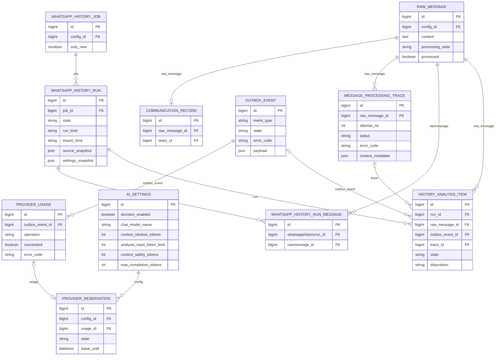
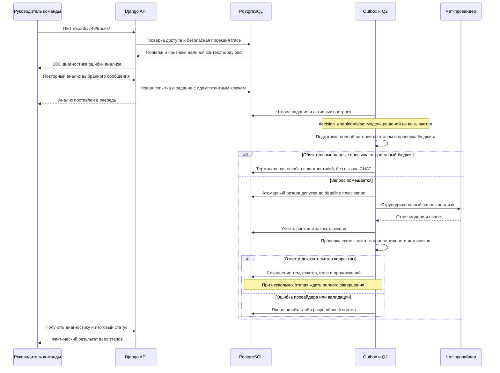

# Исправление диагностики и проверка анализа без LAYA

- Создано: 2026-10-19 11-16-59 MSK (UTC+3).
- Задача: `chat-only-analysis`, прямая постановка пользователя, без GitHub Issue.
- Ветка: `bugfix/chat-only-analysis`; база `main` синхронизирована через `git pull origin main`, commit `aca6176`.
- Статус: спецификация подтверждена пользователем 19.10.2026; исправление развёрнуто, выполняется сквозная проверка.
- Схема БД не меняется. Ниже показаны существующие сущности, которые читаются или обновляются при проверке.

Связь сообщения с заданием хранится в `OutboxEvent.payload.raw_id`, не во внешнем ключе. Активные `AISettings` выбираются глобально. Выделение тем остаётся в существующих `DialogueThread/ThreadMessage/ThreadRevision`; эта задача их структуру не меняет.

## Постановка

Пользователь отключил LAYA и ожидает сквозную обработку через чат-модель. На production `https://ai.mazory.best` запись Messenger №749 отображает ошибку анализа; запрос `/api/messenger/records/749/traces/` возвращает HTTP 500 с correlation_id `2ef9dc7986ca4e34bc029d5fefa65b09`.

Оставить существующую архитектуру векторов и распределения тем. Исправить диагностику и устранить подтверждённый барьер бюджета, затем проверить выбранное сообщение через настоящий worker и провайдер.

## Подтверждённые данные диагностики

Проверено 19.10.2026 на production через Docker context `mazory-remote`; backend и workers используют image `mazory-backend:ai-settings-aca6176`.

1. Активная настройка `decision_enabled=false`, чат-модель `openrouter/free`. Статический аудит подтверждает прямой путь новых сообщений через `extract_message`; уже созданные `route_message` также передают обработку чат-модели при отключённом decision.
2. Messenger record `749` связан с RawMessage `1187`.
3. Последняя попытка `3824`, OutboxEvent `66329`: `failed/context_fixed_input_too_large`, `request_state=not_sent`; ProviderUsage этого задания отсутствует.
4. Read-only повтор подготовки запроса воспроизводит оценку `100123` при лимите `65536`. Для Free Router это консервативная верхняя оценка по UTF-8-байтам, не точные токены выбранной провайдером модели.
5. Сериализованные messages занимают `45189` байт, response_format — `50550`; остальное — резерв/обрамление. Даже подготовка без дополнительных сообщений истории превышает текущий предел.
6. SQL `SELECT jsonb_object_length('{}'::jsonb)` на production возвращает `ProgrammingError: function jsonb_object_length(jsonb) does not exist`. Этот вызов находится в `RecordTracesView`; воспроизведение view с аутентифицированным разрешённым пользователем также даёт 500.
7. Текущие ошибки не доказывают отказ чат-провайдера: проблемная попытка не дошла до внешнего запроса. Успешный сквозной анализ на текущих настройках ещё не подтверждён.
8. Повторное чтение production параметров: окно `200000`, резерв ответа `32768`, safety `2048`; расчётный доступный вход `165184`. Предлагаемый лимит `131072` укладывается в этот бюджет. Возможности фактически выбранной Free Router модели проверяются только реальным запросом.
9. Read-only `manage.py makemigrations --check --dry-run` внутри production backend завершился с `No changes detected`. Код приложения и настройки production не менялись; diff спецификации проверен на пробельные ошибки.

## Требования

- `GET /api/messenger/records/749/traces/` возвращает диагностику без 500 при сохранении авторизации, пагинации и безопасного набора полей.
- Признак наличия JSON-object payload вычисляется поддерживаемым PostgreSQL выражением; пустой объект, массив, JSON null и SQL NULL обрабатываются корректно.
- LAYA/decision остаётся выключенной; векторный поиск, модели, схема БД и бизнес-права не меняются.
- Предлагаемое изменение настройки production: `analysis_input_token_limit: 65536 → 131072`, только после подтверждения этой спецификации и повторной проверки, что предел не превышает `context_window_tokens - max_completion_tokens - context_safety_tokens`.
- Чат-модель остаётся `openrouter/free`; не отключать строгую схему, доказательства, проверки источников или консервативный счётчик для обхода ошибки.
- При реальной ошибке контекста провайдера или валидации отразить её и устранить причину в пределах этой задачи; не объявлять постановку в очередь успехом.
- Сквозная проверка использует существующее сообщение и штатный механизм повторного анализа. Не создавать тестовые сообщения WhatsApp, новые бизнес-обязательства или отправки ради проверки.
- Не выполнять массовый повтор сообщений. Сохранить прежние попытки и все бизнес-данные.

## Планируемые изменения

1. В `backend/api/messenger_api.py` заменить `jsonb_object_length(whatsapp_raw_payload) > 0` внутри object-ветки CASE на `whatsapp_raw_payload <> '{}'::jsonb`.
2. Проверить поведение SQL для объекта/массива/null и реального trace через одноразовые команды внутри Docker; файлы unit/component/integration/mock-тестов не создавать.
3. Выполнить обязательные проверки backend на `kk-minsk`: `manage.py check`, `makemigrations --check`; запустить сервисы и проверить логи backend/qcluster/waha. Сборка frontend требуется только при фактическом изменении frontend.
4. После успешной проверки создать commit и PR только в `main`, дождаться требуемых checks/review, объединить; production обновлять через `mazory-remote` штатным процессом проекта.
5. Перед production изменением повторно прочитать активные параметры и доступный входной бюджет. Применить согласованное значение `131072`, не меняя остальных настроек.
6. Проверить production endpoint диагностики, затем повторить анализ записи №749 штатно с отдельным идемпотентным ключом; проследить все continuations до терминального результата.
7. По trace/outbox/provider usage подтвердить вызов чат-модели, отсутствие decision-запросов и сохранение проверенного результата. Проверить пользовательский статус Messenger и состояние связанных фактов; потенциальные CRM-действия не подменять искусственным созданием.
8. Итоговые проверки и результат дописать в эту же спецификацию; отдельные отчёты и планы не создавать.
9. Дополнительный подтверждённый барьер сквозной проверки: первый OpenRouter запрос не завершился в течение предусмотренного бюджета анализа (240 секунд), а `requests.post` ожидал весь body до проверки deadline. Исправить чтение ответа с проверкой общего бюджета между порциями и ограничением очередного socket read оставшимся временем; сохранять полный успешный JSON, исходный read timeout, классификацию ошибок и освобождение соединения. Не менять модель, схему, доказательства, входной и выходной лимиты ради обхода ожидания.
10. Фактическая проверка выявила ещё одно несоответствие: production `AI_REQUEST_TIMEOUT=1800`, Q2 worker timeout `1920`, но Free Router использовал hardcoded analysis budget `240` и read cap `180`. Применить к `openrouter/free` существующую политику долгих запросов `min(AI_REQUEST_TIMEOUT,1200)`, уже используемую для Qwen, с общим deadline из шага 9 и запасом до worker timeout. Модель, входной лимит 131072, output/schema и доказательства сохраняются; лимит 240 секунд не был требованием пользователя.
11. Согласовать срок резерва глобального допуска с новым долгим бюджетом: текущий резерв 397 имеет lease 600 секунд при выполняющемся запросе с бюджетом 1200. В атомарном `reserve` сохранять прежний минимум 600 секунд, продлевая его до оставшегося deadline + 30 секунд на фиксацию расхода. Завершённый запрос, как раньше, немедленно переводит резерв в settled. Не увеличивать настроенный лимит параллельности и не обнулять квоты. Идентифицированный текущий живой резерв продлить с аудитом, чтобы он оставался учтённым до завершения; не трогать завершённые или чужие резервы.

12. Устранить подтверждённое разрастание схемы источников: новый versioned wire-формат Free Router хранит ID только в ключе `m<ID>`, сервер после native schema validation восстанавливает канонический integer ID. Старые сохранённые request envelopes без версии сохраняют прежнюю схему и проверку согласованности ID. Списки источников, цитаты, факты и публичный DTO не сокращаются. При output-retry уменьшать свежую часть входа относительно обязательного envelope, сохраняя общий лимит 131072. Возобновить 14 проверенных этапов с аудитом и проверкой source_hash; прежние ошибки сохранить.

13. Продолжение 3847 выявило ошибку scheduling для многостраничного состояния: fixed 120274 помещается в hard budget 131072, но 90% cap всей страницы оставлял только 512 байт для новых originals. Применять уменьшение 90% к свободной свежей части, аналогично output-retry; страницы, факты, источники и hard budget сохраняются. Проверить обе фактические страницы и продолжить checkpoint 15 этапов/84 сообщения.

## Критерии готовности

- После размещения полных новых originals заполнять оставшийся бюджет префиксом следующего original, если он целиком не помещается. Бинарный поиск считает весь payload с уже выбранным префиксом. Сохранять хронологию, ranges/cursor/offset и существующий формат partial; отсутствие места при непустом префиксе не считается ошибкой. Frozen page plan не менять.

- После output-backoff восстанавливать только scheduling cap следующего набора страниц на 25% (не менее 512), не выше прежнего hard input budget. Рост разрешён лишь после завершения всех страниц набора, если у каждого main/focused ответа известный положительный completion usage не превышает половины выходного резерва и имеется непустой видимый ответ. При отсутствующих данных или незавершённой странице сохранять cap. Сохранённые envelopes, page plan, coverage, источники и предметные проходы не менять; расчёт должен быть детерминированным при повторе.

- Диагностика №749 возвращает HTTP 200 с безопасными данными; прежняя ошибка анализа доступна пользователю.
- Отключение decision не блокирует `extract_message`; нет вызовов модели решений у проверяемой новой попытки.
- Повторный анализ проходит через реальный Q2 worker и чат-провайдер и достигает терминального успешного состояния всех необходимых этапов; результаты подтверждены trace и связанными сущностями.
- Нет дублированных фактов или новых лишних внешних действий.
- Если провайдер/валидация создают новый барьер, задача остаётся незавершённой до устранения либо конкретного внешнего ограничения; сам HTTP 200 провайдера недостаточен.
- `manage.py check` проходит, `makemigrations --check` сообщает `No changes detected`, diff чист от случайных изменений.
- В production backend и все workers используют один проверенный image; после обновления просмотрены логи.
- PR направлен только в `main`; production результат проверен после развёртывания.

## Выполненные проверки

- 19.10.2026, Docker context `kk-minsk`: image `mazory-backend:chat-only-analysis` собран с исправлением.
- `manage.py check`: `System check identified no issues`.
- `manage.py makemigrations --check`: `No changes detected`.
- Одноразовая SQL-проверка на PostgreSQL: пустой/непустой object и array, JSON null, SQL NULL и scalar возвращают ожидаемый boolean.
- Реальный `RecordTracesView` на данных проверочного окружения: HTTP 200, непустой список попыток, `has_raw_payload` имеет boolean-тип; запрос без аутентификации возвращает 401.
- Проверочные сервисы работают в Docker; логи backend/qcluster/waha просмотрены. Сквозной production результат ещё не подтверждён.

## Развёртывание и проверка production

- PR [#103](https://github.com/envOnion/kz-mazory/pull/103) объединён в `main`, merge commit `5ed207404f4b1ab865df66f3a7b1532879d50de9`. CI: backend/frontend builds, TypeScript, Django checks, migration check, production settings check, dependency audits, Gitleaks и Compose configuration — success.
- Снята резервная копия PostgreSQL перед обновлением. Backend и все workers/outbox обновлены на `mazory-backend:chat-only-5ed2074`, OCI revision совпадает с merge commit. Существующий nginx image сохранён, nginx перезапущен для обновления DNS backend. Volumes, сеть и секреты сохранены.
- Production `migrate`: `No migrations to apply`; `check` без замечаний; `makemigrations --check --dry-run`: `No changes detected`; `ops/check_deployment.py --runtime-context mazory-remote` подтвердил один image у backend и всех workers.
- Реальный HTTPS GET `/api/messenger/records/749/traces/` с сессионной JWT-аутентификацией возвращает 200 и прежние попытки 3824/3812. Проверочная сессия после API-вызовов отозвана.
- Через штатный PATCH `/api/settings/ai/1/models/chat/` сохранён согласованный `analysis_input_token_limit=131072`; `decision_enabled=false`, модель `openrouter/free` сохранены.
- Через штатный POST `/api/messenger/records/749/reanalyze/` создан один повтор с детерминированным UUID: OutboxEvent `66429`, начальный trace `3829`. Исходные попытки сохранены; до запуска кандидатов фактов сообщения не было.
- Первый этап прошёл подготовку и отправлен чат-провайдеру: входная оценка `130614`, история из 760 сообщений читается по этапам. Отправка сама по себе не считается успешным анализом; ожидается терминальный результат.
- Отдельно проверенные WAHA webhook 403 содержат `Источник не разрешён`: подпись проходит, срабатывает фильтр разрешённых чатов. Ключи backend/WAHA совпадают (проверено только boolean-сравнением без вывода значений), session `WORKING`. Фильтры доступа не изменялись.
- Дополнительное исправление транспорта проверено в `kk-minsk`: Django check и migration check чистые; реальный HTTPS JSON OpenRouter `/models` (788509 байт, 471 запись) прочитан полностью за 0.134 секунды. Тестовые и mock-файлы не создавались; использовались одноразовые Docker-команды.
- Реальное чтение того же HTTPS endpoint с коротким бюджетом прервано через 0.0014 секунды (`ReadTimeoutError`, штатно классифицируется `_post` как `provider_timeout`); socket timeout ограничивается оставшимся общим бюджетом, а соединение закрывается в `finally`.
- PR [#104](https://github.com/envOnion/kz-mazory/pull/104) прошёл полный CI и объединён: `dd5130d52d3ed697db5a9311020728058d36429c`. Backend и все workers/outbox обновлены на `mazory-backend:chat-only-dd5130d`; production Django/migration checks и проверка единого image прошли.
- Зависшая проверочная попытка 3829 / событие 66429 отменена с аудитом после остановки её worker. На момент отмены кандидатов фактов не было; прежний trace и неизвестный расход провайдера сохранены, не выданы за успешный результат.
- Повтор после исправления транспорта создан через публичный API: событие `66518`, начальный trace `3830`. Первый ответ `xingchen-agi/xing4.0-29b-a4b:free`: 61383 мс, вход 16772/выход 778 токенов; второй ответ `nvidia/nemotron-3-super-120b-a12b:free`: 50088 мс, вход 14085/выход 2061. Оба этапа прошли серверную валидацию; trace 3832 продолжает чтение после 64/760 сообщений. Это промежуточный результат, не подтверждение окончания всего анализа.
- После четырёх валидированных этапов (67/760 сообщений) пятый этап дважды достиг общего бюджета 240 секунд; read deadline сработал, usage содержит `provider_timeout`, штатные повторы сохранили checkpoint. Для согласования Free Router с production `AI_REQUEST_TIMEOUT=1800` применяется существующий long-request cap 1200 секунд. Image `mazory-backend:chat-only-budget` собран в `kk-minsk`, Django check и migration check прошли.
- PR [#105](https://github.com/envOnion/kz-mazory/pull/105) прошёл CI и объединён: `96a42e328fc911dbd9f7d5b09cc60f275ea27023`. Все backend-сервисы обновлены на `mazory-backend:chat-only-96a42e3`; проверки Django/миграций/одного image прошли. Пятый этап закончен, сохранено 68/760; шестой этап выполняется с бюджетом 1200 секунд, решение LAYA не вызывалось.
- Runtime read-back выявил reserve 397: создание `09:13:11 UTC`, lease до `09:23:11 UTC`, в момент проверки вызов ещё выполнялся. С блокировкой конфигурации и события, проверкой текущего trace 3835 и отсутствия usage продлён только этот живой резерв до `09:33:41 UTC`; создан AuditEvent. Параллельный лимит остался 2. Постоянное согласование lease с deadline собрано в `kk-minsk`; Django check/migration check прошли.
- PR [#106](https://github.com/envOnion/kz-mazory/pull/106) прошёл CI и объединён: `0ffac2d6e05957f7dd765c8482c4a52a590cfa1b`. При graceful drain Q2 текущая попытка завершилась естественно: после обрыва соединения на 731798 мс штатный повтор дал валидный ответ `nvidia/nemotron-3.5-super-vl:free` за 85510 мс; сохранено шесть этапов, 71/760 сообщений. Уничтожения выполнявшейся попытки при этом обновлении не было. Все backend-сервисы обновлены на `mazory-backend:chat-only-0ffac2d`, Django/migration/uniform-image checks прошли; анализ продолжен с сохранённого checkpoint.

- После 14 валидированных этапов обработано 81/760 оригиналов. Ответ Liquid завершился с обрезанным output; восстановление с scheduling cap 65536 упёрлось в обязательный envelope. Read-only прогноз реального запроса: 50 source IDs — 125671, 100 — 148148, 150 — 170698; при 201 источнике прежняя схема переключается в массив и уменьшается, но этот порог недостижим в лимите 131072. Введена отдельная версия компактных source slots, сохраняя legacy-схему и integer DTO.
- Compact-source validation: неизменность legacy-схемы подтверждена на сохранённом request envelope; реальный сохранённый provider_result проходит новую JSONSchema, декодирование сохраняет канонические данные. Прогноз compact при 100/150 источниках: 111036/114936. Подготовка фактического checkpoint: fixed 107063, input 125662, read 84/760; при retry cap 65536: input 112984, read 82/760. Все проверки read-only, без вызовов модели и записи бизнес-данных. Docker `kk-minsk` build, Django check и migration check прошли.
- PR [#107](https://github.com/envOnion/kz-mazory/pull/107) прошёл полный CI и объединён: `d4837d8dd4efbc05236ccd1d0b1ae08070780ad5`. Production обновлён на `mazory-backend:chat-only-d4837d8`; Django/migration/uniform-image checks прошли. Новый запрос через normal scheduler — OutboxEvent `66882`, trace `3846` — получил 14-stage checkpoint события `66518` в атомарной транзакции с проверкой source_hash/config/access и AuditEvent. Сохранён snapshot из 760 оригиналов, прочитано 81; прежние failed traces не изменены. Публичные GET диагностики и записи: HTTP 200; статус analysis=queued. Проверочная JWT-сессия отозвана.
- Первый реальный compact-wire ответ: `xingchen-agi/xing4.0-29b-a4b:free`, 170689 мс, strict schema/evidence validation прошли. Checkpoint увеличен до 15 этапов и 84/760, создан следующий trace 3847; decision calls=0. Это подтверждение нового этапа, полный разбор ещё выполняется.
- Для continuation 3847 подтверждён scheduling-only барьер: обязательный envelope 120274 ниже hard budget 131072; carry пустой, состояние делится на две страницы 15820/7933 байт. После исправления расчёта проверены обе реальные страницы: input 129992 и 121945, одинаковые выбранный fragment/ranges. Длинный оригинал читается по частям, общий счётчик полностью прочитанных сообщений остаётся 84 до окончания текста. Backend build/check/migration check в `kk-minsk` прошли. PR [#108](https://github.com/envOnion/kz-mazory/pull/108) прошёл полный CI и объединён: `4265f82082c8d5732eb0ac86f1fb5973615908bf`.

## Продолжение проверки и экономия квоты

Пользователь 19.10.2026 поручил продолжить production-проверку в `mazory-remote`, исправлять выявленные ошибки и довести текущие сообщения с ошибкой до результата, учитывая суточные 1000 бесплатных запросов. На 11:58 UTC OpenRouter `GET /api/v1/key`: used=53, limit=1000, remaining=947; этот read-only вызов не генерирует ответ модели. Текущие ошибочные цели: RawMessage 1188–1196 и 1198 (Messenger 750–758 и 760). Запись 749 уже выполняется с сохранённым checkpoint, старые failed events не означают новые ошибки текущих сообщений.

- Проверять размер пакетов без генерации; не запускать десять полных повторов истории, если можно использовать штатный batch с отдельными trace/классификациями. Preflight десяти целей выявил `context_fixed_input_too_large` до вызова провайдера; пакеты будут ограничены фактическим envelope.
- У Free Router применять уже существующее продолжение по проверенным цитатам после чтения целевого оригинала независимо от порога в треть окна. Состояние страницы содержит summary и факты; исходный текст остаётся в БД, literal evidence проверяется по оригиналу и сохранённым ranges. Focused passes читают исходный target по существующему контракту. Прочие провайдеры сохраняют прежний порог. Не переносить checkpoint между разными целями только по source_hash.
- Проверить действующий checkpoint read-only: уменьшение полного envelope, неизменность source_hash/validated coverage, продвижение cursor, сохранение фактов и цитат страницы, strict schema. Выполнить сборку и Django/migration checks в `kk-minsk`, затем CI/merge и production deployment с сохранением текущей попытки.
- Подтвердить успех каждого текущего ошибочного сообщения по worker, trace и публичному API; очередь и промежуточный прогресс не считать завершением. Лимиты, модель, decision_enabled=false и проверки доказательств сохраняются.
- Та же политика применяется к остальным целям пакета только после полного подтверждённого чтения соответствующего оригинала. Первый запрос пакета сохраняет полные целевые тексты; источник и coverage не подменяются summary.
- Read-only production checkpoint: прежний fixed=123738/input=127145/read=137; новый fixed=86285/input=100499/read=138, target bytes 14497→2182. source_hash, validated coverage и previous_result совпадают; `validate_evidence` на сохранённом состоянии прошёл. Никаких новых model calls эта проверка не создала.
- Контекст `kk-minsk` отсутствует в текущем Docker CLI. Для этого продолжения пользователь явно поручил тестировать `mazory-remote`: production-image preflight выполняется там, CI использует разрешённый одноразовый Docker Engine. Сервисы или зависимости на хост не устанавливаются.
- Если у прочитанной цели ещё нет подтверждённых цитат фактов, её текст не заменяется пустой строкой: исходник остаётся доступен для нового вывода. Для focused recovery полные прочитанные целевые оригиналы пакета восстанавливаются по DB и coverage, чтобы сжатие main input не убирало контекст соседней цели из дополнительного прохода.
- Preflight штатных пакетов по пять (без генерации): цели 1188–1192 fixed=102879/input=130296; цели 1193–1196,1198 fixed=94098/input=126383, общий snapshot 763 originals. Транзакционно создан saved recovery run 18 с ровно десятью ошибочными целями, отдельными trace и событиями 67487/67488 через `history_analysis.schedule`; источник и права каждой цели проверены, создан аудит. Старые попытки сохранены, загрузка WAHA не повторялась, snapshot_max_id=1201, модели/глобальные лимиты не изменены.
- Production candidate image `mazory-backend:target-continuity-preflight` собран в Docker без замены работающих сервисов. `manage.py check`: no issues; `makemigrations --check --dry-run`: No changes detected. Сеть и volumes существующего приложения сохранены.
- PR [#109](https://github.com/envOnion/kz-mazory/pull/109) прошёл CI и объединён: `c2c04b17a9277ba93cd623de39870b5ec3784676`. Проверки итогового `main` также success. Release image `mazory-backend:chat-only-c2c04b1` собран из merge commit, OCI revision проверен. Перед обновлением создан и прочитан каталог backup PostgreSQL; Django/migration checks чистые. Graceful остановка завершила первый этап пакета 67487 естественно: 63/763, пять учтённых model calls, сохранён следующий trace 3887. Backend и все workers/outbox обновлены, runtime-check подтвердил единый image. Исторические попытки, source snapshot, очередь, сеть, volumes и настройки сохранены.
- Первый реальный запрос после обновления: событие 66954, trace 3886, fixed=86468/input=93822, выбран источник до 138/760 при проверенном checkpoint 33 этапа/136 полностью прочитанных сообщений. Ответ ещё ожидается; это не подтверждение окончания анализа.
- Trace 3886 выявил другой барьер: OpenRouter вернул HTTP 200 с `finish_reason=error` и пустым content. Сейчас расход помечается succeeded, а ответ попадает в `invalid_extraction_schema`, вызывая структурную корректировку/разделение пакета. Обрабатывать choice-level error в `_post` до succeeded=True, сохраняя явный upstream code и Retry-After; для отсутствующего кода — `provider_server_error` с фактическим HTTP 200 в диагностике. Это направляет сбой в существующие ограниченные транспортные повторы и сохраняет checkpoint, а не расходует schema repair. Настоящие нарушения схемы/цитат сохраняют прежние проверки. Контракт подтверждён официальным OpenRouter: https://openrouter.ai/blog/tutorials/model-routing-for-support-bots-cheap-first-faq-handling/ .
- Дополнительное извлечение не пропускается произвольно между первым и последним этапом: финальный focused-контекст не включает все промежуточные оригиналы, поэтому такой пропуск мог бы потерять разрешение предмета обещания. Экономия не должна ослаблять полноту источников; пока сохраняется существующая предметная проверка каждого этапа.
- Диагностика ответа учитывает стандартное поле OpenRouter `message.reasoning` (в дополнение к legacy `reasoning_content`) и числовой `usage.completion_tokens_details.reasoning_tokens`, не сохраняя текст рассуждения. Это помогает отличать пустой `finish_reason=length` из-за reasoning от слишком большого видимого результата, без изменения модели или режима reasoning. Официальный контракт: https://openrouter.ai/docs/guides/best-practices/reasoning-tokens .
- Candidate `mazory-backend:choice-errors-preflight` использует проверенный production image c2c04b1 и единственный изменённый модуль `ai_service.py`; production-config `manage.py check` и `makemigrations --check --dry-run` повторно прошли. Провайдер для проверок не вызывался. Полная сборка исходников и проверки остаются обязательными в CI и перед production release.
- PR [#110](https://github.com/envOnion/kz-mazory/pull/110) объединён: `5d39cf21d5ecfb4549b4e8934b01dc78e7ec2771`, CI PR и итогового main — success. Release image собран с проверенным OCI revision; production-config Django/migration checks прошли. Перед переключением снят backup и выполняется graceful остановка без принудительного прерывания запросов. На этапе 3888 checkpoint сообщения 749 вырос до 34 этапов/138 originals; общий анализ ещё не завершён.
- Read-only проверка восстановления scheduling cap на реальных validated traces 3885/3888 даёт 63572 → 79465; traces 3870–3873 без cap не меняются. Metadata checkpoint не изменена, model calls не выполнялись. Candidate `mazory-backend:cap-recovery-preflight` собран в Docker: `manage.py check` без замечаний, `makemigrations --check --dry-run`: No changes detected. Проверка кода отдельно подтвердила guard всех страниц/дополнительных ответов, неизменность page plan и детерминированный расчёт следующего cap.
- PR [#111](https://github.com/envOnion/kz-mazory/pull/111) объединён: `ee23dafe82e1dbf17e04909f309101bb87b032c2`, CI PR и main — success. Image с проверенным OCI revision развёрнут после backup и graceful остановки. Runtime-check подтвердил один работающий image backend/всех workers/outbox; Django и migration checks чистые. Публичная диагностика всех 11 записей возвращает 200, проверочная сессия отозвана. LAYA выключена, среди 34 учтённых calls целевых событий только operation=chat; модель/лимиты сохранены. Реальный timeout этапа 3894 сохранил 34 этапа/138 originals и ушёл в bounded retry; повтор прошёл, этап 3894 validated, следующий trace 3896 получил cap=79465. У группы 67727 provider_server_error не вызвал нового split и сохранил два этапа.
- Trace 3896 показал ещё одну потерю бюджета: old prepare включил всего 51 новый байт (input=87487/fixed=86621), поскольку partial следующего original выбирался только при пустом полном префиксе. Read-only replay того же сохранённого состояния новой логикой включил 18357 новых байт при input=106983 <=131072. Source hash, previous checkpoint, validated coverage и strict evidence validation сохранены. Реальная frozen page 1/2 группы 67727 получила идентичные payload/page plan/ranges. Candidate `mazory-backend:fill-chunks-preflight`: Django check — no issues, migration check — No changes detected; model calls для этих проверок не выполнялись.
