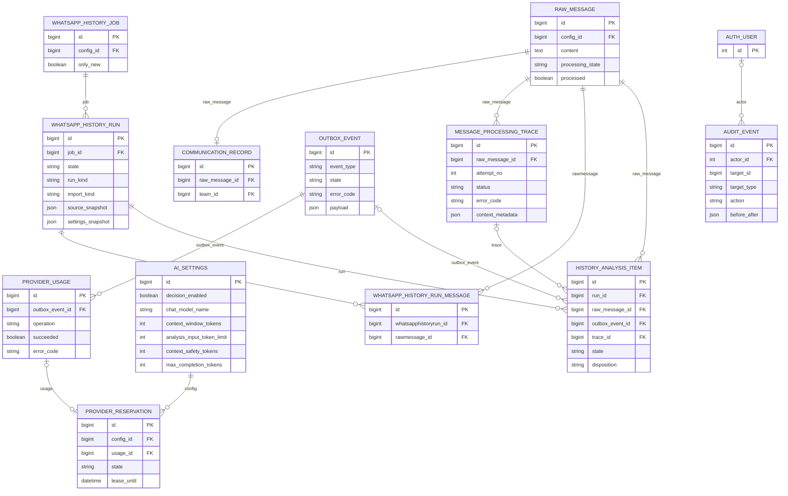

# Исправление диагностики и проверка анализа без LAYA

- Создано: 2026-10-19 11-16-59 MSK (UTC+3).
- Задача: `chat-only-analysis`, прямая постановка пользователя, без GitHub Issue.
- Ветка: `bugfix/chat-only-analysis`; база `main` синхронизирована через `git pull origin main`, commit `aca6176`.
- Статус: спецификация подтверждена пользователем 19.10.2026; исправление развёрнуто, выполняется сквозная проверка.
- Схема БД не меняется. Ниже показаны существующие сущности, которые читаются или обновляются при проверке.



Связь сообщения с заданием хранится в `OutboxEvent.payload.raw_id`, не во внешнем ключе. Активные `AISettings` выбираются глобально. Выделение тем остаётся в существующих `DialogueThread/ThreadMessage/ThreadRevision`; эта задача их структуру не меняет.

```mermaid
sequenceDiagram
    participant U as Руководитель команды
    participant API as Django API
    participant DB as PostgreSQL
    participant Q as Outbox и Q2
    participant CHAT as Чат-провайдер
    participant FREE as Проверенный бесплатный резерв
    U->>API: GET records/749/traces/
    API->>DB: Проверка доступа и безопасная проекция trace
    DB-->>API: Попытки, диагностика и контрольные точки
    API-->>U: 200, фактический статус анализа
    U->>API: Запуск анализа или восстановление упавшего задания
    alt Новый анализ
        API->>DB: Новая попытка и идемпотентное задание
    else Штатное ручное восстановление
        API->>DB: Те же event и trace, счётчик сохранён, добавлен audit
    end
    API-->>U: Задание принято, результат ещё не готов
    Q->>DB: Чтение задания, настроек и сохранённых этапов
    Note over Q: decision_enabled=false: модель решений не вызывается
    Q->>Q: Проверка snapshot, источников и бюджета текущего этапа
    alt Обязательные данные не помещаются
        Q->>DB: Терминальная диагностика без вызова CHAT
    else Запрос помещается
        Q->>DB: Проверка собственного main cache и SHA запроса
        alt Основной ответ уже завершён и проверен
            DB-->>Q: Готовый ответ без повторного вызова CHAT
        else Нужен основной ответ
            Q->>DB: Атомарный резерв допуска
            Q->>CHAT: Сохранённый структурированный запрос
            opt Отмеченное восстановление с free-only резервом и отказ primary
                CHAT->>FREE: Тот же запрос, только проверенный :free model
                FREE-->>CHAT: Ответ либо отказ резерва
            end
            CHAT-->>Q: Ответ или ошибка, usage
            Q->>DB: Учёт расхода; кэш принятого ответа
        end
        opt Основной ответ принят и требуется focused extraction
            Q->>DB: Проверка кэшей дополнительных запросов
            Q->>CHAT: Только незавершённый запрос с собственным SHA
            CHAT-->>Q: Ответ или ошибка дополнительного запроса
            Q->>DB: Готовый cache либо SHA и ключ упавшего вызова
        end
        alt Ответы, схема и доказательства корректны
            Q->>DB: Сохранение этапа, тем и фактов по обычным правилам
            Note over Q,DB: Публикация результата только после всех этапов
        else Подтверждённый случай ограниченного повтора
            Q->>DB: Тот же event, отложенный повтор, SHA в retry history
            Note over Q,DB: Готовые main и focused кэши сохранены; hard limit неизменен
        else Повтор не разрешён или снова неудачен
            Q->>DB: Обычное исправление, дробление либо терминальная ошибка
        end
    end
    U->>API: Получить итоговую диагностику
    API-->>U: Завершение всех этапов или конкретная сохранённая ошибка
```

## Постановка

Пользователь отключил LAYA и ожидает сквозную обработку через чат-модель. На production `https://ai.mazory.best` запись Messenger №749 отображает ошибку анализа; запрос `/api/messenger/records/749/traces/` возвращает HTTP 500 с correlation_id `2ef9dc7986ca4e34bc029d5fefa65b09`.

Оставить существующую архитектуру векторов и распределения тем. Исправить диагностику и устранить подтверждённый барьер бюджета, затем проверить выбранное сообщение через настоящий worker и провайдер.

## Подтверждённые данные диагностики

Проверено 19.10.2026 на production через Docker context `mazory-remote`; backend и workers используют image `mazory-backend:ai-settings-aca6176`.

1. Активная настройка `decision_enabled=false`, чат-модель `openrouter/free`. Статический аудит подтверждает прямой путь новых сообщений через `extract_message`; уже созданные `route_message` также передают обработку чат-модели при отключённом decision.
2. Messenger record `749` связан с RawMessage `1187`.
3. Последняя попытка `3824`, OutboxEvent `66329`: `failed/context_fixed_input_too_large`, `request_state=not_sent`; ProviderUsage этого задания отсутствует.
4. Read-only повтор подготовки запроса воспроизводит оценку `100123` при лимите `65536`. Для Free Router это консервативная верхняя оценка по UTF-8-байтам, не точные токены выбранной провайдером модели.
5. Сериализованные messages занимают `45189` байт, response_format — `50550`; остальное — резерв/обрамление. Даже подготовка без дополнительных сообщений истории превышает текущий предел.
6. SQL `SELECT jsonb_object_length('{}'::jsonb)` на production возвращает `ProgrammingError: function jsonb_object_length(jsonb) does not exist`. Этот вызов находится в `RecordTracesView`; воспроизведение view с аутентифицированным разрешённым пользователем также даёт 500.
7. Текущие ошибки не доказывают отказ чат-провайдера: проблемная попытка не дошла до внешнего запроса. Успешный сквозной анализ на текущих настройках ещё не подтверждён.
8. Повторное чтение production параметров: окно `200000`, резерв ответа `32768`, safety `2048`; расчётный доступный вход `165184`. Предлагаемый лимит `131072` укладывается в этот бюджет. Возможности фактически выбранной Free Router модели проверяются только реальным запросом.
9. Read-only `manage.py makemigrations --check --dry-run` внутри production backend завершился с `No changes detected`. Код приложения и настройки production не менялись; diff спецификации проверен на пробельные ошибки.

## Требования

- `GET /api/messenger/records/749/traces/` возвращает диагностику без 500 при сохранении авторизации, пагинации и безопасного набора полей.
- Признак наличия JSON-object payload вычисляется поддерживаемым PostgreSQL выражением; пустой объект, массив, JSON null и SQL NULL обрабатываются корректно.
- LAYA/decision остаётся выключенной; векторный поиск, модели, схема БД и бизнес-права не меняются.
- Предлагаемое изменение настройки production: `analysis_input_token_limit: 65536 → 131072`, только после подтверждения этой спецификации и повторной проверки, что предел не превышает `context_window_tokens - max_completion_tokens - context_safety_tokens`.
- Чат-модель остаётся `openrouter/free`; не отключать строгую схему, доказательства, проверки источников или консервативный счётчик для обхода ошибки.
- При реальной ошибке контекста провайдера или валидации отразить её и устранить причину в пределах этой задачи; не объявлять постановку в очередь успехом.
- Сквозная проверка использует существующее сообщение и штатный механизм повторного анализа. Не создавать тестовые сообщения WhatsApp, новые бизнес-обязательства или отправки ради проверки.
- Не выполнять массовый повтор сообщений. Сохранить прежние попытки и все бизнес-данные.

## Планируемые изменения

1. В `backend/api/messenger_api.py` заменить `jsonb_object_length(whatsapp_raw_payload) > 0` внутри object-ветки CASE на `whatsapp_raw_payload <> '{}'::jsonb`.
2. Проверить поведение SQL для объекта/массива/null и реального trace через одноразовые команды внутри Docker; файлы unit/component/integration/mock-тестов не создавать.
3. Выполнить обязательные проверки backend на `kk-minsk`: `manage.py check`, `makemigrations --check`; запустить сервисы и проверить логи backend/qcluster/waha. Сборка frontend требуется только при фактическом изменении frontend.
4. После успешной проверки создать commit и PR только в `main`, дождаться требуемых checks/review, объединить; production обновлять через `mazory-remote` штатным процессом проекта.
5. Перед production изменением повторно прочитать активные параметры и доступный входной бюджет. Применить согласованное значение `131072`, не меняя остальных настроек.
6. Проверить production endpoint диагностики, затем повторить анализ записи №749 штатно с отдельным идемпотентным ключом; проследить все continuations до терминального результата.
7. По trace/outbox/provider usage подтвердить вызов чат-модели, отсутствие decision-запросов и сохранение проверенного результата. Проверить пользовательский статус Messenger и состояние связанных фактов; потенциальные CRM-действия не подменять искусственным созданием.
8. Итоговые проверки и результат дописать в эту же спецификацию; отдельные отчёты и планы не создавать.
9. Дополнительный подтверждённый барьер сквозной проверки: первый OpenRouter запрос не завершился в течение предусмотренного бюджета анализа (240 секунд), а `requests.post` ожидал весь body до проверки deadline. Исправить чтение ответа с проверкой общего бюджета между порциями и ограничением очередного socket read оставшимся временем; сохранять полный успешный JSON, исходный read timeout, классификацию ошибок и освобождение соединения. Не менять модель, схему, доказательства, входной и выходной лимиты ради обхода ожидания.
10. Фактическая проверка выявила ещё одно несоответствие: production `AI_REQUEST_TIMEOUT=1800`, Q2 worker timeout `1920`, но Free Router использовал hardcoded analysis budget `240` и read cap `180`. Применить к `openrouter/free` существующую политику долгих запросов `min(AI_REQUEST_TIMEOUT,1200)`, уже используемую для Qwen, с общим deadline из шага 9 и запасом до worker timeout. Модель, входной лимит 131072, output/schema и доказательства сохраняются; лимит 240 секунд не был требованием пользователя.
11. Согласовать срок резерва глобального допуска с новым долгим бюджетом: текущий резерв 397 имеет lease 600 секунд при выполняющемся запросе с бюджетом 1200. В атомарном `reserve` сохранять прежний минимум 600 секунд, продлевая его до оставшегося deadline + 30 секунд на фиксацию расхода. Завершённый запрос, как раньше, немедленно переводит резерв в settled. Не увеличивать настроенный лимит параллельности и не обнулять квоты. Идентифицированный текущий живой резерв продлить с аудитом, чтобы он оставался учтённым до завершения; не трогать завершённые или чужие резервы.

12. Устранить подтверждённое разрастание схемы источников: новый versioned wire-формат Free Router хранит ID только в ключе `m<ID>`, сервер после native schema validation восстанавливает канонический integer ID. Старые сохранённые request envelopes без версии сохраняют прежнюю схему и проверку согласованности ID. Списки источников, цитаты, факты и публичный DTO не сокращаются. При output-retry уменьшать свежую часть входа относительно обязательного envelope, сохраняя общий лимит 131072. Возобновить 14 проверенных этапов с аудитом и проверкой source_hash; прежние ошибки сохранить.

13. Продолжение 3847 выявило ошибку scheduling для многостраничного состояния: fixed 120274 помещается в hard budget 131072, но 90% cap всей страницы оставлял только 512 байт для новых originals. Применять уменьшение 90% к свободной свежей части, аналогично output-retry; страницы, факты, источники и hard budget сохраняются. Проверить обе фактические страницы и продолжить checkpoint 15 этапов/84 сообщения.

## Критерии готовности

- После размещения полных новых originals заполнять оставшийся бюджет префиксом следующего original, если он целиком не помещается. Бинарный поиск считает весь payload с уже выбранным префиксом. Сохранять хронологию, ranges/cursor/offset и существующий формат partial; отсутствие места при непустом префиксе не считается ошибкой. Frozen page plan не менять.

- После output-backoff восстанавливать только scheduling cap следующего набора страниц на 25% (не менее 512), не выше прежнего hard input budget. Рост разрешён лишь после завершения всех страниц набора, если у каждого main/focused ответа известный положительный completion usage не превышает половины выходного резерва и имеется непустой видимый ответ. При отсутствующих данных или незавершённой странице сохранять cap. Сохранённые envelopes, page plan, coverage, источники и предметные проходы не менять; расчёт должен быть детерминированным при повторе.

- Диагностика №749 возвращает HTTP 200 с безопасными данными; прежняя ошибка анализа доступна пользователю.
- Отключение decision не блокирует `extract_message`; нет вызовов модели решений у проверяемой новой попытки.
- Повторный анализ проходит через реальный Q2 worker и чат-провайдер и достигает терминального успешного состояния всех необходимых этапов; результаты подтверждены trace и связанными сущностями.
- Нет дублированных фактов или новых лишних внешних действий.
- Если провайдер/валидация создают новый барьер, задача остаётся незавершённой до устранения либо конкретного внешнего ограничения; сам HTTP 200 провайдера недостаточен.
- `manage.py check` проходит, `makemigrations --check` сообщает `No changes detected`, diff чист от случайных изменений.
- В production backend и все workers используют один проверенный image; после обновления просмотрены логи.
- PR направлен только в `main`; production результат проверен после развёртывания.

## Выполненные проверки

- 19.10.2026, Docker context `kk-minsk`: image `mazory-backend:chat-only-analysis` собран с исправлением.
- `manage.py check`: `System check identified no issues`.
- `manage.py makemigrations --check`: `No changes detected`.
- Одноразовая SQL-проверка на PostgreSQL: пустой/непустой object и array, JSON null, SQL NULL и scalar возвращают ожидаемый boolean.
- Реальный `RecordTracesView` на данных проверочного окружения: HTTP 200, непустой список попыток, `has_raw_payload` имеет boolean-тип; запрос без аутентификации возвращает 401.
- Проверочные сервисы работают в Docker; логи backend/qcluster/waha просмотрены. Сквозной production результат ещё не подтверждён.

## Развёртывание и проверка production

- PR [#103](https://github.com/envOnion/kz-mazory/pull/103) объединён в `main`, merge commit `5ed207404f4b1ab865df66f3a7b1532879d50de9`. CI: backend/frontend builds, TypeScript, Django checks, migration check, production settings check, dependency audits, Gitleaks и Compose configuration — success.
- Снята резервная копия PostgreSQL перед обновлением. Backend и все workers/outbox обновлены на `mazory-backend:chat-only-5ed2074`, OCI revision совпадает с merge commit. Существующий nginx image сохранён, nginx перезапущен для обновления DNS backend. Volumes, сеть и секреты сохранены.
- Production `migrate`: `No migrations to apply`; `check` без замечаний; `makemigrations --check --dry-run`: `No changes detected`; `ops/check_deployment.py --runtime-context mazory-remote` подтвердил один image у backend и всех workers.
- Реальный HTTPS GET `/api/messenger/records/749/traces/` с сессионной JWT-аутентификацией возвращает 200 и прежние попытки 3824/3812. Проверочная сессия после API-вызовов отозвана.
- Через штатный PATCH `/api/settings/ai/1/models/chat/` сохранён согласованный `analysis_input_token_limit=131072`; `decision_enabled=false`, модель `openrouter/free` сохранены.
- Через штатный POST `/api/messenger/records/749/reanalyze/` создан один повтор с детерминированным UUID: OutboxEvent `66429`, начальный trace `3829`. Исходные попытки сохранены; до запуска кандидатов фактов сообщения не было.
- Первый этап прошёл подготовку и отправлен чат-провайдеру: входная оценка `130614`, история из 760 сообщений читается по этапам. Отправка сама по себе не считается успешным анализом; ожидается терминальный результат.
- Отдельно проверенные WAHA webhook 403 содержат `Источник не разрешён`: подпись проходит, срабатывает фильтр разрешённых чатов. Ключи backend/WAHA совпадают (проверено только boolean-сравнением без вывода значений), session `WORKING`. Фильтры доступа не изменялись.
- Дополнительное исправление транспорта проверено в `kk-minsk`: Django check и migration check чистые; реальный HTTPS JSON OpenRouter `/models` (788509 байт, 471 запись) прочитан полностью за 0.134 секунды. Тестовые и mock-файлы не создавались; использовались одноразовые Docker-команды.
- Реальное чтение того же HTTPS endpoint с коротким бюджетом прервано через 0.0014 секунды (`ReadTimeoutError`, штатно классифицируется `_post` как `provider_timeout`); socket timeout ограничивается оставшимся общим бюджетом, а соединение закрывается в `finally`.
- PR [#104](https://github.com/envOnion/kz-mazory/pull/104) прошёл полный CI и объединён: `dd5130d52d3ed697db5a9311020728058d36429c`. Backend и все workers/outbox обновлены на `mazory-backend:chat-only-dd5130d`; production Django/migration checks и проверка единого image прошли.
- Зависшая проверочная попытка 3829 / событие 66429 отменена с аудитом после остановки её worker. На момент отмены кандидатов фактов не было; прежний trace и неизвестный расход провайдера сохранены, не выданы за успешный результат.
- Повтор после исправления транспорта создан через публичный API: событие `66518`, начальный trace `3830`. Первый ответ `xingchen-agi/xing4.0-29b-a4b:free`: 61383 мс, вход 16772/выход 778 токенов; второй ответ `nvidia/nemotron-3-super-120b-a12b:free`: 50088 мс, вход 14085/выход 2061. Оба этапа прошли серверную валидацию; trace 3832 продолжает чтение после 64/760 сообщений. Это промежуточный результат, не подтверждение окончания всего анализа.
- После четырёх валидированных этапов (67/760 сообщений) пятый этап дважды достиг общего бюджета 240 секунд; read deadline сработал, usage содержит `provider_timeout`, штатные повторы сохранили checkpoint. Для согласования Free Router с production `AI_REQUEST_TIMEOUT=1800` применяется существующий long-request cap 1200 секунд. Image `mazory-backend:chat-only-budget` собран в `kk-minsk`, Django check и migration check прошли.
- PR [#105](https://github.com/envOnion/kz-mazory/pull/105) прошёл CI и объединён: `96a42e328fc911dbd9f7d5b09cc60f275ea27023`. Все backend-сервисы обновлены на `mazory-backend:chat-only-96a42e3`; проверки Django/миграций/одного image прошли. Пятый этап закончен, сохранено 68/760; шестой этап выполняется с бюджетом 1200 секунд, решение LAYA не вызывалось.
- Runtime read-back выявил reserve 397: создание `09:13:11 UTC`, lease до `09:23:11 UTC`, в момент проверки вызов ещё выполнялся. С блокировкой конфигурации и события, проверкой текущего trace 3835 и отсутствия usage продлён только этот живой резерв до `09:33:41 UTC`; создан AuditEvent. Параллельный лимит остался 2. Постоянное согласование lease с deadline собрано в `kk-minsk`; Django check/migration check прошли.
- PR [#106](https://github.com/envOnion/kz-mazory/pull/106) прошёл CI и объединён: `0ffac2d6e05957f7dd765c8482c4a52a590cfa1b`. При graceful drain Q2 текущая попытка завершилась естественно: после обрыва соединения на 731798 мс штатный повтор дал валидный ответ `nvidia/nemotron-3.5-super-vl:free` за 85510 мс; сохранено шесть этапов, 71/760 сообщений. Уничтожения выполнявшейся попытки при этом обновлении не было. Все backend-сервисы обновлены на `mazory-backend:chat-only-0ffac2d`, Django/migration/uniform-image checks прошли; анализ продолжен с сохранённого checkpoint.

- После 14 валидированных этапов обработано 81/760 оригиналов. Ответ Liquid завершился с обрезанным output; восстановление с scheduling cap 65536 упёрлось в обязательный envelope. Read-only прогноз реального запроса: 50 source IDs — 125671, 100 — 148148, 150 — 170698; при 201 источнике прежняя схема переключается в массив и уменьшается, но этот порог недостижим в лимите 131072. Введена отдельная версия компактных source slots, сохраняя legacy-схему и integer DTO.
- Compact-source validation: неизменность legacy-схемы подтверждена на сохранённом request envelope; реальный сохранённый provider_result проходит новую JSONSchema, декодирование сохраняет канонические данные. Прогноз compact при 100/150 источниках: 111036/114936. Подготовка фактического checkpoint: fixed 107063, input 125662, read 84/760; при retry cap 65536: input 112984, read 82/760. Все проверки read-only, без вызовов модели и записи бизнес-данных. Docker `kk-minsk` build, Django check и migration check прошли.
- PR [#107](https://github.com/envOnion/kz-mazory/pull/107) прошёл полный CI и объединён: `d4837d8dd4efbc05236ccd1d0b1ae08070780ad5`. Production обновлён на `mazory-backend:chat-only-d4837d8`; Django/migration/uniform-image checks прошли. Новый запрос через normal scheduler — OutboxEvent `66882`, trace `3846` — получил 14-stage checkpoint события `66518` в атомарной транзакции с проверкой source_hash/config/access и AuditEvent. Сохранён snapshot из 760 оригиналов, прочитано 81; прежние failed traces не изменены. Публичные GET диагностики и записи: HTTP 200; статус analysis=queued. Проверочная JWT-сессия отозвана.
- Первый реальный compact-wire ответ: `xingchen-agi/xing4.0-29b-a4b:free`, 170689 мс, strict schema/evidence validation прошли. Checkpoint увеличен до 15 этапов и 84/760, создан следующий trace 3847; decision calls=0. Это подтверждение нового этапа, полный разбор ещё выполняется.
- Для continuation 3847 подтверждён scheduling-only барьер: обязательный envelope 120274 ниже hard budget 131072; carry пустой, состояние делится на две страницы 15820/7933 байт. После исправления расчёта проверены обе реальные страницы: input 129992 и 121945, одинаковые выбранный fragment/ranges. Длинный оригинал читается по частям, общий счётчик полностью прочитанных сообщений остаётся 84 до окончания текста. Backend build/check/migration check в `kk-minsk` прошли. PR [#108](https://github.com/envOnion/kz-mazory/pull/108) прошёл полный CI и объединён: `4265f82082c8d5732eb0ac86f1fb5973615908bf`.

## Продолжение проверки и экономия квоты

Пользователь 19.10.2026 поручил продолжить production-проверку в `mazory-remote`, исправлять выявленные ошибки и довести текущие сообщения с ошибкой до результата, учитывая суточные 1000 бесплатных запросов. На 11:58 UTC OpenRouter `GET /api/v1/key`: used=53, limit=1000, remaining=947; этот read-only вызов не генерирует ответ модели. Текущие ошибочные цели: RawMessage 1188–1196 и 1198 (Messenger 750–758 и 760). Запись 749 уже выполняется с сохранённым checkpoint, старые failed events не означают новые ошибки текущих сообщений.

- Проверять размер пакетов без генерации; не запускать десять полных повторов истории, если можно использовать штатный batch с отдельными trace/классификациями. Preflight десяти целей выявил `context_fixed_input_too_large` до вызова провайдера; пакеты будут ограничены фактическим envelope.
- У Free Router применять уже существующее продолжение по проверенным цитатам после чтения целевого оригинала независимо от порога в треть окна. Состояние страницы содержит summary и факты; исходный текст остаётся в БД, literal evidence проверяется по оригиналу и сохранённым ranges. Focused passes читают исходный target по существующему контракту. Прочие провайдеры сохраняют прежний порог. Не переносить checkpoint между разными целями только по source_hash.
- Проверить действующий checkpoint read-only: уменьшение полного envelope, неизменность source_hash/validated coverage, продвижение cursor, сохранение фактов и цитат страницы, strict schema. Выполнить сборку и Django/migration checks в `kk-minsk`, затем CI/merge и production deployment с сохранением текущей попытки.
- Подтвердить успех каждого текущего ошибочного сообщения по worker, trace и публичному API; очередь и промежуточный прогресс не считать завершением. Лимиты, модель, decision_enabled=false и проверки доказательств сохраняются.
- Та же политика применяется к остальным целям пакета только после полного подтверждённого чтения соответствующего оригинала. Первый запрос пакета сохраняет полные целевые тексты; источник и coverage не подменяются summary.
- Read-only production checkpoint: прежний fixed=123738/input=127145/read=137; новый fixed=86285/input=100499/read=138, target bytes 14497→2182. source_hash, validated coverage и previous_result совпадают; `validate_evidence` на сохранённом состоянии прошёл. Никаких новых model calls эта проверка не создала.
- Контекст `kk-minsk` отсутствует в текущем Docker CLI. Для этого продолжения пользователь явно поручил тестировать `mazory-remote`: production-image preflight выполняется там, CI использует разрешённый одноразовый Docker Engine. Сервисы или зависимости на хост не устанавливаются.
- Если у прочитанной цели ещё нет подтверждённых цитат фактов, её текст не заменяется пустой строкой: исходник остаётся доступен для нового вывода. Для focused recovery полные прочитанные целевые оригиналы пакета восстанавливаются по DB и coverage, чтобы сжатие main input не убирало контекст соседней цели из дополнительного прохода.
- Preflight штатных пакетов по пять (без генерации): цели 1188–1192 fixed=102879/input=130296; цели 1193–1196,1198 fixed=94098/input=126383, общий snapshot 763 originals. Транзакционно создан saved recovery run 18 с ровно десятью ошибочными целями, отдельными trace и событиями 67487/67488 через `history_analysis.schedule`; источник и права каждой цели проверены, создан аудит. Старые попытки сохранены, загрузка WAHA не повторялась, snapshot_max_id=1201, модели/глобальные лимиты не изменены.
- Production candidate image `mazory-backend:target-continuity-preflight` собран в Docker без замены работающих сервисов. `manage.py check`: no issues; `makemigrations --check --dry-run`: No changes detected. Сеть и volumes существующего приложения сохранены.
- PR [#109](https://github.com/envOnion/kz-mazory/pull/109) прошёл CI и объединён: `c2c04b17a9277ba93cd623de39870b5ec3784676`. Проверки итогового `main` также success. Release image `mazory-backend:chat-only-c2c04b1` собран из merge commit, OCI revision проверен. Перед обновлением создан и прочитан каталог backup PostgreSQL; Django/migration checks чистые. Graceful остановка завершила первый этап пакета 67487 естественно: 63/763, пять учтённых model calls, сохранён следующий trace 3887. Backend и все workers/outbox обновлены, runtime-check подтвердил единый image. Исторические попытки, source snapshot, очередь, сеть, volumes и настройки сохранены.
- Первый реальный запрос после обновления: событие 66954, trace 3886, fixed=86468/input=93822, выбран источник до 138/760 при проверенном checkpoint 33 этапа/136 полностью прочитанных сообщений. Ответ ещё ожидается; это не подтверждение окончания анализа.
- Trace 3886 выявил другой барьер: OpenRouter вернул HTTP 200 с `finish_reason=error` и пустым content. Сейчас расход помечается succeeded, а ответ попадает в `invalid_extraction_schema`, вызывая структурную корректировку/разделение пакета. Обрабатывать choice-level error в `_post` до succeeded=True, сохраняя явный upstream code и Retry-After; для отсутствующего кода — `provider_server_error` с фактическим HTTP 200 в диагностике. Это направляет сбой в существующие ограниченные транспортные повторы и сохраняет checkpoint, а не расходует schema repair. Настоящие нарушения схемы/цитат сохраняют прежние проверки. Контракт подтверждён официальным OpenRouter: https://openrouter.ai/blog/tutorials/model-routing-for-support-bots-cheap-first-faq-handling/ .
- Дополнительное извлечение не пропускается произвольно между первым и последним этапом: финальный focused-контекст не включает все промежуточные оригиналы, поэтому такой пропуск мог бы потерять разрешение предмета обещания. Экономия не должна ослаблять полноту источников; пока сохраняется существующая предметная проверка каждого этапа.
- Диагностика ответа учитывает стандартное поле OpenRouter `message.reasoning` (в дополнение к legacy `reasoning_content`) и числовой `usage.completion_tokens_details.reasoning_tokens`, не сохраняя текст рассуждения. Это помогает отличать пустой `finish_reason=length` из-за reasoning от слишком большого видимого результата, без изменения модели или режима reasoning. Официальный контракт: https://openrouter.ai/docs/guides/best-practices/reasoning-tokens .
- Candidate `mazory-backend:choice-errors-preflight` использует проверенный production image c2c04b1 и единственный изменённый модуль `ai_service.py`; production-config `manage.py check` и `makemigrations --check --dry-run` повторно прошли. Провайдер для проверок не вызывался. Полная сборка исходников и проверки остаются обязательными в CI и перед production release.
- PR [#110](https://github.com/envOnion/kz-mazory/pull/110) объединён: `5d39cf21d5ecfb4549b4e8934b01dc78e7ec2771`, CI PR и итогового main — success. Release image собран с проверенным OCI revision; production-config Django/migration checks прошли. Перед переключением снят backup и выполняется graceful остановка без принудительного прерывания запросов. На этапе 3888 checkpoint сообщения 749 вырос до 34 этапов/138 originals; общий анализ ещё не завершён.
- Read-only проверка восстановления scheduling cap на реальных validated traces 3885/3888 даёт 63572 → 79465; traces 3870–3873 без cap не меняются. Metadata checkpoint не изменена, model calls не выполнялись. Candidate `mazory-backend:cap-recovery-preflight` собран в Docker: `manage.py check` без замечаний, `makemigrations --check --dry-run`: No changes detected. Проверка кода отдельно подтвердила guard всех страниц/дополнительных ответов, неизменность page plan и детерминированный расчёт следующего cap.
- PR [#111](https://github.com/envOnion/kz-mazory/pull/111) объединён: `ee23dafe82e1dbf17e04909f309101bb87b032c2`, CI PR и main — success. Image с проверенным OCI revision развёрнут после backup и graceful остановки. Runtime-check подтвердил один работающий image backend/всех workers/outbox; Django и migration checks чистые. Публичная диагностика всех 11 записей возвращает 200, проверочная сессия отозвана. LAYA выключена, среди 34 учтённых calls целевых событий только operation=chat; модель/лимиты сохранены. Реальный timeout этапа 3894 сохранил 34 этапа/138 originals и ушёл в bounded retry; повтор прошёл, этап 3894 validated, следующий trace 3896 получил cap=79465. У группы 67727 provider_server_error не вызвал нового split и сохранил два этапа.
- Trace 3896 показал ещё одну потерю бюджета: old prepare включил всего 51 новый байт (input=87487/fixed=86621), поскольку partial следующего original выбирался только при пустом полном префиксе. Read-only replay того же сохранённого состояния новой логикой включил 18357 новых байт при input=106983 <=131072. Source hash, previous checkpoint, validated coverage и strict evidence validation сохранены. Реальная frozen page 1/2 группы 67727 получила идентичные payload/page plan/ranges. Candidate `mazory-backend:fill-chunks-preflight`: Django check — no issues, migration check — No changes detected; model calls для этих проверок не выполнялись.

- PR [#112](https://github.com/envOnion/kz-mazory/pull/112) объединён: `197b121f4b7cb362ffb7b97532dfff9924dc53f4`; CI PR и main прошли. Production image с тем же revision развёрнут после backup и graceful остановки; Django/migration/uniform-image checks чистые, все 11 публичных traces endpoints возвращают 200. Реальный checkpoint 749 вырос до 41 validated stages/173 из 760 originals; окончательный анализ ещё не подтверждён.
- Дополнительный дефект в том же Messenger: Gunicorn прервал GET `/api/messenger/dialogs/?attention=1` внутри SQL списка. Bounded read-only EXPLAIN на текущих данных: latest-trace FK scan — 336 циклов и около 1794 мс из 1914 мс выполнения; cold запросы достигают statement timeout 5 секунд. Планируемое узкое изменение: сначала выбрать только ID последней попытки через прежние raw_message/order/limit, затем по PK прочитать её статус и JSON request_state. Access scope, NULL semantics, canonical status rules и схема БД сохраняются. Критерий проверки: точное совпадение IDs/analysis/has_attention в одном snapshot и план с ID-only winner selection; сравнить ограниченные планы на тех же данных, выполнить Docker Django/migration checks и HTTPS read-back после CI/deployment. Модель для этих проверок не вызывается.
- Read-only REPEATABLE READ snapshot: оба варианта вернули одинаковые 336 `(id, analysis, has_attention)` строк; SQL status/access semantics совпали точно. Original: SELECT 4693 мс / EXPLAIN execution 3099 мс; candidate: 1188 / 1403 мс. VERBOSE plan: прежний FK scan проектировал JSON для всех попыток (336 loops, 9 rows average, 2821 мс); новый FK scan несёт только ID (90 мс), далее 323 lookup победителя по PK (1 мс суммарно). Измерения относятся к текущей production нагрузке и не являются нагрузочным benchmark.
- Docker `attention-projection-preflight`: Django check без замечаний, `makemigrations --check --dry-run`: No changes detected. Прямой официальный OpenRouter key read-back 14:15 UTC: used=77/1000, remaining=923, usage_daily=0; генерации для диагностики не выполнялись.
- PR [#113](https://github.com/envOnion/kz-mazory/pull/113) объединён: `5b4f7480ebfa52f72d2dbeb92576f9e1b8a775a6`, CI PR и итогового main прошли. Production image собран из merge commit с проверенным OCI revision, создан и проверен PostgreSQL backup. После graceful остановки backend и все workers/outbox работают на одном image; Django/migration checks чистые.
- Публичный HTTPS read-back после #113: `/api/messenger/dialogs/?attention=1` — 200/8285 мс/2 items, `/api/messenger/dialogs/` — 200/3699 мс/3 items. Все 11 целевых traces endpoints — 200; временная JWT-сессия отозвана. После restart backend/worker/outbox tails без ошибок; WAHA сохраняет отдельные webhook errors, whitelist не изменялся и история повторно не загружалась.
- 14:23 UTC root trace3903 достиг provider_timeout, подтвердив сохранение 41 stages/173 originals. Следующий транспортный повтор дал валидный ответ: 14:28 UTC сохранено 42 stages/187 из 760 originals, новый trace3904. Пакет67727 сохранил 3 stages/70 из 763 после provider_server_error. Конечного успеха 11 сообщений это ещё не подтверждает.
- Подтверждён отдельный дефект статуса record750: при event67727 pending / trace3899 warning / action=error / request=failed / retry=pending оба адаптера возвращают analyzed. План: Python и SQL учитывают активный retry незавершённой попытки (pending/budget_wait/rate_wait → queued, processing → analyzing); приоритет terminal error, sending/accepted/unknown и успешные результаты сохраняются. Извлекать только retry.state у выбранного latest trace, не всю metadata. Очередь и сохранённые исходы попыток не изменять. Проверка: bounded read-only сравнение обоих адаптеров на фактических records, guard отсутствия изменений вне активных повторов; Docker Django/migration checks, CI и публичный HTTPS read-back.
- Read-only REPEATABLE READ проверка 1184 реальных записей: Python и SQL совпали полностью для original и candidate. Изменились только три активных повтора: record1170 analyzed→queued, record750 analyzed→analyzing, record749 analyzed→queued. Остальные 1181, attention flags и terminal outcomes не изменились. Генераций модели и изменений очереди не было.
- Candidate `mazory-backend:retry-axis-preflight` собран в Docker; Django check без замечаний, migration check: No changes detected. Новые test/mock suites не создавались.
- PR [#114](https://github.com/envOnion/kz-mazory/pull/114) объединён: `eb4178282dd622d47ec3de913633b1b978ef90bb`; CI PR и итогового main прошли. Release image собран из merge commit, OCI revision проверен, PostgreSQL backup проверен; production-config check/migration check чистые. Чтобы не прерывать выполняющийся provider call, web backend обновлён отдельно во время graceful drain workers. Окончательная проверка единого image выполняется после их остановки и обновления.
- Публичный HTTPS read-back после web update: records749/750/1170 возвращают 200 со статусами analyzing/queued/queued соответственно. Фильтр queued: 200/12 items, analyzing: 200/3 items; у каждой записи возвращённый analysis совпадает с фильтром. Временная сессия отозвана. Это подтверждает исправление отображения активного повтора, а не окончание анализа.
- 14:37 UTC пакет67727 сохранил четвёртый этап, 73/763 originals, следующий trace3905. Root3904 после provider_server_error повторно отправлен с неизменённым validated checkpoint 187/760. Исторический parent67487 остаётся failed после выполненного split; он не воскрешается и не выдаётся за новую ошибку дочерних задач.
- После graceful drain root3904 завершился естественно: 43 stages/188 из760 originals. Backend и все workers/outbox работают на одном image eb41782; повторные Django/migration checks чистые, backend/worker/outbox tails без новых ошибок. Следующий запрос3906 подготовлен, fixed125510/input129278/read189 при validated188; в новом prepare84812мс против fast immutable replay180мс, время включает DB и пока не приписывается одному CPU участку.
- Узкое ускорение preflight: сохранять high и все midpoint бинарного поиска, но для openrouter_free пропускать построение schema заведомо слишком большого probe, если cumulative UTF-8 content bytes >chunk_budget. Это нижняя граница RouterCounter: выбранный content остаётся в context, JSON escaping не уменьшает байты; остальные части увеличивают размер. Не менять midpoints (счётчик может быть немонотонен на пороге200 sources), счётчик, лимиты, payload, source/coverage и partial selection. Проверить реальным read-only replay с профилем времени и полным сравнением context/full_history/page plan/payload; модель не вызывать. При отсутствии подтверждённой пользы изменение не разворачивать.
- 14:54 UTC root остановился на trace3908 до вызова модели: fixed143681 >131072 при сохранённых45stages/190из760. Накопленный result42192B содержит один project fact30093B: evidence14497B буквально совпадает с единственным identity-ref quote того же evidence_message_id1187. Существующий paging уже выделяет этот неделимый факт в отдельную страницу30983B, остальные15themes —11528B; дробление тем само по себе не устраняет дублирование внутри факта.
- План исправления blocker: только в deep-copy continuity prior удалять redundant fact.evidence, если все anchor refs с raw_message_id=evidence_message_id содержат одну точно совпадающую строку; ID, literal quotes, roles и весь остальной факт сохраняются. Явно предписать модели восстановить обязательный output evidence из anchor quote. Оригиналы, immutable segment/provider_result, checkpoint, native output schema и серверная literal validation не менять. Read-only replay проверить fit каждой страницы, неизменность цитат/schema, exact восстановления compact prior и frozen plan; после CI/deploy возобновить root через отдельную аудируемую попытку с тем же checkpoint, не начинать190 originals заново.
- Cheap-reject-only replay под cProfile/nice10: old231609мс, candidate238306мс; context/metadata/full_history/page_plan/payload/hash/state полностью одинаковы, provider calls0. Ускорение не подтверждено — этот эксперимент удалён из кода и не разворачивается.
- Read-only blocker replay: exact restore компактного prior совпадает с исходным, native schema полностью одинакова, удаляется14497 дублирующихся байт. Обе страницы проходят прежний131072: page1 fixed129134/input130878, page2 fixed124450/input126194, source_hash/checkpoint/coverage неизменны, strict evidence validation исходного результата проходит. Проверки не вызывали модель.
- Candidate `mazory-backend:dedup-evidence-preflight`: Docker build и production-config Django check прошли, `makemigrations --check --dry-run`: No changes detected. Legacy compaction по умолчанию остаётся прежней; exact dedup включается только для openrouter_free.
- PR [#115](https://github.com/envOnion/kz-mazory/pull/115) объединён: `a5997337fd318841a392d4e9f0b41e0df364b19d`, CI PR и main прошли. Production image собран из merge commit с проверенным OCI revision; dispatcher остановлен перед backup, in-flight workers завершены graceful. Backend и все workers/outbox работают на одном image a599733. Django/migration checks чистые, backend/worker/outbox tails без ошибок.
- После deployment транзакционно создано ровно одно продолжение root: event68434/trace3916 через schedule_reanalysis с детерминированным UUID и AuditEvent. Проверены права actor, неизменность source_hash/snapshot/settings и все45 segment_validated traces; сохранён checkpoint190/760. Старые event66954/trace3908 не изменялись. Analysis source key/position совпадают с исходным сообщением, порядок очереди сохраняется.
- Штатное уменьшение batch в run18: после checkpoint78/763 event67727 разделён на68402/68403; ответ68402 отклонён fact_thread_missing и разделён на68428/68429. Split parents остаются историческими failed; текущие leaf-задачи продолжают через chat-only и прежние проверки доказательств. Ни одному из11 сообщений пока не приписан окончательный успех.
- 15:18 UTC event68434 получил реальный валидный chat-only ответ после dedup: trace3916 segment_validated, сохранён46-й этап; ожидается вторая страница того же фрагмента (общий read190/760). Блокирующий fixed overflow устранён, обязательный output evidence восстановлен и прошёл прежние проверки. Fixed129134 всё ещё оставляет только1744 байта input для нового фрагмента.
- Дополнительное точное устранение повторов: только в wire-копии previous_result заменять ref.quote на quote_ref (JSON Pointer), если строка целиком и точно совпадает с уже присутствующим content того же integer source ID. Индекс строится заново по окончательным content/target_messages/context каждого request; partial и неоднозначные дубли ID исключаются, неполный target_range не используется. Инструкция сначала раскрывает quote_ref, затем восстанавливает omitted anchor evidence. Source text, checkpoint/prior/page_plan вне wire, выходная схема и literal validation не меняются. Сохранённые request envelopes воспроизводятся прежним _restore_request; legacy не преобразуется. Критерий: exact undo на реальном восстановленном payload3916, native schema equality, меньше count_payload; затем read-only preflight новых страниц без provider calls.

- 15:31 UTC root68434 сохранил47-й валидированный этап (190/760), затем trace3920 завершился provider_invalid_request с provider_error_code=404. Исходное тело ошибки не сохранялось, поэтому причина этого конкретного404 не установлена. Повтор не объявляется успешным и будет создан отдельно с аудитом после исправления входа;47 stages не читать заново.
- В транспорте только для openrouter/free распознавать HTTP404 с явным текстовым префиксом `No endpoints found`: это отсутствие подходящего endpoint, использовать существующий ограниченный transport retry provider_overloaded (до3 попыток), сохранять boolean provider_routing_unavailable и код404 без тела/заголовков провайдера. Неизвестный404 и ошибки других моделей сохраняют прежнюю terminal-классификацию. Историческому3920 не приписывать этот диагноз задним числом.
- Quote-reference сжатие должно учитывать все страницы до выбора новых оригиналов: каждый whole/partial probe проверяется по максимальному полному native count всех страниц. Frozen page-plan не пересчитывать. Включать этот совместный выбор и codec для многостраничного состояния только если carry отсутствует у всех его страниц; singlepage codec допустим независимо от carry. В остальных случаях оставить прежнее поведение. Future page probes точно проецируют target coverage, read_source_ids новых полных/частичных оригиналов, исходную phase и target_range; собственные metadata каждой страницы сохраняются фактическими.
- 15:40 UTC read-only OpenRouter quota: used97/1000, remaining903, usage_daily0; генераций для валидации не выполнялось.
- Read-only replay фактического trace3916: exact prior restore, все остальные input fields, сохранённый envelope/hash и native response_format не изменены; partial target guard действует. Оценка входа130878→116423 (−14455), provider calls0.
- Реальный checkpoint66954 (45stages/190из760) повторно подготовлен без генерации. Новый joint-план: page1 fixed114679/input118725, page2 fixed124528/input128500; обе страницы помещаются в131072, selected/ranges и source_hash одинаковы, исходный checkpoint не изменён, literal evidence validation проходит. Новый fragment продвигается до191 полностью прочитанного оригинала; ранее было190. Подготовка page1 заняла179407мс, frozen page2 —7102мс; ускорение CPU не заявляется, совместный расчёт ограничивает расход неудачных генераций на последующих страницах.
- Candidate Docker image quote-references-preflight: production-config Django check чистый, migration check: No changes detected. PR [#116](https://github.com/envOnion/kz-mazory/pull/116) создан, commitfe44db2; CI остаётсяqueued. Официальный GitHub Status сообщает Actions degraded_performance / Incident with Actions and Pages. До успешногоCI код вproduction не разворачивается.
- ПокаCIожидает, для root создан ровно один native retry неизвестного404 на прежнем стабильном imagea599733: event68666/trace3921, UUIDsingle-router-404-recovery-v1. Транзакционно провереныactorrights/settings/source_hash/snapshot и47 segment_validated stages, сохранён checkpoint190/760, source key/position; AuditEvent фиксирует именно единственный повтор404, без утверждения, что новый код уже установлен. Старыеfailed event68434/trace3920 неизменны. Это pending, не окончательный успех.
- 15:55 UTC единственный native повтор404 дал валидный chat-only результат: event68666 сохранил48-й stage,191из760 originals; создан trace3922. Исторический404 не переписан, новая генерация действительно прошла validation. Это продвижение, не окончательное завершение11 сообщений.
- 15:58 UTC повторная публичная HTTPS-проверка всех11 endpoints /api/messenger/records/{749,750–758,760}/traces/: каждый HTTP200; временнаяJWTсессия отозванаfinally. Event68666 уже49 validatedstages /194из760. Ни terminalsuccess, ни прохождениевсех11 сообщений ещё не подтверждены.
- Найден фактический пропуск focused-extraction для root: trace3921 rawcontent8011chars, canonicalplain7954, coverage7954; read_originals сравнивал с8011 и исключал уже прочитанную цель при PROJECT_SUBJECT=True. Read-only сравнение48 реальныхtraces: в27 случаях добавляется только эта полностью прочитанная цель, остальные sourceIDs неизменны; partialtraces ввыборке0, ихruntime-проверка не заявляется.
- Исправлять completeness в координатах full_history.row: raw для Qwenexact, plain_text для других моделей. Дополнительно actual rawquote3921 НЕ проходит существующий _source_quote по canonicalprefix, поэтому focusedtarget/context должны получать ту же canonicalprojection, которую уже прочитала main-стадия; evidence_excerpt сохраняется буквально, immutable RawMessage не изменяется, legacy без full_history и Qwenexact сохраняют raw. Выходные quotes по-прежнему проходят прежнюю evidencevalidation, unreadоригиналы/partialprefix не открываются.
- Все три focused budget guards (recovery, pair comparison, reconciliation) использовать с тем же budget(cfg)=min(nativewindow-output-safety, userinputlimit), что основной разбор. Настройки131072/32768/1000 неизменны; вспомогательный проход больше не может пройти только по более широкому nativewindow в обход inputlimit.
- Native focusedpreflight выполнен на настоящем savedtrace3921 в REPEATABLE READ READ ONLY: candidate.recover дошёл до штатного сохранения focused_requests и остановлен PostgreSQL25006 перед провайдером. Полученный реальный project payload: canonicaltarget7954chars, input65573<=131072, nativeJSONSchema valid, sourcecoverage exact, историческийtrace неизменён, providercalls0. Contextoriginals0 вэтойпопытке; проверка полного focusedresponse ещё предстоит наproduction.
- Повторная публичная проверка деталей всех11 сообщений: HTTP200, analysis=analyzing для750 иqueued дляостальных10; ошибокanalysis/error иattentionflagsнет. Это корректное отображение выполняющейся обработки, не terminalsuccess. 16:09 UTC root68666 сохранил51stage/209из760; batch68428 —10stages/89из763. Последующая основная подготовкаroot fixed84695/input130802, настройкилимитовнеизменны.
- Downstreamпроверка подтверждает: canonicalwholequote7954 root1187 НЕ сопоставляется существующим rawmatcher сraw8011 (дляостальных10 целей сопоставляется). Поэтому persistence/review/autonomous иcommitmentrefs должны проверять именно representation текущейпопытки, а не менять глобальный _source_quote. Сохраняются sourceScope/snapshot/roles/chronology и exact-equality ledger; short_reply/question guards иreceipt_ack используют ту же projection.
- Для совместимости вводится только metadata-version `evidence_text_policy=canonical-plain-v1` у НОВЫХ nonQwen full_history preparations. Canonicalmatcher/reader требуют этогоявного marker; старые frozenenvelopes/validatedtraces/FactEvidence безmarker продолжают rawповедение. Это исключает ретроспективное отклонение прежних whitespace-restored доказательств. Старые незавершённые frozenфрагменты завершаютсяпо прежнейверсии, следующие свежие этапы получаютновую; историческиеtraces не переписываются. RawMessage ивыходная структураполей неизменны, меткаотделяет representation доказательств.

- 16:27 UTC финальный candidate `quote-references-final-preflight` проверен непосредственно в Docker с production config: Django check чистый, `makemigrations --check --dry-run`: `No changes detected`. SHA256 всех 7 затронутых исходников совпадают с рабочей веткой. Read-only сравнение 50 реальных traces: legacy read_originals неизменён, новая явная policy добавляет только полностью покрытую цель в 28 случаях; остальные source IDs неизменны, partial traces в выборке 0. Для 100 сохранённых FactEvidence legacy matcher даёт прежний результат, недействительных цитат 0.
- Финальный native focused preflight trace3921 выполнен с новой policy только на in-memory копии: canonical quote проходит downstream, legacy rawquote по-прежнему допустима для прежнего trace; input65573 <=131072, target7954chars, native schema valid. PostgreSQL READ ONLY останавливает native recover перед provider call, сохранённый trace неизменён, генераций0. Первоначальный широкий verification SQL достиг statement timeout; исправлена только одноразовая диагностическая выборка на раздельные уникальные IDs, лимиты БД и приложения не повышались.
- 16:29 UTC штатное продолжение на прежнем стабильном image a599733: root68666 —56 validated stages,284/760 полностью прочитанных originals, trace3934 отправлен; batch68428 —12 stages,136/763. Это промежуточный прогресс, полного окончания целевых11 сообщений пока нет.

## Адаптивный размер для уточняющего этапа

PR116 объединён и установлен как92964bc; backend/workers едины, Django/migration checks чистые, все11 публичных traces endpoints HTTP200. Native trace3940 сcanonical-plain-v1 действительно выполнил1187:project, input117184<=131072, actualusage8402/550, facts0/topic_updates0; весь этап segment_validated. Trace3941 main119737<=131072, ноfocusedrequest превышает131072 доотправки и завершён context_budget_exceeded. Сохранено61stage,390/760 originals.

Требуется адаптивное дробление свежего входа с сохранением всех подтверждённых оригиналов: при доказанном overflow вспомогательного запроса уменьшать только scheduling budget новых фрагментов, сохранять checkpoint/source_hash/roles/schema/лимиты131072/32768/1000. Повторы ограничены, отсутствие свободного места под обязательный envelope остаётся явной ошибкой. Уточняющий этап не пропускать, оригиналы не выбрасывать; неизвестные context_budget_exceeded других путей не считать исправимыми автоматически. Предотвратить немедленное восстановление прежнего заведомо слишком большого cap. Проверка — реальный3941 read-only replay, меньший свежий вход и все native payloads влимите; затем native продолжение сcheckpoint61 без повторного чтения предшествующих этапов.

- Реальный read-only replay3941: focused139607>131072, fixed66201,15контекстных оригиналов, main119737, schedulingcap131072. Приcap65536 новыйmain92075, focused116405, selected398 вместо406, validatedprefix390/61stages неизменён; source_hash ивсе предшествующие ranges сохранены. Для focusedиспользованы реальные темы отклонённого ответа только как read-only fixture; будущийответ всё равно проверяется actualguard. Провайдера не вызывали, PostgreSQL READ ONLY остановил native recover перед отправкой.
- Candidate focused-budget-preflight: четыре исходника совпадаютSHA256 светкой, Docker build/check чистые, migrationcheck No changes detected. Native retryproofactual3941 подтверждает dedicatedoverflow139607, cap65536/generation1/freshcontext15, guardreject frozenpage иreconcile, ceilingнерастёт послеlowoutputstage. READ ONLY прерывает retry доизмененияБД; историческийtrace/event/checkpoint неизменны, генераций0.
- Internal analysis_limits metadata хранит focused_context_input_ceiling иper-stagegeneration; настройкиAISettings ипользовательскиеinput/output/dailylimits не меняются. Native error имеет русское объяснение вдиагностике. Для historicalfailed68666 планируется ровноодин auditedresume61validatedstages сcap65536 послеустановкиновойверсии; старыйevent/trace3941 не переписывать.

## Native topic contract and exact continuity repair

Actual run18 leaf68428/raw1188 failed traces3942/3943 with15 blank-topic errors. These rows contain real source links and cannot be discarded. Read-only comparison confirms all15 rows exactly equal their saved prior rows in every field except topic; each prior topic is nonblank.

Map existing CharField min/max/nonblank requirements into fresh native schemas, retaining strict DRF checks and frozen envelopes. Restore a prior nonblank topic only when the same-key row is otherwise exactly equal to the literal prior row in this request; record diagnostic provenance. New/changed/unmatched rows remain invalid, and raw provider results stay unchanged. Verify on both real failures without inference; resume only this leaf from its14-stage checkpoint after Docker/CI checks.

Fresh Free Router payloads opt into native string constraints with an explicit input policy marker. Legacy/default frozen payloads without that marker retain their EXACT effective regenerated native schema, not only the stored envelope hash. Recursive serializer mapping remains legacy by default; other providers/Qwen are unchanged. Non-whitespace patterns apply only to trimmed nonblank CharFields; literal evidence fields with trim_whitespace=False retain their whitespace semantics.

- Candidate topic-contract-preflight built from5627ef5 plusfourchangedfiles; theirSHA256matchworktree. Production-config Django check passes, migrationcheck No changes detected. Bothrealresponses3942/3943 restore15exactpriorlabels andpass validate_evidence, prepare_themes and _facts with16themes/1project each. Originalresult/inputs/provider_result remainunchanged inREADONLY.
- Frozen payload+effective native schema hashes andcountercounts match deployedbaseline exactly:3942 count122770,3943 count123693. Opted-in markedcounts124521/125444 remainbelow131072. No provider calls or business writes.
- PR117 deployed5627ef5; backend/allworkerssameimage. One audited native resume69086/3946 created for749, retaining61validatedstages390/760, freshcap65536 andhardlimit131072. Historical68666/3941 unchanged. Fullrecordsuccessnotyetconfirmed.


## Reuse a successful main response after auxiliary transport failures

Actual trace3952 received a successful main response and then failed with provider_rate_limited during focused recovery. The current same-trace retry sends the main request again although its immutable input and successful native response are already available. Focused requests already have exact-payload caches; apply the same principle to the main response.

Persist a versioned main response cache (canonical result, usage, original diagnostics and response checksum), bound to trace ID and immutable payload hash, immediately after successful native validation. Only new FreeRouter full-history main calls create this cache; do not retrofit historical metadata or inherit it into fresh repair/resume traces. A same-trace cache hit still runs source/access/config/envelope guards, topic restoration, focused recovery and all domain/evidence checks. Invalid cache identity/hash/shape is an explicit snapshot error. Keep final result_override precedence and all model/reasoning/schema/input/output/daily settings unchanged. Never mark a stage validated merely because the main response is cached.

Verify with read-only actual-response fixtures: exact reuse, no provider call on the resumed main path, fresh/legacy behavior without a cache, identity/hash/checksum rejection and copy isolation. Run Docker Django/migration checks and CI before production deployment; observe a real auxiliary retry if one occurs.

Runtime before this change: all11 diagnostics endpoints returned HTTP200. No target has terminal success yet; root749 retained65 validated stages/read411of760. Leaf750 retained14 stages/read144of763 but exhausted3 provider transport attempts, latest provider code504 insideHTTP200. A separately audited once-only resume may run after15minutes AND a later successful native FreeRouter call, without overwriting historical failures. Quota API last reported138/1000 used,862 remaining, usage_daily0.

Read-only output-codec audit found no material timeout benefit: actual quotes are298-byte lines, not long whole originals. Integer slots save1192B/nonempty response (4.3percent of the largest measured main); empty focused responses save nothing and reported substantial reasoning tokens. No new response wire format or reasoning change is planned.

- Candidate main-response-preflight built on05893ef; pipeline.py SHA256 matches the worktree. Docker Django check passes; migrationcheck No changes detected. Actual saved responses3948/3949/3951 reuse exactly, return isolated deep copies, and reject wrongversion/traceID/inputhash/responsechecksum/value-shape/changedresponse. Legacy cache absence is unchanged. READ ONLY confirms allthree DB records and frozen payload hashes unchanged; provider calls0. Independent static review found no actionable regression, including absent cfg attributes, sent-state uncertainty, finaloverride precedence and fresh-stage/repair isolation. Actual production cache reuse remains to be observed after deployment.


## Wait for local provider admission without consuming a failed-call attempt

Actual active leaves69422/3956 and68429/3953 received provider_circuit_open after local reserve refused admission. This occurs before an HTTP request or ProviderUsage record; counting these unsent claims against the3 real-failure retries can fail messages while the circuit is protecting the provider. Treat marked local circuit/concurrency refusals as durable waits, like the existing minute-quota path.

Local reserve adds request_admission_denied=True only for its own provider_circuit_open and provider_in_flight_budget errors. run_outbox may refund this claim and honor retry_after only with that explicit local marker and allowlisted code. External HTTP402 in-flight errors share a code but lack the marker and must retain bounded failure handling. Preserve cancellation protection, source serialization, leases, actual request accounting, all quota/circuit criteria and model/reasoning settings. Add a clear Russian circuit-wait label. Verify Docker/CI and observe native marked waits when they occur; no synthetic provider calls.

Runtime: PR119 merged/deployed e7b3f50 onallbackend/workers, production check/migration clean, all11publicdiagnostics HTTP200. Audited one-time provider-cooldown resume69422/3956 retained14stages144of763, old69122/3950 unchanged. Root69086 retained67validatedstages420of760; still0of11terminalcomplete. Read-only alternate existing array-source schema savesonly7585bytesof125463 for3956; do not introduce a new link wire policy on that evidence.

The pipeline must clear any prior request_admission_denied diagnostic before merging the current error diagnostics, so a later real HTTP error cannot inherit an old local-wait marker. Copy current exception diagnostics first to preserve correct provenance even if dictionaries alias.

A second actual failure exposes flat attempt accounting:3955 main attempts1/2 failed; attempt3 main succeeded and storednative-main-v1, then its first focused request returned429 and the flat3attemptbudget ended69086. Once per validated main-cache identity, checkpoint the completed main phase on the first auxiliary transport failure: archive its retry history/count, start the auxiliary phase at attempt1, retain the existing3failurebound for that phase. Verify the cache identity/hash before planning this transition. Local marked admission waits do not consume either phase. Keep first-cache transition idempotent through an outbox payload marker; a prior marker is inert on a fresh stage/repair because its trace ID differs. No focused check is skipped. Historical failed69086/3955 remains unchanged; any recovery uses a fresh audited attempt from67stages420of760, without copying its cache.

- Final candidate provider-admission-preflight built on e7b3f50; allfive changed source hashes match the worktree. Django check passes; makemigrations check reports No changes detected. Read-only actual3955 cache/checkpoint plan preserves all existing retry history in a copied archive, proposes auxiliary attempt1, rejects an already-applied marker and does not transition an uncached trace. DB/frozen responses unchanged, provider calls0. Independent static review found no actionable regression in provenance, bounded phases, cancellation/claim protection or cache isolation. Native waiting/phase transition remains to be observed after deployment.
- Actual69422/3956 exhausted3claims with only2 ProviderUsage failures and1localcircuit denial. A subsequent audited recovery must account for these2real failures rather than granting a new unbounded cycle; at most1remaining main failure is available unless a successful main response checkpoints progress. Historical69422/3956 stays unchanged.


## Prevent periodic recovery from reviving owned or obsolete attempts

At18:41 UTC the periodic autonomous sweep reset failed69122/3950 to pending/attempt0 although newer69576/3962 owns run18/raw1188. autonomous.reconcile currently bulk-resets every transient extraction after1hour, without checking manual/history ownership or a newer attempt. This defeats bounded manual retries and can duplicate quota use.

Exclude manually requested, run-owned and explicitly resumed jobs from this automatic quarantine sweep. For remaining automatic inbound jobs require the saved trace to still own the raw source and be its latest trace, the raw source to remain unprocessed and no active analysis to own the same raw message (including queued packet coverage). Preserve normal current automatic inbound quarantine recovery and all unrelated reconciliation/CRM behavior. Do not reset quotas or resurrect historical manual failures.

The obsolete pending69122 was retired atomically as cancelled/superseded with AuditEvent after confirming active69576 owns HistoryAnalysisItem18/raw1188 and old69122 owns none. Trace3950/provider_server_error remains unchanged; no provider call was made. Current69550/3960 passed the next stage,68validatedstages426of760; zeroof11terminalcomplete. Provider quota152/1000used/848remaining; application readback167accounted/833remaining, LAYAoff andlimits131072/32768 unchanged.

- Candidate owned-recovery-preflight: Django check passes; migration check reports No changes detected. Actual PostgreSQL READ ONLY selections at current time and two hours ahead return zero eligible jobs; known owned/historical recoveries remain excluded. Both real UPDATE statements compile and PostgreSQL EXPLAIN succeeds (21 plan rows each), without execution. Obsolete69122 remains cancelled and historical3950 retains provider_server_error; provider calls0. Static independent review found no actionable regression. No currently eligible automatic job exists, so a positive native automatic retry is not claimed.


## Factor overlapping literal enums in fresh native schemas

Actual3966 main bound100040 fits but its project-focused schema grows from37774 to81171 bytes, yielding focused131209 above131072. Target evidence enumerates83 literals (29244bytes); the quote enum contains the same83 plus51 others. Exact-node sharing cannot remove this subset duplication. Offline enum-union factoring preserves every literal/constraint and reduces the focused bound to102100, saving29109bytes.

Add opt-in exact string-enum subset factoring to native schema preparation: share one profitable literal subset via a root definition, preserve outer string constraints and the union of allowed values. Keep response shape, evidence, source IDs, roles and all domain validation unchanged. Existing scopes/references must retain legacy behavior. Activate through an explicit versioned input/trace policy only for fresh FreeRouter full-history requests and their focused passes. Unmarked frozen requests and focused retry hashes must remain byte-identical. No model/reasoning/input/output/daily setting changes.

Verify in Docker against actual saved main/focused responses: complete allowed-literal membership and negative-literal equivalence, schema validity, marked byte counts/profit, no in-place mutation, legacy frozen hashes/counts unchanged. Use PostgreSQL READ ONLY and interrupt before any provider or persistence path. Run Django/migration checks, independent review and CI, then observe real native marked stages. Do not lift an existing adaptive scheduling ceiling merely because this representation is smaller.

- Final literal-enum-preflight image matches SHA256 for allthree edited sources. Django check passes; migration check reports No changes detected. Actual3966 PostgreSQL READ ONLY proof validates Draft202012 schema,280 checks over every134 allowed literal plus6 negatives for both fields with0 differences; input schema/memory metadata/database metadata/provider result and saved payload SHA are unchanged. Legacy frozen main100040/focused131209 remain exact. Marked focused102155 (51bytes policy marker; schema saving29105bytes). Native focused preparation propagates the trace marker and produces the exact same marked payload; no provider calls. Independent static review found no actionable issue in constraints, references, no-mutation, scope or frozen-envelope compatibility. Native provider acceptance remains to be observed after deployment.


## Rebase an obsolete scheduling ceiling only after native compression progress

Production e8be9b7 native marked3975 validated its main and focusedproject pass. Main bound78296; focused87344 versus116398 with the equivalent unmarked schema. All existing output guards pass (main3408tokens/2744chars, focused972tokens/31chars, halfreserve16384). Exact read-only comparison: continuation_input_limit returns32768, while an in-memory copy with only the old focused ceiling removed returns40960. The ceiling is the sole growth barrier. Current prior is one3797byte page at both sizes; there is no evidence of page doubling.

Restore only the existing25percent scheduling growth after verified native progress under the new schema policy. Keep an old ceiling unless every completed page has the current native marker, its main and every recorded focused request fit the hard input budget with headroom for the growth, focused request/cache hashes match, and at least one actual completed focused request saves at least the growth through the new representation. Existing complete-page/source-hash/ranges/lowoutput guards still apply. Skip unaccounted custom promise passes.

Remove the obsolete ceiling only from the following fresh trace, recording its prior value, proof trace and policy there; do not edit frozen successful/failed traces or current requests. A later real focused overflow records its current schema policy with the new bounded ceiling so that the same-policy ceiling cannot be rebased by this rule. Preserve all AISettings, source originals/coverage/evidence, three real transport attempts and four structural reductions. Verify using actual3975 and negative copies of its receipt, Docker checks, independent review, CI and a real native continuation.

- Stable chunk-growth-preflight image matches SHA256 for both edited sources. Docker Django check passes; migration check No changes detected. Real3975 READ ONLY candidate calculation permits40960; prior deployed helper and its ceiling-only comparison establish32768 as the old result. All10 negative receipt copies retain32768: same-policy ceiling, missing marker, missing/corrupt main cache, missing focused cache, wrong focused SHA, insufficient headroom, excessive output, custom promise pass and no net compression. Original/copy metadata, DB metadata and saved payload SHA remain unchanged; provider calls0. Independent static review found no runtime regression; its cache-provenance clarification was addressed with the existing native-main-v1 validator. Fresh-trace audit and native cap growth remain to be observed after deployment.


## Fresh native quote input codec

A separate READ ONLY audit of actual saved provider INPUTS shows material duplication in literal quote enums despite shared subsets. A native line-packet projection gives main3991 bound131072→107069 and focused3975 87344→55350 /3991 78977→51928, including marker, catalog, ID, line endings and instructions. This is distinct from the rejected output-only4.3percent estimate. Every source character and line ending round-trips exactly; no provider inference was used. Local judge recommends this scoped change, contingent on the following proofs.

Add one explicit fresh-only versioned FreeRouter native codec. Keep canonical saved request envelopes and all original source strings immutable. At the provider boundary, represent source strings as ordered quote-ID line packets retaining exact text/newlines; IDs must be adjacent to their literal text. Supply full-source IDs only with an exact join interpretation and include any allowed prior literal that is absent from current originals. Resolve existing prior quote_ref pointers against the canonical request before projection, or fail explicitly; never leave pointers resolving to packet arrays. Preserve every allowed literal and all schema restrictions. Transform only enum-bound quote/evidence fields into native integer IDs; summaries/topics and all other fields keep their contract.

Validate the native response against its actual native schema, restore exact canonical quote/evidence strings through the immutable request's codec, and retain the canonical schema/business/source/evidence validation before caching/persistence. Unknown, boolean, cross-domain or malformed IDs must fail closed. Source identity, roles, chronology and existing coverage ranges are unchanged. Native projection must be deterministic/idempotent, including double request preparation. Frozen/unmarked legacy main and focused payloads must remain byte-identical. Only following fresh preparations and their focused passes receive the versioned policy; no historical trace, checkpoint, original or provider result is rewritten.

Acceptance: Docker READ ONLY proofs on actual main/focused payloads and saved responses show complete source/line-ending join equality, full enum-domain roundtrip, exact canonical response restore, correct prior quote_ref handling including a constructed in-memory positive case, rejection of invalid IDs, no input mutation and unchanged legacy native bytes/hashes. Measure final total native bound including all overhead and require material gain on the identified real requests. Run Docker Django/migration checks, independent review and CI before production. Observe real native source/domain validation and progress on the existing authorized messages, without synthetic inference probes. Preserve LAYAoff, openrouter/free, model/reasoning settings and limits131072/32768/1000; do not skip focused passes or discard originals.


- Native production receipt20:46 UTC: root69550/3998 main response cached successfully, first auxiliary attempt then received provider_server_error. The outbox remains pending with retry_phase=auxiliary and completed_main_attempts=1; prior93 validated stages/514of760 remain. This confirms the PR120 main→auxiliary checkpoint on a real error. Actual cache reuse on the following retry is still pending. Run18 leaf751 has21validated stages/247of763; all11terminal successes remain unconfirmed.


- Final quote-input-preflight candidate matches SHA256 for all5 changed sources. Docker Django check passes; migration check reports No changes detected. Actual native focused preparation3975 propagates the new policy, preserves its canonical caller payload, double request preparation is exact, native focused bound55351, and database metadata is unchanged; provider calls0. Independent static review found no actionable issue in current main/focused/custom-schema paths, exact source/quote domains, reference resolution, no-mutation or canonical cache boundaries.
- Six actual saved main/focused requests3975/3991/3992: total bound593240→456012, saving137228(23.1percent) including complete native overhead. Individual main bounds78296→77485,131072→107070,123681→103333; focused87344→55351,78977→51929,93870→60844. Every source character/line ending rejoins exactly, allowed quote/evidence enum domains round-trip, actual saved responses restore exactly(main facts1/2/2; focused0/0/0), malformed IDs and real-source quote_ref positive/negative cases checked. Native provider acceptance and terminal target success remain to be observed; no inference probes were made.

- Supplement compares the genuine pre-codec HEAD router to the candidate: all6 unmarked effective native payload bytes/SHA/bounds are exact. Existing main facts also pass their actual focused schemas(1/2/2); all5 constructed focused cross-domain quote-ID substitutions reject. All4 newline/empty-source cases round-trip, database unchanged. Runtime code remains identical to the checked candidate; no model calls.


## Production native codec receipts and one controlled leaf recovery

PR124 merged/deployed47c9064b6a5d3228062c251efb9d47a93008f122 uniformly across backend/fourQworkers/outbox. Head/main CI, Docker builds/typechecks/audits/configuration, production Django/migration checks pass. All11 public traces endpoints HTTP200 again at21:01UTC; temporary JWT revoked finally. Real3998 auxiliary retry reused its successful main cache and advanced. Native4001 completed main and project-focused source/domain validation with quote-line-packets-v1,95→96validatedstages and534→543 originals; canonical payload SHA unchanged. Samepacket main bound131071 versus164405 without the codec, focused69422 versus105465. Native4002 also validated,97stages578of760/345503 canonicalchars; no target is terminal yet. One actual3991 timing comparison: legacy request/count0.392/0.310seconds, codec1.304/1.780seconds; no observed preparation stall. Final supplement3406enum-domain checks, integral-float ID rejection and pure projection idempotence pass without inference or database writes.

Leaf750 remains failed69576/3962, with129.5minutes cooldown and14validatedstages144of763. READ ONLY samepacket oldbound125464 versus107885 with the new codec:17579saved, all original sources retained. Successful real native main+focused4001 proves the new representation is accepted; it does not prove old404 was size-related. To fulfill the ongoing explicit request to recover all11 messages, permit exactly one additional controlled manual main failure after this concrete wire change. This is a new idempotently keyed operational attempt, not an automatic retry-policy change or an hourly reset. Keep all3 historical failures, old job/trace, ancestor prefix, source hash/snapshot and run18 item lineage. Newjob starts atattempt_count2of3, granting only one main failure; if main succeeds the existing bounded auxiliary checkpoint applies, and normal next stages require validated progress. No repeated new recovery cycle is permitted by this receipt. Before mutation revalidate actor/configuration, unprocessed target, failed item ownership, no active target job, complete ancestor validation and exact source hash. Atomically audit old/new IDs, historical failures, new-policy/cooldown/native-success proof and budget. Preserve limits/model/LAYA/settings and originals.


- Controlled750 recovery committed as event70401/initialtrace4004, AuditEvent6340. Independent operational review strengthened ownership exclusion to all ANALYSIS_EVENTS (extract_message/route_message/extract_thread), then execution retained old69576/3962 failedstate, sourcehash and all14ancestorstages. A separate post-commit database readback confirms the new owner/runitemqueued, attemptcount2, exactly10run18items, historical3mainfailures archived and only1additionalmainfailure budget. The operational script performed0provider calls; normal queue processing is pending. No reset of failed historical attempts or quotas occurred.


## Remove repeated generated-schema meta-validation from planning

Measured native codec CPU is dominated by Draft202012Validator.check_schema(wire_schema),3.508of4.502seconds under profiling, repeated on every source-selection probe. The codec transforms only our fresh generated extraction schema after rejecting references/scopes; custom/frozen/unmarked paths retain their prior behavior. Remove this redundant full generated-schema meta-validation from _project only. Preserve per-field original-domain validation and all native/canonical model-response validation in AIService/restore, unknown/floating/cross-domain ID rejection and source/quote roundtrip checks. This changes no schema, source or native wire bytes. Explicitly validate every final schema in the READ ONLY Docker proof instead of inside every production scheduling probe. Verify exact before/after schema+body+result bytes on all6 real fixtures, legacy identities, deterministic domain checks and measured timing gain; run Docker checks, independent review and CI before deployment. Do not change limits, model, retries, source serialization or business/evidence validation.


- Final quote-planning-preflight matches the changed source SHA; Docker Django check and migration check pass(No changes detected), independent static review has no actionable finding. Genuine47c vs candidate on all6 real requests: native input/schema/body/restored responses exact, raw/final schemas explicitly meta-validated in READ ONLY proof,3406 domain checks plus prior references/floats/idempotence/cross-domain negatives pass; DB and saved SHA unchanged, provider calls0. Actual3991 count2.194–2.682seconds→0.504–0.787seconds. Actual failed750/3962 has115fixed source slots per theme: old native preparation25.192seconds versus2.011seconds after the single removed grammar check (12.5times faster), identical native body/SHA/bound107885. This measured per-probe cost explains why <=200-source planning can take minutes; no schema, response or business check is relaxed.


## Derive fresh native confidence bounds from the existing serializer

Actual4029 failed business validation with confidence max_value<=1. A READ ONLY receipt proves the validated main cache/provider_result contain two project facts at0.9, while its saved focused1187:project response contains confidence100. The focused request/cache SHA matches; this value came from the model, not server arithmetic. Both canonical and native schemas currently specify only type:number, dropping FactSchema.confidence's existing minimum0/maximum1. The bounded repair4030 passed and all760originals/639195canonical characters are now validated; final reconciliation remains in progress. Historical4029 and all frozen requests/results stay unchanged.

Add a separate explicit native_confidence_policy (serializer-confidence-range-v1) only to fresh FreeRouter full-history request inputs and their trace metadata. Propagate it to a focused request only when its owning trace carries that exact policy. extraction_schema derives confidence minimum/maximum from the actual FactSchema serializer field before copying business variants; unmarked requests retain exactly the old schema/native bytes. Do not reuse or change existing quote/string policies. Do not clamp, divide percentages or accept an out-of-range value; normal canonical/native/business/evidence validation remains mandatory. Keep all models, reasoning,131072/32768/1000limits, retry bounds, original source coverage and source serialization unchanged. No database/schema migration is required.

Before production: Docker READ ONLY proof on actual4029 main/focused requests/responses shows unmarked35f/native bytes and SHA exact; the marked schema accepts existing valid0.9 and exact0/1 endpoints but rejects the actual100 and negative/>1 values in both main and focused variants. Marking must not mutate canonical inputs or saved results; fresh focused propagation must be proven, and unmarked parent focused preparation must retain legacy behavior. No inference probes or database writes. Run Django/migration checks, independent review and CI, merge the checked PR, deploy exact merged SHA gracefully, and observe later native marked work without restarting successful stages. This scoped correction is part of the user's continuing authorized request to fix actual failures while recovering the same11messages.


- Final confidence-range-preflight: all3runtime source SHA256 values match; Docker Django check passes, makemigrations --check reports No changes detected, independent static review has no actionable finding. Genuine35f unmarked actual4029 main/focused native body/schema/SHA/bounds remain exact. Marked main108763/focused83636 versus108555/83548; all6main confidence variants plus1focused derive0..1. Actual main0.9/0.9 and endpoints0/1 pass; actual focused100 and -0.01/1.01 reject in canonical/native/quote restore. Quote packets/nonconfidence schema and frozen DB/input SHA are unchanged; double preparation and actual fresh/unmarked/unknown-parent focused propagation pass before budget/save/provider. Provider calls0.
- Production22:48UTC: root749/raw1187/latest4032 is processed/analyzed, trace success with emptyerror and full_history.complete=true, validated760/760. All639195canonical source characters were validated before final two-page reconciliation; real final auxiliary retry reused the main cache. Sixproject candidates508–513 are pending; deterministic decisions defer ambiguous_project/clarification_pending. This proves analysis completion, not CRM application: sixidentity clarifications48–53 remain queued with notification_id null, no CRM delivery observed. Public rootdetail HTTP200/analyzed/clarificationpreparing. Remaining10targets are still nonterminal; run18 retains exactly10items. Leaf750 third actual attempt on the same4013packet succeeded after429/502, advancing17stages190of763; no manual budget reset. Last22:46quota281used/719remaining, application305accounted/695remaining, usage_daily0 and LAYAoff/settings unchanged.
- Public diagnostic pagination at21:59UTC traversed all196then-existing target traces (root3pages), all13list pages HTTP200 with descending unique IDs and valid cursors. Latest/old nonempty context pages also HTTP200. Separate22:05publicdetail readback showed rootanalyzing and all10otherqueued, no stale analysiserror states; temporary JWT sessions were revoked in finally.


## Preserve verified primary-anchor membership after source reconciliation

Production dceb885 is uniform across backend/fourworkers/outbox; Django/migration checks pass and all11public trace/detail endpoints returned HTTP200. Native4038 carries the new confidence policy, bound130380 and actual confidence0.95; exact payload SHA preserved. Root749 remains terminal analyzed. At23:49UTC official free quota319used/681remaining; application344accounted/656remaining, LAYAoff and settings unchanged.

Actual750 stopped at43validatedstages714of763/542553canonicalchars. Two immutable saved responses4063/4064 both reproduce a server coherence defect without inference: primary quote19chars uniquely belongs1147, but model paired1188. Existing exact-source reconciliation correctly remaps the primary anchor1188→1147. Source validation and prepare_themes pass; source-link alignment only processes evidence_messages=[1188], omitting the now-verified primary anchor1147. ready_facts then rejects fact_thread_evidence_missing. Caches and originals are exact; no codec corruption.

Retain the exact quote validation and unique-source remap, then include the verified primary anchor in source-link alignment for its existing model-selected fact theme. Do not select a different theme, remove the model's existing source links, relax membership/source checks or alter frozen envelopes/cache/provider results. Existing explicit reference roles keep their precedence; an added primary anchor uses discusses/intermediate only when absent. Keep routing-disabled legacy and Qwen behavior unchanged.

Prove actual4063/4064 through source validation, theme preparation, ready_facts and pure fact validation inside Docker READ ONLY. Include ambiguous/missing/uncovered quote negatives and unchanged source-scope filtering and unchanged valid/legacy behavior; preserve stored result/hash and original trace. Run Docker Django/migration checks, independent review, full CI, merge and graceful exact-SHA deploy. Then one idempotent audited checkpoint recovery for750 from the43validatedstages, preserving failed70401/4064 and run18exact10items, sourcehash/ranges/snapshot, no cache grafting or quota reset. No new unit/mock test suite and no inference probes.


- Final verified-anchor-preflight: single full_history.py SHA matches worktree; Docker Django check passes, migrationcheck No changes detected. READ ONLY actual4063/4064 both now pass source validation, prepare_themes, ready_facts and pure _facts. Each ready1/retained0/excluded_context_facts1: verified1147 is context, not target1188, and existing target filtering remains effective. Missing/uncovered/ambiguous quote negatives still fail evidence_not_in_source before link mutation. Valid routing-disabled authoritative target-classification case and Qwen old/new transformations remain exact. Frozen metadata, native payload SHA and provider/cache results unchanged; provider calls0/writes0. No actual foreign-source record exists in this snapshot, so no foreign-source negative receipt is claimed. Independent review prompted routing-enabled gating matching the upstream source-remap path.


## Retain safe rejection diagnostics before one bounded752 recovery

PR127 merged/deployed08ce05051492c590c0903f03049739050842868d uniformly; head/main CI and Docker checks pass. Actual750 latest4079 is terminal success/analyzed/full_historycomplete763of763, historyitem succeeded/facts; publicGET200/analyzed/attentionfalse. Candidate514 matched project663 but deterministic decision5580 deferred unsupported_stage because proposedlead lacks citation support; no forced CRM application. Together749/750 are2of11terminal. 751 has47stages707of763 and a real429 was recovered by its normal second attempt. WAHA6oldlogerrors predate this release; no targetdeliverysuccess is claimed.

Actual752 event68403/trace4070 failed extraction_json_parse; its one schema-repair4093 returned valid main with16facts and then failed auxiliary1190:project with provider_error_code400. Main payload/hash/cache exact and all pure source/theme/fact validators pass. Auxiliary immutable SHA exact, native body56998B, bound61191<=131072, JSON/Draft202012 valid, schema2914B/output32768. No source/application request defect proven. Current provider_error discards provider typed error/HTTP provenance, so the specific400cause cannot be reconstructed. Do not present capacity/schema/parameter guesses as confirmed causes or classify all400 as transient.

Add finite safe rejection diagnostics across HTTP, top-level error envelope and choices.error paths: actual HTTP status, error location and recognized documented typed error category, plus finite diagnostic-only message/raw classification when the typed field is absent. Never persist raw provider message/body/metadata, quoted input, tokens, headers or arbitrary strings. Unknown/malformed values remain unknown; diagnostic classification must not alter existing exception codes, retry bounds, routing, provider payloads, caps or domain guards. The OpenRouter primary reference is https://openrouter.ai/docs/api_reference/errors-and-debugging (error.metadata.error_type; actual HTTP and embedded error status may differ). No API opt-in/raw debug header or model change.

Docker READ ONLY verification uses saved4093 main/auxiliary payloads to prove body/hash/schema/count unchanged, plus pure in-memory error envelopes through the real parser for all3locations, missing/malformed typed values and malicious raw text. Confirm no raw/unbounded values appear in diagnostics, all pre-existing codes/retry_after retain exact semantics and no network is called. Run Docker checks, independent review, CI/merge/exact-SHA graceful deploy. Then allow exactlyone idempotent audited operational752 recovery from its8validatedstages/read78 checkpoint, preserving failed68403/4093/4070, run18exact10items and no response/cache grafting. A further rejection must be diagnosed from new safe fields before any additional recovery. This scoped observability correction is necessary to investigate the user's actual failed message; it doesnotclaim tofix unknown vendor400cause.


Independent review identified a concrete same-trace provenance case: a protocol rejection followed by extraction_json_parse leaves the prior4new rejection fields in response_diagnostics, because the new result never reaches the normal replacement before the exception catch. Extend this correction to pipeline.py: clear only the4new provenance keys alongside existing request_admission_denied before merging the copied current exception diagnostics. Preserve copy-first alias handling, original codes/other metadata and all pipeline behavior. Verify pure actualcatch AST transitions (protocol→nonprotocol, currentprotocol, aliasedcurrentdictionary) and final Docker checks.


- Final provider-rejection-preflight matches all3runtime SHA256 values; Docker Django check passes and makemigrations --check reports No changes detected. Pure proof673fixtures preserves646legacy returnederrors and27pre-existing malformedtype exceptions, existingcodes/retry_after/402 semantics, all3locations/27typedvalues/unknown-malformed and boundedcategory/no-raw cases. AST confirms3actual_post parser callsites pass trueHTTPstatus; serialization/reservation/networkcall AST exact08ce050, no request replacement or networkmock. Actual4093main/auxnative body/schema/SHA/count exact08ce050:123580B/bound127773 and56998B/bound61191/schema2914B. Saved DB/payloads unchanged/provider0/writes0.
- Supplemental finalcandidate proof executes only actualcatch copy/pop/merge AST in5purecases: oldprotocol→nonprotocol clearsnew4keys, currentprotocol merge and aliascopy-first exact, unrelatedmetadata/DRFfield_errors retained. Remainderpipeline exact08ce050 exceptapprovedloop/comment. Independent review found no remaining actionable issue; operational752resume script statically reviewed, notexecuted. Last01:03quota968remainingofficial,966applicationincl1unsettled; LAYAoff/settings unchanged.


## Normalize complete single-page results before final persistence

PR128 merged/deployed25bfcdaac38f700230abf6e809696c2a6ae0a2a1 uniformly with head/main CI and production Docker checks clean. All11 public traces/detail endpoints HTTP200; 749/750 are terminal success. One audited752 recovery event71840/initial4105/Audit6370 preserved8stages/read78 and immutablefailed68403/4093. Its normal bounded adaptive retry4110 halved schedulingcap to63854 after actual auxiliary outputtruncation at32768. A real HTTP200 bodyerror504 now records type=timeout/location=top_level. No quota/settings/LAYA changes; last01:36 official45used/955remaining, application46usage+1unsettled/953remaining.

751 retained56validated stages/all763 originals but final4109 and boundedrepair4111 failed thread_revision_conflict. READ ONLY replay proves self-conflict:16 native themes repeat existingIDs1225x3,1222x4,1227x2,1232x4,1173x2 with the same labels. Offeredversions equalDB; all currentrevisions predate requests; snapshot1182<1201. First1222 changesversion3to4; secondalias expects3. Both requests are single-page, with no page_plan. Existing merge_results already collapses these exact16themes to6, but complete single-page publication bypasses it. The earlier attribution to topic-sensitive merge identity was incorrect; no identity change is required.

Retain the current (thread_id, casefoldedtopic) merge identity. Normalize every complete full-history result before final extract_message publication, including single-page results; prove normalization is idempotent for alreadymerged multipage results. Preserve the current last-row scalar/link policy, original-message link union, fact identities/values and parent/fact key remaps. Preserve and remap explicit target_classification and target_classifications, including None and all state/rationale/targetID values. Reject any derived parent cycle with existing thread_parent_invalid before merge_results returns, because intermediate state_parts walks ancestors before final validation. Never silently remove parents, infer classifications, weaken version/snapshot/evidence/domain checks, rewrite frozen requests/caches/checkpoints or change provider requests. No DB migration.

Docker READ ONLY proofs on actual4109/4111 must execute the complete branch normalization assignment, prove16to6, valid source/theme/ready/fact checks, exact original link union/scalar/fact policy, unchanged native cache/envelope and no self-CAS after normalization. Verify multipart double-normalization idempotence, unchanged existing/null-ID/topic identity, classification and parent/fact remaps, and self/two-node cycles rejected before ancestor walks. Persist_themes and _restore_request AST must remain exact25bfcda; genuinely stale versions/future snapshots still reject. No provider calls or DB writes in proofs. Run Docker check/migrationcheck, independent review, CI/merge and exact-SHA graceful deployment.

Then permit exactly one idempotent audited751 recovery from56stages/read763/640271chars, preserving failed68429/4111, run18exact10items, sourcehash/ranges/cursor/offset/analysis_time/snapshot and normal bounded fresh request handling. No response/cache graft, quotareset, parallel same-source bypass or synthetic inference. Completion requires actual terminal states/public diagnostics for the user's eleven messages; queued or validated-stage states are not success.

Independent review found that applying the page helper to single-page results would newly drop distinct facts that collide under the helper's coarse page identity (e.g. two payments with different amounts/directions). Add deduplicate_facts keyword defaultTrue to preserve all existing page behavior; complete-result normalization explicitly disables fact deduplication, retaining every fact in original order and only remapping its thread_key. Prove distinct colliding single-page facts and their domain identities/values survive and double-normalization stays idempotent. Do not change global fact_identity or multipage fact dedup policy.

- Final single-page candidate matches runtime file SHA256; Docker system check passes and migrationcheck reports No changes detected. READ ONLY proof on4109/4111 executes only actual complete AST assignment with deduplicate_facts=False:16to6themes, allsource links/scalars/classifications preserved,1rawfact retained and0post-domain facts; exact frozen envelope/cache/metadata. Ten pure fixtures include two schema-valid same-source/object payments with distinct fact_identity retained in order, default page dedup unchanged, double normalization idempotent and parent cycles rejected before traversal. Identity/persist/_restore AST exact25bfcda and stale/future guard predicates reject;0provider calls/0DBwrites. Independent review found the payment regression before commit; corrected final patch has no remaining actionable finding.


## Reject proven unrepairable completion before focused inference

Production5a9a84f has3of11 terminal targets749/750/751.751 also has native CRM delivery218/219 confirmed, while752/753 continue native bounded processing. Actual753 page4127 main contains15 ready themes with completion reasons but no final source links. Its two focused calls return no facts and only unknown topic updates; current recover cannot change a ready theme, and validate_evidence can add only intermediate links. Existing prepare_themes reproduces thread_completion_unproven before and after those focused calls. Native bounded structural repair4130 subsequently passes; preserve this repair mechanism rather than relaxing validation.

Add a narrow pre-focused check only for openrouter/free thread-context-v2 main responses (cache_enabled and result_override is None), after restore_continuity_topics. A cheap schema-safe scan identifies ready themes with missing completion reason or final link; it does not itself reject. On suspects, call existing prepare_themes on deep copies of result and trace metadata. Propagate only ProviderUnavailable(thread_completion_unproven); other existing ProviderUnavailable/DRF ValidationError outcomes proceed through the unchanged focused/evidence/domain path. Explicit authoritative target classifications can restore final links, so never reject from the raw scan alone. Never mutate original result/metadata, persist a theme, alter a source domain or skip mandatory focused calls for a result that can be accepted. Keep all original final validators, model/caps/quota/retry/serialization and frozen requests/caches unchanged. No DB/schema migration.

Prove actual4127 rejects before focused calls and valid4130/4117/4063/4064 retain their path. Include authoritative-classification final restoration and state/closure/schema negatives using pure real-data variants; verify original metadata/results exact and zero inference/database writes. Prove cache/override/other-model gates, and existing downstream pipeline AST remains exact. Run Docker Django check and makemigrations --check, independent review, head/main CI, merge to main and deploy the exact merged revision gracefully. Do not resume any active or completed target for this fix; continue native recovery and verify actual terminal/public states for all eleven. This scoped change conserves two demonstrably unnecessary calls per affected invalid main; it does not promise every provider response will be valid or that all pending messages have completed.

- Final completion-preflight candidate: installedpipeline SHA exact; Docker Django check passes and migrationcheck reports No changes detected. READ ONLY proof executes actual helper/gate on4127/4130/4117/4063/4064, four configuration/override cases, three authoritative-final-restoration variants, seven malformed scans and reason/state/wire/source/DRF cases. Actual4127 rejects before its two unnecessary auxiliaries;4130 keeps its9project facts. All result/metadata/cache snapshots exact, provider calls0/database writes0. Removing only the new helper and gate leaves the entire pipeline AST equal to5a9a84f. Independent static review found no actionable issue. Last03:39UTC official890remaining, conservativeapplication881remaining; LAYAoff/free model/131072/32768/1000 unchanged. Recovery remains3of11 terminal, active752read284 and753read79; no operational resume performed for this fix.

## Recover the exact failed auxiliary request without restarting analysis

20.10.2026 06:22 UTC: event71840/trace4169 for record752 stopped after45validatedstages/read646of763; its selected range extends to655. Main response is complete, owner/checksum-valid and retained in native-main-v1. The only unfinished focused request1190:project received HTTP200/top_level/body400/typeinvalid_request/categoryunknown on its first attempt. This does not prove a transient provider error or a local malformed request. READ ONLY exact request preparation validates the native schema and payload checksum; bound78218 is below131072. Its provider parameters equal those of accepted4168; enum maximum194 versus376 in4168. These checks make0provider calls and0database writes.

Use the existing privileged POST /api/outbox/71840/retry/ exactly once, only after rechecking failed4169/attempt1 ownership, unchanged45stage checkpoint/source hash/snapshot, active configuration, no other active target owner and no prior audit for this action. Preserve the SAMEevent/trace, main/focused payloads, attempt_count1 and all prior audit/usage/history. Native worker must reuse the verified owning main cache and request only missing focused work. Retain normal source serialization, evidence/schema/CAS validation and quotas; do not create another reanalysis trace, graft caches, reset attempts or change global400 retry policy. Read back the API audit and unchanged payload/checkpoint/counter before observing the native result. If this exact request is rejected again, retain the terminal error and diagnose it; this receipt does not authorize another manual cycle. User's ongoing instruction to recover the same11messages and fix actual failures covers this bounded native action.

- Native action completed06:28:54UTC: publicPOST returned202, SAME71840/4169 pending, attempt_count1 preserved, AuditEvent6377. Independent script review found no substantive issue. Separate post-action readback confirms original payload/checkpoint and all owning main/focused requests unchanged; no reanalysis job or direct provider call by the script. JWT revoked finally. Native outcome is pending; this202 is not analysis success. At06:30 official788requests remain, conservativeapplication770; settings/LAYAunchanged. Docker makemigrations --check --dry-run reports No changes detected, and diffcheck passes.

- Native4169 subsequently validated: errorblank/read655/stage46, verified owning main cache reused, focusedrequest/cacheSHA matches,4projectfacts/finishstop/output3892. Exact stage usage consists of one main success(96322ms/output17026), one focused400(733ms), and one focused success(89669ms/output3892); the main was not resent. This proves recovery of this observed rejection, not that arbitrary400errors are transient.

Prevent recurrence for this exact technical case with a narrow ai_retries helper: only openrouter/free/thread-context-v2, request_state responded, HTTP200/top_level/body400/typeinvalid_request/categoryunknown; verify immutable owning main cache and exactly one unfinished SHA-valid focused PROJECT request belonging to the trace targets. Permit only the first such rejection per trace through the existing transport/checkpoint/delay and hard less-than3 auxiliary-attempt budget. A previous provider_invalid_request in either retry.history or completed_main_phase.history forbids another special retry. A second400 remains terminal with its original code/diagnostics. Do not alter global provider mapping/RETRYABLE, other HTTPstatuses/providers/kinds, schema/domain/source/CAS rules, model/limits/quota, or enqueue/replay existing failures. Prove actual4169 and copied negative variants READ ONLY with0inference/writes, verify surrounding retry AST unchanged, then Dockercheck/migrations/review/CI/merge/exact graceful deploy. No framework test files or new task artifact.

- Candidate focused-project-retry: installedai_retriesSHA d0e8e4ea2e5d699123c0346f857950281903ac08aab74771f24730bc88477b72 matchesworktree. Dockercheck passes, migrationsNo changes detected. READONLY actual4169 checksum/4facts fixture plus53copied guard cases pass, including prior400inbothhistorylocations, otherproviders/statuses/kinds, malformedmetadata and tamperedowner/input/responsechecksums. Trace/exception/results exact;0HTTP/provider/reservation calls and0DBwrites. Removing only helper/jsonimport/scopedtransport.add yields entiremoduleASTexacta7e96b8, preserving original limits/checkpoint/delay/terminalcodes. Actualnative manual recovery is observed; automaticbranch remains to be observed after deployment.

## Preserve a new failed routing request and prove one native recovery

Production4a6368b/PR131 is uniform and verified;752 finished successfully in4188 with all763originals, bringing terminal analysis to4of11. Its9candidates remain deferred for business identity clarification, not analysis errors. New753event72129/trace4192 stopped at22validatedstages/read138, frozenpage2of3, after a successful main response. Soleunfinished1191:project focusedrequest received HTTP404/body404/typeunknown/categoryunknown/locationhttp on attempt1. The scoped200/body400guard correctly excludes it. No provider cause is inferred from unknown404; global404classification stays unchanged.

READONLY preflight proves owning main cache and request checksums, native schema validity, focusedbound53522/nativebody49329bytes below131072, and providerparameters/schema counts equal accepted4191. FocusedSHA bd808acb013d7c3bbd1643f6aa26679386c6fc4fd6a65cb74927c84600ce5267; mainSHA6c54b3625f6cc7030d8f6380f836bbdfb036df5bd22b57ad4f8c6b682e93b9ea. Prior accepted focused payload is not identical, so do not graft its cache.

Use existing privileged POST /api/outbox/72129/retry/ exactly once, with these original SHAs in its audit reason. Recheck actor/MFA/scope, latestfailed4192/attempt1,22stage ownership/sourcehash/snapshot/read138, frozenpageplan and no other active owner for1191. Preserve SAMEevent/trace/counter, owning cache, requests, prior results and source ordering. JWT revokedfinally. Observe native checksum/result/usage and terminal state before considering any retry-policy change. If the retry is rejected again, retain the error and diagnose it; no additional manual cycle or quota reset is authorized by this receipt. This bounded action remains within the user's continuing recovery/fix-along-way instruction.

- At08:26:51UTC the existing nativePOST returned202; AuditEvent6410 records both original SHAs. Post-action readback confirms SAME72129/4192, attempt_count1,22stages/read138 and payload/owning main/focused requests unchanged. No new analysisjob or provider call by the script; temporaryJWTrevoked. Native outcome is still pending, not reported as success.

- Native4192 subsequently validated: errorblank/read138/stage23, maincache reused, both original SHAs exact, projectcache10facts/finishstop/output17913. Stage usage shows main success69487ms/output4881, focused404failure3188ms, focusedsuccess205076ms/output17913, and a later mandatory auxiliarysuccess18788ms/output1398. The main was not resent. This proves recovery of this exact404request, without naming its upstream cause.753 remains nonterminal.

Extend only the existing guard's accepted diagnostic signatures with (HTTP404,body404,locationhttp,typeunknown,categoryunknown). Preserve the prior200/body400case and every other guard: verifiedownmaincache, exactlyone unfinished ownedSHA-valid focusedPROJECT, one special rejection pertrace across either signature via both retryhistories, existing hard3auxbudget/delay/checkpoint. Global404mapping and othermodels/statuses/types/kinds/mainrequests remain unchanged. Do not replay any existingfailed event for this codechange. Prove actual4169/4192 with copied pre-first-failure control fields, unchanged request/result metadata and all old/new rejection negatives; show outer retry moduleASTexact4a after substituting only the helper. Dockercheck/migrations/review/CI/merge/exactgracefuldeployment remain required;0inferenceprobes and no framework tests.


## Preserve payment auxiliary recovery after the completed project

At08:46UTC actual753event72129/trace4197 failed on the next frozen page3of3 after23validatedstages/read138: the identical unknown404 diagnostic now belongs to soleunfinished1191:payment. Owning maincache and completed1191:project are valid; paymentrequest checksum/schema valid, bound55352 below131072, providerparameters and schema counts equal accepted4192payment. MainSHA c572b78ad51ba445947235754323307eee6f69335b43d16686f680ace655f5c3; paymentSHA6275cf5d8d6a29cb6a336b5610dc03eac583320fe7aa855aa0a7ff840e979b48. No inference or writes by preflight.

Permit exactly one audited native retry of existing4197, preserving SAMEevent/trace/attempt_count1,23stage checkpoint/sourcehash/read138, immutableownmain and completedprojectcache, frozenpaymentrequest, sourceordering and all normal validators/quotas. Use existing privilegedPOST once; reason includes both originalSHAs and a distinct4197idempotencylabel. Verify audit/payload/cache after202 and revokeJWTfinally; if rejected again retainerror and diagnose, never repeat this manualcycle. Prior4192action must not be reused.

If this exactpayment request recovers, extend the accepted404signature only to ownedSHA-valid focusedpayment in addition toproject; keep HTTP200/body400 projectonly. Exactcachekey must match '<target>:<kind>', kind must be exactly one admitted singleton, all existingowner/hash/history/budget/checkpoint guards unchanged. No broaderunknown4xxretry, no paymentdomain/schema/evidence relaxation, no automaticexistingfailure replay. Update the same READONLY proof for4197; reconstruct4192pre-failure on copies by excluding its subsequently generatedpaymentrequest/cache, never changing saved metadata.

- Native4197retry accepted08:48:28UTC with Audit6411/SAMEevent+trace/attempt1/checkpoint23stages+read138 and allmain/focusrequests/completedprojectcache exact. Nativeworker advanced to24validatedstages and fresh4200 at08:49:35. Proceed with signature-specificpaymentguard and verify detailed usage/hash receipt; no second manualretry.

- Final candidate installedai_retriesSHA fbc20d6e46b0b563e451a91f79e517e3055e4fdece2a54dc596fe2b58626dc39 matchesworktree. Dockercheck passes; makemigrationsNo changes detected. READONLY actual4169/4192/4197 matrices pass435guardchecks plus35newmalformedkind/completedprojectcachechecks, metadata/results unchanged;0HTTP/provider/reservation calls and0DBwrites. Substituting only the helper leaves fullmoduleASTexact4a. Independent finalreview finds noactionableissue. Native4197receipt confirms owningmain reused, samepaymentSHA,0paymentfacts/output3947, completedprojectnotresent: usage4767main1634,4768project13761,4769payment404,4772paymentsuccess3947. This is a successful stage, not terminal753. All11publicdiagnosticGETs return200. Last08:48quota official723remaining/application701; LAYAoff/free/131072/32768/1000unchanged.


## Budget special rejections by the immutable focused request

Production4200 exposes a concrete over-restriction: initial project200/body400 was correctly requeued automatically under PR131. Attempt2 reused main, successfully cachedproject, then encountered a different missingpaymentHTTP404. The one-special-error-perTRACE guard stops this distinctrequest although the existing hard3attempt budget has one slot left. Actualstage remains24validated/read138/page1of2; this is not a second rejection of the same payload.

Replace only the coarse trace-wide special-error rule with exactfocusedpayload attribution. When a narrowly validated specialrejection is scheduled, attach its verified pendingfocusedpayloadSHA to the normal retryhistoryrow. Permit at most one specialrejection for the same SHA. A different prior markedSHA may coexist only if it corresponds to checksum-valid, owned, completedfocusedwork on this trace; missing/malformed/unknownlegacy provenance failsclosed. Keep all maincache/frozenrequest/target/op/kind/diagnostics gates, unchanged hard3auxattempt limit/delay/checkpoint, quotas and globalmapping. No reset or newmanualcycle for a previouslyrejected samepayload. The marker is internal retrymetadata, not a DBschema/APIchange.

Prove actual4200 on copies: legacyhistoryrejects; accurately attributedcompletedproject permits solepayment404; repeatedpaymentmarker, uncompleted/foreign/corruptSHA, malformedhistories and400paymentreject; projectrequest200/body400caseunchanged. Verify guardedhandler records attribution and retains normalcheckpoint/pending/terminalattempt3 behavior using pureAST/actual-data inspection,0inference/DBwrites; no framework tests. Dockercheck/migrations/CI/review/merge/exactdeployment required.

Separately allow exactly one native audited4200paymentresume after verifying firstfailurebelongedproject and subsequentprojectcachechecksumvalid, solepaymentfailedexact404, sourceownership/24stagecheckpoint/read138/frozenpage unchanged, attempt_count2/no otheractiveowner, configunchanged. Preserve attempt_count2 and SAMEevent/trace/cache/projectresult; nativeclaim3 uses the last normalbudgetslot, no additionalcycleifrejects. Audit reason carries exactmain/paymentSHAs; JWTrevokedfinally. Actualpreflight/usage/hashchecks must precedePOST.

-4200READONLYpreflight: mainSHA166f1188c0909da2491efdc16ec7ce403f048b8cdb2f16490d18688d52493423; paymentSHA02585eee1e3770ed40f12fa22fe7cea51e7f3d4077fff3a3a46df1978bd340ed; schema valid/bound37125/native32932bytes. Completedproject10facts/checksumvalid. Orderedusage4773main3364→4774project400failure→4776projectsuccess14100→4777payment404; this proves the guarded retry succeeded forproject and now a different request awaits.0inference/writes bypreflight.


## Verify one native recovery of the failed main routing request

754event72130/trace4201 failed its first MAIN request with the same exactunknown404 signature, no response/maincache/focus.12validatedstages/read215 remain, selected253. READONLY preflight verifies frozenmainSHA2495d8a2a665ee3230d996d367e8b5bf0b2e38118eed7523f9bcd7254f0dcabe, validnative schema, bound131071 within131072, providerparameters equal accepted4199,0inference/DBwrites. This does not prove upstreamcause.

Use existing privilegednative retry72130 once after scope/owner/latestfailed4201/attempt1/sourcehash/snapshot/12stage/read215/configchecks and no priorreasonaudit. Preserve SAMEevent/trace/counter/frozenmainrequest and all oldstages; no newreanalysis/graft/sourceparallelism. No completedmainexists to resend. Auditreasoncontains originalmainSHA; JWTrevokedfinally. If rejectedagain retainerror, no secondmanualcycle or unprovedglobal404mappingchange. This main-onlyrecovery is distinct from focusedguardfix and must not expand its implementation scope without positiveactualreceipt.

- Final candidate source SHA256: f2d7dd396722e5a04e75a4f1c13bf0e437c1cd9a774efeb4919721b86d02c1a3, matching the installed candidate. Docker Django check passed; migration check reported No changes detected. The read-only actual4200 proof passed42 guard cases and executed the actual pure history/checkpoint/budget AST fragments: attribution is retained, the default path remains equivalent, and attempts1/2/3 retain their original pending/terminal behavior. All other retry module AST is unchanged. No handler, persistence, HTTP, inference or reservation calls were executed by the proof. Independent static review found no actionable issue.

- The one native4200 payment action was accepted09:04:32UTC as Audit6412, preserving attempt_count2, checkpoint24/read138 and both original request SHAs plus completed project cache. The one native4201 main action was accepted09:07:57UTC as Audit6413, preserving attempt_count1, checkpoint12/read215 and the original main SHA. Both remain pending behind native source ordering; neither admission is reported as analysis success.


## Retry the verified first main routing rejection automatically

Record754 provides a positive main-request receipt:4201 first received unknown HTTP404, then the one native retry succeeded using the exact original SHA2495d8a2a665ee3230d996d367e8b5bf0b2e38118eed7523f9bcd7254f0dcabe. Usage4778 is the failed404 and4785 is the accepted main (31357input/1246output). Its native main cache validates; stage13/read253 was accepted, then4203 advanced to stage14/read290. A different fresh main4204 now failed the same exact404 signature on attempt1, selected330. This is a recurring routing case; no upstream cause is inferred.

Permit exactly one automatic special retry for this MAIN case only: free model, thread-context-v2, request_state failed, exact HTTP404/body404/http/unknown/categoryunknown, no provider result/main cache/focused work, immutable owning envelope/checksum valid, request model free and target owned by this trace. A previous provider_invalid_request in either history forbids another main retry. Preserve the existing hard3 main/auxiliary phase budgets, checkpoint and delay; do not reset counters beyond the existing main-to-aux checkpoint. Other main4xx statuses and all global mappings remain unchanged.

Attach main_payload_sha256 only to the normal history row for this verified guarded failure. The focused guard may recognize such a prior error only after its owning main cache and exact main SHA have been verified; reject duplicate, corrupt, foreign, legacy or simultaneously main/focused markers. Preserve the existing per-focused-SHA checks for all other prior special failures. Defaults to record_attempt remain equivalent, and completed main/focused work must never be resent.

Verify using the actual4201 request/usage and copied control state, plus narrow provenance/history/phase/ownership checks with no inference or DB writes. Mandatory Docker checks, independent review, CI, merge and exact graceful deployment remain required. Do not replay existing failed4200 or graft missing legacy attribution. For4204, independently preflight its own schema/hash/budget/source checkpoint before deciding one existing native audited recovery; no retry of4200 is authorized.

-4204 preflight passed read-only: original mainSHA8c7c21797a138e0eee508f04da422cf99e97e4d61e97261b3aa2382b2c265085, native schema valid, bound131071 within131072 and provider parameters equal accepted4203. Checkpoint14/read290, selected330. Permit exactly one existing native audited4204 retry after the same actor/scope/latest-failed/attempt1/sourcehash/no-active-owner checks; retain the SAMEevent/trace/frozen request/counter, audit originalSHA, revoke temporaryJWTfinally. No second manual cycle if this exact request is rejected again.

- Final main-guard source SHA256ceec1fb224cee550b3264ab0145f47d9f1a54c6d029f6ed5b0b5c8a86f74fcff matches the candidate. Docker Django check passed; migration check reported No changes detected. Actual4201/4200 read-only proof passed90main guard cases and15focused handoff cases. Pure actual history/checkpoint/hard3 AST checks pass; defaults and all other module AST matchd601d38 except the scoped guard and attribution. Original metadata is unchanged, with0inference/HTTP/reservation/DBwrites and no handler/record_attempt calls. Independent review found no actionable issue.

- Native4204 recovery admitted09:27:51UTC as Audit6414 with SAME72130/4204, attempt_count1,14stages/read290 and frozenSHA exact. A second provider404 subsequently stopped this request; no additional manual4204cycle or exhausted4200cycle is authorized. The new guard offers one bounded retry for future such requests; it does not promise that the provider will accept them.

- A separate read-only input compaction probe found no material saving: actual4204 prior facts have0null fields;4205 has1null field worth20bytes. Stop this probe without native/schema experiments or implementation; original inputs/metadata/output packing remain exact and0inference/writes.


## One bounded native recovery after a provider cooldown

New source inspection confirms RetryOutboxView explicitly supports audited manual analysis recovery without a new event or resetting attempt_count. The framework advertises MAX_ATTEMPTS=5; the Free Router automatic transport limit remains3. The earlier one-cycle stop was a conservative operational choice, not a user prohibition or a native API restriction. The user continues to require recovery of these same11messages; no reserve-model response has arrived, so keep the exact current free model and LAYAoff.

Amend that operational stop for exactly ONE additional audited native action per failed753/4200 and754/4204 after at least5minutes since the latest failure. Require each current counter below min(5,MAX_ATTEMPTS):753 is3 and754 is2. Preserve SAMEevent/trace/immutable request/checkpoint/caches/source ordering and every previous counter/history/audit; do not change automatic limits or create reanalysis jobs. The expected next native claims are4 and3. This consumes at most two real recovery requests if no further logical work is needed; subsequent normal pipeline work remains native and quota-controlled. If either exact request is rejected again, stop this cooldown action; no repeated cooldown loop is authorized.

Recheck original main/focus SHA, scope/MFA/latest failed ownership, exact source snapshot/ranges/stages, unchanged free131072/32768/1000 configuration, no prior audit for each distinct cooldown reason, and the aware timestamp cooldown before POST. The753 completed project and main must stay exact;754 has no completed main. Add audit reasons with original SHAs, verify admission/counter/checkpoints, revoke temporary sessions finally. The conservative application quota had684requests remaining at09:23UTC. This bounded original-message recovery is not a synthetic inference probe.

- The bounded cooldown actions were accepted sequentially at09:38:28UTC (753 Audit6415, SAME72129/4200, attempt_count3,24stages/read138, exact main/payment/project caches) and09:38:31UTC (754 Audit6416, SAME72130/4204, attempt_count2,14stages/read290, exact main request). Both temporary sessions were revoked finally. They are pending native source admission;202 is not completion. No counters, automatic budgets, provider/model configuration or quotas were reset.


## Resume the failed auxiliary output before splitting successful work

Actual4202 retains a valid main cache but1194:project failed inside AIService before a focused result was cached (invalid_extraction_schema). Native target splitting then produced4205. Its main and two completed focused caches are valid, but the same1194:project payloadSHA527d… failed with provider_output_truncated, finishlength/output32768/reasoning9337. Splitting did not reduce this exact failing auxiliary request and reissued already successful main/other focused work. No saved response proves an application decoder defect; do not relax schema/evidence validation.

At the focused AIService call boundary, annotate ProviderUnavailable with the server-generated failing focused payload SHA and cache key, preserving the original exception/code/diagnostics. Before structural repair/splitting, allow one bounded retry of the observed project auxiliary invalid_extraction_schema/provider_output_truncated only when this annotation matches the sole owned SHA-valid unfinished request and its owning main cache is verified. Preserve every completed cache/request. Reuse the existing checkpoint/delay/hard3 budget. Attribute its actual code and focused SHA in normal history; one special retry per SHA across these output failures and the existing routing signatures. A repeated/malformed/unowned/unproven case falls through to unchanged structural repair/splitting; main output failures retain their existing path.

The guard requires Free Router/thread-context-v2/responded, project-only output recovery, exact server call-boundary attribution and all existing ownership/operation/hash checks. Do not infer this from stale merged diagnostics alone. No new output protocol, target fragmentation, relaxed validator, model/cap/quota/counter change or replay of failed parents. Inspect the actual4202/4205 caches/request equality and pure exception-attribution/retry branch invariants read-only, with no model/HTTP/DB writes. Mandatory Docker checks, independent review, CI and exact deployment apply to the combined final PR scope.


- Read-back after the bounded cooldown:753 trace4200 successfully validated its payment response and advanced to25stages; the next trace4215 failed its first MAIN request with the exact unknown404 signature.754 trace4204 failed again atattempt3; stop further4204cooldown actions. Native753preflight verifies4215 frozenmainSHAb68d7b551555d5de2950b10173278b5891a7f10558444f7079a7b3c6c2d9e658, nativebound103231/schema valid, providerparameters equal accepted4200, unchanged25stages/read138. No completedmain/focus exists for4215. This is a different immutable request after verified progress, not another retry of4200. After exact combinedrelease, allow one existing audited native4215retry atattempt1 with the same ownership/source/checkpoint/configuration/no-active-owner/idempotence checks; retain SAME72129/4215/counter/request and revoke temporaryJWTfinally. Stop manual4215actions if rejected again; automatic budgets and quota remain unchanged.


- Final combinedcandidate source SHAs match the installed Docker image: ai_retries5a2cbc978f21ae0c5656f7686cca799dc4c1ea25c2845053f760a399cd24e3d9 and focused_extraction9a8426359b81d282a07104b627390359522d51a5de9b5b3bb0c68abb25cd2e26. Docker Django system check passed; makemigrations --check reports No changes detected. Read-only native-data proof passes90main/15focused handoff cases plus76auxiliary cases on4202/4205, including actual failed request equality across splitting, exact boundary attribution, same-SHA across3error codes, stale merged metadata rejection and project-only output scope. Pure actual history/checkpoint/delay/hard3/default and structural-fallback AST checks pass; all other module AST is unchanged. Original metadata, requests and caches remain exact. No provider/HTTP/reservation/DB writes or pipeline/handler/record_attempt calls by the proofs. Final independent review and CI remain pending at this receipt.


- Independent review identified an exhausted-budget edge: a first eligible auxiliary output failure atattempt3 with an already-used main checkpoint must retain the existing structural split/repair path rather than skip it and become terminal. Before suppressing structural handling, require remaining hard3capacity OR the existing unused validated main-to-aux checkpoint. Do not reset counters or introduce any new phase. Main routing/focused rejection behavior and the actual common scheduler stay unchanged. Cover attempt1/2/3/exhausted with used/unavailable versus legitimate unused checkpoint in the pure actual branch proof; rebuild and repeat final source verification/checks before release.


- Final reviewed source ai_retriesSHA1e86e0e48dc682fc5cd475724d21add3b9c5117e3fd8907e03722bd00b0108ae and focused_extractionSHA9a8426359b81d282a07104b627390359522d51a5de9b5b3bb0c68abb25cd2e26 match rebuilt Docker candidate. Repeated Docker Django/migration checks pass. Both actual-data proofs pass all90main/15focused/76auxiliary cases plus32capacity and2routing-noninterference checks. Exhausted consumed checkpoint retains original structural fallback; legitimate unused checkpoint retains only the existing counter assignment. All provenance/default/history/remaining AST and source/cache immutability checks pass,0inference/HTTP/reservation/DBwrites. Independent finalreview has no remaining actionable finding.


## Distinguish actual provider rejection bodies without retaining raw errors

PR134018c140 is deployed uniformly; Docker/runtime/source checks pass, all22public target GETs are200,4of11terminal, official687/application657requests remain at10:23UTC. Native7534215 one audited recovery6417 is pending, not success.7544204stopped on its repeated404.7554218 first failed auxiliary404, then its existing bounded retry returned HTTP200/bodyerror400/top_level/unknown; it isfailed atattempt2. Do not describe its last rejection as404. Rejected raw bodies are not retained, so unknown labels cannot establish the upstreamcause or whether an HTTP404 is an API JSON error or gateway HTML.

For actual rejected responses only, add finite diagnostic labels for body representation(empty/html/text/json object/array/string/scalar), error-detail shape, and a bounded recognized message hint. Derive hint from actual error message/metadata.raw (or non-JSON error body) using finite known phrases, never from successful model content. Preserve existing provider_error_category/type/status/location and every exception code, retry_after, routing/retryguard, request/native bytes and reservation/usage semantics. Recognized hint is observational, not proof of upstreamcause and must not affect retries. Never retain raw body/text/metadata/header/URL/token or arbitrary strings; only finite labels. Do not print or archive raw error fixtures.

Implement in provider parsing helpers and actual HTTP/top-level/choice failure sites; retain the explicit Free Router no-endpoints behavior. Clear only the newly introduced diagnostic keys in pipeline.py alongside existing rejection provenance before merging a current exception; copy-first alias handling remains. No schema/migration/model/cap/quota/counter changes and no replay of already failed requests for instrumentation. Future original native work supplies observations; no synthetic inference probes.

Validate read-only inside Docker using pure actual parser helpers on finite in-memory error fixtures and actual catch AST, proving current error mappings/category precedence/retry_after unchanged, successful/native request construction AST exact, stale-label removal/alias handling and only finite labels even when inputs contain malicious/raw text. No unit/mock/integration suites, network/model/reservation calls or DBwrites. Independent review, Dockercheck/migrationcheck, fullCI, merge/exactgracefuldeploy and public/worker read-back required. Continue existing original-message work and stop manual exhausted-request loops.


- Candidate body-observation Docker check/migration checks pass; independent static review has no actionable finding for providersSHA0abbe582de2a311dba82bd51342d1f0a9afe03b7d376891f852ab5b61597a0de, ai_serviceSHAf17b779e014d062b1517cc60aa47315b3470c0897fe93678bdb665c1ae9ae75f and pipelineSHA35fdc282b3179d4d2974fa729582f8bb030f952339648974c9136dc15471d5a7. Pure helper/actual-catch legacy comparison is still pending at this receipt.
- Actual first production auxiliary-output guard receipt:756event75096/trace4219 failed provider_output_truncated, kept its own maincache and4validated stages/read112, phaseauxiliary and normalattempt1 checkpoint. Actual serverboundary1194:projectSHAfe000992064e1531212e2c4eecad8e003bd2a1920e9e27f123d263dc8cc5e708 matches its pending request and normal retry history marker. Nativeclaim2 resumes this same trace/request; no split/reanalysis or manual action. This is recovery scheduling, not finalsuccess.7534215 second actual call instead returned HTTP200/body404/type not_found/top_level and isfailedattempt2; stop manual4215cycles. No upstreamcause inferred.


## Free-only model fallback for the three stopped original messages

The user explicitly requests recovery of the failing originals, fixes along the way and conservation of the free1000/day quota. Preserve primarymodel openrouter/free and all global settings. Official OpenRouter model-fallback documentation https://openrouter.ai/docs/guides/routing/model-fallbacks supports models alongside model; only:free fallback entries keep the request free. This is a free-only routing correction within the authorized recovery, not a paid reserve or a global model change. The optional unanswered reserve preference does not authorize any paid model; none is added.

Publiccatalog GET at10:51UTC and actual validated focused caches4214/4216/4219 identify nvidia/nemotron-3.5-super-vl:free as the same model that successfully produced8target-anchored project facts three times. Currentcatalog advertises context1000000/maxoutput131072, response_format and structured_outputs, prompt/completion prices0. These capacities exceed current131072input+32768output. Primary free remains unchanged. Use at most ONE explicitly verified free fallback, selected from this real positive receipt; do not make evaluation inference calls.

Add a server-owned immutable free_fallback_policy snapshot only to fresh recovery traces of753/754/755, then copy it exactly through their native continuation/repair/split traces. Snapshot versionfree-fallback-v1 contains one model ID ending:free, positive strictinteger context_window/max_output_tokens, exactTrue response_format/structured_outputs and zero string input_price/output_price. Reject malformed/extra/paid/incompatible snapshots before provider admission. Freeze the selected catalogue fields and their checksum/time in the operational audit; no runtime external call from HTTP handlers.

For marked traces, validate official OpenRouter/OpenAI-compatible transport, primarymodel free and input+output/output capacities, then add models=[validatedfreeID] BEFORE main/focused input counting, canonical hashing, reservation and envelope persistence. Cover every focused/promise payload builder. Keep model=openrouter/free, provider parameters, source/quote/confidence schemas, existing counters/codecs, requested/resolvedmodel accounting and all domain/evidence guards. Unmarked tasks and existing frozen native envelopes remain byte-exact. A marked frozen main payload must match the validated policy's models list; do not retrofit old requests, change existing caches, silently add routing after hash or reuse an unrelated response. No globalAISettings/model/key/reasoning/quota/counter change and no migration.

Application reservation/usage counts one outward HTTP request; officialinternal fallback quota accounting is not established. Do not claim a daily-quota saving. Both current daily caps remain1000, all routes are free, normal rate/budget backpressure remains and officialquota read-back continues. A fallback handles upstream errors, not locally invalid/truncated HTTP200 model output; existing bounded auxiliary recovery remains.

After Docker read-only actual-payload/default/caps/paid-negative/propagation/cache-boundary checks, independent review, CI, merge and exact deployment: allow exactly one idempotent audited fresh checkpoint recovery per currently failed753/72129/4215,754/72130/4204,755/75095/4218. Revalidate latest ownership, actor/scope/MFA, unprocessed target, no active owner of that raw, run18exact10items, source snapshot/hash/ranges and every native validated ancestor stage. Preserve each OWNentire full_history_state and validated prefix25/read138,14/read290,4/read112 respectively. Keep old failed events/traces/counts and all originals unchanged; no main/focus envelope/result/cache graft. Reserve a fresh trace/job via native scheduling, link existing runitem, copy source ordering and bounded limits, attach the verified free policy. Start new event atattempt_count2 so its first nativeclaim3 grants at most ONE additional main failure; a successful main uses only the existing bounded auxiliary checkpoint. Audit old counters/source/checkpoint/newIDs/catalogue snapshot/deployedSHA and policy idempotence. No repeated recovery cycle if this new policy fails. Active four unmarked jobs are neither cancelled nor rewritten.

Recovery preflight receipt: default READ_ONLY_PREFLIGHT on production5301775 at11:07UTC passed all3exact latest owners/source snapshots/validated prefixes and run18item-count10, with0inference/0newjobs/0settingschanges. Fresh catalogue manifestSHA c94c07c9897147e34322bb029caedcf1aa960ffdd107e674dadf8ead1282b2e7 advertises the same1000000/131072 capacities and exactzero prompt/completion prices. Candidate Docker system/migration checks pass (No changes detected). Independent static review of all8runtimefiles and the guarded recovery script finds no blockers; actual-payload proof is required before commit/deployment.

Final candidate Docker actual-payload proof passes153checks:6whole-policy deep-copy propagation sites;7genuine5301775 full-module rollbackASTs equal; actual4204/4215/4218 legacy/fresh nativebounds131071/103231/131072 equal and payloads differ only by models; originalSHA/cache/metadata untouched; markedfreshSHA differs; frozen route mismatches failclosed; paid/cap/URL/transport/shape negatives and all centralmain/focused/promise builder ordering/native preparation idempotence pass.0provider/HTTP/reservation/DBwrites; no pipeline/recover/handler execution or repository tests.
