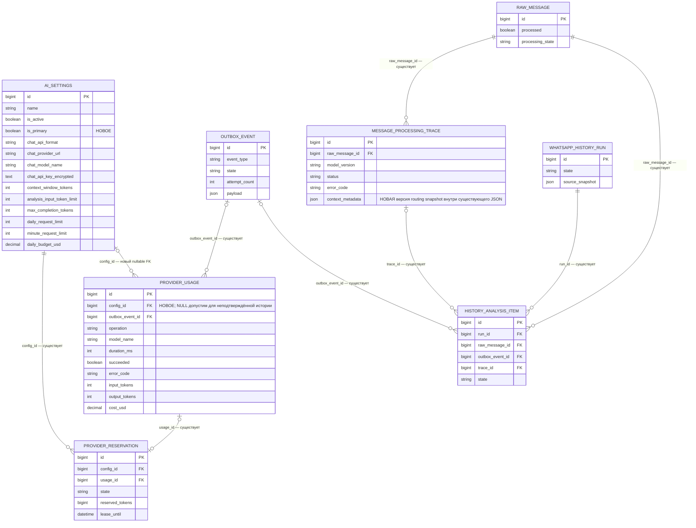
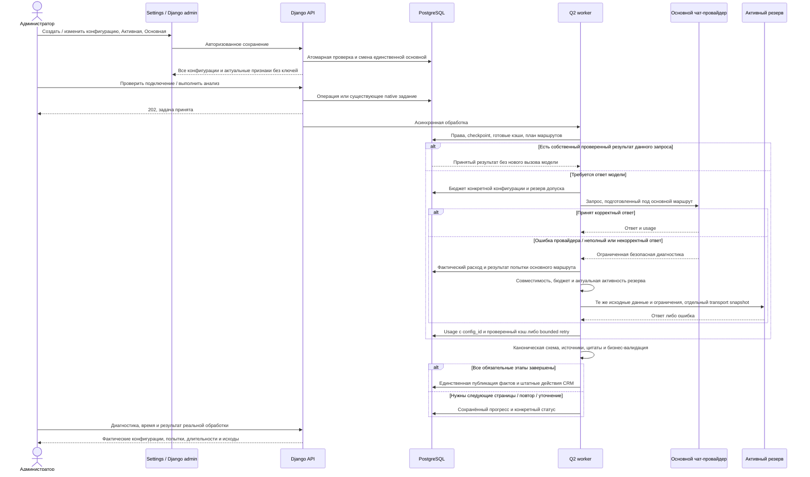

# Несколько активных AI-конфигураций, основная модель и автоматический резерв

- Создано: 2026-10-20 17-28-37 MSK (UTC+3).
- Задача: `multi-ai-configurations`, прямая постановка пользователя.
- Ветка: `feature/multi-ai-configurations`; база `main` синхронизирована через `git pull origin main` с rebase, commit `74f9b768aae2f2161f16e3100ea64cc56cdf948b`.
- Статус: спецификация подтверждена пользователем; реализация завершена в feature-ветке, production-конфигурация и измерение реальных вызовов ожидают выпуска.
- Связь с предыдущей задачей: продолжить незавершённую обработку Messenger с сохранением её контрольных точек; предыдущую спецификацию и исторические результаты не переписывать.

Новые поля и связи помечены в диаграмме. Остальные сущности и связи существуют сейчас. Идентификаторы конфигураций в новом routing snapshot — целые числа в существующем JSON, не новые столбцы trace. В `AuditEvent` сохраняются действия выбора основной конфигурации и перехода текущей обработки; секреты в аудит не включаются.

## Постановка и подтверждённое состояние

Пользователь просит на `https://ai.mazory.best/settings?section=ai` и в Django admin несколько AI-конфигураций. Активных может быть несколько, основная — одна. При ошибке запрос должен переходить к другой активной конфигурации. Ранее переданное платное подключение требуется создать второй конфигурацией, назначить основным и оценить скорость и качество на реальных сообщениях.

На production 20.10.2026 17:26 MSK одна запись `AISettings`, id 1, `OpenRouter Free`, активна, модель `openrouter/free`, OpenAI-compatible, модель решений выключена. Семь целевых сообщений ещё не завершены, существуют шесть активных событий обработки. Это требует перехода с сохранением прогресса, а не перезапуска всей истории.

В коде уже существуют список и создание `AISettings`, редактирование по ID, независимые role-карточки и ключи, Django admin и проверки подключений через Q2. Ограничения находятся в `update_model` (деактивация остальных записей), `get_active` (первая активная запись), привязке frozen-запроса к единственному текущему маршруту и поддержке контекста только известных моделей.

Использовать существующую модель `AISettings`; не вводить дублирующий реестр подключений. Независимые настройки чат-модели, embeddings и модели решений сохраняются в каждой конфигурации. Автоматический резерв в этой задаче относится к чат-вызовам анализа и ответов; резерв чат-модели не меняет модель embeddings или пространство векторов.

## Конфигурации и интерфейс

1. Добавить `is_primary` — «Основная конфигурация», отдельно от существующего `is_active` — «Активная».
2. Разрешить несколько активных записей. Если есть активные конфигурации, должна быть ровно одна основная. Основная обязательно активна. Если активных нет, AI явно выключен.
3. Смена основной атомарно снимает этот признак с прежней, сохраняя её активность. Запретить отключение основной без выбора замены при наличии других активных. Удалять используемые конфигурации нельзя; для исключения из резерва использовать деактивацию.
4. Ограничить БД: не более одной основной и запрет `is_primary=true` при `is_active=false`. Проверки наличия основной, атомарное переключение и валидация должны одинаково работать через API и Django admin, включая конкурентные сохранения.
5. На `/settings?section=ai` добавить компактный список конфигураций: название, модель/хост, «Активная», «Основная», выбор для редактирования и добавление. Сохранить независимые role-карточки; подробности показывать для выбранной конфигурации. Часто изменяемые признаки доступны сверху, расширенные параметры остаются свёрнутыми.
6. В Django admin добавить признак основной в список, фильтры и форму. Использовать тот же сервис изменения признаков, что и API.
7. Существующие `/api/settings/ai/`, `/api/settings/ai/<int:pk>/` и role endpoints расширить полем `is_primary`; сохранить целочисленные ID, авторизацию, permissions, MFA и аудит. Ключи остаются write-only, шифруются существующим механизмом и не попадают в ответы, экспорт, логи, спецификацию или Git.

## Маршрутизация и пределы повторов

1. Новые логические чат-запросы начинают с основной конфигурации. Резервный порядок детерминирован: остальные активные конфигурации по ID. Неактивные исключены.
2. Обрабатывать всю цепочку в Q2. HTTP-обработчики только сохраняют настройки и ставят операции в очередь. Не менять глобальные настройки временно ради одного запроса.
3. Один законченный обход цепочки вызывает каждую подходящую конфигурацию не более одного раза. Существующие конечные бюджеты native-повторов и структурного исправления сохраняются; история использованных маршрутов учитывается и после перезапуска воркера. Не добавлять вложенные бесконечные циклы и не выдавать каждому резерву новый неограниченный бюджет.
4. Переходить к резерву при ошибках сети/таймауте, 429, 5xx, отказе доступа/ключа/кредитов, ошибке маршрута или неподдерживаемого запроса, а также неполном/неразбираемом ответе и провале структурной схемы ответа. Эти попытки заканчиваются до публикации бизнес-данных.
5. Не обходить резервом отмену, отзыв прав, изменение источника или snapshot, нарушение принадлежности запроса, повреждение кэша и общие ограничения автономной обработки. Не подменять выбором другой модели бизнес-проверки цитат, объектов, сумм и прав.
6. При исчерпании лимита конкретного подключения разрешён следующий активный маршрут со своим допуском. Общие ограничения автономной работы не сбрасываются.
7. Перед каждым внешним вызовом проверить текущую активность конфигурации, принадлежность ключа её хосту/протоколу, совместимость, контекст и квоты. Отказ локального допуска не выдавать за ошибку уже отправленного запроса. Если подходящего маршрута нет, сохранить конкретный bounded retry/терминальный исход.
8. Различать канонический логический запрос и transport snapshot конкретного провайдера. Для каждого маршрута сохранить config ID, безопасную версию параметров, канонический SHA и фактический wire SHA. Модель, протокол и технические параметры адаптируются под выбранный маршрут без изменения исходных данных, источников и требуемого результата.
9. Готовый основной/дополнительный ответ не отправлять повторно из-за сбоя соседнего этапа или смены основной конфигурации. Публикация результатов, CRM и WhatsApp сохраняют штатную идемпотентность.
10. Показывать фактическую конфигурацию/модель, длительность, код исхода и переход к резерву в диагностике. Первоначальная модель плана не должна ошибочно отображаться как фактически ответившая модель.

## Контекст и совместимость платной модели

- Добавить поддержку выбранной OpenAI-compatible модели без ложного применения токенизатора NVIDIA. Для маршрута без проверенного локального токенизатора использовать явно обозначенную консервативную оценку UTF-8 с полным учётом сообщений, схемы, технического запаса и резерва ответа; это не точный подсчёт токенов.
- До отправки резерву пересчитывать пригодность того же запроса под его окно. Не усекать данные молча; несовместимый маршрут пропускать с понятной диагностикой. Если не подходит вся цепочка, использовать существующее контролируемое дробление/ошибку бюджета.
- Сохранить канонические контракты извлечения, source/evidence validation и возможность компактного представления схем/цитат. Подготовка и восстановление native-представления относятся к конкретному запросу, а не ошибочно к названию глобально выбранной модели.
- В адаптере `claude-haiku-5-5` учитывать поддерживаемые параметры; не передавать несовместимые sampling-параметры и OpenRouter-only поля. Не отключать структурную проверку ради прохождения запроса.
- Идентификатор модели, официальные окно/пределы и ограничения sampling сверять с [документацией Claude Haiku 5.5](https://platform.claude.com/docs/en/models/haiku-5-5/overview); для данного proxy окончательное подтверждение — его фактический ответ.
- Официальные возможности модели не доказывают возможности или цены стороннего proxy. Проверить реальное подключение и реальные запросы через Q2; стоимость отображать только при фактических данных провайдера.

## Миграции и учёт расхода

- Добавить `AISettings.is_primary` и ограничения. Data migration выбирает прежнюю активную запись как основную; при нескольких исторических активных выбирает прежнего детерминированного победителя, сохраняя остальные записи активными. При отсутствии активных основная отсутствует.
- Добавить nullable `ProviderUsage.config` с `PROTECT`. Для старых расходов восстанавливать config из существующей связанной `ProviderReservation`, где связь доказана; неизвестные не приписывать произвольной конфигурации. Все новые фактические вызовы обязаны иметь config ID.
- Минутные/суточные квоты, бюджет и circuit breaker считать по фактической конфигурации, атомарно со связанными резервами. Ошибки бесплатного маршрута не должны закрывать circuit платного. Неподтверждённые исторические расходы учитывать консервативно при переходе, не обнулять использованную квоту.
- Бизнес-политики, общие пределы автономной обработки и embeddings/decision берутся из основной конфигурации. Переход отдельного чат-запроса к резерву использует подключение и его технические/провайдерские ограничения, не подменяя бизнес-политику вторичной записью.

## Существующие незавершённые сообщения

- До смены основной снять фактический список текущих владельцев, traces, стадий, source snapshot/ranges и готовых кэшей. Завершённые сообщения не переанализировать.
- Выполняющийся запрос штатно завершить при graceful drain. Исходные frozen-запросы и принятые результаты не переписывать.
- Добавить явный версионированный и аудируемый переход к новой цепочке маршрутов для текущих последних владельцев. Сохранить канонический запрос и его кэши; новый транспорт фиксируется отдельным snapshot. Если смена протокола/представления требует свежей подготовки, создать native-продолжение с собственным trace из последней проверенной контрольной точки, не начинать историю заново.
- До перехода проверить права, отсутствие второго активного владельца, принадлежность prefix и точный source hash. Старые failed parents не оживлять, счётчики и старую историю не обнулять.
- Free-only локальная policy не должна попасть на сторонний платный маршрут как будто он OpenRouter. Её прежние лимиты и запросы сохраняются в истории; новый маршрут проверяется по собственной версии и бюджету. Изменение маршрута не является основанием вручную снимать защитные ограничения объёма.

## Production-конфигурации и проверка результата

Уточнение пользователя 21.10.2026: завершить полный разбор ограниченного окна на `gpt-sol-5-6`, затем восстановить ошибочные сообщения и проверить качество. Это продолжение согласованной задачи; первоначальное назначение Haiku основной заменяется GPT Sol после проверки совместимости.

План исправления: версионированный компактный транспорт GPT Sol с обычными массивами тем/ссылок вместо матрицы 16 × N слотов, явным JSON-контрактом в пользовательском входе и той же серверной проверкой типов, ID, цитат, фактов и полного покрытия. Бюджет считать по фактически отправляемому представлению. Использовать сохраняемые стадии, дробление входа и состояния при переполнении ответа; частичный JSON и reasoning никогда не считать результатом. Не вводить глобального потолка 1500 токенов и не обещать отменить внешнее ограничение шлюза: полный результат может складываться из нескольких полностью проверенных ответов, с контрольной точкой после каждого. Старые frozen-попытки неизменны, новые используют максимум 51 исходник. Полный повтор через Q2 должен подтвердить `complete=true`, все прочитанные источники, финальный статус RawMessage, источники каждого принятого факта и отсутствие повторной доставки.

Реальная проверка PR148: на GPT Sol получены 9143 выходных токена при резерве32768 — прежний обрыв1500 снят. Первое отклонение относится к `sender_phone:null` при допустимом неизвестном значении пустой строкой; сервер уже нормализует необязательные null далее в конвейере. Эту строго ограниченную нормализацию перенести перед wire-валидацией GPT Sol: только необязательные поля, пустые строки там, где они разрешены сериализатором, без приведения ID, исправления цитат, сумм или статусов. Ошибки формы/переполнение GPT Sol должны возвращаться в native repair/paging непосредственно, а не маскироваться двухминутным таймаутом OpenRouter. Отказы доступности провайдера сохраняют резервную маршрутизацию. Отклонённая попытка79591 остаётся неизменной; восстановление идёт новой попыткой.

1. Сохранить `OpenRouter Free` активной резервной конфигурацией и её собственные ограничения.
2. Создать `SmertAPI · Claude Haiku 5.5`: Base URL `https://smertapi.top/v1`, модель `claude-haiku-5-5`, протокол OpenAI-compatible; ключ взять из уже переданного пользователем секрета и записать только штатным зашифрованным механизмом. Назначить её активной и основной.
3. При создании новой записи сохранить текущие независимые подключения embeddings/decision и бизнес-настройки; модель решений остаётся выключенной. Настройки контекста/генерации проверить под новую чат-модель. Не копировать OpenRouter-only модельный профиль как профиль Claude.
4. Проверить обе конфигурации в API, пользовательских настройках и Django admin. Убедиться, что активны две записи, основная одна, ключи не раскрываются, старый бесплатный маршрут не выключен.
5. После проверки подключения направить незавершённую реальную обработку на новый основной маршрут с сохранением контрольных точек. Отдельные массовые bench-задания не запускать.
6. На первых трёх реальных чат-вызовах основного маршрута зафиксировать длительности, число ответов, принятых схемой и бизнес-проверкой, обрезанные ответы/повторы, найденные факты и причины неприменения. Сопоставить с уже сохранёнными бесплатными вызовами того же вида и близкого объёма, явно указав ограниченность выборки и отсутствие идентичного A/B эксперимента.
7. Проверить источники фактов, суммы/валюты, объект/компанию, полноту и отсутствие дубликатов на обработанных сообщениях. Более быстрый HTTP 200 не считать доказательством лучшего качества. Правомерное уточнение при неоднозначных данных не считать ошибкой.
8. На сохранённых реальных ошибках проверить в Docker READ ONLY решение маршрутизатора: следующий активный кандидат, отсутствие цикла, правильные ключ/хост, бюджет и неизменность канонического запроса. Не запускать новые неуспешные генерации ради искусственного сбоя, не ломать production URL/ключ и не создавать бизнес-сообщения. При естественном отказе реальной обработки дополнительно подтвердить фактический переход по usage/trace; если такого отказа не было, явно разделить проверенную ветку маршрутизации и ещё не наблюдавшийся внешний переход. Не создавать test/mock suites или файлы тестов в репозитории.

## Планируемые области изменений и проверки

- Backend: `models.py`, миграции, сервис атомарного выбора основной и маршрутизации, `settings_api.py`, role/check endpoints, admin/form, `ai_service.py`, контекст/адаптеры, `provider_reservations.py`, native pipeline/focused/continuation и безопасная диагностика.
- Frontend: типы настроек, `SettingsView.vue`, существующие AI-компоненты; создание/выбор конфигурации, видимые признаки активности и основной, согласованное обновление списка после переключения.
- Все сборки и проверки только в Docker. Контекст `kk-minsk` сейчас отсутствует. Production-наблюдение и release — `mazory-remote` по явному указанию пользователя; не поднимать там отдельные dev-сервисы. CI использует разрешённый одноразовый Docker Engine. Секреты не нужны для сборки и в image не включаются.
- Обязательны Django check, создание/применение миграций и повторный `makemigrations --check` с `No changes detected`, сборка nginx с TypeScript/Vite, просмотр логов backend/Q2/WAHA и проверка diff. Запрещённые проектом unit/component/integration/mock suites не добавлять.
- До release: PR только в main, CI и review. Затем backup, graceful drain, миграции, единый проверенный image для backend/воркеров, frontend build, readiness и фактическая проверка публичного API/интерфейса.
- Все результаты, ограничения и измерения дописывать в эту спецификацию; отдельные планы, отчёты и runbook не создавать.

## Критерии готовности

1. Через обе административные поверхности создаются и редактируются несколько конфигураций; одновременно активны минимум две, основная ровно одна, конкурентный выбор не нарушает ограничения.
2. Новый чат-запрос действительно начинает платная основная модель. Фактический provider/config ID и время видны в расходах и диагностике.
3. При допустимом отказе запрос ограниченно переходит на другую активную конфигурацию, прошедший ответ принимается исходными проверками. Неактивные не вызываются, цикл отсутствует, выбранная основная самопроизвольно не меняется.
4. Расход и резерв учитываются у фактически вызванного подключения; квоты не сброшены и не обходятся повтором или сменой primary.
5. Текущие семь незавершённых сообщений продолжают работу с сохранёнными prefix/source/caches; смена primary не порождает `context_configuration_changed`, параллельных владельцев, повтор завершённых анализов или дубли CRM.
6. Обе production-конфигурации сохранены в нужных состояниях, LAYA выключена, ключи зашифрованы и отсутствуют в публичных данных/экспортах/Git/логах.
7. Получена конкретная, ограниченная по выборке оценка скорости и корректности реальных результатов платной модели. Улучшение не объявляется заранее; если платный маршрут не работает или результаты хуже, сообщается фактический барьер.
8. Docker/CI/migration/frontend/runtime проверки пройдены; production revision и видимые пользователю результаты подтверждены после развёртывания.

## Реализация и локальная проверка

- Добавлены основная конфигурация, ограничения БД и общий транзакционный сервис переключения для API и Django admin. Несколько профилей могут быть активны; прежний основной остаётся активным резервом. Ключи остаются в штатном зашифрованном хранилище.
- Settings UI показывает список активных/выключенных и основной конфигураций, позволяет создать профиль и выбрать его для редактирования; независимые карточки Chat/Embedding/Decision сохранены.
- Чат-анализ и ассистент пробуют активные конфигурации в порядке «основная, затем резервные», не более одного раза на профиль. Вызовы embeddings/decision не переводятся. Provider usage связывается с фактической конфигурацией; общие автономные пределы остаются общими.
- Для неизвестных OpenAI-compatible токенизаторов добавлен консервативный подсчёт UTF-8 байтов. Для смены маршрута в незавершённом frozen-запросе сохраняются payload/source hash и создаётся аудит; запрос в состоянии `sent` не отправляется повторно на другой маршрут. Free-only локальный бюджет не применяется к платному профилю.
- Проверки 20.10.2026 в Socktainer: сборка nginx прошла; сборка backend прошла; `manage.py check` завершилась `System check identified no issues`; все миграции, включая `0065`, применились к отдельной временной PostgreSQL базе; `makemigrations --check --dry-run` завершилась `No changes detected`; `git diff --check` чистый. Временные контейнеры и база удалены. Тестовые наборы и тестовые provider-запросы не запускались.
- Релиз `d40e304` развёрнут в production после свежей проверенной копии БД/media: миграция `0065` применена, Django/migration checks пройдены, backend и все воркеры используют один образ, readiness отвечает `ready`. Профиль SmertAPI создан отдельно от OpenRouter.
- Продолжение проверки 21.10.2026: ранее переданный пользователем ключ сохранён штатным методом в шифрованном хранилище, без вывода секрета и сохранения в Git. Платный профиль активирован как резервный до проверки; Q2 connection operation `90` успешно проверила `claude-haiku-5-5`, длительность provider-вызова `534 ms`. Основная конфигурация до проверки реального анализа остаётся OpenRouter.
- Обнаружены и исправляются две причины, мешавшие реальному многошаговому запуску: UTF-8 счётчик реализовывал только `count_payload`, хотя полный анализ требует `count_text`, границы символов и метаданные счётчика; запрет повторного provider-вызова ошибочно применялся ко всему outbox-событию, включая следующие порции истории и невалидный JSON. Исправление сохраняет одно обращение к каждому кандидату за вызов, ограниченные повторы очереди и проверяемый по хешу кэш валидного ответа.
- Реальную обработку возобновлять из безопасных существующих контрольных точек, без повторов состояния `sent`, без удаления истории попыток и без новых бизнес-сообщений. Сравнение времени/качества и внешнего failover остаётся незавершённым до наблюдения результата обработки.
- CI дополнительного исправления выявил отдельный security blocker Vite `6.4.3` (`GHSA-587h-7wmj-h5pm`). Обновление до patch `6.4.4` сохраняет идентичные зависимости/peer constraints по metadata npm, проверяется штатными сборкой TypeScript/Vite и аудитом без отключения проверок безопасности.
- Следующий этап аудита выявил уязвимые certifi `2026.7.22` и Pillow `12.3.0`. Обновлены pins/lock до исправленных `2026.10.19` и `13.0.0`; artifacts и SHA-256 получены из metadata PyPI, обычных новых зависимостей нет. Pillow используется только нормализатором аватаров; совместимость этого пути проверяется на новом release-image без изменения пользовательских данных.
- READ ONLY подготовка реального запроса выявила, что unknown-tokenizer счётчик не учитывал JSON schema с enum исходных цитат, добавляемую адаптером после нарезки. Счётчик должен учитывать ту же детерминированную схему уже в пробах границ; окно модели `200000`, резерв ответа и исходные тексты не расширяются/не обрезаются. Для старой незавершённой страницы, не помещающейся в платное окно, допускается аудируемое перепланирование от последней полностью завершённой страницы; частичные результаты остаются в прежних trace, завершённый префикс не перечитывается.
- Для общего платного OpenAI-compatible адаптера структурная JSON schema сохраняет типы/обязательные поля/ID источников, но не дублирует каждую исходную цитату во множестве enum-полей. Цитаты остаются строками; обязательная проверка буквального соответствия источнику и прочитанным диапазонам выполняется в приложении до материализации. Native Free/Qwen/Ollama схемы сохраняют прежние enum-ограничения. Счётчик использует тот же вариант схемы, что и фактический адаптер.
- Повторяющиеся структурные подсхемы общего адаптера вынесены в `$defs`/`$ref` без изменения ограничений. Перед внешним вызовом на реальных входах проверяется, что развёрнутая схема полностью совпадает со структурной исходной схемой, а полная wire-оценка вместе с резервами укладывается в окно модели.

- Реальные платные повторы `78998–79000` сохранили исходные checkpoints, но не дали принятого результата: один ответ отклонён `invalid_extraction_schema`, два вызова получили `provider_overloaded`. Резервный профиль во всех трёх случаях отклонил канонический запрос по своему окну до внешнего вызова. Новых кандидатов нет; качество пока не оценено.
- Для следующего наблюдаемого повтора добавляются ограниченные диагностические пути/типы ошибок JSON schema без значений исходного текста, сохраняются диагностики всех провайдеров. Несовместимое окно резерва больше не заменяет исходную ошибку основной модели: штатный ограниченный повтор очереди сохраняется для временной перегрузки. Исправлена ссылка на отсутствующую переменную в Anthropic-ветке адаптера.

- Повтор `79046` выявил более раннюю границу: два HTTP-ответа с usage были отклонены ещё при чтении OpenAI envelope, до заполнения schema diagnostics. Содержимое ответа и точная несовместимая часть неизвестны; это не оценка качества извлечения. Добавлена проверка фиксированных полей envelope на HTTP-границе с сохранением только типов/числа choices, без текста/неизвестных ключей. Некорректный envelope учитывается как `provider_invalid_response`, а не как успешный JSON-анализ. Необязательный null usage допускается как отсутствие измерения, без выдуманных токенов.

## Результат production replay 21.10.2026

### Уточнение пользователя: окно последних 50 сообщений

Пользователь явно заменил обход всей истории ограниченным окном. Для обычного входящего сообщения используются оно само и максимум 50 предшествующих сообщений того же источника/чата, упорядоченных по времени сообщения (при неизвестном времени — по времени получения) и ID. Более поздние сообщения запрещены, даже если уже лежат в БД. Для явно запрошенного повторного анализа и заранее загруженного пакета разрешены поздние сообщения внутри того же общего окна: максимум 51 уникальный исходник, включая основную цель; остальные цели пакета входят в этот предел.

Единый неизменяемый список источников сохраняется в диагностике попытки и ограничивает основной запрос, поиск по темам, дополнительные извлечения и сверку обязательств. Поиск по словам/цитатам не расширяет окно. Связанные сводки/обязательства, содержащие источники вне окна, не передаются модели. Старые frozen-запросы и checkpoints полной истории не переписываются и не переиспользуются как ограниченные: для восстановления нужны новые попытки.

Критерии: live-сообщение 3 видит 1/2 и не видит 4/5/6; при 51+ предшественниках выбираются только последние 50; одинаковое время упорядочивается по ID; другие чаты/сессии исключены; повторный/пакетный режим может видеть поздние источники, но не расширяет общий предел; вспомогательные обращения используют тот же набор; отсутствие связных данных не запускает поиск за его пределами. Проверки выполняются без новых test suites и без provider-вызовов для синтетических данных. После CI/выпуска реальные ошибочные сообщения запускаются новыми ограниченными попытками и проверяются по источникам.

- PR142–145 объединены после успешного CI. Backend, все Q2 и outbox используют единый image `paid-envelope` с деревом merge `5abc3ff`. Runtime parity и readiness прошли; Django check без замечаний; makemigrations check: `No changes detected`; миграций к применению нет. TypeScript/Vite и dependency audits прошли в CI.
- SmertAPI config2 активна и основная; OpenRouter config1 остаётся активным резервом. Проверка подключения operation90 дала успешный ответ за534ms, но не доказывает качество анализа.
- Реальные платные Usage4981–4988:8 вызовов, из них5 отклонены `provider_overloaded`,3 HTTP-ответа отвергнуты при разборе envelope до извлечения фактов. Принятых результатов:0. У трёх HTTP-ответов usage.output_tokens=1500 при запрошенных32768; точная причина несовместимой формы не сохранена старым кодом и остаётся неизвестной.
- Последний replay79080/trace4310 завершился failed после3 штатных транспортных попыток: HTTP503, длительности5195/14612/18092ms. Новый валидатор envelope не получил успешного HTTP-ответа в этом запуске; его runtime ветка для HTTP200 ещё не подтверждена. Первичная ошибка503 больше не маскируется локальным `context_budget_exceeded` резервного профиля. Внешних вызовов OpenRouter в этих переходах не было: локальный бюджет отклонил запрос до отправки.
- Replay продолжался от49/7/8 подтверждённых этапов; история попыток и исходные тексты сохранены. Все21 сообщения остаются failed/processed=False. Остальные планы не поставлены массово в очередь, пока новый маршрут не дал принятого результата.
- Авторизованные GET `/api/messenger/records/749/traces/` и `/api/settings/ai/` после выпуска отвечают200. Исходная500 в диагностике сейчас не воспроизводится.
- Критерии восстановления сообщений и улучшения времени/качества НЕ выполнены: полный анализ не завершён, сравнивать качество данных пока нельзя. Текущий внешний блокер — повторяемые HTTP503 платного шлюза. Лимиты не расширены, невалидные ответы не приняты, бесконечные ручные повторы не назначены.

### Уточнение проверки качества GPT Sol

Реальная новая попытка79660 прошла первый этап49/51: основной ответ12851 токен (stop), уточняющий project-проход восстановил точные цены и непрерывные цитаты. Выявлен перенос цены продажи29428679 из1170 в contract_amount при отдельном сообщении1194 о подписании, без явно названной суммы договора. Неизвестный заказчик также представлен вымышленным служебным наименованием.

После проверки буквальных доказательств, перед сохранением промежуточного состояния и кандидатов GPT Sol, неподтверждённые необязательные contract_amount/company_name исключаются с диагностикой причины и неопределённостью; доказанные цены продажи, статусы и цитаты сохраняются. Сумма договора требует прямой ценовой договорной формулировки и соответствующего числа в одном исходном предложении, без склеивания разных цитат, подстановки аванса/прибыли или вычисления по процентам. Тот же предохранитель используется автоматическим применением старых кандидатов. Исходный ответ и main_response_cache не переписываются. Поля ID, цитаты, суммы и статусы не угадываются.

Перед выпуском — CI Docker/Django/migrations/TypeScript/Vite, независимый review и read-only проверка на реальном segment_result4317 без нового provider-вызова. После выпуска — продолжение штатного ограниченного конвейера, новые попытки для остальных ошибок и проверка фактов по исходникам. Отключение reasoning не включается: полный контрольный запрос с none дал пустые facts при готовой классификации, несмотря на подтверждённые события.

Этап4318 выявил ещё одно несоответствие: GPT Sol возвращает краткие непрерывные доказательные цитаты, но focused wire-schema допускает только полную строку либо полный текст сообщения. Ошибки facts.0/1.evidence enum обрывают второй этап при HTTP200/stop6139 токенов. Для GPT Sol убрать только этот перечислительный предел focused evidence, сохранив непустую строку, закреплённый source ID, фактическую проверку непрерывной цитаты по прочитанному диапазону, типы фактов и темы. Остальные профили по умолчанию сохраняют прежнюю схему. Резервный и повторный проходы не переписывают старые конверты.

Транспорт нового запроса версионируется как gpt-sol-json-v2; сохранённые v1-конверты и их прежняя focused-схема воспроизводятся неизменно. Новый вариант применяется только к свежим попыткам. Уже проверенный checkpoint49/51 разрешено переносить в новую попытку с тем же источниковым hash и неизменным manifest; старые запросы и отклонённые ответы не становятся проверенными этапами.
