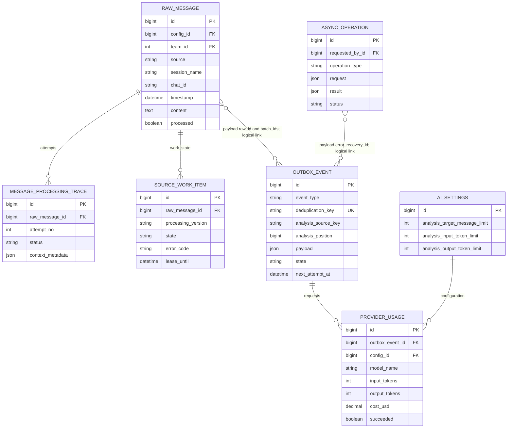

# Пакетный разбор входящих сообщений и оценка MiniMax M3.1 Flash

- Создано: 2026-10-22 01-57-20 MSK (UTC+3).
- Задача: `message-batching-minimax`, прямая постановка пользователя, без GitHub Issue.
- Ветка реализации: `feature/minimax-batch-delivery`, интегрирована с `main` после PR #154. Исходная незакоммиченная рабочая копия `feature/message-batching-minimax` сохранена без изменений; `git pull origin main` повторён перед интеграцией.
- Статус: пользователь подтвердил спецификацию и реализацию 22.10.2026; реализация и Docker-проверки выполнены, production-выпуск отдельно от этой задачи.
- Затрагиваемые существующие таблицы перечислены ниже. Новые сущности и поля БД не предполагаются: накопление и срок следующей отправки должны использовать существующие события Outbox; поле `payload` хранит состав пачки.



`OutboxEvent.payload` связывает событие с оригиналами сообщениями логическими ID; внешнего ключа для этой связи нет. `analysis_source_key` изолирует очередь по существующему ключу источника: команда, конфигурация WhatsApp, семейство источника, сессия и чат (для источников без конфигурации также проект).

```mermaid
sequenceDiagram
    participant WA as Вебхук или мониторинг
    participant DB as PostgreSQL Outbox
    participant D as Dispatcher
    participant Q as Q2 worker
    participant M as MiniMax Chat Completions
    WA->>DB: Сохранить оригинал и уникальный buffer_message
    alt Накоплено 50 целей одного источника
        WA->>DB: Атомарно создать extract_message с batch_ids
    else Истёк срок 5 часов
        D->>DB: Создать extract_message для остатка
    else Ожидается порог или срок
        Note over DB: AI не вызывается; сообщения переживают перезапуск
    end
    D->>Q: Поставить due-задание; один активный разбор источника
    Q->>DB: Закрепить снимок и трассировки каждой цели
    Q->>M: OpenAI-compatible tools + SSE, ключ из admin
    M-->>Q: Части аргументов, reasoning, usage, finish_reason, DONE
    alt Ответ полный и схема/источники/покрытие валидны
        Q->>DB: Сохранить проверенные результаты всех целей
    else Обрезка, переполнение или таймаут большой пачки
        Q->>DB: Создать обе дочерние пачки, не теряя цели
        D->>Q: Продолжить дочерние задания в пределах бюджета
    else Ошибка доступа или исчерпан лимит повторов
        Q->>DB: Зафиксировать ошибку и незавершённые цели
    end
```

## Постановка

Каждое новое сообщение сейчас создаёт отдельное событие `extract_message`; при выключенной модели решений для него начинается непосредственный AI-разбор. Уже существует коалесцирование после распределения по темам, но оно не предотвращает запрос на каждую новую реплику в этом пути.

Накопление должно происходить до первого внешнего AI-вызова. Размер 50 — согласованный начальный порог. Остаток отправляется по повторяющемуся интервалу 5 часов; после пороговой отправки накопление остатка и пятитичасовой срок начинаются заново. Это повторяющиеся интервалы, а не календарные границы суток. Пачки разных чатов/источников не смешиваются.

## Требования

- Сохранять каждое входящее сообщение немедленно. До готовности пачки не вызывать для него модель решений, LAYA, чат-модель или резервный AI-маршрут.
- Как только для одного источника доступны 50 необработанных сообщений, ставить их на штатный разбор немедленно. Несколько полных пачек могут уйти подряд.
- Первый непустой остаток после последней отправки получает сохраняемый срок flush через 5 часов. Новые сообщения не отодвигают срок. Пороговая отправка завершает текущую пачку; следующее сообщение начинает новый интервал.
- По сроку flush отправлять весь остаток независимо от количества. При пустом остатке AI-вызов не выполнять.
- Сохранять порядок оригиналов, точные ID и связь результата/трассировки с каждым сообщением. Повторная доставка вебхука, перезапуск воркера и конкурентные сообщения не должны терять или повторно классифицировать цели.
- Размер 50 — верхний предел одной логической пачки; ограничение текущего контекста, схемы или API может потребовать штатного разбиения на меньшие запросы. Все цели должны получить проверенный результат, даже если для этого необходимо несколько запросов.
- Пакетный повтор текущих ошибок из PR #154 также объединяет цели одного источника в запросы до 50. Явный повтор отправляется сразу, сохраняя отдельные попытки каждой цели, закреплённую конфигурацию, права и удержание новых кандидатов перед CRM. При разделении наследуются эти ограничения; терминальный результат и прогресс учитывают все цели, включая не являющиеся якорем запроса.
- Использовать MiniMax M3.1 Flash с ключом из существующей конфигурации ИИ в Django admin. Хранить ключ зашифрованным штатным механизмом Chat API Key. `MINIMAX_API_TOKEN` в локальном `.env` используется только для текущей проверки; production не зависит от него. Значение не включать в логи, трассы или код.
- Записывать по каждой реальной попытке модель, входные/выходные токены, длительность, статус и цену, которую возвращает API/текущий учёт. Секрет и текст запроса/ответа не журналировать.
- MiniMax получает штатную совместимую JSON Schema как параметры именованной функции через Chat Completions API. SSE собирается полностью, включая usage и конечный сигнал; только затем аргументы проверяются общей схемой и бизнес-валидаторами. При обрезке неполный JSON не дописывается конкатенацией нескольких ответов: цели переходят в две свежие попытки, которые наследуют текущий резерв ответа из admin.
- Chat Completions и Responses поддерживают полный ответ одним синхронным запросом; оба также умеют SSE. Используется Chat Completions, поскольку он поддерживает принудительный function call с JSON Schema. В Responses API `previous_response_id` игнорируется, а для ответа документирован только `text.format.type=text`; он не подходит для возобновления и строгого структурированного контракта Mazory.
- `AISettings.analysis_target_message_limit` теперь допускает до 50 целей для нового пути накопления; исторический/маршрутизированный путь отдельно сохраняет свой предел.

## Планируемые изменения

1. Собрать каждое сообщение в устойчивую очередь по ключу источника, не вызывая AI до достижения 50 целей.
2. Сохранять срок пятитичасовой отправки для начатого остатка и дать Q2 надёжно отправлять due-остатки после перезапуска.
3. Сформировать 50-целевой запрос из существующего контракта `extract_message`, использовать штатные проверки бюджета, разбивку, идемпотентность и coverage.
4. Подключить MiniMax через существующую серверную AI-инфраструктуру. Сохранить полную валидацию ответа Mazory; при недопустимом формате явно зарегистрировать отказ и применить существующую стратегию ограниченного повтора/деления.
5. Провести проверки в отдельной локальной Docker Compose/БД с реальным MiniMax; оформить PR в `main`, дождаться CI/review и объединить. Историю и production-данные при проверке не изменять.

## Оценка квоты и токенов

- Подписочный ключ из `.env` читается успешно; официальный MiniMax usage API возвращает `status_code=0`. До запросов было 100% в пятичасовом и недельном окнах; после двух запросов на реальные сообщения стало 99% в обоих. Значение округлено до целого процента, а поля `current_interval_usage_count`/`current_weekly_usage_count` API вернул как 0, поэтому абсолютный лимит и точное число пакетов из него не вычислить. Окна общие для моделей/инструментов и сбрасываются независимо; 5-часовое окно начинается с первого использования.
- Официальная текущая справочная цена M3.1 Flash для pay-as-you-go: $0,15 за 1 млн входных и $0,60 за 1 млн выходных токенов; к подписке эти цены не являются счётом, но годятся лишь для денежного эквивалента после получения счётчиков.
- Read-only подготовка на существующих production-данных одного чата дала три разные пачки по 50: соответственно 81 525, 113 833 и 57 457 символов оригиналов. Для последнего примера полный envelope сообщений с системной инструкцией — 182 836 байт; схема, которую использует штатный OpenAI-compatible путь, занимает 67 157 байт. Остаток из трёх сообщений: 3 754 символа оригиналов и envelope 52 478 байт.
- Для M3.1 Flash MiniMax рекомендует `max_completion_tokens=131072` и документирует верхнюю границу 524288. Для проверки пользователь попросил убрать прежний QA резерв 32768; изолированные поля `max_completion_tokens` и `analysis_output_token_limit` выставлены на 524288 при окне контекста 1000000. Потом дочерние попытки после разбиения наследуют текущие значения admin.
- Реальный запрос без response_format/tool schema, 50 сообщений: `prompt_tokens=45 890`, `completion_tokens=8 192` (из них reasoning 1 266, cached input 128), API завершил по `length`; JSON оборван, штатная проверка и coverage не пройдены. Запрос из трёх сообщений: `prompt_tokens=11 518`, `completion_tokens=6 446` (reasoning 1 395); остановлен штатно, JSON разбирается, но строгая schema/coverage-проверка этим замером не подтверждена. Итого получено 57 408 входных + 14 638 выходных токенов; публичный эквивалент по pay-as-you-go ценам — около $0,0174. Это справочная оценка, не сумма списания подписки.
- Попытка 50-сообщенного вызова с 67-КБ штатной JSON Schema через MiniMax function calling истекла по таймауту клиента 240 с. После неё usage API не показал дополнительного процентного изменения; завершение или тарификация этого вызова не подтверждены. Ответ модели не сохранялся и не выводился; напечатаны только usage/статусы.
- Полученные данные показывают, что вход 50-сообщенной пачки около 46 тыс. токенов помещается с большим запасом, но ответ с лимитом 8 192 обрезан. Реальный расход на полноценный 50-целевой результат и число таких пачек в окне подписки остаются неизвестными; обещать, что пакет 50 успешно разбирается, нельзя. Затем измерен первый валидный реальный отчёт (1 цель, 12 facts, 7 тем): 15 616 входных и 10 877 выходных токенов. Первый специализированный запрос на 50 новых реальных целей дошёл до верхнего резерва 32 766 токенов и был безопасно разделён на две части; первая часть из 25 тоже достигла резерва 32 768 и разделена на 12 и 13. После этого резерв в изолированной настройке поднят до 524 288 — максимума MiniMax M3.1 Flash; дочерние свежие попытки после деления берут актуальный резерв из admin.

## Критерии готовности

- Документация содержит правило: немедленный разбор каждых 50 сообщений одного источника и отправка всего остатка каждые 5 часов; частые сообщения не сдвигают срок.
- Статический размер, реальный token usage и успешность бизнес-анализа приведены отдельно. HTTP 200 сам по себе не означает покрытие всех целей.
- Полная пачка помещается в реальный бюджет подписки с недельным запасом при наблюдаемом потоке либо рабочая стратегия уменьшает под-пачки и сохраняет все цели.
- После реализации обязательны Docker `manage.py check`, `makemigrations --check`, просмотр логов backend/qcluster и сквозное подтверждение накопления, порогового сброса, истечения срока, повторного запуска и отсутствия ранних AI-вызовов.

## Интеграция и проверенные результаты

- Реализация перенесена в чистую ветку поверх `main` с PR #154. Исходная рабочая копия, её `.env`, изменение `AGENTS.md` и посторонняя спецификация не включены в PR и не изменены.
- Сохранение оригиналов, durable buffer и release проверены на отдельной Docker PostgreSQL/Redis: при 49 целях — 0 extraction-заданий и 0 вызовов модели; при 50 — одно задание на все 50; следующие 3 имеют общий фиксированный срок через 5 часов. После имитации истечения сохранённого срока создаётся одна пачка из 3. Повтор enqueue/release не создаёт дублей. Два сообщения другого источника остаются в отдельном буфере и переживают перезапуск Q2.
- Реальный MiniMax/Q2 разбор синтетического остатка из 3: 17011 входных / 723 выходных токена, все 3 трассы успешны. Синтетическая пачка 50: 35052 / 7202, все 50 трасс успешны одним запросом. В обоих случаях нет кандидатов или CRM-доставок.
- Пакетный повтор 3 синтетических ошибок получил отказ схемы в родительском запросе, затем обе дочерние пачки 1+2 успешно завершились. Итог: 3 успеха, 0 ожидающих, 0 ошибок, без потери целей.
- Три коротких реальных сообщения из ранее подготовленной изолированной копии: 10611 входных / 2036 выходных токенов, все 3 цели успешно классифицированы одним запросом. Один длинный реальный отчёт после исправленной попытки: 27259 / 9804, сохранены 10 проверенных кандидатов с `review_before_delivery`. Реальная Q2-команда решения дала `deferred / maintenance_review_required`; CRM-доставок нет.
- Сложные реальные отчёты могут нарушать строгую схему даже при большом резерве ответа. В старом незавершённом прогоне 50 целей суммарный расход 39 вызовов с делением и повторными запросами составил 2877679 входных / 422263 выходных токена; весь пакет не был подтверждён как успешный. Этот расход нельзя выдавать за цену одного нормального запроса или доказательство полного покрытия 50 реальных целей.
- Usage API после текущих проверок показывает 99% остатка пятичасового окна и 98% недельного, численные total/usage counters равны 0. Округлённые общие проценты не дают точного количества пачек в подписке; качество ответа и цена повторов — отдельные ограничения.
- Исправлена совместимость с включённым автономным режимом: прежние одиночные лимиты 30 сообщений / 12000 входных токенов не сокращают новую пачку. Её политика сохраняется при фиксации envelope, повторе и разделении; используется заданный бюджет анализа и окна модели. Старые пути сохраняют прежние лимиты.
- Повтор 50 синтетических сообщений с `autonomous_enabled=True`: 35456 входных / 7819 выходных токенов, 50 успешных целей одним запросом, 0 ожидающих и ошибок. В сохранённом envelope подтверждены `live_batch_policy=live-50-or-5h-v1`, `incremental_context=False`; прежние одиночные лимиты не применились.
- В QA явно установлен `AI_REQUEST_TIMEOUT=1200`; production-таймаут и бюджеты должны быть проверены при отдельном выпуске. Проверка с включённой автономностью подтвердила независимое ограничение `autonomous_daily_token_limit=1000000`: резерв максимального ответа учитывается до отправки запроса и может поставить пачку в `ai_daily_budget_exhausted` при ещё свободной подписочной квоте. Для продолжения QA этот отдельный внутренний лимит выключен значением 0; production-настройки не менялись и код бюджетной защиты сохранён. Ключ взят только из зашифрованной QA-конфигурации, в код/логи/PR не включён. Production-маршрут, профили и сообщения в этой задаче не изменялись.
- Docker backend/frontend image builds, Django `check`, `makemigrations --check` (`No changes detected`), миграции временной БД и `git diff --check` пройдены. Подтверждение нового кода в production и повтор живых ошибок относятся к отдельному выпуску после настройки пользователем основной MiniMax-конфигурации согласно согласованной спецификации PR #154.

## Источники

- [MiniMax M Plan — правила квот](https://platform.minimax.io/docs/m-plan/usage-rules)
- [MiniMax M Plan — FAQ и статус production-пригодности](https://platform.minimax.io/docs/m-plan/faq)
- [MiniMax OpenAI Chat Completions API](https://platform.minimax.io/docs/api-reference/text-chat-openai)
- [MiniMax OpenAI Responses API](https://platform.minimax.io/docs/api-reference/responses-create)
- [MiniMax M3.1 Flash — объявленная цена](https://www.minimax.io/blog/minimax-m31f)
