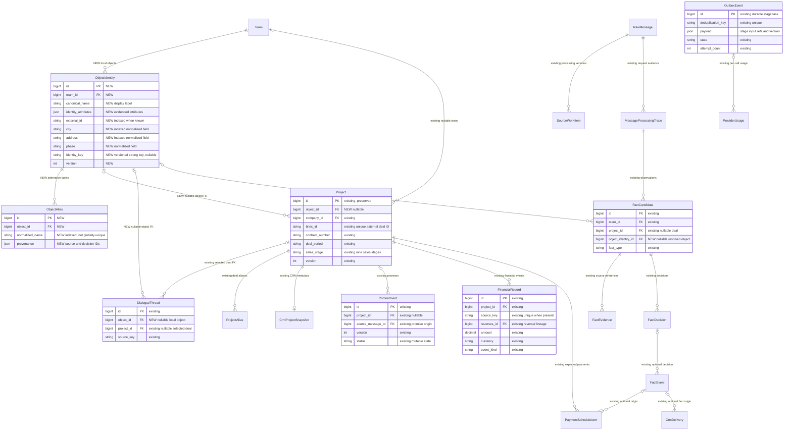
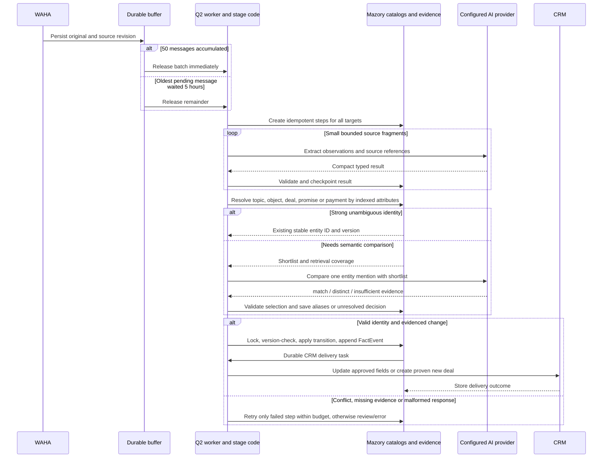

# Короткие AI-операции и системное сопоставление сущностей Mazory

- Создано: 2026-10-22 18:44:24 MSK.
- Задача: `entity-resolution-pipeline`; ветка: `refactor/entity-resolution-pipeline`.
- База исследования: `origin/main`, `38c53d6` (PR #156).
- Статус: спецификация подтверждена пользователем 2026-10-22; реализация выполняется в отдельной ветке. Production-настройки этой задачей пока не менялись.

## Постановка и подтверждённые проблемы

Пользователь требует управляемого кодом процесса с небольшими AI-запросами: извлечение упоминаний, нормализация, поиск по составным признакам, отдельное семантическое сравнение только при необходимости и обновление существующих сущностей. Стандартизация названий выполняется внутри Mazory, без переименования CRM.

В текущем пути основная модель одновременно формирует темы, классифицирует каждую цель, извлекает бизнес-факты и доказательства. Один изученный запрос на одну цель содержал 17 исходных сообщений и занимал около 124 КБ: schema tools около 26 КБ, system-инструкции около 21 КБ, 100 проектов около 10 КБ. Из 1263 хранящихся тем отправлялись 15–17, около 4 КБ: причина перегрузки не в передаче всех тем. Это измерения сохранённых запросов, не постоянные нормативы.

Опоры существующего кода: `pipeline.py` выбирает до 100 проектов; `dialogue_threads.py` ограничивает основные кандидаты тем 20; `minimax.py` передаёт схему через function tool; `focused_extraction.py` содержит разнонаправленные указания о `facts`/`topic_updates` и отдельный резерв 2048 в сопоставлении обязательств. Отдельный decision-маршрутизатор в проверенной production-конфигурации выключен. Уже существуют нормализация названий, `ProjectAlias`, `FactEvidence`, версии, `FactDecision`, `FactEvent`, durable outbox и учёт вызовов.

## Требования и границы

1. Код определяет область поиска, правила идентичности, версии, допустимые переходы состояний, порядок операций, бюджеты повторов и полноту обработки. Модель возвращает наблюдения и предложения; сама не выполняет SQL/CRM-изменения и не устанавливает факт отсутствия сущности во всей базе.
2. Сохраняется правило intake: немедленный выпуск 50 накопленных сообщений, остаток через 5 часов ожидания старейшего сообщения этого остатка. Новые сообщения не отодвигают срок. Это условие запуска обработки, а не требование отправить все 50 одним запросом.
3. В основном запросе нет общего каталога CRM, всех объектов, всех обязательств или всех диалогов. Маленькие результаты этапов не воспроизводят историю переписки целиком.
4. Нельзя обещать безошибочность внешней модели. Стабильность обеспечивается проверкой результата, сохранением прогресса, ограниченными повторами и явным незавершённым исходом без потери сообщения и без неподтверждённой записи.
5. Сохраняются динамические AI-конфигурации, зашифрованные ключи, девять согласованных стадий продаж, защита ручных правок и отсутствие служебного спама в CRM.

## Идентичность сущностей

У каждой сущности остаётся постоянный числовой ID. Составной ключ — версия правил над доказанными атрибутами; это не конкатенация всех текущих полей. Неизвестное значение не является совпадением или подстановкой любого значения. Изменение срока, статуса, текста отображения или суммы не должно менять идентичность исходного события. Область поиска учитывает команду и настроенную интеграцию CRM; идентификаторы чужой команды недопустимы.

| Сущность | Сильные и вспомогательные признаки | Изменяемое состояние |
|---|---|---|
| Объект | Внешний ID объекта, если существует; сочетание названия, населённого пункта, адреса, корпуса/очереди и иных подтверждённых признаков | Каноническое отображение, варианты написания, уточнение реквизитов |
| Сделка | Существующий CRM ID; либо объект, контрагент, договор/номер и период с достаточными отличительными признаками | Стадия, суммы и параметры, действия, выезд, получение проекта |
| Обязательство | Происхождение обещания, действие, исполнитель/стороны, связанный объект/сделка; связи ответов и исходников | Срок, перенос, исполнение, отмена, просрочка; с историей |
| Финансовое событие | ID транзакции/счёта при наличии; иначе сделка, вид события, стороны, сумма/валюта, дата и доказанное происхождение | Уточнение/подтверждение по версии; отдельные поступления и сторнирования сохраняются отдельно |

Правила ключа для каждого типа реализуются отдельно и версионируются. Фиксированный универсальный порог «похожести» не вводится без проверки на примерах. Одно и то же название, сумма и дата сами по себе не объединяют две сделки, два обещания или две оплаты. Два сообщения об одной оплате не удваивают поступление, но два реально разных поступления одинаковой суммы не схлопываются.

### Объект и сделка

Сегодня `Project` одновременно представляет объект и CRM-сделку. Добавить локальные `ObjectIdentity`/`ObjectAlias`; `Project` сохранить как существующую сделку с прежним ID, CRM ID, историями и связями. Добавить nullable `Project.object_id`: у одного объекта допустимо несколько сделок.

Существующий `DialogueThread.project_id` остаётся ссылкой на конкретную сделку. Добавить nullable `DialogueThread.object_id` для темы об объекте, где договор ещё не определён; выбор объекта сам по себе не выбирает одну из его сделок. Существующие `Project.team_id` и некоторые исторические связи nullable: доступ к таким записям разрешается только при доказанной области интеграции/команды, а не через глобальный поиск.

`ObjectIdentity.identity_key` формируется только из достаточных типизированных, подтверждённых признаков и версии правил; уникальность полного сильного ключа ограничена командой. При неполных/конфликтующих признаках ключ остаётся null, а запись не становится автоматически разрешённой. Каноническое имя и отдельный alias не имеют глобальной уникальности и не подменяют сильный ключ.

Каноническое имя — удобная подпись из известных признаков, например «Астана / Медео / корпус 2», а не доказательство идентичности. Нельзя терять значимые казахские буквы, номер корпуса, город или юридически значимые реквизиты. Исходные написания и источники сохраняются. Коллизия alias возвращает несколько кандидатов, а не первый попавшийся ID.

### Нормализация и разрешение

1. Извлечь исходное упоминание и подтверждённые атрибуты с ID/диапазонами исходных сообщений.
2. Нормализовать кодом; проверить сильные ID, составные признаки, связи диалога и сохранённые aliases.
3. При единственном доказанном совпадении связать с существующей записью без AI-сравнения.
4. При отсутствии однозначного совпадения выполнить индексированный поиск по нескольким независимым признакам. Подбирать shortlist программно; сохранять параметры поиска, число результатов, признаки конфликтов и полноту охвата.
5. Семантический запрос сравнивает только одно упоминание с подобранными кандидатами и возвращает `match`, `distinct` либо `insufficient_evidence`, ID из предложенного списка и ссылки на основания.
6. Отрицательный ответ по одной странице не доказывает отсутствие сущности. Расширить поиск/просмотреть следующие страницы по установленному бюджету; если покрытие или реквизиты недостаточны, сохранить unresolved/review.
7. Создавать запись только при доказанном новом объекте/сделке/событии, достаточных атрибутах и повторной проверке ключа под блокировкой. Подтверждённый alias закреплять за выбранной сущностью вместе с происхождением.

## Этапы небольших запросов

### A. Приём и разбор источников

Сохранить неизменяемые оригиналы, ревизии, durable buffer и связи ответа/цитирования. Простой приём сообщения не вызывает модель. После выпуска пачки создать versioned-этапы в существующем `OutboxEvent`; связь с исходной операцией и всеми её целями сохраняется при дроблении.

Первичный запрос содержит небольшой фрагмент источников и простой единый формат наблюдений: ссылки на сообщения, упоминания сущностей, вид подтверждённого события/изменения и необходимые доказательства. Не требовать одновременно полного дерева из 16 тем, всех вариантов бизнес-сущностей и итогового решения CRM. Точный формат каждого этапа генерируется из его валидатора: prompt, tool schema и серверная проверка не должны расходиться.

Начальные предлагаемые параметры для QA: до 10 целевых сообщений в одном шаге; общий бюджет входа 16 384 токена, включая system, tools и контекст; shortlist до 10 кандидатов на страницу. Это предлагаемые рабочие настройки, а не новые требования пользователя. Окончательные значения уточняются измерениями на реальных пачках и сохраняются в AI-конфигурации. Длинные источники делятся по связанным фрагментам с сохранением ID, диапазонов и полного покрытия; обрезка с потерей хвоста запрещена.

### B. Диалоги и контекст

Код сначала использует явный reply/цитату и уже подтверждённые связи. Для неоднозначного сообщения выбирает релевантные темы по источнику, участникам, времени, идентификаторам и поиску. Небольшой AI-запрос определяет семантическую принадлежность, допускает несколько тем у отчёта и `insufficient_evidence`. Короткое «оплатили» получает нужные исходные реплики, а не автоматически становится самостоятельной темой. Каждый дополнительный источник добавляется адресно; сам факт соседства не подтверждает связь.

Существующие `DialogueThread`/`ThreadMessage` переиспользуются; отдельную большую decision-модель и обязательный AI-вызов на каждое входящее сообщение не вводить. Неизменившийся подтверждённый результат маршрутизации повторно не вычисляется.

### C. Сопоставление и обновление

Объекты, сделки, обязательства и финансовые события разрешаются по правилам выше. В AI-сравнение передавать только необходимые атрибуты и оригинальные основания; никакого повторного извлечения всей истории ради смены одного статуса.

Код проверяет tenant, выбранный ID, версию и источники. Изменение оформляется через существующие `FactCandidate`/`FactEvidence`/`FactDecision`/`FactEvent` и версионные проекции. После исполнения обещания его исходная запись сохраняется. Дата сообщения и дата бизнес-события различаются; запоздавшая старая реплика не откатывает более новое подтверждённое состояние. Стадии CRM меняются по явным фактам и разрешённым переходам, с сохранением ручных правок.

Платежи остаются отдельными событиями, привязанными к сделке: счёт, ожидание, частичное поступление и сторнирование различаются. Оплаченная сумма и состояние сделки выводятся из принятых записей. Упоминание счёта не означает получение денег; статус «Оплата по счетам» не заменяет журнал событий.

В модели нет самостоятельной карточки счёта: в этой задаче происхождение выставленного счёта хранится как типизированный `FactEvent`, ожидаемые суммы/сроки — в существующем `PaymentScheduleItem`, а поступление — отдельным `FinancialRecord` с обязательной связью со сделкой. План и поступление связываются только по доказанному основанию; запись о счёте не превращается в денежное поступление простой сменой `event_kind`. Неопределённая сделка оставляет финансовое наблюдение кандидатом, а не создаёт непривязанный платёж.

### D. Повторы и наблюдаемость

- Durable checkpoint для каждого этапа: версия схемы/политики, fingerprint исходников и выбранных сущностей, входные ссылки, компактный результат, попытки, состояние и расход.
- Одновременный запуск и рестарт воркера не создают дубли. Успешные независимые этапы не запускаются заново при ошибке следующего.
- Ограничить число transport/schema-повторов каждого этапа и общее число вызовов одной операции; учитывать дополнительный контекст и страницы поиска. Бесконечные повторы, циклические переразбиения и повторный полный разбор пачки запрещены. По исчерпании бюджета — явный review/error с сохранённым прогрессом.
- Дробление всегда уменьшает число целей или диапазон исходного текста и заканчивается атомарным фрагментом. Невыполнимый атомарный фрагмент становится unresolved/error; та же ветвь не запускается рекурсивно без изменения входа и доступного бюджета.
- HTTP 200 не является успехом: проверить окончание потока, JSON, схему этапа, допустимые ID и доказательства. Различать ошибки SSE/оболочки, обрезанный вывод, типы/enum/required и бизнес-конфликты.
- Убрать скрытый резерв 2048 во вспомогательных проверках и противоречивые указания формата. Выходной параметр берётся из явной конфигурации и возможностей провайдера; тайный малый cap или обрезка готового ответа не допускаются. Незавершённый вывод не считается полным результатом.
- Показывать реальный прогресс исходных сообщений, число шагов/вызовов, причины review/errors и расход по этапам. Отделить «все задачи поставлены в очередь» от «все сообщения получили конечный исход».

## Миграция и выпуск

1. Сначала локальный справочник и nullable-связь объекта со сделкой; сохранить прежние PK и внешние ID. Backfill объединяет только доказанные идентичности; неоднозначные старые записи остаются без связи, доступными для проверки. Данные CRM не переименовывать и не удалять.
2. Переиспользовать текущую durable очередь, модели фактов и доставок. Версию этапа и fingerprint хранить в `OutboxEvent.payload`/trace metadata; уникальность этапа обеспечивать существующим `deduplication_key`.
3. Реализовать новый путь под версионированной политикой и отключаемым флагом. Старые checkpoint и незавершённые операции не интерпретировать по новой схеме. Переход/повтор выполняется отдельной новой processing version, сохраняющей исходники и предыдущие результаты.
4. QA: отдельные Docker PostgreSQL/Redis и приложение, затем read-only сравнительный прогон на разрешённых реальных источниках без доставки CRM. Не менять текущую production-операцию повтора в рамках подготовки спецификации.
5. После согласованной реализации и проверок — PR в `main`, CI/review/merge. Выпуск нового пути и массовый повтор: backup, остановка/фиксация затронутой очереди, миграции, проверки, ограниченный canary, проверка конечных записей и CRM read-back; затем расширение. Ключи только в конфигурации.

## Критерии готовности

1. 49 сообщений не вызывают AI; 50 запускают обработку; новый остаток из 3 выпускается через 5 часов без переноса срока последующими сообщениями. Источники независимы, рестарт не теряет буфер.
2. Для каждой исходной цели доказано покрытие всех фрагментов и конечный исход. Общее число 50 не превращается в обязательный запрос на 50 сообщений.
3. В main-extraction отсутствует список 100 проектов. Размеры/лимиты каждого этапа измеряются по фактически отправляемому payload, включая schema/system; ни один этап не получает весь каталог под видом дополнительного контекста.
4. Точное составное совпадение и известный alias разрешаются без AI-сопоставления. Отдельный запрос по неопределённому совпадению содержит только shortlist и необходимые основания.
5. Один объект с двумя договорами сохраняет две сделки. Совпадающие названия в разных городах/командах не объединяются. Новая запись не создаётся из-за неполной страницы поиска.
6. Перенос/исполнение/отмена изменяют то же обязательство, сохраняя происхождение и историю. Неизвестный исполнитель/договор не используется как wildcard.
7. Повторная доставка сообщения и повтор обработки не создают повторную оплату, обязательство, сделку или CRM-комментарий. Разные равные по сумме платежи не объединяются без доказанного общего происхождения.
8. Сбой последнего этапа и рестарт Q2 не повторяют успешный первичный разбор; после ограниченных повторов состояние явно review/error. На всех типах ошибок видна конкретная стадия и причина.
9. На разрешённых реальных пачках посчитаны вызовы, входные/выходные и reasoning-токены, задержки, доли success/review/error, число повторов и остаток квоты MiniMax. Не обещать фиксированную вместимость подписки без этого измерения; дополнительный вызов должен решать отдельную необходимую задачу.
10. Подтверждены фактическое создание/обновление нужной CRM-сделки и её стадий, защита ручных изменений и отсутствие служебного спама. Успешный AI-ответ без принятого результата не считается прохождением сквозного сценария.

## Проверки

Соблюдать Docker-only и запрет на создание unit/component/integration/mock-наборов. Применить миграции в изолированной БД, выполнить Django `check`, `makemigrations --check` с `No changes detected`, TypeScript/Vite build в image nginx при изменении frontend, поднять сервисы и проверить backend/qcluster/WAHA-логи. Проверки поведения выполнять одноразовыми сквозными прогонами на разрешённых источниках, без новых постоянных тестовых наборов и без неподтверждённых CRM-записей. При изменении только этой спецификации — проверка diff и обязательный `makemigrations --check`.

Подготовка проекта спецификации: `git pull origin main` выполнен до создания ветки; отдельный worktree сохраняет прежнюю рабочую копию. Проверки исходной базы не являются проверками итоговой реализации. Production-настройки и данные этой веткой пока не изменялись.

## Реализация согласованного процесса

- `entity_stages.py` задаёт узкие серверные сериализаторы наблюдений, одного типизированного факта и одного сопоставления; JSON Schema строится из тех же сериализаторов. `no_fact` отличается от недостатка источников. Пустая цель получает явный исход, а длинные сообщения покрываются непрерывными диапазонами без отбрасывания хвоста.
- `entity_pipeline.py` выполняет по одному новому AI-вызову за запуск воркера. Родительский `extract_message` координирует обработку, дочерние `entity_checkpoint` сохраняют проверенный результат. ID цитаты преобразуется кодом в неизменённый текст оригинала; модель не перепечатывает доказательство. Перед сохранением проверяются схема, ID источников, буквальные цитаты, конфигурация и актуальность снимка.
- Запрос содержит только источники данного этапа и ограниченный shortlist: до 10 кандидатов на страницу, до 3 страниц; темы — до 5. Полнота локального поиска и возможность создания проверяются кодом. Пустой shortlist без достаточного составного ключа не разрешает создание. Отдельный AI-этап подтверждает различие нового объекта/сделки.
- `entity_resolution.py` и `object_identity.py` сопоставляют объекты, сделки, обязательства и финансовые события. Канонический справочник не переименовывает CRM. Существующая сделка может быть подтверждена собственными реквизитами даже без физического объекта. Поручение, обещание, исполнение, перенос и отмена сохраняют происхождение; одинаковые суммы не доказывают тождество платежей, номер счёта не подменяет номер поступления.
- Принятие и запись используют прежние `FactCandidate → FactDecision → FactEvent`, версии и доставку CRM. Перед применением финансовое событие повторно сопоставляется кодом под блокировкой сделки. Версии соседних принятых наблюдений одной операции учитываются отдельно от ручных изменений. Подтверждённый alias сделки получает основание принятого решения.
- `entity_reconciliation.py` подключён к периодическому восстановлению: отложенное наблюдение сопоставляется повторно только при изменении относящихся к нему записей справочника. Уже извлечённый факт используется повторно, первичный AI-разбор не запускается. Сохранение результата и отметки публикации атомарно; истёкший claim не заменяет результат нового воркера.
- Повторы ограничены настройками `entity_stage_attempts` (по умолчанию 3), `entity_max_calls` (128) и `entity_input_token_limit` (16384). Отложенное сопоставление делит общий бюджет с исходной операцией. Отказ допуска провайдера не расходует попытку; ошибки схемы имеют ограниченную повторную попытку с диагностикой. Выходной бюджет берётся только из явной AI-конфигурации.
- Флаг `entity_pipeline_enabled` по умолчанию выключен; processing version нового пути отделена от прежних checkpoint. Миграции 0068–0073 добавляют локальный справочник, nullable-связи, индексы, составную уникальность сделок и настройки. Старые ID/данные сохраняются.
- Интерфейс показывает этапы исходного разбора и последующего сопоставления, реальные вызовы/токены, reasoning при наличии данных провайдера, размер payload и причины остановки. Повтор ошибок учитывает активные этапы и их расход, включая отложенное сопоставление; неизвестные токены не выдаются за нулевые.

По указанию пользователя сначала завершается весь код, затем выполняются итоговые Docker-проверки и сквозные прогоны. Результаты промежуточных прогонов не заменяют проверку итогового состояния ветки. Выпуск, массовый повтор и подтверждение реальной доставки CRM остаются отдельными шагами после проверок и PR.

### Итоговые проверки ветки

- В изолированном Docker QA (`socktainer`, отдельные PostgreSQL/Redis) применены миграции 0068–0073; `manage.py check` — без замечаний, `makemigrations --check` — `No changes detected`. Собраны backend и nginx с TypeScript/Vite; запущены backend/qcluster/nginx, frontend отвечает HTTP 200.
- Одноразовые прогоны с откатом подтвердили буфер 49/50/остаток 3, полное покрытие длинного источника, составные идентичности, два договора одного объекта, защиту ручных версий, перенос/исполнение обязательства без отката старым сообщением, финансовую повторность и отдельные равные поступления. Постоянные тестовые наборы не создавались.
- Финальный проход дополнительно проверяет создание нового самостоятельного обещания и именованного поручения: сервер отмечает достаточность происхождения/исполнителя/действия в отдельном сопоставлении. Основание поручения сохраняет роль `request`, основание обещания — `promise`; жизненный цикл поручения использует тот же исходник. Прежний валидатор обязательств приведён к этому различию без ослабления требований к исполнителю и явному поручению. Фоновая перепривязка отложенного счёта к появившейся доказанной сделке идемпотентна и не вызывает повторный AI-разбор.
- Финальное ревью исправило повторное удержание уже сопоставленного отдельного платежа, неполный fingerprint после первых 31 записей и порядок блокировок источника. Полный локальный invalidation digest вычисляется потоком без отправки каталога модели. Повторные одноразовые прогоны подтвердили применение semantic-distinct платежа и инвалидирование при изменении существующей 34-й записи даже без обновления `updated_at`.
- Реальный MiniMax/Q2: три исходных сообщения 65–67 завершили стадии без ошибок, два получили success, одно review из-за недостатка оснований; синтетический контрольный источник 215 создал один объект и одну сделку, два кандидата приняты в ту же сделку, стадия `proposal_sent`, версия 2. Найден и исправлен прежний `UnboundLocalError` при проверке стадии. Проверены конечные кандидаты и проекция, а не только HTTP-ответ.
- У этих двух QA-операций суммарно 33 вызова, 57773 входных и 24071 выходной токен, включая отклонённые ответы, исправления контрактов и повторные попытки во время разработки. Это расход диагностики, не норматив обработки четырёх сообщений и не основание обещать вместимость 50 сообщений в квоту. Новые контракты допускают отсутствие nullable-ссылки без выбранной сущности и отсутствие пояснения у ready-факта, сохраняя обязательный ID для match, факт для ready и причину для недостатка данных.
- В QA отключена доставка CRM; отдельного WAHA-сервиса в этом изолированном стенде нет. Реальный CRM read-back, WAHA и production-canary этими результатами не подтверждены. Производственные данные и настройки не менялись; флаг по умолчанию выключен.
- CI выявил опубликованную уязвимость существующей DOMPurify 3.4.16 (GHSA-cg2g-xh64-v4q7 и связанные advisory). Для прохождения обязательного security audit зависимость и lockfile обновлены точечно до 3.4.17; обход проверки и новые исключения не добавляются. Обновление выполняется только внутри Docker, затем повторяются аудит и TypeScript/Vite build.
- Полный backend audit дополнительно выявил три advisory DRF 3.18.1. Минимум в `pyproject.toml`, `uv.lock` и экспортированный `requirements.txt` согласованы на исправленной 3.18.2 (GHSA-33wh-fxxf-88vv, GHSA-3547-9m27-7rxg, GHSA-xw6w-gcfp-cf8m); сторонние зависимости не обновляются. Пересборка и проверки выполняются с этой версией внутри Docker.

### Уточнение контракта по production-canary 2026-10-23

После выпуска 1865695 и миграций 0068–0073 ограниченный повтор обнаружил ответ с classifications=[1221], но observations относились к контекстному сообщению 1220. Ответ отклонён `entity_target_coverage_invalid`, до публикации данных. Исправление остаётся в согласованном требовании проверки допустимых ID и полноты целей: JSON Schema каждого запроса ограничивает ID наблюдений/классификаций фактическими target_ids и требует классификацию каждой цели ровно один раз. Наблюдение содержит доказательство собственного целевого сообщения, evidence_message_id типизированного факта равен этому target ID; контекст допускается только как дополнительные основания. Серверные проверки сохраняются, а диагностика повторной попытки перечисляет разрешённые числовые ID без текста источников. Чужие наблюдения не перепривязываются кодом и не принимаются фильтрацией. Старые попытки/успешные операции сохраняются; повтор выполняется новой явной попыткой после проверки исправления.
