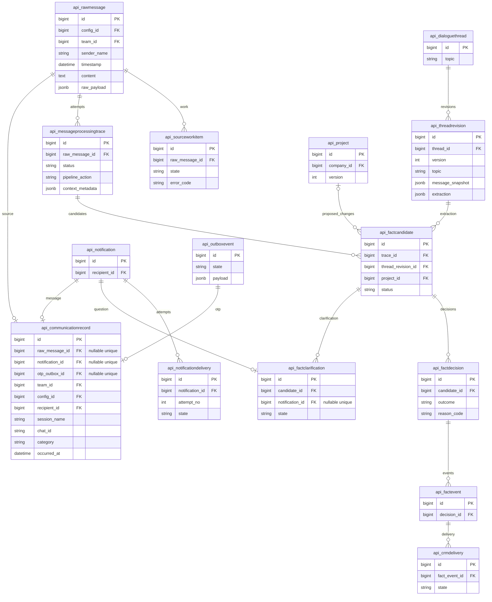

# Ускорение общих SQL-путей операторского интерфейса Mazory

- Задача: `messenger-dialog-query`, ветка `bugfix/messenger-dialog-query`.
- Создано: 2026-10-23 11:48:59 MSK (UTC+3).
- База: `main`, `69d5896222989d53c2004efd34afa91fb8aedf5a`.
- Основание: диагностика production и прямое поручение пользователя подготовить спецификацию, исправить SQL/индексы и проверить в Docker; реализация разрешена этим поручением.
- Уточнение пользователя: проблема систематическая и относится не только к диалогам. Область расширена на общие статусные выборки, аналитику операций, список заданий и список кандидатов; отдельные спецификации не создаются.



```mermaid
sequenceDiagram
    actor Operator as Оператор
    participant API as Scoped API
    participant PG as PostgreSQL
    Operator->>API: Диалоги / сообщения / аналитика / кандидаты / очередь
    API->>API: Проверить пользователя и область доступа
    alt Статусная выборка
        API->>PG: Отобрать кандидатов по индексу, прочитать только последнюю попытку
        PG->>PG: Вычислить JSON-состояния один раз на последнюю попытку
        PG->>PG: Общие статусы; группировка и ID превью из одной выборки
        PG-->>API: Статусы / агрегаты / выбранные ID
    else Кандидаты
        API->>PG: Ограниченная страница и пакет связанных решений/CRM
        PG-->>API: Только поля DTO, без снимков AI
    else Очередь
        API->>PG: Исключить дубликаты через однократный hash-набор ID источников
        PG-->>API: Ограниченная страница заданий
    end
    API-->>Operator: Прежний контракт ответа и курсоров
```

Диаграмма отражает существующие связи по актуальным моделям и миграциям. Новые таблицы, поля и связи не вводятся. Планируются только индексы таблицы `api_messageprocessingtrace`.

## Постановка и исходные измерения

`GET /api/messenger/dialogs/?attention=1` на production в обработчике Django под суперпользователем вернул два диалога за 51,008 с: два SQL-запроса по 26,098 и 24,601 с. Это внутренний замер обработчика, без времени браузера, сети и middleware.

Причины: сканирование большого `context_metadata` в предварительном отборе, повторная распаковка JSON в ветвях вычисления статуса, повторный полный расчёт той же выборки для превью. Изолированный JSON-предикат занял 8,397 с; у 4 736 попыток суммарный сжатый размер этого поля 94 МБ. JIT в планах добавлял 2,4–2,9 с на SQL. Индексы FK исправны, подходящего частичного индекса и `(raw_message_id, id DESC)` нет.

Общие пути: `/api/analytics/operations/` — статусный SQL 6,098 с; `/api/messenger/records/?attention=1` — превышение диагностического `statement_timeout=8s`; `/api/processing/jobs/` — SQL 3,005 с с приведением индексируемого `SourceWorkItem.raw_message_id` к строке. `/api/candidates/` — 57 SQL, из них 50 запросов последнего решения по одному на кандидата, плюс загрузка полных трассировок. Вызовы списка проектов и кандидатов в диагностическом factory получили `DisallowedHost` на формировании pagination URL: это ограничение способа замера, не зафиксированная ошибка production. Остальные измеренные API: CRM changes 0,693 с, directory 0,913 с, messenger changes 0,092 с. `/admin/` перенаправляет в Vue через `operator_entry`; старые Django-admin changelist не являются активным путём, их изменения исключены.

## Требования

1. Сохранить контракт `items`, `next_cursor`, `as_of`, `coverage`, числовые ID, имена и превью, правила сортировки и все существующие фильтры (`q`, category, attention, analysis, cohort, cursor, limit).
2. Сохранить область `records_scope`, изоляцию команд/получателей и семантику последней попытки: историческая ошибка после успешной обработки не возвращается как текущая. Сохранить `needs_review`, pending-кандидатов, уточнения, доставку и CRM.
3. Рассчитать отфильтрованные записи один раз в SQL и повторно использовать для группировки и выбора превью. Превью определяется по `(occurred_at DESC NULLS LAST, id DESC)`; `MAX(id)` курсора не подменяет ID превью.
4. Извлекать JSON-состояния только последней попытки и вычислять их один раз до повторных CASE-выражений. Граница проекции `LATERAL ... OFFSET 0` сохраняет оценку максимум одной строки и предотвращает повторное чтение JSON. Использовать обычные JOIN для уникальных FK, где LATERAL/LIMIT не нужны.
5. Добавить частичный индекс по `raw_message_id` с точным предикатом `status='error' OR context_metadata.request_state='needs_review'`, и составной индекс `(raw_message_id, id DESC)`. Создавать/удалять индексы конкурентно неатомарной обратимой миграцией; состояние моделей и миграций должно совпадать.
6. Не менять бизнес-данные и настройки production, не вводить новые требования к пагинации, кеширование, задержку видимости статусов или глобальные изменения JIT. Frontend в данной задаче не изменяется.
7. Общий статусный адаптер оптимизируется для диалогов, сообщений, polling и аналитики. Список кандидатов получает последнюю запись решения пакетно и не загружает большие JSON трассировок/ревизий, не нужные ответу; контракт полей и права сохраняются, неприспособленные вызывающие пути сохраняют корректный fallback.
8. Исключение дублирующих заданий строит hash-набор текстовых представлений source ID один раз через некоррелированный `IN`, без `EXISTS` внутри `CASE` и без преобразования недоверенного JSON в bigint. Сохраняется исходное строгое сопоставление представления числового JSON (`1.0` не подменяется `1`), отсутствующие ключи, нечисловые, дробные и выходящие за bigint значения обрабатываются без исключений и ложных совпадений. Внешний контракт ID остаётся целочисленным.

## Планируемые изменения

- `backend/api/messenger_api.py`: граница проекции последних попыток; однократный расчёт совпавших записей для страницы диалогов и ID превью; ограниченная загрузка полей выбранных превью по PK, сообщений и polling.
- `backend/api/models.py` и одна миграция: два индекса `MessageProcessingTrace`.
- `backend/api/operations_api.py`: однократный hash-набор source ID для исключения дубликатов по JSON raw_id в списке заданий.
- `backend/api/platform_views.py`: облегчённая выборка кандидатов/связей и пакетное последнее решение; dormant admin-код не изменяется.
- Настоящие PostgreSQL/Redis/backend в отдельном локальном Docker Compose с отдельным volume, контекст `socktainer` (доступный локальный Engine; `kk-minsk` отсутствует). Текущие контейнеры и незакоммиченная рабочая копия не изменяются.
- Одноразовые команды проверки и измерения в контейнере; новые unit/component/integration/mock-наборы не создаются. Результаты фиксируются здесь.

## Критерии готовности

- На одинаковой локальной БД до/после совпадают значимые поля ответов и курсоры, включая пустую выборку, несколько страниц, null-время/команду, различие максимального ID и последнего времени, поиск и роли доступа. Проверены актуальные/устаревшие ошибки, review, work, notification/OTP и CRM-состояния.
- `attention=1` рассчитывается один раз за запрос; превью загружаются по выбранным PK без повторения status CTE. Число запросов не зависит от количества сообщений в диалоге.
- На тех же данных сравниваются список сообщений с attention, аналитика операций, очередь и кандидаты. Для страницы 50 кандидатов отсутствуют 50 отдельных запросов решений; DTO списка и карточки сохраняются. В плане очереди набор source ID читается один раз, включая проверку неверных типов и отсутствующих ключей JSON raw_id.
- На локальной БД не менее 1 200 записей и 4 800 попыток с большим JSON: замеры до/после на одном наборе; ориентир медианы пяти прогретых вызовов после исправления < 2 с, ускорение >= 2 раз. Проверить EXPLAIN ANALYZE BUFFERS и использование индексов. Это локальные измерения, не обещание production SLA.
- В Docker проходят миграция вперёд/назад/вперёд, `manage.py check`, `makemigrations --check` с `No changes detected`, сборка backend и nginx (TypeScript/Vite); сервис backend отвечает HTTP, qcluster запускается без новых ошибок. Состояние WAHA отражается отдельно, если локально отсутствует.
- Проверен diff; PR направлен в `main`, обязательные CI/review пройдены перед объединением. Production-релиз выполняется по последующему прямому поручению пользователя; его результаты фиксируются ниже.

## Результаты проверки

Проверено 2026-10-23 в отдельном Compose `mazory-query-qa`, контекст `socktainer`. База содержит 1 217 записей коммуникаций, 4 804 попытки анализа (129 МБ `context_metadata`), 120 кандидатов и 20 025 событий outbox. Это синтетические данные в настоящем PostgreSQL 16, без копирования production-переписки и ключей.

Медианы пяти прогретых внутренних вызовов Django на одном локальном наборе; сравниваются исходный код/схема и итоговая реализация с индексами (для очереди, которая не использует новые trace-индексы, повторно сравнены исходный и итоговый код на финальных edge cases):

| API | До, мс | После, мс | Ускорение |
| --- | ---: | ---: | ---: |
| Диалоги `attention=1` | 308,018 | 37,370 | 8,24x |
| Сообщения `attention=1` | 155,456 | 53,214 | 2,92x |
| Аналитика операций | 83,377 | 45,268 | 1,84x |
| Очередь | 19,346 | 11,378 | 1,70x |
| Кандидаты | 47,227 | 9,638 | 4,90x |

- У кандидатов на странице 50 записей: 57 → 7 SQL. У диалогов с attention остаются два SQL, второй — только превью по выбранным PK, без status CTE.
- EXPLAIN ANALYZE BUFFERS подтверждает `trace_attention_source_idx` и `trace_source_latest_idx`; стоимость основного SQL диалогов 104 755 → 61 840, JIT в новом плане отсутствует без изменения настроек БД. Очередь использует один hash-набор source ID; оценочная стоимость снизилась с 121 443 до примерно 1 617, JIT не требуется.
- 110 ответов исходного/нового API совпали, кроме ожидаемо изменяющегося `as_of`; сравнивались также HTTP-коды. Проверены суперпользователь, руководитель одной команды и пользователь без доступа, обход всех страниц диалогов, null-время, курсоры, поиск, пустая выдача, фильтры, review/retry/work, уточнения, notification/OTP, CRM-ошибки, список/карточка кандидатов и fallback `candidate_data` для существующих вызывающих путей.
- Проверены JSON `raw_id`: отсутствующий ключ, null, строка, boolean, object, array, дробное число, `1.0`, bigint-границы и выход за них, очень большое число; ответы очереди соответствуют исходной семантике.
- Миграция `0074` применена, отменена до `0073`, применена повторно. Оба индекса `indisvalid=true`, `indisready=true`.
- Собраны backend и nginx (включая TypeScript/Vite). Финальный образ запущен без bind mount исходников. Через nginx и настоящий JWT/session пять затронутых API вернули HTTP 200; frontend также HTTP 200. Один холодный HTTP-проход: диалоги 0,359 с, сообщения 0,061 с, аналитика 0,048 с, очередь 0,022 с, кандидаты 0,264 с.
- В финальном образе `manage.py check`: 0 issues; `makemigrations --check`: `No changes detected`. Логи backend/nginx/qcluster без новых ошибок; реальная задача Redis → QCluster → `django_q.Task` завершилась успешно с ожидаемым результатом. WAHA в этом локальном стеке отсутствует, внешний WhatsApp-вызов не выполнялся.
- `git diff --check` чист. Новые тестовые наборы не создавались. Во время локального этапа production-контейнеры, данные и настройки не изменялись. PR #164 объединён в `main` как `ae3d425dced633d2956abe5e4ac6bed908ff2a81`; CI PR и merge-коммита завершился успешно.

## Production-релиз и приёмка 2026-10-23

Основание: прямое поручение пользователя развернуть исправление в production и подтвердить загрузку диалогов быстрее 20 секунд.

- Исходная production-версия: `93b2b58`. Развёрнут точно проверенный `ae3d425`, без последующего независимого изменения analytics overview из `44bb80f`.
- Контекст `mazory-remote`. Образы `mazory-backend:query-ae3d425` и `mazory-nginx:query-ae3d425` собраны из `git archive` указанного SHA с OCI revision label. Backend, nginx, все четыре QCluster и outbox проверены на одну ревизию; на момент активации все запущены, restart count 0.
- До миграции выполнен `pg_dump -Fc`: 113 586 564 байта, права 0600, каталог `pg_restore --list` прочитан, SHA-256 сохранён. Резервная копия находится в `/home/a_belianskii/.local/share/mazory-dialog-query-20261023-ae3d425/pre-release.dump` на production-хосте.
- Outbox и воркеры штатно остановлены перед миграцией. Применена `api.0074_trace_read_indexes`; оба индекса valid/ready. `manage.py check` без ошибок, `makemigrations --check` — `No changes detected`. Существующие ключи, конфигурация и volumes сохранены; PostgreSQL/Redis/Qdrant/WAHA не пересоздавались.
- Активация завершена 2026-10-23 14:50:22 MSK. Публичный `/api/health/ready/` вернул `ready`.
- Пять последовательных авторизованных HTTPS GET с компьютера пользователя к `https://ai.mazory.best/api/messenger/dialogs/?attention=1`, включая первый запрос после релиза: **7,8069; 11,6881; 10,3147; 5,5459; 5,5434 с**. Все HTTP 200, по два диалога, 821 байт. Медиана **7,8069 с**, максимум **11,6881 с**; каждый запрос уложился в критерий **<20 с**. Это замер полного HTTP-ответа публичного API, не визуального рендера браузера.
- Дополнительные авторизованные HTTPS-проверки: диалоги без фильтра 7,1655 с, сообщения с attention 6,5283 с, аналитика операций 6,0191 с, очередь 1,7818 с, кандидаты 4,3062 с; все HTTP 200.
- Временная проверочная JWT-сессия отозвана после измерений; токен не выводился и не сохранялся. Новых ошибок в просмотренных логах backend, QCluster и outbox не обнаружено; WAHA продолжает работу с прежним временем запуска и нулём рестартов.

### Повторная проверка фактической текущей версии

Пока завершалась проверка, независимый релиз analytics overview обновил production до `44bb80f69ccd6a9555eb6437834088da209ab7a1` (включает `ae3d425`). Это подтверждено live image/revision labels; наш SQL-код и модели между этими ревизиями не менялись. Поэтому приёмка повторена после обновления, без отката независимого релиза.

- На текущей версии пять полных авторизованных HTTPS-ответов диалогов: **5,1020; 4,8261; 5,8358; 4,8127; 4,6215 с**, все HTTP 200, по два диалога и 821 байту. Медиана **4,8261 с**, максимум **5,8358 с**, пять из пяти быстрее 20 секунд.
- Дополнительные API на этой версии: диалоги без фильтра 4,1828 с; сообщения с attention 9,6029 с; аналитика операций 9,6508 с; очередь 1,9656 с; кандидаты 4,2859 с. Все HTTP 200. Проверочная JWT-сессия отозвана.
- Реальная canary-задача в рабочей очереди `ai` прошла Redis → QCluster → `django_q.Task` с `success=true` и ожидаемым результатом. Первоначальная canary, отправленная в не обслуживаемую production-воркерами default-очередь, удалена по точному ID/пакету без затрагивания других задач.
- Результат приёмки: исправление присутствует в текущем production, исходный публичный URL отвечает быстрее установленного порога. Визуальный рендер браузера отдельно не измерялся.
