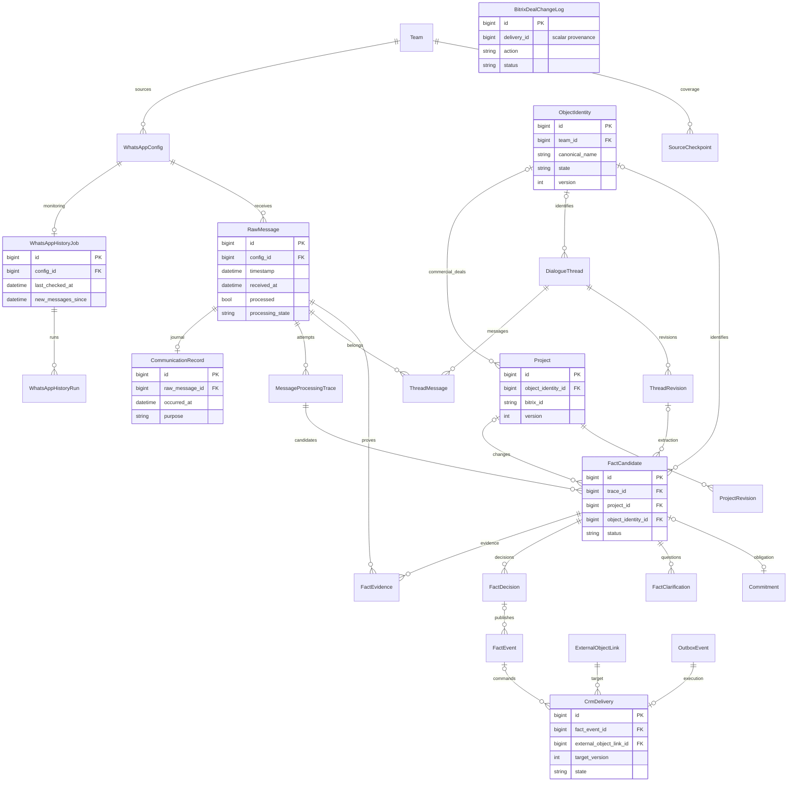

# Обзор: актуальность WhatsApp и подтверждённый результат CRM

- Задача: `analytics-overview`; ветка: `feature/analytics-overview`.
- Создано: 23.10.2026 12:13:22 MSK.
- Основание: концепция рассмотрена в чате; пользователь поручил оформить её в спецификацию и полностью реализовать. Дополнительное согласование того же объёма не требуется.
- База: актуальный `origin/main`, полученный через `git pull origin main` в отдельном worktree; исходные незакоммиченные изменения сохранены.
- Схема БД не меняется. ERD ниже описывает существующие модели и миграции 0066–0073, а не новые таблицы.



```mermaid
sequenceDiagram
    participant W as WhatsApp / WAHA
    participant Q as Существующие Q2 workers
    participant DB as PostgreSQL
    participant CRM as Bitrix24
    participant API as Overview API
    participant UI as Менеджер
    W->>Q: Сообщения и проверка источника
    Q->>DB: Уникальные сообщения, актуальные результаты анализа, темы, факты
    alt Нужен ответ человека
        Q->>DB: Уточнение с получателем и состоянием
    else Изменение подтверждено правилами
        Q->>CRM: Фоновая доставка
        CRM-->>Q: Ответ и проверка чтением
        Q->>DB: Доставка и журнал действия
    end
    UI->>API: Период, команда, чат
    API->>DB: Авторизованная когорта сообщений и связанные результаты
    DB-->>API: Агрегаты, свежесть, проблемы, подтверждения
    API-->>UI: Статус, показатели, внимание, аномалии, результаты
    UI->>API: Детали выбранного показателя с теми же границами
    API-->>UI: Страница объектов и ссылки на основания
    Note over API,CRM: GET только читает БД; внешние вызовы и повторная обработка не запускаются
```

## Постановка

Менеджер за 10 секунд понимает актуальность данных, полезный результат шлюза и необходимые действия. За один переход он получает конкретные объекты и сообщения, объясняющие показатель. Технические детали сохраняются в раскрываемом блоке и существующих разделах.

## Требования и определения

1. Фильтры: сегодня (по часовому поясу проекта), последние 7/30 дней, весь период, произвольные даты; команда и разрешённый чат. Интервал полуоткрытый `[from, to)`. По умолчанию сегодня. Все даты API timezone-aware; пользователь видит часовой пояс и время расчёта.
2. Единая когорта: уникальные входящие исходные сообщения WhatsApp/TXT в `records_scope`, с известным временем источника в интервале, полученные до `as_of`. Неизвестное/оценочное время показывается отдельно и запрещает утверждать полное покрытие. Технические сообщения, OTP, исходящие уведомления не увеличивают входящие.
3. Анализ: переиспользовать канонический latest-state адаптер Messenger. Показать всего, разобрано, без CRM-действий, очередь, в работе, нужен контекст, проверка и ошибки. Повторная попытка не увеличивает число сообщений. Терминальное отсутствие коммерческих фактов является нормальным исходом.
4. Диалог — активное обсуждение `DialogueThread`, связанное с когортой через `ThreadMessage`, а не чат WhatsApp. Тема определена, нужен контекст, тема не определена; отдельно привязка к сделке. Исключить `superseded`, не считать связи сообщений за диалоги. Для ожидающих сообщений без треда нельзя придумывать число ещё не выявленных диалогов.
5. Факты связывать с сообщениями через `FactEvidence` и прямую связь trace; ограничивать текущими кандидатами (не rejected/superseded, не устаревшая попытка). Каждый узел отдельно ограничен существующими правами. Доставка связана через `FactEvent.decision.candidate`; версии и попытки не суммируются как новые объекты.
6. Сделки — `Project` и внешние `deal`; проекты/объекты — существующий `ObjectIdentity`. Показывать их отдельно с ясными определениями, не складывать в общий результат. Число выявленных проектов — уникальные связанные ObjectIdentity; созданных — время создания в периоде, обновлённых — существовавшие до периода объекты с изменением в периоде и version>1. Это локальные изменения, не отдельные проекты Bitrix. При отсутствии надёжной истории помечать ограничения атрибуции, не выдавать updated_at за полную историю.
7. CRM: для сделок и задач отдельно выявленные изменения, подтверждённые создания/обновления/закрытия, ожидающие, требующие внимания и подтверждённые без классификации действия. Считать уникальные целевые объекты; один объект может иметь создание и последующее обновление, столбцы не складываются. Успех — только `delivered/confirmed`. Тип действия доказывает связанный журнал `BitrixDealChangeLog`, без него нельзя угадывать create/update по текущему external_id. Замещённые и отменённые доставки исключены. Отсутствие записи не равно нулю выполненных действий: показывать неподтверждённые/неклассифицированные результаты отдельно.
8. Общий статус: пусто, недостаточно подтверждений, обработка, требует внимания, завершено. «Завершено» разрешено только при свежем подтверждении источников, терминальном анализе всей когорты, отсутствии неизвестного времени/ошибок/активных связанных работ/отложенных решений/незаконченных доставок. Уточнения показывать отдельно от технической неисправности. Не утверждать актуальность всего WhatsApp по одному пустому backlog.
9. Свежесть по каждому разрешённому источнику: `last_checked_at/new_messages_since`, состояние подключения, последний полученный материал. Порог задержки проверки: max(5 минут, 3 интервала мониторинга); отсутствие мониторинга или проверки — неизвестно, а не здоровый статус. Для исторического интервала проверка должна покрывать его конец. Полный импорт — отдельная информация о покрытии; неполная история явно обозначается. Без источников показывать ограниченный объём доступных данных.
10. Внимание: текущие ошибки анализа/CRM, ожидание контекста, неподтверждённые факты, вопросы по идентичности/сумме с получателем/возрастом/статусом, незаполненные сроки/ответственные и просроченные подтверждённые обязательства. Группы могут пересекаться: не складывать их в ложное общее число проблем. Все группы раскрываются в соответствующую серверную выборку.
11. Аномалии: рост обсуждений на 100 сообщений, доли тем без определения, числа новых сделок, очередь без продвижения/давно ожидающие сообщения и несвежая проверка источника. База — не менее 7 полных дней с данными, не менее 100 сообщений, сравнение нормировано на объём и длительность; рост не объявляется неисправностью без проверки. При недостаточной базе текст «Недостаточно данных для сравнения». Критерий и основание каждого сигнала доступны пользователю.
12. Дополнительно: возраст старейшего незавершённого сообщения; задержка до подтверждения CRM и доля доставок без участия человека (по доступным связям решений; при отсутствии данных — null); важные изменения суммы/стадии/сроков по подтверждённым журналам. Лента последних результатов ведёт к исходному сообщению, факту и CRM-журналу; не раскрывает секреты или недоступные узлы.
13. Числовые показатели кликабельны и открывают ограниченную страницу деталей в самом Обзоре. Когорта и фильтры сохраняются, полный count считается на сервере; пагинация, загрузка, пустое состояние, ошибки и повторная загрузка. При смене фильтров старые ответы не заменяют новые. Автообновление только активного Обзора, прекращается при уходе/скрытии вкладки; ошибка обновления явно помечает старые данные.
14. Авторизация: `IsAuthenticated`, существующие access/scopes, фильтр команды/чата не расширяет доступ. Клиентские роли не получают командную аналитику. Идентификаторы int/number; DTO в `frontend/src/types/`; без any, новых зависимостей, новых тестовых наборов и миграций.

## Планируемые изменения

- Read-only `backend/api/analytics_overview.py`: общая когорта, SQL/ORM-агрегаты, статус/свежесть, результаты, внимание, аномалии, страницы деталей.
- Новые `GET /api/analytics/overview/`, `GET /api/analytics/overview/details/?metric=...`; старый `/analytics/operations/` остаётся совместимым.
- Типизированный контракт и отдельный Vue компонент Обзора; существующие вкладки, финансовый AI-чат и разделы сохраняются, AI-чат доступен ниже основных результатов.
- Показатели вычисляются детерминированно; LLM для арифметики/статуса не вызывается. Никаких новых запусков анализа/записей в CRM из GET.

## Критерии готовности и проверки

- Все блоки концепции реализованы; нули отделены от отсутствия сведений, частичное покрытие от завершения, локальные объекты от CRM-сделок.
- Проверены страницы деталей, фильтры, пустая/ошибочная выборка, свежий и несвежий источник, смешанные результаты, повторная попытка, неклассифицированный успех, закрытая роль/чужая команда на изолированных данных без внешних вызовов.
- Выполнить Docker build backend/nginx (vue-tsc + Vite), migrate, manage.py check, makemigrations --check (No changes detected), migrate --check; поднять изолированные сервисы и проверить логи backend/qcluster/WAHA при доступности реального образа WAHA.
- Выполнить browser QA пользовательского экрана и чтения API, git diff --check. Не создавать unit/component/integration/mock тесты.
- Из-за отсутствия kk-minsk и default Engine используется доступный локальный socktainer по переданным пользователем инструкциям (они исключили обязательную строку context use kk-minsk). Production mazory-remote не используется.
- После проверок: commit только файлов задачи, push, PR только в main, обязательные CI/review, merge и проверка итогового SHA. Production deployment не входит в поручение.

## Результаты выполнения

- Реализованы общий статус, проверка начала/конца покрытия, свежесть источников, сообщения и темы, раздельные сделки/задачи/локальные проекты, неподготовленные доставки, уточнения, вложения, аномалии, скорость/автоматизация, лента результатов и пагинируемые детали.
- Существующий `/analytics/operations/` сохранён. Новый GET использует read-only repeatable-read транзакцию. Модели и миграции не менялись; новые тестовые наборы и зависимости не добавлялись.
- Локальный Docker (`socktainer`): backend/nginx build (vue-tsc + Vite), применение миграций до 0073, `manage.py check`, `makemigrations --check` (`No changes detected`), `migrate --check`, `git diff --check` прошли.
- На искусственных данных PostgreSQL проверены текущая ошибка и успешная повторная попытка, создание/изменение CRM без повторного счёта, конфликт, вопросы по сумме, неизвестное время, все страницы деталей, пустой период, запрет клиентской роли, чужие команды/чаты, некорректные даты, зелёный/несвежий/выполняющийся статус, фоновый буфер, локальное принятие без доставки, мониторинг после начала периода, строгий исторический конец и полный импорт, закрывающий пропуск. Импорт от другого источника не подтверждает покрытие.
- Проверены база сравнения (8 дней / 160 сообщений), сигнал роста обсуждений, прямое основание через trace без FactEvidence, неопределённые шаблонные темы, legacy-записи без created_at и пагинация 43 элементов (30 + 13).
- Браузер Chromium в Docker: основной экран, переход от показателя к деталям, вторая страница, фильтр чата, завершённая актуализация, произвольный период и пустое состояние. JavaScript/HTTP ошибок нет; на ширине 390 px горизонтального переполнения нет. После визуального просмотра бизнес-итоги перенесены наверх, подробные определения и источники свёрнуты.
- Независимый review проведён; исправлены замечания о непокрытом начале/хвосте периода, неодинаковой атрибуции сравнений и выполненных исторических обязательствах.
- В изолированном окружении backend и qcluster работают; воркер выполнил периодическую очистку. Запущен закреплённый образ WAHA без пользовательской WhatsApp-сессии. Это подтверждает запуск сервиса; реальную отправку/приём пользовательских сообщений данная задача не проверяет.
- Ограничения: полнота считается только в пределах прав и доказанного покрытия; полный исторический журнал обновлений локальных объектов отсутствует, поэтому для всего периода число обновлений показано как недоступное. Состояния в деталях живые; границы когорты сохраняются.
- Результаты проверок относятся к изолированным данным и пользовательскому экрану. Production и реальные сделки/сообщения пользователя не изменялись. Доставка задачи в main выполняется через PR и CI.
