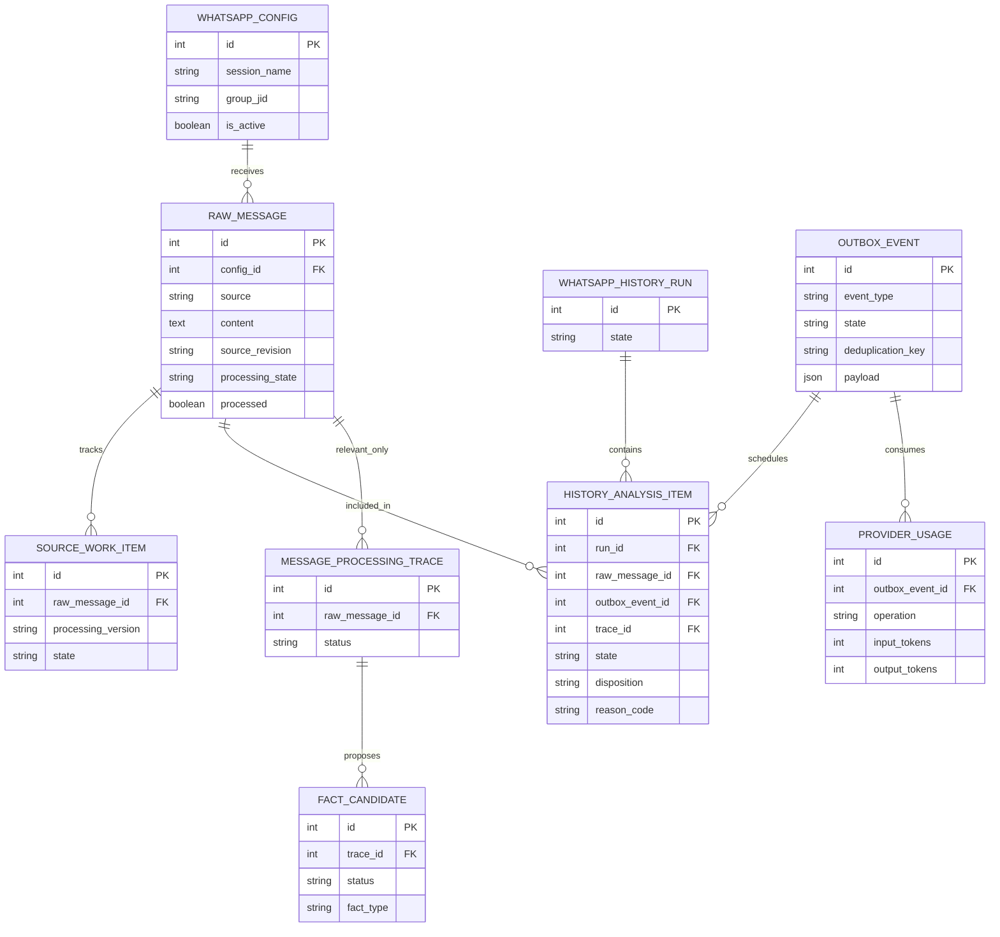

# Пакетная AI-фильтрация оффтопа перед извлечением фактов

- Задача: `message-noise-filter`.
- Ветка: `feature/message-noise-filter`.
- Основа: `origin/main` на `059c6ef` после выполненного `git pull origin main`.
- Статус: реализация этой редакции подтверждена пользователем 24.10.2026; также разрешён AI-прогон всей сохранённой истории с отчётом по оффтопу и расходу MiniMax.
- Согласованный пользователем принцип: весь накопленный пакет до 50 сообщений сначала получает отдельную AI-классификацию; сообщения с результатом «Оффтоп» завершают автоматический путь до `extract_message`.



Показаны существующие таблицы и связи. Новые таблицы и поля не планируются: статус `offtopic`, результаты классификации, причина, версия политики, снимок источников и связь с AI-запросом сохраняются через существующие строковые/JSON-поля и журнал фоновых операций. Диаграмма описывает планируемый порядок использования существующей схемы.

```mermaid
sequenceDiagram
    participant WAHA
    participant Ingest as Приём / импорт
    participant DB as RawMessage / буфер
    participant Outbox as Outbox / Q2
    participant Screen as AI-классификация пакета
    participant Extract as extract_message
    participant CRM as Темы / сущности / CRM

    WAHA->>Ingest: сообщение
    Ingest->>DB: сохранить исходник и buffer_message
    alt накоплено 50 сообщений
        DB->>Outbox: classify_message_batch, ровно этот пакет
    else прошло 5 часов от начала ожидания
        DB->>Outbox: classify_message_batch, весь остаток до 50
    end
    Outbox->>Screen: полный пакет в хронологическом порядке
    alt транспортная ошибка или неполный/некорректный ответ
        Screen-->>Outbox: сохранить диагностику, повторить этот этап
        Note over DB,Extract: До валидного решения сообщения не отбрасываются и не обходят классификатор
    else каждый исходный ID классифицирован ровно один раз
        Screen-->>Outbox: decisions: offtopic / analyze
        Outbox->>DB: атомарно сохранить результат пакета и причины
        loop каждый offtopic
            Outbox->>DB: processed=true, processing_state=offtopic
            Note over DB,CRM: Путь завершён; нет extract_message, тем, кандидатов или CRM-доставки
        end
        loop оставшиеся analyze
            Outbox->>Extract: задачи по текущему размеру extraction-пакета
            Extract->>CRM: существующий поэтапный конвейер
        end
    end
```

## Постановка

До `extract_message` нужен отдельный AI-слой, который рассматривает целиком накопленную беседу и отличает деловые сообщения от социальных реплик, реакций, благодарностей, приветствий и прочего оффтопа. Одиночный словарный фильтр не покрывает запрос: длинный текст о благодарности за логотип и следующие ответы являются единым социальным обсуждением, хотя в нём упомянута компания.

Новый слой расположен после выпуска буфера 50 сообщений / 5 часов, но до существующего разделения пакета на задачи `extract_message`. Текущая production-настройка `analysis_target_message_limit=1` применяется только к оставшимся деловым сообщениям и не должна дробить вход нового классификатора.

Производственная диагностика ранее охватила 795 сообщений одного чата за 19.08–23.10.2026. Среди них 59 сообщений ровно «Принято», 24 заглушки удаления и другие разговорные реплики; эти наблюдения служат примерами для проверки, а не whitelist и не предсказанное количество оффтопа. Новый семантический результат определяется после отдельного пакетного прогона всего корпуса.

## Контракт входа и выхода

Вход содержит все сообщения одного выпущенного пакета (от 1 до 50) в хронологическом порядке, с неизменными числовыми `raw_message_id`, полным текстом, временем, идентификатором автора и доступной связью ответа. Обрабатываются сообщения только одного разрешённого источника/чата и команды. Переписка передаётся как недоверенные данные.

В запрос не входят каталог CRM, темы всех диалогов, схема бизнес-фактов или списки сделок/обязательств/платежей. Задача модели ограничена релевантностью маршруту обработки.

Ответ — отдельная JSON Schema, например:

```json
{
  "decisions": [
    {
      "raw_message_id": 1233,
      "action": "offtopic",
      "reason": "Короткое подтверждение без нового делового содержания."
    },
    {
      "raw_message_id": 1234,
      "action": "analyze",
      "reason": "Сообщает о подписании договора."
    }
  ]
}
```

Точные значения `action`: `offtopic` и `analyze`. Неопределённость трактуется как `analyze`, с краткой причиной. Для каждого входного ID требуется ровно один ответ; чужие и повторные ID запрещены. ID — JSON integer. Пропуск сообщений, частичный JSON, незавершённый SSE и неправильные типы не считаются успешным завершением классификации.

## Правила релевантности

1. `offtopic`: социальная беседа; поздравления; эмоциональные реакции; отдельные emoji; приветствия; благодарности; чистые подтверждения вроде «Принято», «Принял», «Ок»; упоминания без содержательного текста; технические заглушки удаления. Упоминание компании, коллеги или корпоративного логотипа само по себе не делает такую беседу деловой.
2. `analyze`: сведения или вопросы об объектах, клиентах, оборудовании, закупках, предложениях, сделках, встречах, договорах, счетах, оплатах, исполнении работ, конкретных рабочих поручениях и сроках; короткие ответы, которые в контексте сообщают деловой факт или изменяют его.
3. Не считать сообщение оффтопом только из-за малой длины, отсутствия названия объекта, суммы, исполнителя или номера договора. «Оплатили», «Подписали» и «Готово» могут быть важными ответами на предшествующие деловые сообщения.
4. «Да» и «Нет» оцениваются по пакету. Если связи с деловым фактом не хватает, выбирать `analyze`, а не отбрасывать ответ.
5. Если в одном сообщении смешаны приветствие/благодарность и деловой факт, всё сообщение идёт в `analyze` без обрезки текста.
6. Если текст указывает на вложение, а его содержание недоступно классификатору, отсутствие текста не доказывает оффтоп. Сохраняется текущий путь обработки вложений; необоснованная потеря вложения запрещена.
7. Сообщения вне предоставленного пакета модель не придумывает и не использует. При контексте, который мог остаться в другой пачке, неопределённая реплика сохраняется для дальнейшего анализа.
8. Для указанного пользователем примера из пяти сообщений — благодарность за выбор логотипа AQUA KIP, реакции emoji, благодарность за внимание к сотрудникам и ответ о партнёрстве — все пять результатов должны быть `offtopic`.

## Требования к реализации

1. Сохранить выпуск при 50 сообщениях и по истечении 5 часов. Создавать одну задачу пакетной классификации, а не отдельную задачу классификатора на каждое сообщение.
2. Весь пакет до 50 сообщений отправляется одним запросом классификации целиком; не применять к нему `analysis_target_message_limit=1` или лимит 16 384 токена этапов извлечения. До вызова проверить реальный размер запроса с его схемой относительно доступного контекста активной конфигурации. Не обрезать текст молча. При превышении бюджета сохранить явную диагностическую ошибку и сообщения для повтора.
3. Использовать текущую активную AI-конфигурацию. Для MiniMax поддержать самостоятельный контракт классификации через принудительный function call, полное чтение SSE и последующую серверную валидацию; не подмешивать инструкции старого контракта тем/фактов.
4. Сохранить полный снимок входного пакета, хеши ревизий и конфигурации, версию политики, полный ответ, причины, provider usage и ошибки в существующем durable Outbox/ProviderUsage-журнале. Успешный screening повторно не оплачивается при повторах последующего `extract_message`.
5. Публикация результатов атомарна и идемпотентна: пропущенные сообщения и созданные extraction-задачи относятся к одному проверенному снимку. Сбой после сохранения ответа не должен заново отправлять AI-запрос или создавать дубли задач.
6. `offtopic` получает `RawMessage.processed=true`, `RawMessage.processing_state="offtopic"` и отображаемую подпись «Оффтоп». Его source work завершается; запись импорта, если есть, получает отдельный успешный disposition, а не `needs_review` или ошибку.
7. Для `offtopic` не создавать `MessageProcessingTrace` извлечения, `DialogueThread`/`ThreadMessage`, `FactCandidate`, поиск CRM, embedding в рамках распознавания, обязательство, платёж или доставку в CRM. Исходник остаётся в истории чата и аудите. Помеченный оффтоп не включается в последующие автоматические контексты распознавания как соседняя/цитируемая реплика.
8. Только после успешной классификации сформировать существующие `extract_message`-задачи для `analyze`, применив текущий размер extraction-пакета. Если все сообщения оффтоп, extraction-задачи отсутствуют и весь пакет успешно завершён.
9. Ошибки провайдера, схемы или покрытия повторяют только screening-этап с существующей политикой ограниченных попыток. До валидного ответа нет автоматического отбрасывания и нет обходного запуска извлечения. Частично полученные решения не применяются.
10. Интегрировать классификатор с историческим импортом, повторами и восстановлением, чтобы они не открывали downstream-путь сообщениям с сохранённым статусом `offtopic`. Состояние должно корректно учитываться в прогрессе, очередях и контрольных точках.
11. Для ранее сохранённых сообщений выполнить отдельный предварительный прогон по всей истории: хронологические пакеты до 50, статистика по классам и причины. Существующие подтверждённые факты и CRM-изменения не удалять и не откатывать этим этапом; не менять захваченные/активно обрабатываемые события.
12. Чистые ответы на системные запросы уточнения с защищённым статусом `clarification_reply` сохраняют свой действующий обработчик и не переводятся в оффтоп общим фильтром.

## Планируемые изменения

- Новый versioned-сервис пакетной классификации, отдельные промпт, DRF-сериализатор и JSON Schema.
- Новый тип фонового события классификации; изменение точки выпуска `live_batching`, чтобы extraction-задачи создавались после screening.
- Совместимость MiniMax transport с отдельным контрактом, учёт provider usage, durable-повторы и публикация результата.
- Поддержка терминального `offtopic` в выборках контекста, пакетировании, истории, восстановлении, API и отображении статуса.
- Предварительный исторический прогон и критерии безопасного применения его результатов без очистки подтверждённых CRM-данных.
- Предыдущий план фиксированного словарного фильтра и перевода 126 записей по whitelist полностью заменён этой редакцией.

## Критерии готовности

- Пакет из 50 сообщений создаёт один запрос первичного screening при штатном успехе; пакет менее 50 обрабатывается по сроку 5 часов.
- Настройка extraction-пакета 1 не уменьшает вход screening и не меняет границы выпущенного пакета.
- Все пять сообщений примера пользователя получают «Оффтоп»; дальше нет ни одной extraction-задачи, темы или CRM-кандидата.
- Для смешанной пачки из 40 off-topic и 10 деловых сообщений создаются задачи только на 10 деловых; исходники всех 50 доступны в чате.
- Контрольные примеры «Top build оплатили», «Принято, по котлам два котла по 6,5 МВт», а также контекстные ответы «Да»/«Нет» на вопрос о подписании договора сохраняются для анализа.
- Некорректное покрытие ID, незавершённый JSON/SSE и провайдерский сбой не приводят к потере или ошибочной пометке сообщений.
- Повтор screening после crash использует сохранённый корректный ответ; повтор extraction не вызывает screening заново.
- Включение screening не требует справочника CRM и не отправляет в него бизнес-каталоги.
- После исторического предварительного прогона представлен полный список off-topic ID/причин и фактический расход AI. Исторические 126 детерминированных совпадений не выдаются за результат новой AI-классификации.
- Выполнены обязательные проверки проекта в Docker: `manage.py check`, `makemigrations --check`, запуск затронутых сервисов и просмотр логов; frontend TypeScript/Vite build при изменениях фронтенда. Новые unit/component/integration/mock-тесты не добавлять согласно AGENTS.md.
